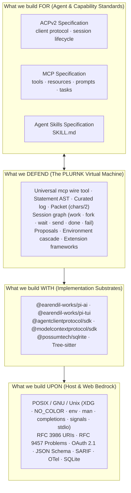
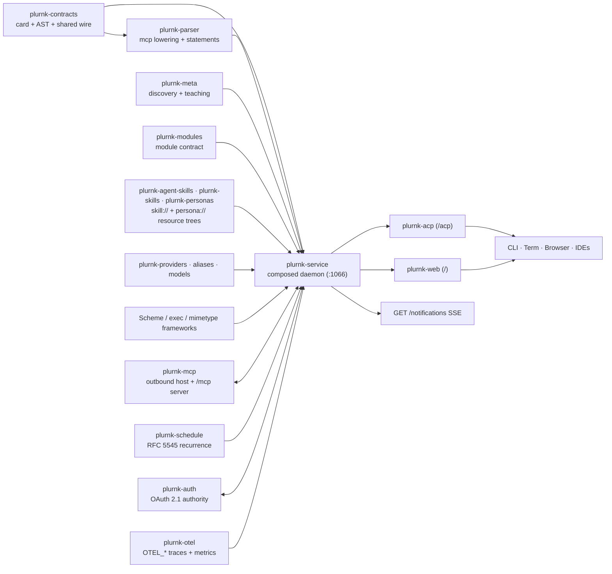
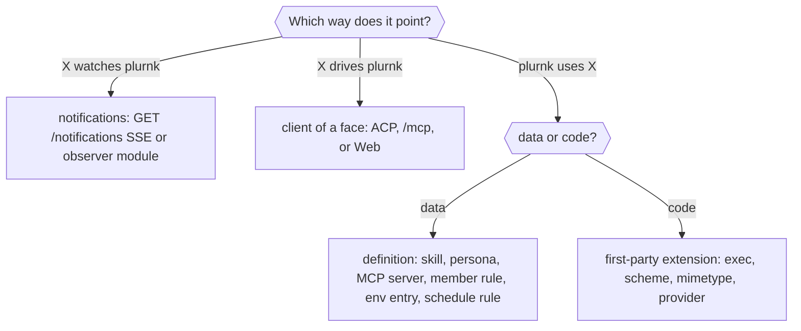
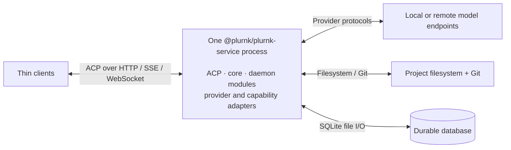
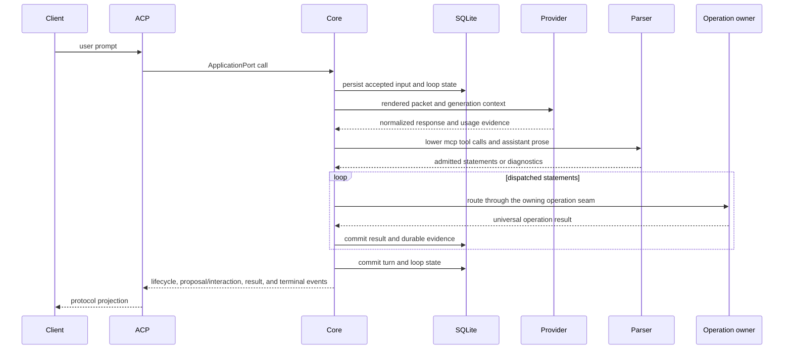

# Architecture

PLURNK is an **agentic operating environment** built around a small virtual machine (in the lineage of
Plan 9's mountable URI namespaces, Smalltalk's persistent image, and Emacs's uniform selection
algebra). Three first-class principals — `model` (stochastic reasoning), `client` (humans and external
applications), and `_plurnk` (deterministic schedules, sentinels, and derivations) — share one
workspace address space, statement AST, consent gate, and causal journal, whether or not a filesystem
`project_root` or an active model route is configured. At its exterior boundaries, PLURNK speaks
standard ACPv2, MCPv2, Agent Skills, OAuth 2.1, OpenTelemetry, and SSE (`/notifications`). Outside the
virtual machine, custom protocols, parallel configuration dialects, and translation shims are treated
as defects. Package specifications own behavior; design history lives in Git and forge issues.

## Standards and substrate

| Role | Authorities | Architectural rule |
| --- | --- | --- |
| **What we defend** (the PLURNK VM) | The universal `mcp` wire tool (`MCP_WIRE_TOOL`), the session operating card (`plurnk.md`), the canonical statement AST (`ops://`), the curated log, the packet (`chars/2` model-owned context curation), the session delegation graph (`work`, `fork`, `wait`, `send`, `done`, `fail`), proposals as the consent gate, the cascading environment, and the extension frameworks (`scheme`, `exec`, `mimetype`, `provider`). | Keep these organs intact: never introduce daemon-side compaction, hidden state, or competing model invocation dialects. |
| **What we build for** (the agent & capability standards) | **ACPv2** (client protocol and session lifecycle), **MCP** (tools, resources, prompts, tasks, and SEP-2640 skills), and **Agent Skills Specification** (`SKILL.md`). | **ACPv2 is the Schelling point.** PLURNK is an ACPv2 agent whose execution engine is the PLURNK VM, not a bespoke protocol behind an adapter. |
| **What we build upon** (the host & web bedrock) | **POSIX / GNU / Unix** (XDG, `NO_COLOR`, env cascade, man, completions, exit codes, signals, fd conventions) and **IETF / W3C / SQLite** (RFC 3986 URIs, RFC 9457 Problems, OAuth 2.1 / RFC 9728 / RFC 8414, JSON Schema, SARIF, OpenTelemetry, SQLite). | Host and web standards govern wherever a domain standard is silent. Cross-client roots (`.agents/skills`, `.agents/personas`, `.agents/mcp.json`) are read alongside PLURNK XDG overrides. |
| **What we build with** (the implementation substrates) | `@earendil-works/pi-ai` (provider inference), `@earendil-works/pi-tui` (terminal UI), `@agentclientprotocol/sdk`, `@modelcontextprotocol/sdk`, `@possumtech/sqlrite`, Tree-sitter. | Delegate transport framing, terminal diffing, JSON-RPC, and structural parsing to dedicated substrates behind their owning package boundaries. |

### Four rules against bespokery and translation layers

1. **Convergence on ACPv2.** Wherever ACPv2 names or structures an agent-client concept (sessions, archiving, deletion, status, titles, cancellation, gates, updates, capabilities), `plurnk-contracts`, `plurnk-core`, SQLite, `plurnk-acp`, and clients adopt ACPv2's vocabulary and semantics directly. `ApplicationPort` exists strictly for package dependency direction. `_plurnk/action` holds only workspace and VM operations ACPv2 does not yet define, and shrinks as ACPv2 grows.
2. **Defend the VM's organs; standardize everything else.** One universal `mcp` wire tool, one canonical statement AST, one URI address space, the curated log, the packet, proposals, and the session graph define the VM. Outside those organs, custom protocols, custom lifecycle nouns, and adapter shims are technical debt.
3. **One system, multiple standard sources.** Standard files (`SKILL.md`, `mcp.json`), ACP session admission options (`mcpServers`, `additionalDirectories`, `systemPrompt`), the cascading environment, and live workspace mutations feed the same owning contracts without turning workspace management into a global disk installer.
4. **Open standards only, never vendor dialects.** Single-vendor conventions (`CLAUDE.md`, `.claude/`, `.cursor/`) are not supported.

### Judgment seams: where the VM and exterior standards meet

Where the PLURNK VM differs from an exterior standard's default assumption, we neither weaken the VM nor hide the difference behind a silent shim:

| Seam | Standard assumption (ACPv2 / MCP) | PLURNK VM reality | Standing resolution |
| --- | --- | --- | --- |
| **Fixed `mcp` wire tool vs. Flat tool-schema injection** | MCP hosts serialize `tools/list` schemas directly into the model's `tools[]` array, growing prompt prefixes and invalidating KV caches when servers connect or authenticate. | Built-in verbs, executors, Functionality families, and external MCP servers all dispatch through one fixed `MCP_WIRE_TOOL` (`{ server, tool, aside, arguments }`). | Keep `tools[]` constant across the session; materialize tool summaries and JSON Schemas as pull-on-demand `mcp:///` resources; recover unambiguous model-tier parameter aliases at {§parse-recovery} and refuse ambiguous shapes ({§diagnostic-observation}). |
| **Workspace vs. Session** | ACPv2 is session-scoped (`cwd` on `session/new`) without a workspace entity. | A workspace owns shared Functionality (MCP, skills, members, personas, schedules, env) and a multi-session graph. | Bind `cwd` to workspace attachment; keep workspace-wide management in `_plurnk/action` (`list \| discover \| add \| replace \| enable \| disable \| remove`) only where ACPv2 has no native equivalent. |
| **Context curation vs. Append-only chat** | Clients expect an append-only `session/update` stream and harness-side context compaction. | The model curates its own address space (`read`, `edit`, `kill`); bodies live at addressable entry URIs; the daemon never compacts. | Project log operations as `tool_call_update` with `resource_link` references and ignore `compaction_*`. |
| **First-class session graph vs. Opaque subagents** | Subagents are opaque child tasks (`subagent_update`) or `session/fork` clones. | Every `work` / `fork` child is a durable session (`<workspaceId>#<sessionName>`) with its own loops and inbox (`send` / `wait`). | Emit standard `subagent_update` and `session_message` for ACPv2 clients while preserving full session addressability. |
| **Environment cascade vs. Imperative mutation** | Tools often rewrite user-global or project-committed config files directly. | The cascading environment (`.env.defaults` → user → workspace → session) owns choices; standard files are input sources, not persistence targets. | Ingest standard files and ACP admission options into the cascade/workspace without silently rewriting user-global or committed project files. |
| **Native VM primitives vs. Legacy escape hatches** | Harnesses shell out (`jq`, `nohup`, `curl`) or drive browsers for structured queries, background polling, state inspection, and API auth. | Every resource, stream, schedule, and subsystem is a typed URI under one 14-verb + 6-pattern ISA shared by `model`, `client`, and `_plurnk`. | Reserve executors (`sh`, `js`, `python3`) for Turing-complete compute and host toolchains; complete the owning `scheme`, `mimetype`, or Functionality family when structured semantics are missing. |

## Ecosystem

[`plurnk-contracts/plurnk.md`](./plurnk-contracts/plurnk.md) is the session operating card; models emit
native `mcp` wire tool calls (`{ server, tool, aside, arguments }`) lowered deterministically by
`@plurnk/plurnk-parser` ({§parse-recovery}, {§expression-boundaries}, {§turn-source-resources}) and
replayed as matched canonical tool calls and results ({§emission-history}).

## Package ownership

| Contract area | Owner | Normative source |
| --- | --- | --- |
| Session operating card, universal `mcp` wire tool, shared types/wire | `@plurnk/plurnk-contracts` | [`plurnk.md`](./plurnk-contracts/plurnk.md), [`SPEC.md`](./plurnk-contracts/SPEC.md) |
| `mcp` tool-call lowering, statement parser, and AST serializer | `@plurnk/plurnk-parser` | [`plurnk-parser/SPEC.md`](./plurnk-parser/SPEC.md) |
| Discovery, trust predicate, teaching bytes | `@plurnk/plurnk-meta` | [`plurnk-meta/SPEC.md`](./plurnk-meta/SPEC.md) |
| Agent Skills documents and resource trees | `@plurnk/plurnk-agent-skills` | [`plurnk-agent-skills/SPEC.md`](./plurnk-agent-skills/SPEC.md) |
| Agent Skills workspace management | `@plurnk/plurnk-skills` | [`plurnk-skills/SPEC.md`](./plurnk-skills/SPEC.md) |
| Workspace personas and `persona://` resource trees | `@plurnk/plurnk-personas` | [`plurnk-personas/SPEC.md`](./plurnk-personas/SPEC.md) |
| Provider adaptation, aliases, and model catalog | `@plurnk/plurnk-providers`, `@plurnk/plurnk-aliases`, `@plurnk/plurnk-models` | [`plurnk-providers/SPEC.md`](./plurnk-providers/SPEC.md), [`plurnk-aliases/SPEC.md`](./plurnk-aliases/SPEC.md), [`plurnk-models/SPEC.md`](./plurnk-models/SPEC.md) |
| Scheme framework | `@plurnk/plurnk-schemes` and installed scheme extensions | [`plurnk-schemes/SPEC.md`](./plurnk-schemes/SPEC.md) |
| Executor framework | `@plurnk/plurnk-execs` and installed executor extensions | [`plurnk-execs/SPEC.md`](./plurnk-execs/SPEC.md) |
| Content detection and projection | `@plurnk/plurnk-mimetypes` and installed handler packages | [`plurnk-mimetypes/SPEC.md`](./plurnk-mimetypes/SPEC.md) |
| Persistence, sessions, turns, dispatch | `@plurnk/plurnk-service` | [`plurnk-core/SPEC.md`](./plurnk-core/SPEC.md) |
| Daemon module contract | `@plurnk/plurnk-modules` | [`plurnk-modules/SPEC.md`](./plurnk-modules/SPEC.md) |
| OIDC / OAuth 2.1 resource server | `@plurnk/plurnk-auth` | [`plurnk-auth/SPEC.md`](./plurnk-auth/SPEC.md) |
| External WebSocket/HTTP ACP v2 client protocol | `@plurnk/plurnk-acp` | [`plurnk-acp/SPEC.md`](./plurnk-acp/SPEC.md) |
| MCP host/client and `/mcp` server | `@plurnk/plurnk-mcp` | [`plurnk-mcp/SPEC.md`](./plurnk-mcp/SPEC.md) |
| Scheduled session messages | `@plurnk/plurnk-schedule` | [`plurnk-schedule/SPEC.md`](./plurnk-schedule/SPEC.md) |
| OpenTelemetry SDK module | `@plurnk/plurnk-otel` | [`plurnk-otel/SPEC.md`](./plurnk-otel/SPEC.md) |
| Forensic reports, snapshots, and interviews | `@plurnk/plurnk-digest` | [`plurnk-digest/SPEC.md`](./plurnk-digest/SPEC.md) |
| CLI, Term (`@plurnk/plurnk`), and browser UI (`@plurnk/plurnk-web`) | Separate client repositories | Consume ACP (and `/` module seams); own presentation only. |

Framework packages define extension contracts; first-party `@plurnk/*` extensions implement them; core
composes them without absorbing domain logic. Frameworks never depend on extensions of their kind; the
service manifest owns the default bundled set ({§bundled-set}). Protocol compatibility and version
negotiation belong to the client-interface module publishing each protocol.

### Package principles

Robert C. Martin's six component principles govern package placement and dependency direction. A
package's instability is its plurnk dependencies divided by its plurnk dependencies plus dependents (`0`
when everything depends on it, `1` when nothing does):

| Principle | Rule |
| --- | --- |
| Reuse/Release Equivalence | Code reused together is released together. |
| Common Closure | Code that changes for the same reason lives in one package. |
| Common Reuse | No consumer depends on code it does not use. |
| Acyclic Dependencies | The package graph has no cycles. |
| Stable Dependencies | A package depends only on packages at least as stable as itself. |
| Stable Abstractions | The more stable a package, the more abstract it is. |

`root:lint` enforces Acyclic and Stable Dependencies across workspace `dependencies` and
`peerDependencies`; the other four govern design review.

### Package releases

Packages are independently versioned public contracts; `@plurnk/plurnk-service` versions the assembled
platform product. Compatibility is expressed by declared dependency ranges and verified against exact
installed compositions, never inferred from matching version numbers ({§package-release-contract},
{§release-candidate-graph}).

### Implementation mechanisms

Use declarative mechanisms for the contracts they naturally express — grammar productions for syntax,
JSON Schema for wire shapes, SQL for relational queries and invariants — and TypeScript for
orchestration, algorithms, and integration. Procedural layers must not duplicate rules already enforced
by the parser, schema validator, or database.

## Extensibility

PLURNK is extended through typed standard seams, never by altering its VM organs (see
[`plurnk-meta/skills/plurnk/extensibility.md`](./plurnk-meta/skills/plurnk/extensibility.md)):

| Surface | What it is | Code in the daemon |
| --- | --- | --- |
| Configuration | Cascade settings and definition files: `.env`, `mcp.json`, skill and persona roots | none |
| Definition | A skill, persona, MCP server, member rule, env entry, or schedule rule managed via shared Functionality verbs | none; MCP servers run out-of-process or remotely |
| Notifications | `GET /notifications[/<workspace>[/<session>]]` SSE stream of discrete `DaemonNotification` envelopes (`Last-Event-ID` replay; [guide](./plurnk-core/docs/notifications.md)); sub-turn streaming rides `/acp` and `/mcp` `subscriptions/listen` | none |
| Client | An application or agent driving `/acp`, `/mcp`, or `/` | none |
| Extension | First-party `@plurnk/*` package of one kind: `exec`, `scheme`, `mimetype`, `provider` | in-process |
| Module | First-party `DaemonModule` composed statically in the daemon lifecycle as a family, face, or observer | in-process, lifecycle-bound |

A project root never contributes executable daemon code.

| Organ | Why it is not an extension point |
| --- | --- |
| The `mcp` wire tool & statement AST | Keeps `tools[]` constant across capability changes and centralizes lowering at one boundary |
| The log and the packet | Preserves model-owned context curation without background compaction |
| Proposals | Provides one uniform consent gate across all side-effecting schemes and runtimes |
| The cascade | Keeps every behavioral choice in one inspectable precedence order |
| The session graph | Unifies delegation and messaging under `work`, `fork`, `wait`, and `send` |
| The Functionality coordinator | Shares one lifecycle grammar across all workspace definition families |

## Vocabulary by audience

| Layer | Rule |
| --- | --- |
| Operator, wire, storage | Use the ACPv2 or open-standard term wherever one exists (`session`, `archive`, `unarchive`, `delete`, `title`, `status`, `tool_call`, `terminal`, `configOptions`, `contextWindow`, `reasoning`, `completion`, `finish_reason`, and usage nouns). |
| Core lifecycle | Use `Workspace` → `Session` → `Loop` → `Turn` → `Op` ({§lifecycle-terms}); unqualified `run` names no internal entity. |
| Model-facing packet | Match model training priors: HTTP/shell-aligned verbs, Markdown headings, JSON metadata, and standard text coordinates. |
| PLURNK-specific nouns | `packet` (assembled address-space projection), `costUsd` (exact decimal USD string), and `curationWeight` / `curationBudget` (model-agnostic `chars/2` curation units, distinct from provider tokens, {§tokenomics}). |

## Extension vocabulary

| Term | Meaning | Distinct from |
| --- | --- | --- |
| `extension` | First-party `@plurnk/*` package of one `kind`, declared in `package.json#plurnk` | File extensions or protocol extensions (always qualified) |
| `kind` | Extension seam: `exec`, `scheme`, `mimetype`, `provider` | `family` (manages data definitions) |
| `framework` | Package owning one `kind`'s contract, discovery, and loading (`plurnk-modules` for modules) | Functionality coordinator |
| `grammar package` | Pre-built Tree-sitter WASM package for `@plurnk/plurnk-mimetypes` (declares no `kind`) | Runtime extension |
| `module` | First-party `DaemonModule` acting as a **family** (Functionality adapter), **face** (HTTP/protocol mount), or **observer** (event subscriber) | Dynamic extension |
| `family` / `definition` | Shared workspace manager (`skills`, `personas`, `mcp`, `schedule`, `members`, `env`) and one managed datum within it | Extension `kind` or `runtime` |
| `runtime` / `tool` | Execution target (`server: "plurnk", tool: "<runtime>"` or `server: "<mcp>", tool: "<tool>"`) invoked via `mcp` and documented under `mcp:///` | Functionality `family` |

## Documentation authority

| Document | Role |
| --- | --- |
| `README.md` | Overview, listener map, and entry points. |
| `MANIFESTO.md` | Architectural rationale: why the VM interior and standard edges are shaped this way. |
| `ARCHITECTURE.md` | System boundaries, package ownership, configuration law, and state authority. |
| `AGENTS.md` | Contributor and agent field guide: commands, gates, conventions, and workflows. |
| `SPEC.md` (per package) | Normative behavioral contracts anchored by `§tag` declarations and verified by code, panels, and tests. |

Only `SPEC.md` files declare `§tag` headings; code, panels, tests, and other docs cite `{§tag}`. Every
declared tag requires an implementation/panel witness and a test witness, enforced mechanically by
`@plurnk/plurnk-spec-check` (`scripts/spec-witness-allowance.json` only shrinks). `plurnk.md` and
model-facing skill/reference pages under `plurnk-meta` are runtime surfaces read by models, not
developer documentation.

## Configuration authority

**The cascading environment is the only home for a behavioral choice.** Code holds mechanism only:

| Surface | Owns | Litmus test |
| --- | --- | --- |
| [`plurnk.md`](./plurnk-contracts/plurnk.md) & contracts | Session card, wire tool, and AST shapes | Changing it changes the VM contract. |
| Turn 0 | Initial session orientation | Changing it changes what a fresh session is taught. |
| Each package's `.env.defaults` | Limits, timeouts, policies, postures | Changing it changes deployment behavior under the same contract. |

- **Guaranteed floor, zero inline fallbacks:** Each `@plurnk/*` package declares its prefixed keys in
  `.env.defaults`. The daemon assembles all installed `.env.defaults` files beneath operator sources
  ({§operator-config-precedence}), so code readers never carry literal fallback defaults. Unset means
  "disabled" or "defer to upstream library default", never a hidden constant.
- **Non-fatal repair path:** Reject invalid settings at the owning capability boundary and surface
  diagnostics through ordinary client/model inspection ({§configuration-repair-path}) rather than
  crashing unrelated capabilities.
- **Knobs vs. mechanism:** Expose deployment levers (timeouts, page sizes, approval postures, safety
  bounds) as knobs; keep protocol constants and algorithmic invariants in code (`scripts/env-surface-policy.mjs`
  and `scripts/env-surface-mechanism.json` enforce this in `root:lint`).
- **Narrowing rings and CLI flags:** Narrower scopes (alias, workspace, session, run) override the same
  knob name within outer-ring ceilings (e.g., `PLURNK_SERVICE_GIT_ALLOWED` bounds
  `PLURNK_SERVICE_GIT_AUTO`). CLI flags mirror panel knobs for a single invocation.
- **Sources vs. persistence scopes:** Standard files (`mcp.json`, `SKILL.md`) supply definitions; live
  workspace mutations persist in SQLite without rewriting user-global or project-committed files.
- **Single trust domain:** One daemon process forms one credential domain ({§credential-authority}),
  unauthenticated on loopback by default with browser origin/DNS-rebinding defenses ({§http-host}) and
  optionally verifying external OIDC / OAuth 2.1 JWTs via `plurnk-auth` ({§auth-oauth}) across all mounted faces. Outbound
  credentials to providers and MCP servers follow each remote party's scheme. OS sandboxing and
  container isolation belong to the host deployment (see [`ASSURANCE.md`](./ASSURANCE.md)).
- **Boundary validation, internal trust:** JSON Schema validates external wire inputs and scheme results
  at the boundary; SQLite `STRICT` tables and foreign keys own persisted invariants ({§db-migrations}).

## Process composition

`@plurnk/plurnk-service` is a single long-running process; extensions and modules load in-process
({§module-lifecycle}, {§module-seam-slices}), while clients own presentation and interactive user
consent.

## Model-loop request flow

Core owns packet assembly ({§packet-assembly}) and result persistence ({§operation-results}). Proposals
and interactive clarifications route through the session's durable owner ({§session-ownership}),
independently of transient client connections.

## Execution observation and proposals

External executions (`sh`, `js`, `python3`, and async streams) settle asynchronously: the call
resolves `200 started` ({§exec-target-routing}), streams output into `<scheme>:///<id>` channels
({§exec-stream}, {§execution-output-identity}), and publishes settled output on a subsequent turn
({§exec-lifetime}). Gating follows effect class rather than verb name: `read` and `pure` effects run
directly, whereas `host` effects (subprocesses, file writes, outbound mutating HTTP or MCP calls,
{§http-manifest}) propose (`202`) when policy requires review; accepted proposals replace `202` with
the applied result ({§proposal}).

Workspace Functionality mutations settle synchronously before the next statement in the turn, trading
the turn's shared workspace lease for an exclusive publication gate ({§functionality-model-projection}).
Executors remain session-agnostic (`ExecArgs` carries no session identity).

## State authority

| Concern | Authority |
| --- | --- |
| Workspaces, sessions, loops, turns, logs | SQLite via core's lifecycle and persistence contracts. |
| Project bytes and Git membership | Project filesystem and Git repository; database entries hold the agent-visible projection. |
| Active session drains, wakes, cancellation | Process-local `DrainSupervisor`, per-workspace `WorkspaceAdmission`, and on-demand `SessionProcess` actors reconciled against SQLite ({§session-loop-lifecycle}, {§session-causal-admission}). |
| Session model, effort, and spawn model | `SessionModels` ({§session-model-selection}). |
| Composed modules and HTTP mounts | `DaemonModules` ({§module-lifecycle}, {§module-contract}). |
| In-flight client operations | `ClientOperations` ({§connection-lifecycle}, {§session-causal-admission}). |
| Message delivery | `MessageDelivery` ({§methods}, {§machine-processes}). |
| Provider requests and teardown | `Engine` (provider calls) and `Daemon` (reverse-order shutdown). |
| Workspace Functionality residency | `WorkspaceResidency` ({§module-workspace-residency}). |
| External conversation references | Protocol adapters interpret external IDs; core stores opaque references ({§session-external-reference}). |
| Behavioral choices | Owning package `.env.defaults` resolved through the environment cascade. |

## Data preservation

Curation changes packet visibility, never the audit log; content hashing deduplicates storage without
promising version history; a SQLite backup captures daemon state, not external filesystems or services:

| Data | Authority and lifetime |
| --- | --- |
| Model working context | Log projections; `kill` changes packet visibility without deleting the underlying event ({§log-history-projection}, {§log-kill-scope}). |
| Messages, operations, approvals, turn sources | Durable SQLite records; approvals commit before execution ({§message-arrival}, {§turn-source-resources}, {§log-history-projection}, {§proposal}). |
| Database commits | Governed by WAL synchronization settings ({§db-durability}). |
| Provider requests and accounting | One immutable row per physical request, including failures and unknown costs ({§tokenomics}). |
| Retained packets and raw payloads | Bounded by count/age knobs (`PLURNK_SERVICE_RETAIN_*`); request accounting persists after payload expiry ({§content-store}, {§provider-request-accounting}). |
| Resource bodies, indexes, attachments | Reference-counted by SHA-256 across active channels, messages, and retained packets ({§content-store}). |
| Project files | Filesystem-authoritative; revision preconditions guard `edit` commits ({§file-snapshot-revision}). Not included in SQLite backups. |
| Configuration, schedules, OAuth grants | Workspace/session overrides live in SQLite ({§functionality-coordinator}); schedules rearm on startup ({§schedule-residency}, {§schedule-delivery}); OAuth grants persist encrypted on disk while in-flight interactive flows are process-local ({§oauth-continuation}). |
| Drains, live streams, transient notices | Process-local; startup recovery settles interrupted work without fabricating unobserved results ({§session-causal-admission}, {§operation-results}). |
| Forensic shares and backups | `plurnk-service share` exports retained evidence ({§share}, {§share-packet-names}); `VACUUM INTO` snapshots SQLite ([backup guide](./plurnk-core/INSTALL.md#backup-and-restore)). |
