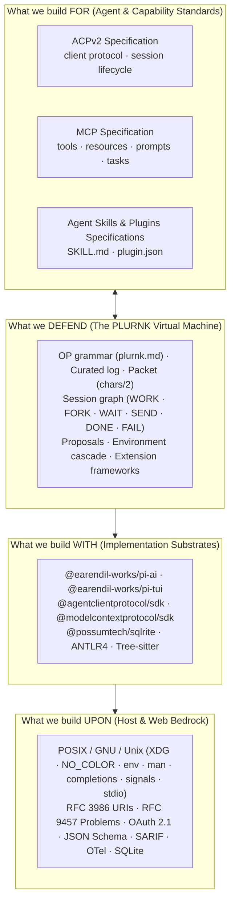
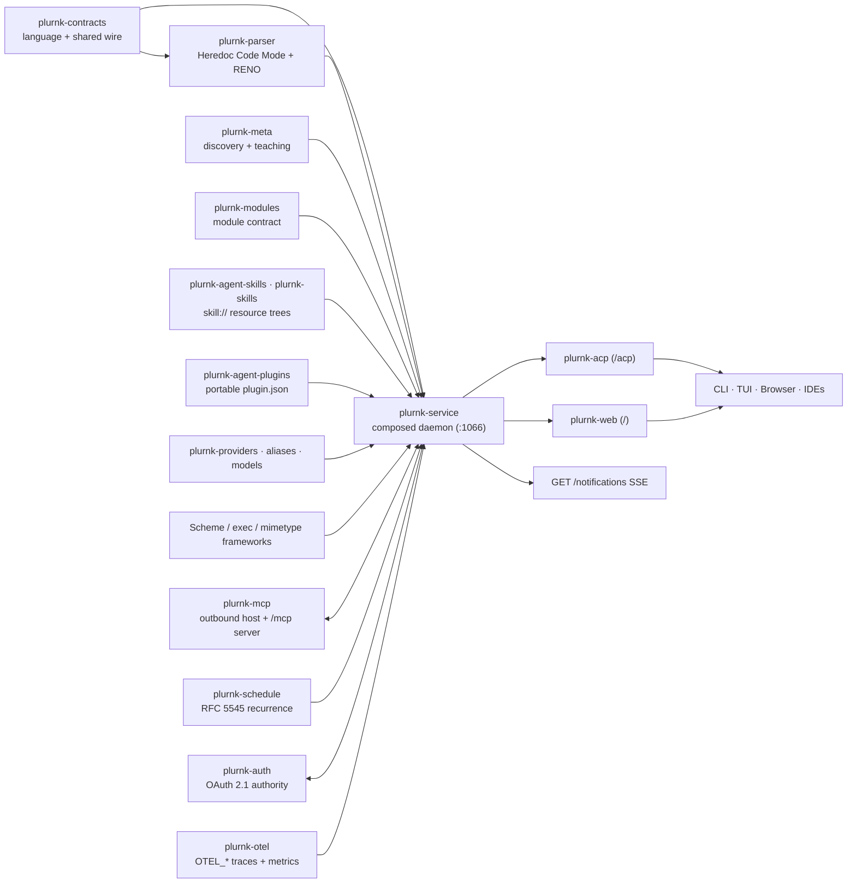
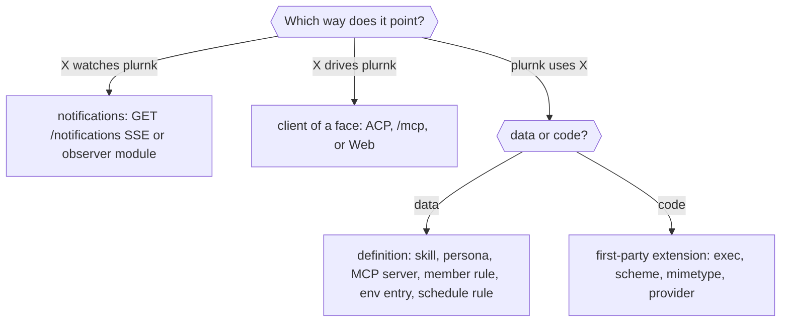
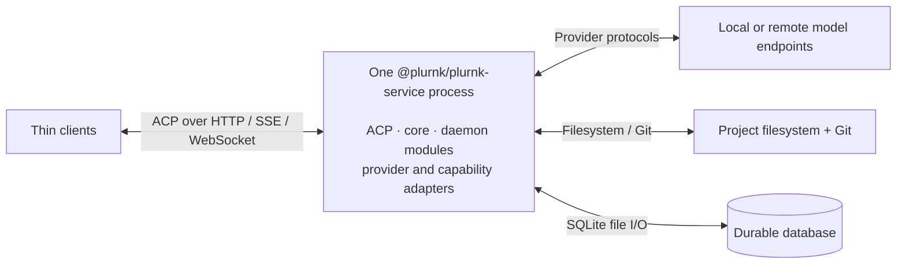
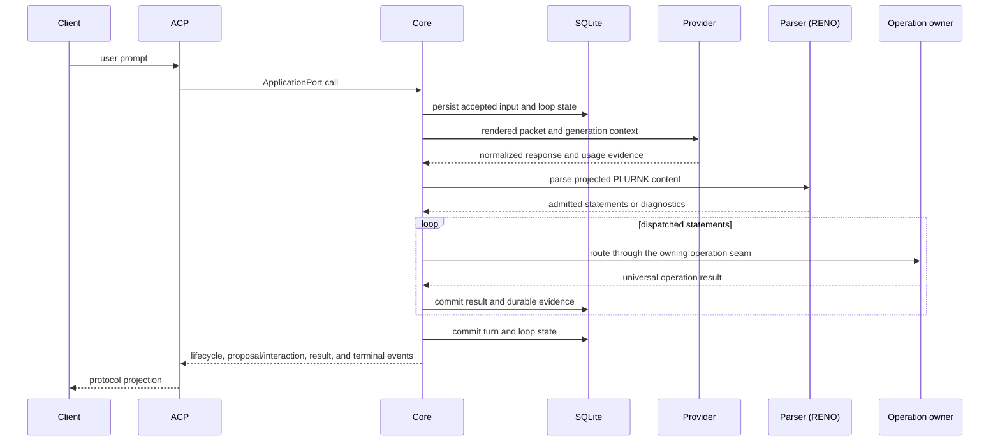

# Architecture

PLURNK is an ACPv2 agent powered by a small, distinct virtual machine. We defend that virtual
machine and treat any bespokery outside it as an unforced error — amateurish, unstable, unspecified
behavior to be eliminated, never preserved behind a translation layer. This document owns that
boundary, the ecosystem map, cross-boundary flow, and the one rule every package shares: where a
choice may live. Package specifications own behavior; design history belongs in Git and forge
issues.

## Standards and substrate

| Role | Authorities | Architectural rule |
| --- | --- | --- |
| **What we defend** (the PLURNK VM) | The OP grammar (`plurnk.md`), the curated log, the packet (`chars/2` model-owned context curation), the session delegation graph (`WORK`, `FORK`, `WAIT`, `SEND`, `DONE`, `FAIL`), proposals as the consent gate, the cascading environment, and the extension frameworks (`scheme`, `exec`, `mimetype`, `provider`). | These organs are the product. Never conform them away or add daemon-side compaction, hidden state, or a second model operation syntax. |
| **What we build for** (the agent & capability standards) | **ACPv2** (client protocol and session lifecycle), **MCP** (tools, resources, prompts, tasks), **Agent Skills Specification** (`SKILL.md`), and **Agent Plugins Specification** (`plugin.json`). | **ACPv2 is the Schelling point.** PLURNK is not a bespoke agent behind an ACPv2 translation layer; it is paradigmatically an ACPv2 agent whose engine is the PLURNK VM. |
| **What we build upon** (the host & web bedrock) | **POSIX / GNU / Unix** (XDG, `NO_COLOR`, env cascade, man, completions, exit codes, signals, fd conventions) and **IETF / W3C / SQLite** (RFC 3986 URIs, RFC 9457 Problems, OAuth 2.1 / RFC 9728 / RFC 8414, JSON Schema, SARIF, OpenTelemetry, SQLite). | Host and web standards govern wherever a domain standard is silent. Where a domain standard names a cross-client location (such as `.agents/skills`), PLURNK reads it, and its XDG location beside it holds PLURNK-only entries that shadow global ones. |
| **What we build with** (the implementation substrates) | `@earendil-works/pi-ai` (provider inference), `@earendil-works/pi-tui` (terminal UI), `@agentclientprotocol/sdk`, `@modelcontextprotocol/sdk`, `@possumtech/sqlrite`, ANTLR4, Tree-sitter. | Delegate undifferentiated heavy lifting (provider wire dialects, terminal viewport diffing, JSON-RPC framing, parsing) to proven substrates instead of hand-rolling plumbing. Keep substrate internals behind their owning package boundary. |

### Four rules against bespokery and translation layers

1. **Aggressive convergence on ACPv2.** Wherever ACPv2 names or structures an agent-client concept (sessions, archiving, deletion, status, titles, cancellation, gates, updates, capabilities), `plurnk-contracts`, `plurnk-core`, SQLite, `plurnk-acp`, and clients converge on ACPv2's vocabulary and semantics as if PLURNK had been designed around ACPv2 from the beginning. `ApplicationPort` exists for package dependency direction, never to shelter a competing internal dialect. `_plurnk/action` is a residual bridge for VM and workspace operations ACPv2 cannot yet express, and it shrinks whenever ACPv2 grows.
2. **Defend the VM's organs; standardize everything else.** The model-facing virtual machine — one OP grammar, one URI address shape, the curated log, the packet, proposals, and the session graph — is non-negotiable. Outside those organs, custom protocols, custom lifecycle vocabulary, and adapter shims are tech debt.
3. **One system, multiple standard sources.** Standard files (`SKILL.md`, `plugin.json`, `mcp.json`), ACP session admission options (`mcpServers`, `additionalDirectories`, `systemPrompt`), the cascading environment, and scoped live changes feed the same owning contracts. Standards alignment never withdraws environment-only configuration or turns workspace management into a global disk installer.
4. **Open standards only, never vendor dialects.** A vendor-owned convention (`CLAUDE.md`, `.claude/`, `.cursor/`, or a vendor's proprietary configuration dialect) earns no place, whatever its traction.

### Judgment seams: where the VM and exterior standards meet

When the PLURNK VM is richer than an exterior standard's default mental model, we neither mutilate the VM nor build a silent shim. These four seams are explicit design checkpoints for collaborative resolution:

| Seam | Standard assumption (ACPv2 / MCP) | PLURNK VM reality | Standing resolution & escalation rule |
| --- | --- | --- | --- |
| **Workspace vs. Session** | ACPv2 is session-scoped (`cwd` on `session/new`); there is no first-class workspace entity. | A workspace owns shared Functionality (MCP, skills, members, personas, capability policy) and a multi-session graph. | Bind `cwd` to workspace attachment; keep workspace-wide management in `_plurnk/action` (`list \| discover \| add \| replace \| enable \| disable \| remove`) only where ACPv2 has no native equivalent. |
| **Context curation vs. Append-only chat** | Clients expect an append-only `session/update` stream and agent-side context compaction. | The model curates its own address space (`READ`, `EDIT`, `KILL`); bodies live at addressable entry URIs; the daemon never compacts. | Project log operations as `tool_call_update` with `resource_link` references; ignore `compaction_*`; surface any tension between in-place curation and stream replay before inventing shims. |
| **First-class session graph vs. Opaque subagents** | Subagents are opaque child tasks (`subagent_update`) or `session/fork` clones. | Every `WORK` / `FORK` child is a full, durable session (`<workspaceId>#<sessionName>`) with its own loops and inbox (`SEND` / `WAIT`). | Emit standard `subagent_update` and `session_message` for ACPv2 clients while preserving full session addressability. |
| **Environment cascade vs. Imperative mutation** | Tools often assume imperative global installers or direct config-file rewrites. | The cascading environment (`.env.defaults` → user → workspace → session) is the single home for choices; standard files are sources, not persistence scopes. | Ingest standard files and ACP admission options into the cascade/workspace without silently rewriting user-global or project-committed files. |

## Ecosystem

[`plurnk-contracts/plurnk.md`](./plurnk-contracts/plurnk.md) is the
model-facing canon for **Heredoc Code Mode** (`<service>.<tool>({ ... })`
with `<<<EOF` raw blocks). It is intentionally narrower than **Reflective
Emission Normalization (RENO)** ({§parse-recovery}, {§fence-pairing},
{§turn-source-resources}): RENO normalizes unambiguous post-training envelopes
and syntax near-misses on admission and reflects canonical statements into
`ops://`, while `plurnk.md` teaches only the canonical form.

## Package ownership

| Contract area | Owner | Normative source |
| --- | --- | --- |
| Model language contract, shared types/wire | `@plurnk/plurnk-contracts` | [`plurnk.md`](./plurnk-contracts/plurnk.md), [`SPEC.md`](./plurnk-contracts/SPEC.md) |
| Language parser and RENO AST builder | `@plurnk/plurnk-parser` | [`plurnk-parser/SPEC.md`](./plurnk-parser/SPEC.md) |
| Discovery, trust predicate, teaching bytes | `@plurnk/plurnk-meta` | [`plurnk-meta/SPEC.md`](./plurnk-meta/SPEC.md) |
| Agent Skills documents and resource trees | `@plurnk/plurnk-agent-skills` | [`plurnk-agent-skills/SPEC.md`](./plurnk-agent-skills/SPEC.md) |
| Agent Skills workspace management | `@plurnk/plurnk-skills` | [`plurnk-skills/SPEC.md`](./plurnk-skills/SPEC.md) |
| Agent Plugins discovery and containment | `@plurnk/plurnk-agent-plugins` | [`plurnk-agent-plugins/SPEC.md`](./plurnk-agent-plugins/SPEC.md) |
| Provider adaptation, aliases, and model catalog | `@plurnk/plurnk-providers`, `@plurnk/plurnk-aliases`, `@plurnk/plurnk-models` | [`plurnk-providers/SPEC.md`](./plurnk-providers/SPEC.md), [`plurnk-aliases/SPEC.md`](./plurnk-aliases/SPEC.md), [`plurnk-models/SPEC.md`](./plurnk-models/SPEC.md) |
| Scheme framework | `@plurnk/plurnk-schemes` and installed scheme extensions | [`plurnk-schemes/SPEC.md`](./plurnk-schemes/SPEC.md) |
| Executor framework | `@plurnk/plurnk-execs` and installed executor extensions | [`plurnk-execs/SPEC.md`](./plurnk-execs/SPEC.md) |
| Content detection and projection | `@plurnk/plurnk-mimetypes` and installed handler packages | [`plurnk-mimetypes/SPEC.md`](./plurnk-mimetypes/SPEC.md) |
| Persistence, sessions, turns, dispatch | `@plurnk/plurnk-service` | [`plurnk-core/SPEC.md`](./plurnk-core/SPEC.md) |
| Daemon module contract | `@plurnk/plurnk-modules` | [`plurnk-modules/SPEC.md`](./plurnk-modules/SPEC.md) |
| OAuth 2.1 authorization server | `@plurnk/plurnk-auth` | [`plurnk-auth/SPEC.md`](./plurnk-auth/SPEC.md) |
| External WebSocket/HTTP ACP v2 client protocol | `@plurnk/plurnk-acp` | [`plurnk-acp/SPEC.md`](./plurnk-acp/SPEC.md) |
| MCP host/client and `/mcp` server | `@plurnk/plurnk-mcp` | [`plurnk-mcp/SPEC.md`](./plurnk-mcp/SPEC.md) |
| Scheduled session messages | `@plurnk/plurnk-schedule` | [`plurnk-schedule/SPEC.md`](./plurnk-schedule/SPEC.md) |
| OpenTelemetry SDK module | `@plurnk/plurnk-otel` | [`plurnk-otel/SPEC.md`](./plurnk-otel/SPEC.md) |
| Forensic reports, snapshots and interviews | `@plurnk/plurnk-digest` | [`plurnk-digest/SPEC.md`](./plurnk-digest/SPEC.md) |
| CLI, TUI (`@plurnk/plurnk`) and browser UI (`@plurnk/plurnk-web`) | Separate client repositories | Consume ACP (and `/` module seams); own presentation only. |

The typed module seam is released as `@plurnk/plurnk-modules`, and core exposes no runtime version or
update-advertising action: protocol compatibility and any version negotiation belong to the
client-interface module that publishes that protocol.

Framework packages define extension contracts. Installed first-party `@plurnk/*` extensions
implement those contracts. Core composes them but does not absorb their domain logic. Shared
facts have one schema and one specification owner. Frameworks do not depend on the extensions
of their kind; the service manifest is the sole owner of its default extensions and modules
({§bundled-set}).

### Package principles

Robert C. Martin's six component principles decide which package a type belongs in and which way
packages depend. A package's instability is its plurnk dependencies over its plurnk dependencies
plus dependents: 0 for a package everything depends on, 1 for one nothing depends on.

| Principle | Rule |
| --- | --- |
| Reuse/Release Equivalence | Code reused together is released together. |
| Common Closure | Code that changes for the same reason lives in one package. |
| Common Reuse | No consumer depends on code it does not use. |
| Acyclic Dependencies | The package graph has no cycles. |
| Stable Dependencies | A package depends only on packages at least as stable as itself. |
| Stable Abstractions | The more stable a package, the more abstract it is. |

The root lint enforces Acyclic and Stable Dependencies over every workspace's dependencies and peer
dependencies, naming the cycle or the edge; the other four are design review rules. An extension
kind's API therefore sits beneath both its host and its extensions, never inside the host.

### Package releases

Packages are independently versioned public contracts, not synchronized slices of a repository.
The service is the assembled platform product; its release describes changes visible through that
product. Client and benchmark releases have their own contracts. No additional repository version
governs their compatibility.

Dependency ranges express supported contracts; a tested installation records an exact composition.
Neither matching version numbers nor a shared release date proves compatibility. Release planning
may coordinate packages, but it never republishes an unchanged package merely to align numbers.
The release workflow and its qualification boundaries live at {§package-release-contract} and
{§release-candidate-graph}.

### Implementation mechanisms

Prefer standard declarative mechanisms that directly express the owning contract: grammar
productions for syntax and operand binding, JSON Schema for data shapes, and SQL for relational
queries and invariants. Use TypeScript for orchestration, integration, algorithms, and behavior
those mechanisms do not express clearly.

This is a design bias, not a prohibition or an invitation to force awkward DSLs. A procedural layer
must not independently reconstruct or enforce rules already owned by the grammar, schema, or
database. When imperative interpretation is necessary, document the concrete limitation it addresses
and verify the composed behavior.

## Extensibility

Plurnk is extended at its standard seams, never its virtual-machine organs. Each seam has one
contract and, where one exists, one open standard; the organs below are not extension points, and
every integration composes with them. The plurnk skill's chapter,
`skill://plurnk/extensibility.md`
([source](./plurnk-meta/skills/plurnk/extensibility.md)), is the agent-facing account and
links each kind's contract.

| Surface | What it is | Code in the daemon |
| --- | --- | --- |
| Configuration | cascade settings and definition files: `.env`, `mcp.json`, skill and persona roots | none |
| Definition | a skill, persona, MCP server, member rule, env entry or schedule rule, managed through the shared management verbs | none; an MCP server runs elsewhere |
| Plugin | an Agent Plugin carrying skills, personas and MCP servers, from npm or a plugin root | none |
| Notifications | `GET /notifications` Server-Sent Events stream of `DaemonNotification` envelopes | none |
| Client | an application or agent driving an existing face | none |
| Extension | first-party `@plurnk/*` code of one kind: `exec`, `scheme`, `mimetype`, `provider` | in-process |
| Module | a first-party `DaemonModule` composed statically in the daemon lifecycle as a family, a face or an observer | in-process, in the lifecycle |

The rows run from least to most invasive, and each row down costs trust and maintenance. Delivery is
orthogonal to kind: an MCP server is the same definition whether it arrives from the operator's
`mcp.json`, a plugin's `mcp.json` or the model's `add`, and the cascade decides which wins. A project
root never contributes code.

| Organ | Why it is not a seam |
| --- | --- |
| The operation grammar | One shape per concern; a second grammar taxes every model |
| The log and the packet | The product: the model curates its own context |
| Proposals | The one consent path for every mutation |
| The cascade | The only home for a choice |
| The session graph | WORK, FORK, WAIT and SEND are the delegation story |
| The Functionality coordinator | One management grammar for every family |

## Vocabulary by audience

Vocabulary follows the standard of its audience.

| Layer | Rule |
| --- | --- |
| Operator, wire, storage | Use the ACPv2 and industry term wherever ACPv2 or an exterior standard names the concept (`session`, `archive`, `unarchive`, `delete`, `title`, `status`, `tool_call`, `terminal`, `configOptions`, `contextWindow`, `reasoning`, `completion`, `finish_reason`, and usage nouns). |
| Core lifecycle | Use the exact Workspace → Session → Loop → Turn → Op hierarchy in {§lifecycle-terms}. |
| Model-facing packet | Use the model's training distribution: operations mirror HTTP and shell, while log records use ordinary Markdown headings, strict JSON metadata, and text coordinates. Renaming this vocabulary to internal API terminology would discard useful resonance for a standard the model never sees. |

| PLURNK-native term | Why it is its own |
| --- | --- |
| `session` / `loop` / `turn` | The process hierarchy in {§lifecycle-terms}; unqualified `run` names no internal entity. |
| `packet` | The assembled address space, a kernel concept rather than merely a provider request. |
| `costUsd` | No standard cost field exists; the explicit currency avoids implied units, and the value remains an exact decimal string. |
| `curationWeight` / `curationBudget` | Explicitly distinguish Core's model-independent context-shaping facts from physical provider tokens. |
| the `chars/2` curation ruler | Model-agnostic by design ({§tokenomics}); it is never presented as a tokenizer. |

## Extension vocabulary

One word per concept, defined here.

| Term | Meaning | Not |
| --- | --- | --- |
| plugin | An Agent Plugin: the standard package (`plugin.json`, `skills/`, `personas/`, `mcp.json`) | Native code of any kind |
| component | A plugin's portable content: a skill, a persona, or an MCP server | |
| extension | First-party `@plurnk/*` code the daemon loads, of one kind, declared once in `package.json#plurnk` | A file extension, always said in full; a protocol's extension, always protocol-qualified |
| kind | Which seam an extension fills: `exec`, `scheme`, `mimetype`, `provider` | A family, which manages definitions |
| framework | The package that owns one kind's contract, discovery and loading; for modules, `plurnk-modules` holds the contract and the service composes them statically | A capability, which is what policy admits |
| grammar package | A package that ships one pre-built Tree-sitter WASM grammar for the mimetype framework; it declares no kind | An extension |
| module | A first-party `DaemonModule` composed in the daemon lifecycle. Its roles follow from the seams it uses: a **family** (a Functionality adapter), a **face** (declared mounts), an **observer** (an event subscription) | A plugin |
| family | Core's shared manager of one definition kind: skills, personas, MCP, schedule, members, env | An extension kind or its framework; a runtime or its document |
| definition | One managed datum of a family; components are the standard-portable definitions | |
| face | A module role that serves an HTTP/protocol surface: ACP (`/acp`), MCP (`/mcp`), OAuth 2.1 (`/oauth/*`), Web (`/`) | |
| organ | A subsystem that is not an extension point | |
| capability | The admission policy's word, and what it admits | A package or framework |
| runtime, tool | The execution namespace (`plurnk.<runtime>` or `<server>.<tool>`) the model calls, taught by its runtime document; one callable tool within it | A family |
| leaf | A path's or a tree's last segment | A package |

## Documentation authority

Four documents, four jobs, and one home for every sentence.

| Document | Its job |
| --- | --- |
| `README.md` | The front porch: what this is and how to start. |
| `AGENTS.md` | The field guide: how to work here — drills, gates, the forge, the vocabulary. |
| `ARCHITECTURE.md` | The lodestar: what PLURNK believes, and why. Short enough to read in one sitting, because every contributor reads it first. |
| `SPEC.md`, one per package | The documentation: contracts anchored to the implementation, the panels and the tests. |

Code comments stay lean and cite `{§tags}`, so the specifications are the hub
that links to the moving parts. Only a file named `SPEC.md` may declare an
anchor; every other document cites. An anchor is *witnessed* when the
implementation, a panel or a test cites it. One that nothing outside prose cites
is a principle in the wrong document, orientation in the wrong document, or a
contract nobody witnesses — and, cited by nothing, it rots without anything
failing. The shared development tool `@plurnk/plurnk-spec-check` enforces this
discipline; `scripts/spec-witness-allowance.json` holds this repository's existing
allowance, which only shrinks.

Promotion is never duplication. A principle moves here; a how-to moves to the
field guide; a value that lives on a panel is deleted from prose, which cites
the knob by name; history is deleted, because Git and the forge keep it. What
remains in a specification is contract. `plurnk.md` and each package's
`docs/*.md` are not documentation at all: they are surfaces a model reads.

## Configuration authority

**The cascading environment is the only home for a choice.** Three surfaces
define the platform, and each owns one kind of fact. Code holds mechanism only.

| Surface | Owns | The test |
| --- | --- | --- |
| [`plurnk.md`](./plurnk-contracts/plurnk.md) | The language: what a model may say. | A different value would be a different language. |
| Turn 0 | The orientation: what a model is shown and taught. | A different value would teach something else. |
| Each package's `.env.defaults` | **Every choice**: limits, timeouts, dispositions, identities, postures. | A different value would still be plurnk, behaving differently. |

A constant in code is legitimate only when it derives from one of those
surfaces or from an external standard. *Default* is a word reserved for a value
on the panel: a constant, a parameter default, a settings field, a wire-schema
default or a SQL column default that supplies a value the environment did not is
a second home for a choice, and it will eventually disagree with the first.

- **The system environment is the mechanism.** Node, the shell and CI all speak
  it. Each `@plurnk/*` package declares its own keys in `.env.defaults`; a
  key's prefix names its owner; one package owns a key. The daemon assembles
  every installed `@plurnk/*` package's file into one floor, set-if-unset beneath every
  operator source, so a declared key is always present
  ({§operator-config-precedence}). A package's own tests run on its own panel,
  or that guarantee is a fiction where the code is exercised.
- **A read never carries a value.** Because the floor is guaranteed, a fallback
  beside a read can only disagree with the panel. An unset key is a broken
  deployment; an invalid operator value is a configuration diagnostic, not an
  instruction to terminate the application. Neither permits a reader-local fallback.
  Unset may mean "off", or "the dependency's own default applies and plurnk
  makes no choice" — never a literal.
- **Configuration errors must preserve a repair path.** Reject the invalid
  configuration at its owning capability boundary and expose the diagnostic
  through ordinary client/model inspection. An optional capability must not
  prevent unrelated work or require another agent to repair Plurnk. Internal
  invariant failures remain distinct; inability to start the core requires a
  concrete dependency failure, not merely the existence of an invalid setting.
- **One knob per choice.** Independent behavior choices override independently
  through the environment cascade.
- **Least surprise, then least regret.** Defaults follow established expectations;
  where those leave a trade-off, prefer recoverable consequences over irreversible
  loss or unintended authority. An operator may explicitly choose another posture.
  Review defaults together where they compose: an outer deadline must leave room
  for the work its inner default promises. Do not weaken a guarantee for an
  unmeasured performance benefit.
- **A knob earns its place.** PLURNK is as configurable as is practical, and the
  panel is still something an operator reads: a knob is a lever somebody would
  turn for their deployment — a deadline, a page, a disposition, how much the
  model is shown, a safety bound. A format's magic byte, an algorithm's iteration
  bound, a persisted unit of measure or a protocol's retry pacing is mechanism,
  and a knob for it is noise that hides the real ones. Mechanism stays in code
  under a name that says what it is.
- **Rings narrow the same knob.** A narrower scope — an alias, a workspace, a
  session, a run — overrides a knob under its own name; it is never a second
  vocabulary. Where an inner ring must be bounded, an outer ring's ceiling knob
  gates the inner default, as `PLURNK_SERVICE_GIT_ALLOWED` gates
  `PLURNK_SERVICE_GIT_AUTO`.
- **A flag mirrors a knob.** A command-line flag is a knob's spelling for one
  invocation and nothing more; the service's flags are generated from its panel.
- **A definition is not a knob.** A schedule's rule or an MCP server's address
  is data with its own lifecycle, not a choice of behaviour. Resolution selects
  a whole definition, not field patches ({§configuration-repair-path}).
- **A source is not a scope.** A standard file supplies definitions; its format
  does not choose where live changes persist. Workspace management must not
  silently rewrite project or user-global installations. Subsystem commands,
  environment declarations, and supported standard sources converge on the
  family's owning schema and lifecycle, not separate registries. Inspection
  must distinguish the effective configuration from runtime readiness and
  identify where the configuration came from.
- **A daemon is one trust domain with one credential authority.** Every
  credential presented to the listener, whatever protocol is mounted there, was
  issued by the daemon ({§credential-authority}): `plurnk-core` holds the
  records, `plurnk-auth` is the OAuth 2.1 face that issues them ({§auth-oauth}),
  and every mounted resource verifies through the same seam. The operator signs
  in from a browser; the operator's own tools exchange the minted secret; a
  remote agent is a declared client with its own revocable credentials. What the
  daemon presents to others (MCP servers, remote agents, model providers)
  follows the remote party's scheme and is never minted here. A different
  security situation is a different daemon with a different panel — ideally
  inside a sandbox, which is somebody else's project: PLURNK owns authority,
  consent and audit, and never claims containment.

`scripts/env-surface-policy.mjs` enforces this in `root:lint`
({§operator-config-precedence}). A number whose own name says duration, size or
limit is either on the panel or in `scripts/env-surface-mechanism.json`, the
reviewed register of deliberate non-knobs, each with its reason; a bare number
handed to a timer has no register at all. Before adding a constant, a flag, a
parameter default or a settings field, find its knob — or say why it has none.

**The SQL core owns each invariant.** Contracts (JSON Schema) are enforced at
the gates: a scheme's result entering core, and the wire leaving to clients.
Everything between trusts core and the gates and carries no defensive
re-validation ({§db-migrations}).

## Process composition

`@plurnk/plurnk-service` is the only long-running platform process. Extension
packages, modules included, run inside it; a package boundary is not a security boundary.
ACP owns client transport, while clients own presentation and explicit user
decisions. MCP is an optional in-process host/client under core's
{§module-lifecycle} and {§module-seam-slices} seams. MCP server
attachments are workspace Functionality; their tools and resources join
the ordinary executor, scheme, proposal, entry, and client-action paths.

## Model-loop request flow

Core owns packet assembly at {§packet-assembly} and durable result handling at
{§operation-results}. Provider, capability, and ACP details remain in their
own specifications. Approval routes through the session's durable owner
({§session-ownership}), independently of messages and connections. Core's server
policy may settle proposals automatically. Clarification goes to the same owner, but
only a person can answer it: the owner must be interactive and declare the tool
({§session-ownership}). Client convenience and daemon authority are not
interchangeable.

## How an execution outcome is observed

An external execution answers `200 started`, gated or not: the
runtime slot resolves the executor ({§exec-target-routing}), the spawn
backgrounds, and its output is *observed, not fetched* ({§exec-stream}). The
executor streams into the channels of its `<tag>:///<id>` output entry
({§execution-output-identity}) and settles them (`closed` or `errored`); an executor's refusal
travels as the settled status of the operation's log row, never as channel
content. The model learns the result through the ordinary environment
observation of newly publishable stream content on a later turn — there is no
same-turn receipt ({§exec-lifetime}). `read`/`pure` runtimes auto-run;
`host` runtimes propose — and so does any other operation that declares the
host effect, because the effect is the rule and the op is not: an outbound
POST, PUT or DELETE leaves the machine exactly as a subprocess does
({§http-manifest}). An accepted proposal's settlement replaces the
202 with the applied operation's result, preserving failures
({§proposal}).

Subsystem management is ordered configuration, not background work. Its commands
retain those proposal and output paths, but settle before the next operation;
resident publication hands off the turn's shared workspace lease for exclusive
publication and reacquires it before continuing ({§functionality-model-projection}).

Executors are Session-agnostic by contract: `ExecArgs` carries no Session
identity. MCP servers and Functionality managers are published per workspace
through capability replacement ({§functionality-model-projection}). Invocation
callbacks retain the submitting operation's causal identity without making
the submitter the owner of the shared runtime.

## State authority

| Concern                                 | Authority                                                                                             |
| --------------------------------------- | ----------------------------------------------------------------------------------------------------- |
| Workspaces, sessions, loops, turns, logs | SQLite through core's tagged lifecycle and persistence contracts.                                     |
| Project bytes and Git membership        | The project filesystem and repository; database entries are the agent-visible projection.             |
| Active session drains, wakes, cancellation | Process-local `DrainSupervisor` state reconciled against durable state; see {§session-loop-lifecycle}. |
| A session's model, effort and spawn model | `SessionModels` owns the durable selection and the loop's immutable route snapshot ({§session-model-selection}). |
| Composed modules and their mounts | `DaemonModules` owns static composition, explicit registration, mount claims and the setup/start/stop/close phases ({§module-lifecycle}, {§module-contract}). |
| A person's client operations in flight | `ClientOperations` owns each operation's loop, cancellation scope and settlement, and the shutdown scope they all descend from ({§connection-lifecycle}, {§session-causal-admission}). |
| A message's delivery to a session | `MessageDelivery` resolves the session's model and effort, prepares the message and its source, and injects it into the drain that starts or continues the loop ({§methods}, {§machine-processes}). |
| Provider calls and process teardown       | `Engine` owns provider-call state; `Daemon` owns reverse-order process teardown.                       |
| Workspace Functionality residency            | `WorkspaceResidency` owns demand-driven residency, provider activation/cooling, capability replacement under the workspace gate ({§module-workspace-residency}), and the generated-document reconciliation those transitions trigger; `Daemon` composes and delegates. |
| External conversation identity | The adapter interprets its protocol identifiers; core retains opaque session references with referential integrity ({§session-external-reference}). Connections and presentation remain client-interface state. |
| A choice of behaviour                   | The owning package's `.env.defaults`, read through the system environment; see Configuration authority. |

## Data preservation

Working context, execution evidence and current resource state have distinct lifetimes. Curation is
not erasure; content addressing is not version history; a consistent database copy is not a snapshot
of the surrounding filesystem or external services.

| Data | Authority and lifetime |
| --- | --- |
| Model working context | Log projections; curation changes visibility, not the recorded event or its source ({§log-history-projection}, {§log-kill-scope}). |
| Accepted messages, operations, approval decisions and turn sources | Core's durable records; independent of curation, but containing-object deletion can cascade history. The approval is recorded before application and remains distinct from its result ({§message-arrival}, {§turn-source-resources}, {§log-history-projection}, {§proposal}). |
| Database commits | Connection-time WAL synchronization governs crash/power-loss durability, separately from retention and backups ({§db-durability}). |
| Provider requests and accounting | One record per physical request, including failed requests and unknown usage; forked history does not create new spend ({§tokenomics}). |
| Packet compositions and call payloads | Retained according to count/age policy. Logical-response and physical-request payloads expire together; request identities and accounting remain, including failures and unknown costs ({§content-store}, {§provider-request-accounting}). |
| Stored resource bodies and derived indexes | Current channels and their references retain content; unreferenced bodies and indexes may be collected. Deduplication supplies identity, not a promise of past versions ({§content-store}). |
| Native attachment snapshots | READ, message and packet references retain bytes independently of curation or source deletion. Publication protects in-flight captures; only unreferenced snapshots are collected ({§content-store}). |
| Project files | The filesystem is authoritative; captured revisions guard native mutations and complete-file publication avoids truncation ({§file-snapshot-revision}). Internal commit serialization is not a session reservation or exclusion of external writers ({§file-snapshot-revision}). SQLite commits and backups do not include project files. |
| Configuration and credentials | Workspace/session overrides live in SQLite; service configuration and extension-owned files require separate backup. Schedules rearm from the present; interactive OAuth state is process-local and requires reauthorization ({§functionality-coordinator}, {§schedule-residency}, {§schedule-delivery}, {§oauth-continuation}). |
| Drains, live producers and notices | Process-local owners disappear on restart; recovery settles interrupted work without claiming its unobserved outcome ({§session-causal-admission}, {§operation-results}). |
| Diagnostic shares and backups | A share exports retained evidence; a SQLite snapshot preserves database state. Neither restores external effects ({§share}, {§share-packet-names}; [backup procedure](./plurnk-core/INSTALL.md#backup-and-restore)). |

Audit claims name the evidence retained and its limits. Logical immutability through Plurnk's APIs
and database guards is not tamper evidence against a host administrator. Session and owner addresses
provide application attribution, not proof of a person's identity. A recorded command or remote
response is evidence of the interaction, not independent verification of every external effect.
