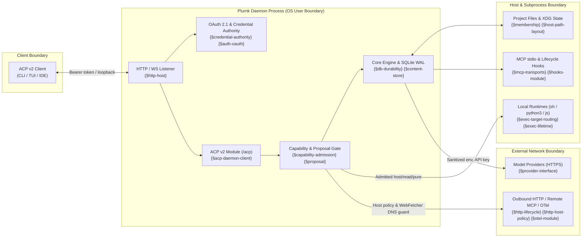

# Operator Assurance Map and Shared Responsibility

Plurnk is a contract-first agentic execution daemon (`@plurnk/plurnk-service`) that connects an operator's clients, model providers, local workspace files, and execution runtimes. This document maps the platform's security, privacy, and operational resilience controls to their authoritative specifications and defines the shared-responsibility boundary between the daemon and the operator.

For vulnerability disclosure, see [`SECURITY.md`](./SECURITY.md). For architecture and package ownership, see [`ARCHITECTURE.md`](./ARCHITECTURE.md).

## Scope and non-claims

Plurnk enforces application-level admission, capability, and provenance controls inside a single POSIX user account. It does **not** claim to be:

- **An operating-system sandbox or container runtime.** When an execution (`sh`, `python3`, `js`) or an MCP `stdio` server is admitted by policy or operator approval, it runs as a child process under the daemon's OS user and inherits that user's filesystem and network reach ({§execution-output-identity}, {§mcp-module}). Host isolation (`systemd` sandboxing, containers, VMs, firewall rules) is an operator responsibility.
- **A multi-tenant isolation boundary.** One daemon instance serves one trust domain ({§credential-authority}, {§acp-session-owner}). Concurrent ACP clients attached to a workspace share that workspace's commons (`workspace:///`) and operator approval identity (`acp://operator`).
- **A compliance attestation.** This document maps technical controls to their specification tags and verification gates; it is not a SOC 2, ISO 27001, or HIPAA certification.

## Deployment data flow and trust boundaries

## Control map

Every control below is specified under its named specification tag and verified by deterministic unit or integration witnesses in the repository's drill (`npm test`, {§lint-gate}).

| Domain | Control | Specification authority | Primary operator knobs |
| --- | --- | --- | --- |
| **Listener & authentication** | Loopback bind (`127.0.0.1`) and `PLURNK_AUTH=1` by default (`PLURNK_AUTH=0` explicitly disables authentication). OAuth 2.1 with PKCE (`S256`), constant-time secret/passcode comparison, in-memory token families revoked on restart or refresh replay, and strict origin/frame/CSP headers on `/oauth/*`. | {§http-host}, {§credential-authority}, {§acp-http-authorization}, {§auth-oauth}, {§auth-oauth-clients}, {§auth-oauth-tokens}, {§auth-configuration} | `PLURNK_HOST`, `PLURNK_PORT`, `PLURNK_AUTH`, `PLURNK_SECRET`, `PLURNK_PASS`, `PLURNK_AUTH_ISSUER`, `PLURNK_AUTH_ACCESS_TTL_SEC`, `PLURNK_AUTH_REFRESH_TTL_SEC`, `PLURNK_AUTH_CLIENT_<id>`, `PLURNK_AUTH_ALLOW_ORIGIN` |
| **Extension & plugin trust** | With `PLURNK_EXTENSIONS_TRUSTED_ONLY=1` (default), only packages declared in `@plurnk/plurnk-service`'s root manifest are imported, after realpath containment within `PLURNK_SERVICE_ROOTS`. Portable Agent Plugin components (`skills/`, `mcp.json`) validate realpath containment; native plugin `module` extensions load only from npm and global user plugin roots (`$XDG_CONFIG_HOME/plurnk/plugins`, `~/.agents/plugins`), never from a project repository. | {§extension-discovery}, {§core-extension-composition}, {§agent-plugins-roots}, {§agent-plugins-containment} | `PLURNK_EXTENSIONS_TRUSTED_ONLY`, `PLURNK_SERVICE_ROOTS` |
| **Capability & proposal gate** | Subtractive capability cascade (`PLURNK_SERVICE_CAPABILITIES` → workspace settings → session narrowing → parent-to-child delegation → proposal review). Operator ceilings (`PLURNK_SERVICE_GIT_ALLOWED`, `PLURNK_SERVICE_FILE_CREATE_SCOPE`, `PLURNK_SERVICE_MEMBERS_MODEL_SCOPE`, `PLURNK_SERVICE_MAX_COMMANDS`, `PLURNK_SERVICE_MAX_TURNS`) can only be narrowed, never widened by a client or model. Side-effecting operations pause on immutable proposal records until resolved by the session's owner. | {§capability-policy-cascade}, {§capability-admission}, {§operator-config-workspace-settings}, {§proposal}, {§proposal-disposition}, {§session-ownership} | `PLURNK_SERVICE_CAPABILITIES`, `PLURNK_SERVICE_PROPOSALS`, `PLURNK_SERVICE_EFFECT_HOST`, `PLURNK_SERVICE_EFFECT_READ`, `PLURNK_SERVICE_EFFECT_PURE`, `PLURNK_SERVICE_PROPOSAL_TIMEOUT_MS` |
| **Subprocess & environment hygiene** | Child executions (`sh`, `python3`, `js`), MCP `stdio` servers, and lifecycle hooks receive a scrubbed environment (`PLURNK_*` and provider API keys stripped; `HOME` and XDG paths projected). Non-file resources materialize into `0700` scratch directories as `0600` files for the invocation lifetime and are bounded by duration/loop/turn deadlines with `SIGTERM` → `SIGKILL` escalation. | {§execution-output-identity}, {§host-path-layout}, {§exec-target-routing}, {§exec-lifetime}, {§executor-policy} | `PLURNK_SERVICE_EXEC_ENV_INHERIT`, `PLURNK_SERVICE_EXEC_ENV_EXCLUDE`, `PLURNK_SERVICE_EXEC_CONCURRENCY`, `PLURNK_SERVICE_EXEC_KILL_GRACE_MS`, `PLURNK_SERVICE_EXEC_SCRATCH` |
| **Filesystem & Git boundaries** | Working-directory `.env` files are never loaded into daemon configuration. File membership tracks the working set (`(tracked ∪ include ∪ created) − exclude`); `EDIT` refuses non-members before reading or writing bytes and commits via atomic temp-file-and-rename after revision validation. Git invocations scrub `GIT_*`, disable `core.fsmonitor` and hooks (`core.hooksPath=/dev/null`), and skip repositories declaring `clean`/`process` filters. | {§operator-config-precedence}, {§membership}, {§membership-auto-add}, {§fs-write-surface}, {§file-snapshot-revision} | `PLURNK_SERVICE_GIT_ALLOWED`, `PLURNK_SERVICE_GIT_AUTO`, `PLURNK_MEMBERS_AUTO_ADD`, `PLURNK_SERVICE_FILE_CREATE_SCOPE`, `PLURNK_SERVICE_MEMBERS_MODEL_SCOPE`, `PLURNK_SERVICE_FILE_MATERIALIZE_MAX_BYTES` |
| **Outbound HTTP & host policy** | Outbound `http://`, `https://`, `ws://`, and `wss://` requests enforce `PLURNK_SCHEMES_HTTP_HOSTS` host policy (`all`, `public`, `private`, `none`, or host patterns) on the initial URL and every redirect hop, stripped of credentials across origins. `WebFetcher` additionally resolves DNS before connect (`Guard.fetch`) and blocks loopback, RFC 1918 private, link-local, CGNAT, unique-local, multicast, and unspecified IP ranges; direct `HTTP`/`WS` operations gate network effects through `effect: "host"` proposals. | {§scheme-address}, {§http-lifecycle}, {§http-host-policy}, {§http-manifest} | `PLURNK_SCHEMES_HTTP_HOSTS`, `PLURNK_SCHEMES_HTTP_FETCH_TIMEOUT`, `PLURNK_SCHEMES_HTTP_REDIRECTS` |
| **MCP, hooks & telemetry** | Remote MCP servers validate transport URLs, keep OAuth tokens in process memory only, and isolate failures per server. Lifecycle hooks (`plurnk-hooks`) are operator-configured only (no model or RPC mutation path) and run with bounded concurrency and timeout. OpenTelemetry exports only when `OTEL_*` exporters are configured. | {§mcp-transports}, {§mcp-configuration}, {§mcp-module}, {§oauth-continuation}, {§hooks-event-projection}, {§hooks-module}, {§otel-module} | `PLURNK_HOOKS_COMMAND`, `PLURNK_HOOKS_ARGS`, `PLURNK_HOOKS_EVENTS`, `PLURNK_HOOKS_TIMEOUT_MS`, `PLURNK_HOOKS_CONCURRENCY`, `PLURNK_HOOKS_QUEUE_LIMIT`, `OTEL_TRACES_EXPORTER`, `OTEL_METRICS_EXPORTER` |
| **Persistence, retention & digests** | SQLite runs in WAL mode with `STRICT` tables, foreign keys, `defensive` mode, and an exclusive `DaemonLock`. Content is interned by SHA-256 under a 100 MiB channel cap with configurable packet/response retention and incremental vacuum. Forensic digests (`plurnk-service share` / `npm run share`) copy the database consistently via `VACUUM INTO` and write unredacted diagnostic reports; review reports for sensitive content before sharing externally. | {§db-durability}, {§db-migrations}, {§content-store}, {§session-causal-admission}, {§share}, {§share-packet-names} | `PLURNK_SERVICE_STATE_ROOT`, `PLURNK_SERVICE_DB_PATH`, `PLURNK_SERVICE_SQLITE_SYNCHRONOUS`, `PLURNK_SERVICE_RETAIN_PACKET_*`, `PLURNK_SERVICE_RETAIN_RESPONSE_*`, `PLURNK_SERVICE_AUTO_VACUUM` |

## Operator hardening checklist

1. **Keep credentials in the login shell or service manager.** Never place provider API keys, `PLURNK_SECRET`, or `PLURNK_PASS` in a project `.env` or repository ({§operator-config-precedence}). Use `systemd` `EnvironmentFile=` or `LoadCredential=` (`plurnk.service`) with `0600` permissions.
2. **Terminate TLS at a reverse proxy before non-loopback exposure.** Keep `PLURNK_HOST=127.0.0.1` behind the shipped `plurnk.nginx.conf` (or equivalent TLS proxy) with `PLURNK_AUTH=1` and a strong `PLURNK_PASS` ({§acp-http-authorization}, {§auth-configuration}).
3. **Set explicit capability and proposal posture for unattended runs.** Review `PLURNK_SERVICE_PROPOSALS` (`review`, `accept`, `reject`), `PLURNK_SERVICE_EFFECT_HOST`, and `PLURNK_SERVICE_CAPABILITIES` before running autonomous or scheduled workloads ({§capability-policy-cascade}, {§proposal-disposition}).
4. **Constrain file creation and model membership scope when operating on sensitive hosts.** Set `PLURNK_SERVICE_FILE_CREATE_SCOPE=root` (or `none`) and `PLURNK_SERVICE_MEMBERS_MODEL_SCOPE=root` (or `none`) with `PLURNK_MEMBERS_AUTO_ADD=0` if the model should not enroll or create files outside `project_root` ({§operator-config-workspace-settings}, {§membership-auto-add}).
5. **Bound resource consumption and retention.** Configure `PLURNK_SERVICE_LOOP_TIMEOUT`, `PLURNK_SERVICE_MAX_TURNS`, `PLURNK_SERVICE_EXEC_CONCURRENCY`, and `PLURNK_SERVICE_RETAIN_*` to match host disk and provider budget limits ({§operator-config-workspace-settings}, {§content-store}).
6. **Validate configuration offline before deployment.** Run `plurnk-service config check` to verify core, module, MCP, schedule, and hook settings without opening a listener or database ({§operator-config-precedence}).

## Supply chain and release integrity

- **Single lockfile & script lockdown:** The monorepo pins a single `package-lock.json` validated under `npm ls --all`, with third-party install scripts denied by default (`allowScripts` in `package.json`, {§native-source-toolchain}).
- **Moderate-floor advisory gate:** Every package's `prepublishOnly` and the release gate enforce `npm audit --audit-level=moderate` and `npm run deps:check` ({§bundled-set}, {§package-release-contract}).
- **Clean-worktree drill & packed-tarball verification:** Releases are built and verified in an isolated worktree (`scripts/drill.mjs`), checking TypeScript compilation, `oxlint`, `publint`, `@arethetypeswrong/cli`, stripped `plurnk-dev` conditions, and first-party client conformance before signed tag finalization ({§lint-gate}, {§package-release-contract}, {§release-finalization}, {§acp-first-party-client-conformance}).

## Known limits and compensating operator controls

| Architectural limit | Why it exists | Compensating operator control |
| --- | --- | --- |
| Admitted `sh` / `python3` / `js` and MCP `stdio` subprocesses share the daemon's OS user and network access | Plurnk is a developer and automation platform designed to run native toolchains without mandatory containerization overhead. | Run `plurnk-service` inside a dedicated OS user, container, VM, or `systemd` unit (`ProtectSystem=strict`, `PrivateTmp=yes`, `ReadWritePaths=`), or gate `host` effects with `PLURNK_SERVICE_EFFECT_HOST=propose` / `PLURNK_SERVICE_CAPABILITIES`. |
| In-memory OAuth tokens and pending client interactions reset on daemon restart | Avoids persisting bearer secrets in SQLite and guarantees clean revocation on process restart ({§credential-authority}, {§session-causal-admission}). | Operator tools re-exchange `PLURNK_SECRET` (or the boot-minted `secret` file) via `client_credentials` and browser/public clients re-authenticate via OAuth 2.1 + PKCE after a daemon restart; interrupted loops settle deterministically at startup recovery. |
| Provider prompts and tool outputs leave the host to the selected model provider | Inference requires transmitting assembled packets to the configured upstream provider ({§provider-interface}). | Select self-hosted or enterprise-contracted providers via `PLURNK_MODEL_<alias>`, exclude sensitive paths with `!glob` membership rules ({§membership}), and scrub subprocess environments via `PLURNK_SERVICE_EXEC_ENV_EXCLUDE` ({§execution-output-identity}). |
| SQLite database (`plurnk.db`) stores workspace snapshots, logs, and turn sources in cleartext on disk | Enables zero-dependency local persistence, FTS5 search, and offline forensic digests ({§db-durability}, {§content-store}). | Store `PLURNK_SERVICE_STATE_ROOT` on an encrypted volume with `0700` directory permissions ({§host-path-layout}) and configure `PLURNK_SERVICE_RETAIN_*` to bound historical payload retention. |
