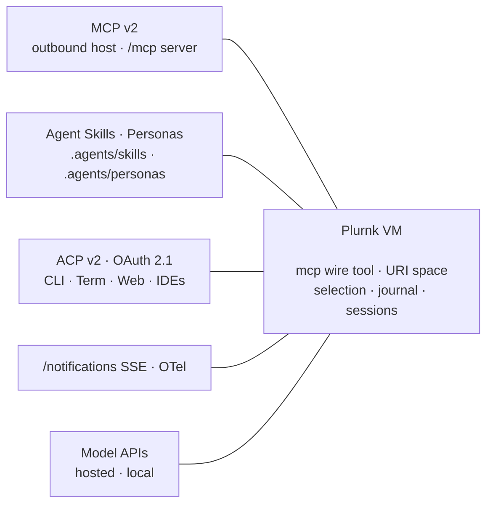

# Plurnk: An Agentic Virtual Machine

## Abstract

Most agent harnesses treat a language model as a function inside a chat loop: the harness sends an append-only transcript, executes a tool call, appends the output, and summarizes or truncates history when the window fills. Plurnk inverts that arrangement. It provides a small virtual machine — one URI address space, one universal `mcp` wire tool, model-managed working memory, demand-paged results, and one selection algebra — operated jointly by stochastic models, human clients, and deterministic schedules. At its exterior boundaries, it speaks standard protocols (ACP v2, MCP v2, Agent Skills, OAuth 2.1, and OpenTelemetry) rather than inventing parallel conventions.

## 1. Shared machine, three principals

Instead of wrapping a chat transcript around shell commands, Plurnk exposes one workspace state machine — one URI namespace, one statement AST, one proposal gate, and one SQLite journal — shared by three principals:

| Principal | Role |
|---|---|
| `model` | Stochastic reasoning: spends tokens and attention where ambiguity, synthesis, and judgment are required. |
| `client` | Human operators and external applications driving the workspace over ACP v2 (`@plurnk/plurnk` CLI and Term, `@plurnk/plurnk-web`, IDEs) or `/mcp`, with or without a model configured. |
| `_plurnk` | Deterministic kernel schedules, sentinels, stream settlements, and structural derivations executing through the same statement AST without waking a model turn until needed. |

A workspace need not wrap a Git checkout (`project_root` is optional): source repositories, research notes, and operational schedules inhabit the same entries, sessions, skills, personas, MCP mounts, and recurrence rules. In the lineage of Plan 9's per-process namespaces, Smalltalk's persistent image, and Emacs's uniform buffer algebra, storage, processes, and history share one set of operations.

## 2. The interior

### 2.1 One wire signature (`mcp`)

Modern models are post-trained on native parallel tool calls, URIs, JSON objects, shell commands, and HTTP status codes. Rather than inventing a custom text DSL in assistant prose — or pushing dozens of distinct tool schemas into every request — Plurnk exposes **one universal `mcp` wire tool** across every provider:

```json
{
  "server": "plurnk",
  "tool": "read",
  "arguments": { "path": "src/server.py", "range": "1,80" },
  "aside": "inspect request entry point"
}
```

Fourteen built-in verbs (`note`, `find`, `read`, `edit`, `copy`, `move`, `kill`, `work`, `fork`, `bare`, `wait`, `send`, `done`, `fail`), installed executors (`sh`, `js`, `python3`), workspace Functionality tools (`env`, `mcp`, `members`, `personas`, `schedule`, `skills`, `question`), and external MCP servers all use the exact same envelope:

```json
{
  "server": "github",
  "tool": "list_issues",
  "arguments": { "repo": "owner/repo", "state": "open" }
}
```

Results return as paired `tool` messages carrying HTTP-style status codes (`200`, `202` proposed, `404` missing, `409` stale anchor or edit conflict, `413` over curatable room, `416` range out of bounds). Free-form assistant prose alongside tool calls lowers automatically into a durable `note`.

Keeping the model's `tools[]` array fixed to this single signature yields four practical properties:

- **Constant tool-schema overhead:** `tools[]` stays ~90 tokens whether zero or two hundred external MCP tools are attached. Per-tool summaries and JSON Schemas live at `mcp:///<server>.md` and `mcp:///<server>/<tool>.json` for pull-on-demand inspection.
- **Prefix KV-cache stability:** Connecting, authenticating via OAuth, enabling, or disabling MCP servers mid-session never mutates `tools[]` or invalidates the cached prompt prefix.
- **Minimal constrained-decoding overhead:** Because `arguments` is an open JSON object (`additionalProperties: true`), local inference engines (`llama.cpp`, `vLLM`) avoid compiling large per-token union-schema state machines.
- **Deterministic alias recovery and canonical replay:** Models arrive with varied parameter habits (`file_path` vs. `path`, `old_string` vs. `oldText`, `cmd` vs. `text`). Because `arguments` is validated at Plurnk's lowering boundary rather than rejected upstream, unambiguous aliases recover deterministically and replay as canonical `mcp` calls in `ops://`, while genuinely ambiguous or cross-verb shapes fail `400` with a working-form example.

A turn is a declarative batch of calls, not a general-purpose language: statements execute sequentially without variables or control-flow branches. Control flow happens between turns as the model inspects results; Turing-complete computation belongs inside `sh`, `python3`, or `js`. Because Turn 0 orients the session through `mcp:///plurnk.md` and `skill://plurnk/`, the system prompt ([`plurnk.md`](plurnk-contracts/plurnk.md)) remains a single sentence (~35 tokens).

### 2.2 Everything has an address

An append-only chat transcript can only be read from start to end; an agent cannot cite a specific earlier output, copy twenty lines of it into a file, or retire one large read while keeping the rest. In Plurnk, every resource and past event has a URI:

| Address | Resource |
|---|---|
| `src/server.py` | Project file on disk |
| `workspace:///plan.md` | Shared in-database workspace entry |
| `log:///1/4/2/read` | Observation from loop 1, turn 4, operation 2 |
| `sh:///ab3d5678#stderr` | Error channel of a background shell stream |
| `session://tests` | Sibling or child session in the workspace |
| `reasoning://cc2b614d/1/7` | Recorded reasoning trace from a prior turn |
| `skill://plurnk/SKILL.md` | Installed Agent Skill tree |
| `https://example.com/feed.xml` | Web resource (when HTTP scheme is enabled) |

With uniform addresses, ordinary verbs compose across storage, history, and processes:

```json
[
  { "server": "plurnk", "tool": "copy", "arguments": { "from": "sh:///ab3d5678", "to": "build.log" }, "aside": "save full stream to disk without flooding context" },
  { "server": "plurnk", "tool": "read", "arguments": { "path": "reasoning://cc2b614d/1/7", "pattern": "/hypothesis/" }, "aside": "check prior turn hypothesis" }
]
```

Authority attaches to addresses and effects rather than a static allowlist of tool names: pure reads run freely, while host-affecting mutations (`edit`, subprocesses, non-read HTTP or MCP tools) propose (`202`) when policy requires owner consent. Sessions are addressable processes too: `work` spawns a fresh child session, `fork` clones the parent's journal, `send` delivers messages, and `wait` yields until streams or delegated work settle.

### 2.3 Model-owned memory

When a context window fills, most harnesses run background compaction or summarization — garbage collection by a collector that cannot see which facts the current task still depends on.

Plurnk leaves context curation to the session itself. Every log row carries its address and token-scale weight in the packet. When curatable room tightens, the model retires stale observations and records distilled conclusions using the same verbs it uses on files:

```json
[
  { "server": "plurnk", "tool": "note", "arguments": { "text": "exampleModule.py: exampleFunction() returns 42 on empty input (lines 12-40); both callers in exampleTest.py rely on it." } },
  { "server": "plurnk", "tool": "kill", "arguments": { "path": "log:///1/[1-7]/*/{read,emission}" }, "aside": "free early exploration rows" },
  { "server": "plurnk", "tool": "move", "arguments": { "from": "log:///1/4/2/read", "fromRange": "12,40", "to": "workspace:///excerpt.py", "toRange": "-1" }, "aside": "archive excerpt" }
]
```

Curation is non-destructive: `kill` removes a row (or line range) from active packet projection while preserving the underlying record in SQLite at its `log:///` address, so the model can re-`read` any retired slice later. The daemon never summarizes, folds, or evicts context behind the model's back.

### 2.4 Demand-paged results

Rather than dumping ten-thousand-line command outputs directly into the transcript, Plurnk bounds unrequested output and lets the model pull what it needs:

- **Explicit selections** (`range` or `pattern`) return the exact requested slice within available room.
- **Unscoped reads and settled streams** return a bounded preview plus total extent (for example, `<1,100> of 4812 lines` on a file read, or `<4713,4812> of 4812 lines` on settled command output).
- **Oversized results** that exceed remaining curatable room settle as `413` receipts reporting their address and extent, leaving the active packet intact so the model can curate room or query a narrower slice.

Model-authored `note`s, inbound messages, and canonical `ops://` emissions remain unpaged.

### 2.5 One selection algebra

Every verb that inspects, mutates, copies, or retires content shares one `pattern` field backed by six dialects:

| Prefix | Dialect | Target |
|---|---|---|
| none | Literal, glob, extglob | Substrings and lines |
| `/` or `^` | Regular expression | Text matches and captures |
| `//` | XPath 1.0 | XML, HTML, Markdown, and AST projections |
| `$` | JSONPath (RFC 9535) | JSON, YAML, TOML, and symbol outlines |
| `~` | FTS5 full-text | BM25-ranked indexed content |
| `&` | Symbol graph | Tree-sitter definitions (`&sym`), callers (`&<sym`), and callees (`&>sym`) |

A `pattern` means the same thing across verbs (`find` locates, `read` extracts, `edit` replaces, `kill` trims) and across schemes (project files, `sh:///` streams, `log:///` history, `skill://` docs, and `http(s)://` responses).

### 2.6 Composition under an instruction budget

Teaching $N$ specialized tools scales prompt cost as $O(N)$ without allowing capabilities to combine. Teaching orthogonal primitives — verbs, URI schemes, scopes, and pattern dialects — scales prompt cost with the **sum** of the primitives while expressive combinations scale with their **product**:

- Adding a `scheme` makes its resources addressable by every verb and pattern dialect.
- Adding a Tree-sitter `mimetype` grammar gives `find` and `read` structural outlines, XPath/JSONPath AST queries, and `&symbol` call graphs for that language.
- Attaching an MCP server exposes its tools under `mcp` and its resources/prompts under `<server>:///`.

## 3. Distinct interior, standard edges

MCP, ACP v2, OAuth 2.1, and Agent Skills govern exterior boundaries between systems while leaving an agent's internal context model unspecified. Plurnk pairs its VM interior directly with those open standards and declines single-vendor configuration dialects:



| Standard object | Projection inside Plurnk |
|---|---|
| Outbound MCP tool | Invoked via `{ "server": "<mcp>", "tool": "<tool>", "arguments": { ... } }`; schema demand-paged at `mcp:///<mcp>/<tool>.json` |
| Outbound MCP resource / prompt | Addressable at `<mcp>:///resources/...` and `<mcp>:///prompts/...` by every verb and pattern |
| Agent Skill (`SKILL.md`) | Mounted as a searchable file tree under `skill://<alias>/` (and exported via SEP-2640 over `/mcp`) |
| ACP v2 client | Connects over WebSocket or Streamable HTTP to durable sessions that outlive any single client connection |

## 4. Walkthrough: one turn, one batch, one journal

Suppose a test is failing around `handle_request`. Each turn, the model receives the system card, its surviving journal rows, its prior canonical `mcp` calls (`ops://`) paired with `tool` receipts, and a brief status footer reporting remaining curatable room and active streams.

On Turn 1, the model batches structural lookup and test execution in parallel:

```json
[
  { "server": "plurnk", "tool": "find", "arguments": { "path": "src/**/*.py", "pattern": "&handle_request" }, "aside": "locate definition" },
  { "server": "plurnk", "tool": "read", "arguments": { "path": "src/**/*.py", "pattern": "&<handle_request" }, "aside": "read call sites" },
  { "server": "plurnk", "tool": "sh", "arguments": { "text": "python -m pytest tests/test_server.py -x -q" } }
]
```

When `pytest` finishes, its output streams to `sh:///ab3d5678` and surfaces as a bounded tail preview (`<4713,4812> of 4812 lines`). On Turn 2, the model extracts only failing lines and edits `src/server.py` by the 5-character content anchor (`@k3x9a`) printed on its earlier `read` — avoiding full-block string quoting while guaranteeing a `409` conflict if line 88 changed underneath it:

```json
[
  { "server": "plurnk", "tool": "read", "arguments": { "path": "sh:///ab3d5678#stdout", "pattern": "/FAILED|Error/" }, "aside": "inspect failure lines" },
  { "server": "plurnk", "tool": "edit", "arguments": { "path": "src/server.py", "range": "@k3x9a", "text": "        return response" }, "aside": "fix early return" }
]
```

Once tests pass, it records the conclusion and frees the exploratory reads in one call:

```json
[
  { "server": "plurnk", "tool": "kill", "arguments": { "path": "log:///1/[1-2]/*/read", "note": "handle_request is called from router.dispatch; fixed early return at src/server.py." } }
]
```

## 5. Measuring the trade-offs

A richer runtime need not carry a heavy prompt tax. On a fresh session, Plurnk's fixed envelope is ~35 tokens for [`plurnk.md`](plurnk-contracts/plurnk.md), ~90 tokens for the single `mcp` tool schema, and ~2.6k tokens for the initial workspace and capability orientation. Because `tools[]` never changes and the model curates old `log:///` rows in place without rewriting surviving message blocks, prefix KV-cache hit rates stay high even on constrained local context windows (such as 32K KV slots).

Whether model-managed curation, pull-on-demand schemas, and structural selection outperform append-only harnesses is an empirical question tracked in [`plurnk-bench`](https://github.com/plurnk/plurnk-bench) across task resolution, token spend, and KV-cache telemetry. Because Plurnk persists every packet, physical request, and log transition in SQLite, every run can be audited through deterministic forensic digests (`plurnk-service share`).

## Availability

Plurnk is open source under the MIT license:

- Daemon, contracts, and bundled extensions: <https://github.com/plurnk/plurnk-service>
- Terminal client and CLI: <https://github.com/plurnk/plurnk>
- Browser interface module: <https://github.com/plurnk/plurnk-web>
- Reproducible benchmarks: <https://github.com/plurnk/plurnk-bench>

## References

1. D. M. Ritchie and K. Thompson. *The UNIX Time-Sharing System.* Communications of the ACM 17(7), 1974.
2. R. Pike, D. Presotto, S. Dorward, B. Flandrena, K. Thompson, H. Trickey, and P. Winterbottom. *Plan 9 from Bell Labs.* Computing Systems 8(3), 1995.
3. C. Packer, S. Wooders, K. Lin, V. Fang, S. G. Patil, I. Stoica, and J. E. Gonzalez. *MemGPT: Towards LLMs as Operating Systems.* arXiv:2310.08560, 2023.
4. X. Wang, Y. Chen, L. Yuan, Y. Zhang, Y. Li, H. Peng, and H. Ji. *Executable Code Actions Elicit Better LLM Agents.* ICML 2024. arXiv:2402.01030.
5. J. Yang, C. E. Jimenez, A. Wettig, K. Lieret, S. Yao, K. Narasimhan, and O. Press. *SWE-agent: Agent-Computer Interfaces Enable Automated Software Engineering.* NeurIPS 2024. arXiv:2405.15793.
6. Model Context Protocol. <https://modelcontextprotocol.io>
7. Agent Client Protocol (ACP). <https://agentclientprotocol.com>
8. Agent Skills. <https://agentskills.io/specification>
