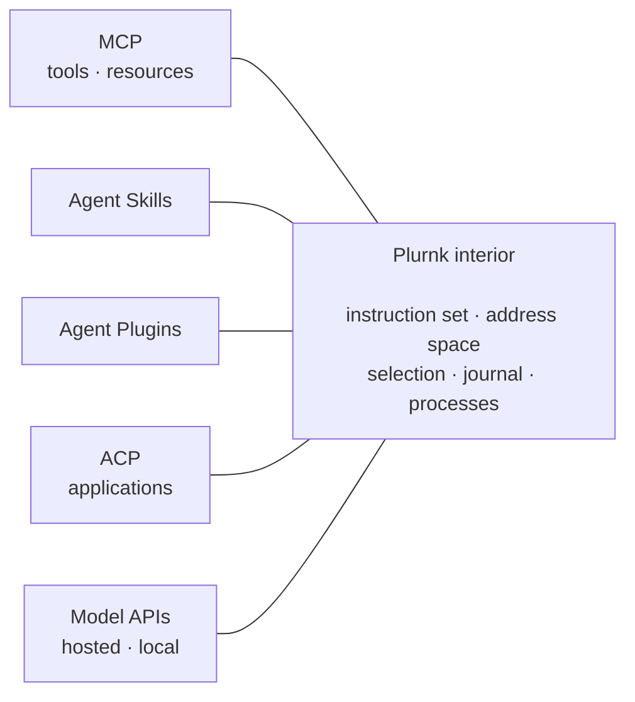

# Plurnk: An Agentic Virtual Machine

## Abstract

Language models have outpaced the paradigms for using them. The prevailing agent architecture treats
the model as a function inside someone else's program: the harness calls it with a transcript, and it
returns a tool call. This paper argues for the inversion. The harness should be a virtual machine that
the model programs. Its instruction set should be drawn from what models already read. It should have
an address space in which everything, including the model's own past, can be named; a memory the
model manages itself; information offered for the model to pull rather than pushed into its attention;
and one algebra of selection.

Six claims describe the interior of such a machine. A seventh describes its edges: a radical interior
is best paired with a conventional exterior that adopts the ecosystem's standards (MCP, Agent Skills,
ACP and Agent Plugins), because those standards govern exactly the boundaries the interior
leaves alone. Plurnk is a working instance of the argument. Watch the user, and it looks like any
terminal agent. Watch the model, and it looks like nothing else.

## 1. The inversion

Language models are revolutionary enough to deserve a radical restructuring of the computing
environment around them. The agentic harness must become a complete virtual machine: an operating
system, programming language and development environment that centers and composes with stochastic
intelligence rather than appending it as an application in a chat window.

Consider how agents are built today. A harness owns a program: a loop that sends the model a
transcript and receives either prose or a request to call a tool. It executes the tool, appends the
result, and sends the transcript again. The harness decides what the model sees, what it may do, and
what it will forget when the transcript grows too long. The model is a subroutine: an extraordinarily
capable one, invoked by a program it did not write and cannot inspect.

That is the shape of a peripheral, a device the program calls when it needs something done. But the
model is not a peripheral. It is the only component in the system that understands the task. It
decides what to look at next, what matters, what to change, and when the work is done. In any other
machine, the component that makes those decisions is called the control unit.

Plurnk inverts the call graph: the model writes programs, and the harness executes them. Each turn,
the model emits a short program. The machine executes it against a single address space, records every
result in a journal, and presents the journal back. The model reads the journal and writes the next
program. Control flow lives in the model's judgment between turns; everything else is the machine.

"Virtual machine" is not a metaphor stretched for effect. A machine has an instruction set, an address
space, memory, processes and devices. A model operating one needs each of them designed for the kind of
control unit it is: stochastic, literate, and trained on the written record of how people operate
computers. The claims that follow describe that interior. The last describes the boundary where the
machine meets everything else, and explains why a machine with a contrarian core can be, from the
outside, entirely ordinary.

## 2. The interior

### 2.1 The native instruction set

Every model already has an instruction set. It is documented nowhere, but it is unmistakable: the
conventions the model has read billions of times. Fenced code blocks. URIs. JSON. Shell commands. HTTP
status codes. HTML comments as notes to the reader. A model that sees `404` does not need to be told
what happened.

An interface designed for a model can either teach it something new or recognize what it already
knows. Teaching costs twice: once in the instructions, and again in every response, where the model
spends capacity translating its intent into an unfamiliar form. Recognition costs once, in the card. The design
question for an agentic instruction set is therefore not "what is the cleanest syntax?" but "what does
the model already write, and how do we give it meaning?"

Minimal harnesses have found half of the answer already. They ask the model for one shell command in
a fenced block, and the model obliges fluently, because that is how shell commands appear in
everything it has read. Research on code as action makes the same point from the other side: models
act better through executable code than through JSON tool calls. Plurnk accepts the same fenced block:

````markdown
```sh
echo "Hello, world!"
```
````

It then generalizes it. Every Plurnk statement is one fenced block. Its extensible formalization is
shaped like the three things the model knows best: Markdown, URIs and JSON.

````text
```VERB (path) <scope> [metadata] pattern <!-- aside -->
body
```
````

Each slot borrows a convention:

- the fence and body are a Markdown code block;
- the path is a URI;
- the metadata is JSON;
- the scope uses the line-and-column coordinates of every editor and stack trace;
- the pattern uses the usual delimiters of its dialect;
- the aside is an HTML comment in which the model says why.

Eleven workflow verbs mirror the verbs of HTTP and the shell: NOTE, FIND, READ, EDIT, COPY, MOVE, KILL,
WORK, FORK, WAIT and SEND. Every installed runtime and every attached tool uses the same shape:

````markdown
```github (list_issues)
{ "repo": "owner/repo", "state": "open" }
```
````

There is no second calling convention for tools. Results come back the way the web returns them, with
status codes the model reads without instruction: 404 for a missing path, 409 for an edit aimed at
text that has changed, 413 for a result too large for the room it was requested into.

Plurnk is a complete instruction set rather than a complete programming language, and the distinction
matters. A Plurnk program is straight-line: its statements execute in order, without variables or
branches. Branching belongs to the control unit, which decides between turns what to do with what it
has read. When a step needs computation, an executor's body is a program in a complete language:
shell, Python, JavaScript or SQL. The programs are deterministic in execution and stochastic in
authorship, which is exactly the division of labor between a machine and a model.

The entire language is taught by one short card, [`plurnk.md`](plurnk-contracts/plurnk.md). It is less
a lesson than a reminder.

### 2.2 Addressability is the precondition of agency

What cannot be named cannot be acted upon. This is one of the oldest lessons of systems design, and
agent harnesses have mostly ignored it.

A transcript is a tape. The model can read it from the start, and it can do nothing else with it. It
cannot point at the third result from an hour ago, copy two lines of it into a file, compare it with a
newer result, or discard the half it no longer needs. Every one of those acts requires a name for the
thing being acted on.

In Plurnk everything has one:

| Address | Resource |
|---|---|
| `src/server.py` | A file in the project |
| `log:///1/4/2/READ` | An observation the model made: loop 1, turn 4, item 2 |
| `sh:///ab3d5678#stderr` | The error stream of a running process |
| `session://tests` | Another agent in the same workspace |
| `reasoning://cc2b614d/1/7` | What a session was thinking on a past turn |
| `skill://plurnk/SKILL.md` | A skill and its files |
| `https://example.com/feed.xml` | A resource on the web |

Once things have addresses, the ordinary verbs reach them:

````markdown
```COPY (sh:///ab3d5678) (build.log) <!-- the output lands in a file, never in my context -->
```

```READ (reasoning://cc2b614d/1/7) /hypothesis/ <!-- what I was thinking then -->
```
````

Two consequences follow. First, memory becomes random-access instead of sequential: the model's past
is not a tape to rewind but a space to navigate. Second, authority can attach to names. Reading is
free; acting on the world is proposed. Anything with effects outside the workspace becomes a proposal
that the session's owner accepts or rejects: a subprocess that touches the host, an outbound request
that writes, a file created outside policy. Consent becomes a property of addresses and effects
rather than a list of tools.

Processes are addresses too. Sessions persist beyond any client session. WORK starts a child with a
fresh journal, and FORK starts one with a copy of the parent's. SEND writes to a session or to a running
process, and WAIT yields until a child or a stream has something to say. A machine with a stochastic
control unit can still be a multiprocessing machine, as long as every process can be named.

### 2.3 Memory belongs to the program

Every agent has a working memory, its context window, and every harness has to manage it, because the
world is always larger than the window. The interesting question is who manages it.

The prevailing answer is the harness. When the transcript grows too long, the harness compacts it: it
drops old turns, asks a model to summarize them, or both. This is garbage collection by a collector
that cannot see which objects are live. It frees by age and summarizes by guess, because the only
party that knows what the task still needs is the model, and the model was not consulted.

Systems that frame the model as an operating system, such as MemGPT, let the model page information
between tiers of memory through dedicated functions. But the system still evicts and summarizes under
pressure, and the model's memory remains a different kind of thing from the world it works on.

Plurnk moves memory management into the program, where the knowledge of what is still live resides.
Every observation becomes a row of a journal, with an address and a weight. The model sees the size of
its room and its heaviest rows, and it curates them with the same verbs it uses on everything else:

````markdown
```KILL (log:///1/[1-7]/*/{READ,emission,reasoning}) <!-- old results and programs, in bulk -->
exampleModule.py: exampleFunction() returns 42 on empty input (lines 12–40); both callers in exampleTest.py expect it.
```

```MOVE (log:///1/4/2/READ) <12,40> (notes/excerpt.py) <-1> <!-- keep these lines, but in a file -->
```
````

A KILL retires rows by address or glob, and a scope trims lines instead. A KILL's body becomes the
model's own note about what it is keeping, so even a summary is the model's decision, in the model's
words. MOVE and COPY carry text between the journal and files. READ brings back any range.

Nothing is lost. Curation changes what the model sees, never the record. Every observation, program
and line of reasoning stays at its address, readable again if the model needs it. Forgetting becomes
reversible. The journal becomes something no transcript can be: a memory that the mind using it is
allowed to organize.

### 2.4 Pull, not push

Most harnesses push. A command prints ten thousand lines, and all ten thousand land in the transcript.
From that moment the model has two choices, and both cost something. It can digest the flood, spending
attention on lines that never mattered. Or it can destroy it, which in most harnesses means waiting for
compaction to destroy it on the model's behalf. In a push design, every result is an obligation.

Plurnk offers instead of imposing, and what arrives is sized by what the model asked for:

- **A precise request,** such as a range of lines or a pattern, is answered exactly.
- **A loose request, or none at all,** is answered with a preview: the first page, plus one line stating
  the whole, such as `<1,100> of 4812 lines`. This covers an unscoped READ of a large file, a command's
  output, or a message from another session.
- **Anything too large for the room** arrives as a receipt: its size, its address, and the verbs that
  will fetch it.

In every case the rest stays where it is, at an address, until the model decides it is worth the room.
Only what the model wrote deliberately stands whole and unpaged: its notes return every turn in its own
voice, its messages are delivered entire, and its programs stay whole at their addresses. The world is
paged; the author is not.

In the language of virtual machines, this is demand paging for attention. Everything is mapped, and
nothing is loaded until the model touches it. A receipt is to content what a directory listing is to a
file system: enough to decide, without making the decision the cost. Because the content stays
addressable, no decision is final. The model can pull a range now, a pattern later, and the rest never.

This is the previous claim seen from the other side. If memory belongs to the program, the machine must
not fill it unasked. The machine's job is to make everything reachable and to say honestly what is
there. The model's job is to decide what deserves its attention.

### 2.5 Selection is how attention gets spent

Context is the scarcest resource an agent has, and the decision it makes most often is what to look
at. A repository has a million lines, a build log ten thousand, and a web page a thousand elements.
The task needs a few dozen of them. Everything an agent does well, it does by selecting well.

A harness that offers only "read the file" forces the model to spend attention just to find out what
deserves attention. A harness with a dozen specialized search tools spends the model's instructions
teaching each one, and still cannot search a build log with the tool that searches code.

Plurnk gives selection one slot in every statement, with six dialects behind it:

| Prefix | Dialect | Selects |
|---|---|---|
| none | Literal, glob and extglob | Substrings and lines |
| `/` | Regular expressions | Matches |
| `//` | XPath | Elements, text and attributes |
| `$` | JSONPath | Members and values |
| `~` | Full text | Indexed tokens |
| `&` | Symbol graph | Definitions, references and dependencies |

A selection means the same thing in every verb: FIND reports it, READ shows it, EDIT replaces it, COPY
and MOVE carry it, and KILL removes it. It also means the same thing on every resource. The regular
expression that filters a source file also filters a build log, a web page, or the model's own
history.

````markdown
```READ (sh:///ab3d5678#stdout) /FAILED|Error/ <!-- only the failing lines -->
```

```READ (src/**/*.py) &<handle_request <!-- every call site, across the tree -->
```
````

Programmable selection is programmable attention. The model stops reading the world and starts
querying it.

### 2.6 Orthogonality under a teaching budget

A model learns the machine it operates in context, from instructions it receives on every call. Those
instructions are a budget, and the budget imposes a law on design.

A machine built from tools pays to teach every capability separately. Its teaching cost grows with the
number of capabilities, and its capabilities do not combine: a tool that searches files and a tool
that reads logs do not make a tool that searches logs. A machine built from orthogonal parts (verbs,
addresses, patterns and scopes) teaches each part once. **Its teaching cost grows with the sum of its
parts; its expressive power grows with their product.** SWE-agent showed that the interface designed
for an agent matters as much as the model behind it. Orthogonality is a claim about what that
interface should be made of.

This is the Unix insight restated for a stochastic operator. Unix made everything a file, provided
small tools that each did one thing, and let pipes compose them. Plurnk makes everything an address,
provides eleven verbs and one selection algebra, and lets every statement compose them. Statements such
as "retire every old READ in turns one through seven, keeping this note" or "move these lines of that
observation to the end of this file" were never designed. They exist because the parts compose.

The law has a corollary that matters more than the law itself: in an orthogonal machine, every new
resource type, pattern dialect or tool joins the product at once.

- A new scheme inherits every verb and every pattern.
- A structural parser for a file type makes every resource of that type queryable by structure.
- A tool server's tools become statements, and its resources become addresses.

A capability added to a tool-based harness is one more capability. A capability added to Plurnk is
multiplied by everything already there.

### 2.7 What the interior adds up to

Taken together, the interior claims describe one design:

- the instruction set is native, so the model writes it fluently;
- the address space is universal, so the instruction set can reach everything;
- memory sits inside the address space, so curating context is ordinary programming;
- information is offered rather than imposed, so the model's attention is spent only by its own
  choice;
- selection is uniform, so reaching everything does not mean reading everything;
- the parts are orthogonal, so a short card buys a machine whose expressive power multiplies.

None of these ideas is new alone. Their composition is what makes Plurnk a machine rather than a
harness, and so does the decision to place the model's own memory in the same address space as
everything else.

## 3. The edges

The interior is contrarian on purpose. The edges are not. Plurnk is **conventional at the edges and
radical at the core**.

Everything a person, a tool or another agent touches is the ecosystem's own standard:

- MCP servers come from an ordinary `mcp.json`.
- Agent Skills are discovered in `.agents/skills`.
- Agent Plugins install as plugins.
- Applications reach it over ACP.
- Models are reached through the common provider APIs, hosted and local.
- Configuration lives in plain environment files.

Plurnk adopts each standard as an adapter behind an existing seam rather than inventing an
alternative. It declines conventions that belong to a single vendor, however popular.



This is more than politeness toward the ecosystem. The standards and the bets occupy different
territory. Each standard governs one boundary between systems:

- MCP, between tools and agents;
- ACP, between an agent and its interface;
- Agent Skills and Agent Plugins, the packaging of knowledge and capability.

All of them deliberately say nothing about an agent's interior: what the model sees, how it acts, how
it remembers. Plurnk's contrarian bets all live in that interior. They do not compete with the
standards; by design, they fill the space the standards leave open.

The core also makes the ecosystem's objects more capable than they are elsewhere. This is claim 2.6
applied outward:

| Standard object | In Plurnk |
|---|---|
| An MCP tool | A statement: a fence with the tool's name and a JSON body |
| An MCP resource | An address, reachable by every verb and every pattern |
| An Agent Skill | A tree of files at `skill://`, searchable and readable by pattern |
| An ACP client | A view of a durable session that outlives the connection |

Every standard Plurnk adopts becomes one more factor in the multiplication. Integration is not a
concession a contrarian system makes to an ordinary world. It is the input the orthogonal machine was
built to multiply.

The practical consequence is the one that matters most to anyone deciding whether to try it. A Plurnk
user installs it, points it at a model, gives it the MCP servers and skills they already have, and
talks to it in a terminal. Applications
drive it the way they drive any ACP agent. In daily use it is as ordinary as any popular harness,
and more ordinary than those that depend on one vendor's conventions.

Watch the user, and Plurnk looks like any terminal agent. Watch the model, and it looks like nothing
else.

## 4. One turn, one program, one journal

A short sequence shows the claims working together. A test is failing somewhere around a function
called `handle_request`.

Each turn, the model receives a packet with four parts:

- the card, as its system message;
- the journal of everything it has observed;
- the notes it wrote on earlier turns, in its own voice, each turn's behind the row that announced it;
- a short status that includes the size of its room and its heaviest rows.

It answers with a program:

````markdown
```FIND (src/**/*.py) &handle_request <!-- where it is defined -->
```

```READ (src/**/*.py) &<handle_request <!-- every call site -->
```

```sh
python -m pytest tests/test_server.py -x -q
```
````

The machine executes the three statements in order. The definition and every call site arrive as
journal rows, each at an address of its own. The test run starts, and its output streams to
`sh:///ab3d5678`.

By the next turn the run has finished. Its output was long, so it arrived as a preview: the first page,
plus one line stating the whole, `<1,100> of 4812 lines`. The model was never obliged to read the rest.
It pulls only the failures, then repairs the line it saw, using the anchor its earlier READ published:

````markdown
```READ (sh:///ab3d5678#stdout) /FAILED|Error/ <!-- only the failing lines -->
```

```EDIT (src/server.py) <@k3x9a> <!-- READ showed 88<@k3x9a>; the body replaces line 88 -->
        return response
```
````

Had the file changed since the model read it, the anchor would no longer match, and the edit would be
refused rather than applied to the wrong line. With the fix verified, the model keeps what it learned
and retires the exploration:

````markdown
```KILL (log:///1/[1-2]/*/READ) <!-- exploration done; keep what was learned -->
handle_request is called only from router.dispatch and its tests; the fix is the early return in src/server.py.
```
````

Every statement in this sequence draws on several claims at once:

- the instruction set is native;
- the addresses span a source tree, a process stream and the journal;
- the selections are a symbol graph, a regular expression and a content anchor;
- the memory is curated by the program that needs it.

Nothing here is a tool. Everything is the same grammar.

## 5. What this opens

The argument of this paper is simple to state. An agent harness should be a machine the model
programs, not a chat the model talks into.

- Its instruction set should be the conventions the model already knows.
- Everything in it should have an address, including the model's own past.
- Memory should be managed by the program that knows what matters.
- Information should be offered for the model to pull, never pushed into its attention.
- Selection should be one algebra across every resource.
- Its parts should be orthogonal, so that a short card buys a multiplying machine.
- Its edges should be the ecosystem's standards, which govern exactly what the interior leaves alone.

Plurnk is a working instance of that argument. It runs today against hosted and local models, alongside
the tools, skills and agents people already use.

### Measuring the bet

A richer machine need not carry a heavier harness tax. Model-directed selection and memory offer a
path to broader capabilities at costs competitive with minimal harnesses. That is a measurable bet:
[plurnk-bench](https://github.com/plurnk/plurnk-bench) provides reproducible evaluations of task success,
cost and context use across models and harnesses.

It also opens questions that a chat loop cannot pose:

- What does a model do with its memory when the memory is its own, over hours instead of minutes?
- How should a model spend attention when attention is a query rather than a read?
- What happens when models are trained on an instruction set rather than taught one in context?
- How do many models, of different sizes and costs, share one workspace when every process in it can be
  named?

Plurnk records every request, packet and decision it makes, so these questions can be studied rather
than argued.

The next step for agents may not be a better conversation. It may be a machine.

## Availability

Plurnk is open source under the MIT license:

- the daemon, language and bundled extensions: <https://github.com/plurnk/plurnk-service>;
- the terminal client: <https://github.com/plurnk/plurnk>;
- evaluations: <https://github.com/plurnk/plurnk-bench>.

## References

1. D. M. Ritchie and K. Thompson. *The UNIX Time-Sharing System.* Communications of the ACM 17(7), 1974.
2. C. Packer, S. Wooders, K. Lin, V. Fang, S. G. Patil, I. Stoica and J. E. Gonzalez. *MemGPT: Towards LLMs as Operating Systems.* arXiv:2310.08560, 2023.
3. X. Wang, Y. Chen, L. Yuan, Y. Zhang, Y. Li, H. Peng and H. Ji. *Executable Code Actions Elicit Better LLM Agents.* ICML 2024. arXiv:2402.01030.
4. J. Yang, C. E. Jimenez, A. Wettig, K. Lieret, S. Yao, K. Narasimhan and O. Press. *SWE-agent: Agent-Computer Interfaces Enable Automated Software Engineering.* NeurIPS 2024. arXiv:2405.15793.
5. mini-SWE-agent. <https://github.com/SWE-agent/mini-swe-agent>
6. Model Context Protocol. <https://modelcontextprotocol.io>
7. Agent Client Protocol (ACP). <https://agentclientprotocol.com>
8. Agent Skills. <https://agentskills.io/specification>
9. Agent Plugins. <https://agent-plugins.org/specification>
