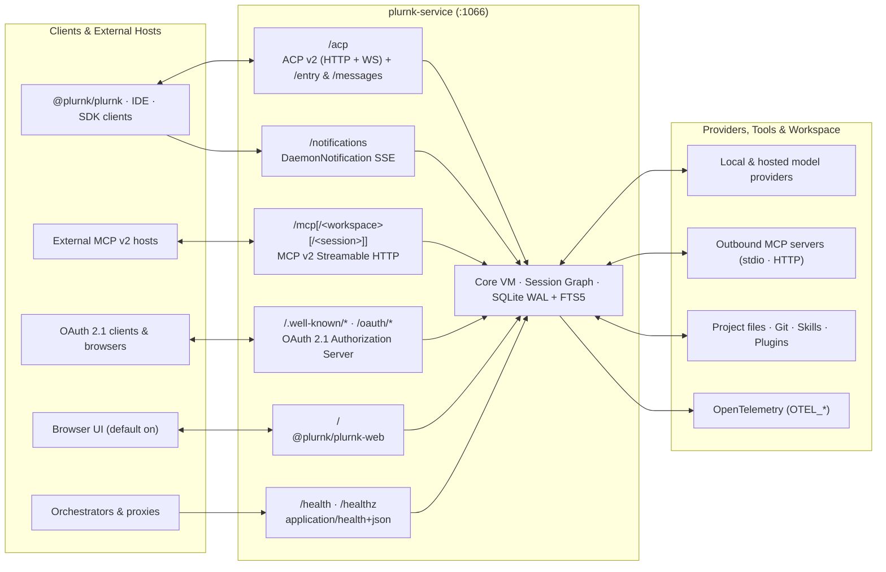

# Plurnk service

The runtime behind [Plurnk](https://github.com/plurnk/plurnk): an agentic virtual machine with a model-facing operation language, universal URI address space, persistent SQLite journal, and multi-session graph.

- **Start here to use Plurnk:** [terminal client](https://github.com/plurnk/plurnk#get-started) (`plurnk` CLI, TUI, and `plurnk web`).
- **Why it is built this way:** [MANIFESTO.md](MANIFESTO.md).

## Core organs

- **Heredoc Code Mode + RENO:** Declarative `<service>.<tool>({ ... })` statements with raw `<<<EOF` heredocs; Reflective Emission Normalization (RENO) transduces post-training envelopes and near-misses on admission and reflects canonical statements into `ops://`.
- **Universal address space:** Project files, process streams, MCP resources, skills, reasoning, and past receipts share one URI namespace the model reads and curates.
- **Unified selection algebra:** Globs, regex, FTS5 full text, JSONPath, XPath, and Tree-sitter symbol queries share one `pattern` field across every verb.
- **Durable session graph:** Sessions delegate (`plurnk.work`, `plurnk.fork`), message (`plurnk.send`), and synchronize (`plurnk.wait`) independently of client connections.

## Surface (`:1066`)

One listener (`127.0.0.1:1066` by default) serves every face under one OAuth 2.1 credential authority:



| Mount | Owner | Surface |
|---|---|---|
| `/acp` | `@plurnk/plurnk-acp` | ACP v2 JSON-RPC 2.0 over Streamable HTTP (SSE) and WebSocket, plus `GET /acp/<workspaceId>/<sessionId>/{entry,messages}`. |
| `/mcp[/<workspace>[/<session>]]` | `@plurnk/plurnk-mcp` | MCP v2 Streamable HTTP server exposing the 15 VM verbs, executors (`sh`, `js`, `python3`), 6 Functionality families, and `skill://` SEP-2640 Skills. |
| `/notifications` | `@plurnk/plurnk-service` | Authenticated `GET /notifications` SSE stream of `DaemonNotification` envelopes. |
| `/.well-known/*`, `/oauth/*` | `@plurnk/plurnk-auth` | OAuth 2.1 server (`authorize` PKCE `S256`, `token` with `requested_subject`, `revoke`, RFC 7591 `register`, browser `session`, loopback `handoff`). |
| `/` | `@plurnk/plurnk-web` | Browser client mounted by default (`PLURNK_WEB_ENABLED=0` disables). |
| `/health`, `/healthz` | `@plurnk/plurnk-service` | Unauthenticated `GET`/`HEAD` readiness probes (`200` `{"status":"pass"}` or `503 service-starting`). |

## Reference

| Area | Authority |
|---|---|
| Manifesto & architecture | [MANIFESTO.md](MANIFESTO.md) · [ARCHITECTURE.md](ARCHITECTURE.md) |
| Installation, `.env` cascade & backups | [INSTALL.md](plurnk-core/INSTALL.md) (`plurnk-service config defaults`) |
| Security & operator assurance | [SECURITY.md](SECURITY.md) · [ASSURANCE.md](ASSURANCE.md) |
| Model language & parser | [plurnk.md](plurnk-contracts/plurnk.md) · [Contracts](plurnk-contracts/README.md) · [Parser](plurnk-parser/README.md) |
| Model routes, catalog & providers | [Providers](plurnk-providers/README.md) · [Models](plurnk-models/README.md) · [Aliases](plurnk-aliases/README.md) |
| Client, auth & web faces | [ACP](plurnk-acp/README.md) · [OAuth 2.1](plurnk-auth/README.md) · [Web](https://github.com/plurnk/plurnk-web) |
| Tools, skills, plugins & schedules | [MCP](plurnk-mcp/README.md) · [Skills](plurnk-skills/README.md) · [Plugins](plurnk-agent-plugins/README.md) · [Schedule](plurnk-schedule/README.md) |
| Extension frameworks & modules | [Extensibility](ARCHITECTURE.md#extensibility) · [Modules](plurnk-modules/README.md) · [Schemes](plurnk-schemes/README.md) ([HTTP](plurnk-schemes-http/README.md)) · [Execs](plurnk-execs/README.md) · [Mimetypes](plurnk-mimetypes/README.md) |
| Observability & forensics | [OpenTelemetry](plurnk-otel/README.md) · [Digest](plurnk-digest/README.md) |

## Development

```sh
git clone https://github.com/plurnk/plurnk-service.git
git clone https://github.com/plurnk/plurnk.git
npm ci --prefix plurnk
cd plurnk-service && npm ci && npm test
```

`PLURNK_CLIENT_CHECKOUT` overrides the sibling `../plurnk` path. See [CONTRIBUTING.md](CONTRIBUTING.md) for test tiers and releases, and [plurnk-bench](https://github.com/plurnk/plurnk-bench) for comparative evaluations.

## License

[MIT](LICENSE). Report vulnerabilities via [SECURITY.md](SECURITY.md).
