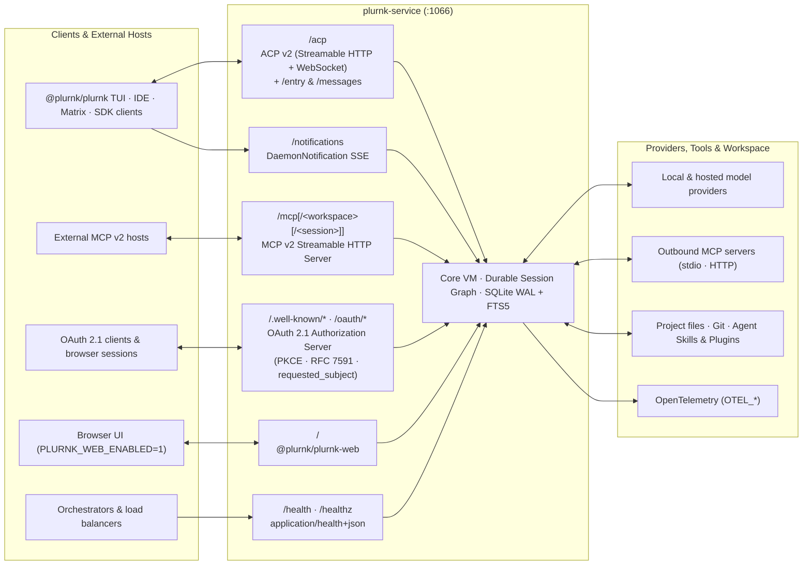

# Plurnk service

The runtime behind [Plurnk](https://github.com/plurnk/plurnk): a model-facing
operation language, searchable resources, persistent context, and cooperating
sessions. Use local or hosted models through the same environment.

**To use Plurnk, start with the [terminal client](https://github.com/plurnk/plurnk#get-started).**
This repository owns the daemon, language contracts, and bundled extensions.

**Why it is built this way, and what that costs today: [PLURNK.md](PLURNK.md).**

## Design

- **Heredoc Code Mode with Reflective Emission Normalization (RENO):** The model controls its context and workflow through declarative `await <service>.<tool>({ ... })` calls with raw `<<<EOF` heredoc blocks for multiline payloads, while RENO deterministically normalizes post-training tool-call envelopes and syntax near-misses on admission and reflects canonical statements back into `ops://` history.
- **Universal address space:** Files, tool results, messages, and reasoning have addresses the model can inspect and curate.
- **Unified selection algebra:** Globs, regex, full text, structured queries, and symbol relationships share one `pattern` interface.
- **Durable session graph:** Sessions delegate and communicate within a persistent workspace, independent of a client connection.

## Surface (`:1066`)

One shared listener (`127.0.0.1:1066` by default) serves the client protocol, external MCP host surface, OAuth 2.1 authorization server, optional web client, and health probes under a single credential authority:



| Mount | Owner | Surface |
|---|---|---|
| `/acp` | `@plurnk/plurnk-acp` | Standard ACP v2 JSON-RPC 2.0 over Streamable HTTP (SSE) and WebSocket, plus `GET /acp/<workspaceId>/<sessionId>/entry` and `/messages`. |
| `/mcp[/<workspace>[/<session>]]` | `@plurnk/plurnk-mcp` | MCP v2 Streamable HTTP server exposing the 15 VM operations, REPL executors (`sh`, `js`, `python3`), 6 Functionality families, and `skill://` SEP-2640 Skills. |
| `/notifications` | `@plurnk/plurnk-service` | Authenticated `GET /notifications[?event=...&workspace=...&session=...]` Server-Sent Events stream of `DaemonNotification` envelopes. |
| `/.well-known/*`, `/oauth/*` | `@plurnk/plurnk-auth` | OAuth 2.1 authorization server (`authorize` with PKCE `S256`, `token` with `requested_subject` session scoping, `revoke`, RFC 7591 `register`, browser `session`). |
| `/` | `@plurnk/plurnk-web` | Browser web client mounted when `PLURNK_WEB_ENABLED=1`. |
| `/health`, `/healthz` | `@plurnk/plurnk-service` | Unauthenticated `GET`/`HEAD` readiness probes (`200` `{"status":"pass"}` or `503 service-starting`). |

See [ARCHITECTURE.md](ARCHITECTURE.md) for internal process boundaries and package ownership.

## Installation and configuration

The [installation guide](plurnk-core/INSTALL.md) covers requirements, configuration,
and running a shared daemon. The client can also start an installed backend
privately for its own session.

Configuration belongs to the package that reads it. Inspect the installed
catalog rather than a copied list of settings:

```sh
plurnk-service config defaults
```

The Plurnk skill exposes the same guides and catalog to the model on demand.

## Reference

| Area | Guide |
|---|---|
| Model-facing language | [plurnk.md](plurnk-contracts/plurnk.md) |
| Model routes and provider settings | [Providers](plurnk-providers/README.md) |
| Client protocol | [ACP](plurnk-acp/README.md) |
| External tools and web search | [MCP](plurnk-mcp/README.md) |
| HTTP resources | [HTTP scheme](plurnk-schemes-http/README.md) |
| Scheduled messages | [Schedule](plurnk-schedule/README.md) |
| Extending Plurnk: integrations, plugins, extensions | [Extensibility](ARCHITECTURE.md#extensibility) |
| Writing a daemon module | [Module contract](plurnk-modules/README.md) |
| Package map and extension boundaries | [Architecture](ARCHITECTURE.md#package-ownership) |

Each package's `SPEC.md` owns its public contract. The root is an npm workspace
with one lockfile and cross-package checks.

## Development

```sh
git clone https://github.com/plurnk/plurnk-service.git
git clone https://github.com/plurnk/plurnk.git
npm ci --prefix plurnk
cd plurnk-service
npm ci
npm test
```

The complete test gate requires the installed client checkout. Set
`PLURNK_CLIENT_CHECKOUT` for a different layout. Real-model tests are separate
from `npm test` and may incur inference charges.

See [CONTRIBUTING.md](CONTRIBUTING.md) for test tiers, source-built candidates,
optional audits, and releases. [plurnk-bench](https://github.com/plurnk/plurnk-bench)
owns external evaluations and comparative reports.

## Contributing

[Issues](https://github.com/plurnk/plurnk-service/issues) and pull requests are
welcome. See [CONTRIBUTING.md](CONTRIBUTING.md); report vulnerabilities through
[SECURITY.md](SECURITY.md), not a public issue.

## License

[MIT](LICENSE).
