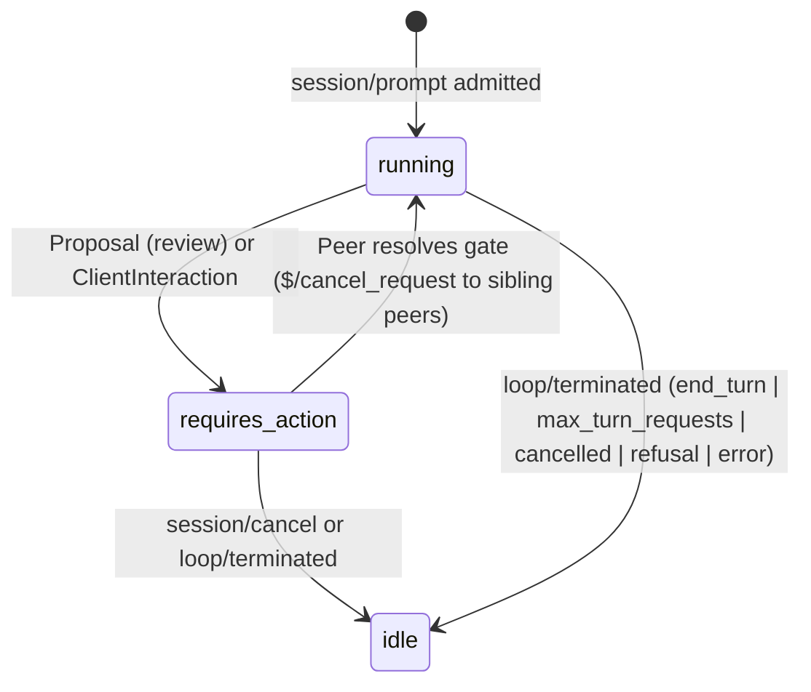

# @plurnk/plurnk-acp — ACP v2 Server Module Specification

The module is the daemon's Standard ACP v2 (`@agentclientprotocol/sdk/experimental/v2/unstable`) server interface. It consumes {§application-session-observation} and mounts `/acp` on the daemon's listener via `AcpServer` (`@agentclientprotocol/sdk/experimental/server`), serving Streamable HTTP and WebSocket JSON-RPC 2.0 connections alongside HTTP entry and history resources under one OAuth 2.1 perimeter.

## §acp-daemon-client 1. Architecture, Client Types, and Session Binding

- **Discovered daemon module (`plurnk: { kind: "module", module: "./module" }`):** Claims only `/acp` on the shared HTTP/WebSocket listener ({§http-host}, {§module-lifecycle}), registers the `acp` `MessageScheme` in `setup`, and mounts `/acp` at `start` (answering `503 service-starting` before activation and `503 service-stopping` from `stop`). A daemon without a listener omits it.
- **Runtime-neutral client contract (`@plurnk/plurnk-acp/client`):** Exports runtime-neutral types for `_meta.plurnk` state and action outcomes, type-checked under DOM libraries without Node globals (`tsconfig.browser.json`, {§whitespace-contract}).
- **Standard ACP v2 authority:** `initialize` negotiates `protocolVersion: 2` (`PROTOCOL_VERSION`) and advertises `agentCapabilities` (`promptCapabilities: { image: true, embeddedContext: true }`, `sessionCapabilities: { list: {}, resume: { replay: true }, fork: {}, close: {}, delete: {}, configOptions: {} }`, `providerCapabilities: { list: {}, set: {}, disable: {} }`, `mcpCapabilities: { http: true, sse: false }`).
- **Workspace & session binding:**
  - *Qualified address (`<workspaceId>#<sessionName>`):* Positive safe decimal integer + `#` + native model-session name (`400 session-address-invalid` on leading zeroes, out-of-range ID, or invalid name). Always selects the immutable workspace ID.
  - *Workspace resolution:* `session/new` attaches or creates the workspace for `cwd` (`AbsolutePath`) or `_meta.plurnk.workspace`; `session/resume` and `session/list` attach an existing workspace (`404 workspace-not-found` when absent). Concurrent first workspace acquisitions are serialized without caching failures.
  - *Session resolution:* Resolves model-origin sessions only (`_plurnk` is never bound as a conversation session). `session/new` creates the session; `session/resume` attaches an existing session (unless `_meta.plurnk.create === true`, returning `404 session-not-found` when absent). Unqualified opaque `sessionId` values resolve through Core's `acp` external reference ({§machine-processes}) or as a session name in the `cwd` workspace. Process-local bindings key on `(workspaceId, sessionId)`.

## §acp-session-owner 2. Approval Ownership and Connection Lifetime

- **Workspace-scoped owner (`acp://operator`):** Shared across ACP sessions in the workspace. Control attachment (`session/new`, `session/prompt`, permission/elicitation responses, or `session/resume` with `_meta.plurnk.control !== false`) registers `acp://operator` with `request_approval` ({§machine-processes}) plus client-declared `_meta.plurnk.tools`, claims the bound session and its model descendants, and starts workspace Functionality activation ({§methods}) asynchronously. Passive observation (`_meta.plurnk.control === false`, `session/list`, `/script`) claims and activates nothing.
- **Persistent observation & disconnect immunity:** Connections attached via `session/new`, `session/resume`, or `session/fork` receive live `session/update`, `session/request_permission`, and `elicitation/create` messages until `session/close` or disconnect. Each peer tracks `pendingGates` to avoid duplicate gate presentation. Closing a WebSocket/HTTP stream or calling `session/close` ends delivery only and never cancels admitted prompts, gate resolutions, or `/script` operations; only `session/cancel` (`ApplicationPort.cancelSession` / `cancelLoop`) or completion ends work.
- **Graceful shutdown:** `stop` refuses new requests with `503 service-stopping`; `close` closes `AcpServer` and all active streams after Core settlement ({§module-lifecycle}).

## §acp-body-reference 3. Bodies by Reference and Entry Route

- **Reference projection:** A tool receipt carrying a non-empty `content` body projects to `tool_call_update` with a metadata text block (body and `lineAnchors`/`lineAnchorIdentity`/`lineNumberWidth` stripped) plus a `resource_link` block (`{ type: "content", content: { type: "resource_link", uri, name, mimeType } }`) pointing to the entry route; file edits with `original` and `patched` also include `{ type: "diff", path, oldText, newText }`.
- **Entry route (`GET <origin>/acp/<workspaceId>/<sessionId>/entry?target=<address>[&channel=<ch>&offset=<n>]`):** Protected by {§acp-http-authorization}; answers the selected channel ({§methods}) as `content-type: <mimetype>; charset=utf-8` with `cache-control: no-store` (`400 entry-target-required` if `target` is missing; `400 entry-query-invalid` if parameters are invalid).

## §acp-plurnk-metadata 4. Standard ACP v2 Event Projection

Every daemon log entry and runtime notification projects to standard ACP v2 `SessionUpdate` variants on `session/update`, carrying Plurnk provenance in `_meta.plurnk` (`addressOf(op, attrs)` and body-stripped `attrs` on row updates; `{ status, budget, workspace, providers }` on `usage_update` and session responses; `{ terminal }` with physical-request accounting on idle `state_update`; `{ problem }` on `RequestError.data`):

| Daemon source | Standard ACP v2 `SessionUpdate` |
|---|---|
| `session/new`, `session/resume`, `session/fork` | Response carrying `configOptions` (`model`, `thought_level`, `spawn_model`, `mode`), `availableCommands`, and `_meta.plurnk`; `session/resume` emits current `state_update` (`idle` \| `running` \| `requires_action`) and `usage_update` before returning. |
| `log/entry` arrival (`_plurnk` SEND, `kind=message`) | `user_message_chunk` under sender's `messageId` (or coordinate when external) with `_meta.plurnk`. |
| `log/entry` WAIT (model) | With body: `agent_message_chunk` carrying the body and receipt in `_meta.plurnk`; bodiless: `tool_call_update` (`kind: "other"`). |
| Successful SEND replying to this session | Optional `agent_thought_chunk`, then `agent_message_chunk` with `_meta.plurnk`. |
| `log/entry` model operation (`READ`, `WRITE`, `EDIT`, `COPY`, `MOVE`, `KILL`, `FIND`, `NOTE`, `WORK`, `FORK`, `EXEC`, scheme calls) | Optional turn `agent_thought_chunk` (if durable `reasoning` was not already streamed live), then `tool_call_update` (`toolCallId: coordinate`, `kind` [`"think"` for `NOTE`], `title`, `locations`, `rawInput`, `rawOutput`, `content`, `status: "completed" \| "failed" \| "in_progress"`). |
| Obligation-discharging `log/entry` / progress reply | `tool_call_update` updating the opening call's `toolCallId` to `status: "completed" \| "failed"` with `_meta.plurnk.coordinate` naming the discharging row; intermediate progress replies emit `user_message_chunk`. |
| `log/entry` model `error` row (parse refusal) | `tool_call_update` (`status: "failed"`, `kind: "other"`, `rawInput: { text }`) when `attrs.attempt.verb` is present; otherwise `notice` (`severity: "warning"`). |
| `reasoning/event` | Live `agent_thought_chunk` deltas (`messageId: "model-call-<call>/request-<n>/reasoning"`), or `resource_link` to `reasoning://<session>/L/T` at the entry route when `_meta.plurnk.reasoning === "link"` (`400 reasoning-invalid` for values other than `"inline"` or `"link"`). No encrypted reasoning is emitted or stored ({§provider-interface}). |
| `outside/event` | `agent_message_chunk` carrying `text` and `_meta.plurnk.outside: { coordinate, tokens }` ({§notifications}) for the bound session only. |
| `stream/event` + `stream/concluded` (`sh://`) | Opening `tool_call_update` includes `{ type: "terminal", terminalId }`; live stream events emit `terminal_update` (`terminalId`, `command`, `cwd`, `exitStatus`) and `terminal_output_chunk` (`terminalId`, base64 `data`, `_meta.plurnk.stream`). |
| `loop/packet` / `loop/terminated` | `loop/packet` emits `usage_update` (`used`, `size`, `cost`, `_meta.plurnk`) + `state_update` (`state: "running"`). `loop/terminated` emits `usage_update` + `state_update` (`state: "idle"`, `stopReason: "end_turn" \| "max_turn_requests" \| "cancelled" \| "refusal" \| "error"`, `_meta.plurnk.terminal` with `usage.accounting` verbatim from {§provider-request-accounting}). |
| `notice/event`, `workspace/preparation`, and ambient rows | Standard ACP v2 `notice` (`severity: "info" \| "warning" \| "error"`, `title`, `description`, `_meta.plurnk`). |

### §acp-status-descendants 4.1 Status, Gauge, and Provider Metadata

| Metadata path | Daemon source & projection contract |
|---|---|
| `_meta.plurnk.status.descendants` & `subagent_update` | Projected from `listSessions`, `pendingProposals`, and `pendingClientInteractions` as `subagent_update` (`sessionId: "<workspaceId>#<name>"`, `title`, `state: "running" \| "idle" \| "requires_action"`, `capabilities: { cancel: {} }`, `_meta.plurnk: { id, name, parentSessionId, kind, lifecycle, gates }`). |
| `_meta.plurnk.status.spend` & `usage_update.cost` | From `sessionAccounting({ workspaceId, sessionId })`: `cost: { amount: costUsd, currency: "USD" }` and `spend: { requests, usage, knownUsage, costUsd, knownCostUsd }`. |
| `_meta.plurnk.status.streams` | Active `sh://` streams from `readStreams`. |
| `_meta.plurnk.status.claimedAt` / `terminatedAt` / `loopSeq` / `waitUntil` | Latest loop's timestamps, sequence `L` (`null` when `loopId` is `null`), and parked deadline (`null` when unparked) from `listSessionLoops`. |
| `_meta.plurnk.status.model` | Durable resolved model route from `readSessionModel`, mirrored in `model`/`spawn_model` `configOptions` and `config_option_update`. |
| `_meta.plurnk.budget` & `usage_update.used`/`size` | Verbatim from `sessionGauge`: `{ curationWeight, curationBudget, contextTokens, contextCapacity }`. |
| `_meta.plurnk.providers[*]` | From `listProviders().aliases[*]`: `{ alias, provider, model, effort, effortSource, active, inputCapacity }`, also exposed via `providers/list`. |
| `_meta.plurnk.workspace` | `{ id, name, projectRoot, projectLabel, preparation, activity }` from workspace preparation and derivation status. |

## §acp-history-window 5. Replay and History Pagination

- **Inference-free `session/resume` replay:** Replays the bound session's newest `PLURNK_ACP_HISTORY_LOOPS` loops bounded by `PLURNK_ACP_HISTORY_PAGE_CHARS` characters (cutting between whole turns unless a single turn exceeds the ceiling) as exact live-ordered `session/update` notifications (pairing obligation discharges after their opening calls, and appending unobserved inbox messages with `_meta.plurnk.published: false`), followed by current `usage_update`, `state_update`, and pending gates. `_meta.plurnk.history.older` links the preceding page URL or `null`. Message/reply bodies exceeding `PLURNK_ACP_HISTORY_PAGE_CHARS` travel via `resource_link` to the entry route ({§acp-body-reference}).
- **History pagination routes (`GET <origin>/acp/<workspaceId>/<sessionId>/messages`):** Protected by {§acp-http-authorization}, answering `application/json` with `cache-control: no-store`:
  - `?session=<sessionId>&before=<cursor>`: Returns `{ final, updates, hasMore, beforeLoopSeq, older }` (`400 history-session-required` if `session` missing; `404 history-cursor-not-found` if cursor unknown).
  - `?session=<sessionId>&loop=<sequence>`: Returns that loop's complete `updates` array without character-ceiling truncation (`400 history-loop-invalid` if invalid or combined with `before`; `404 history-loop-not-found` if sequence absent).

## §acp-overview 6. Session Directory and Client Conformance

- **Side-effect-free `session/list`:** Calls `readSessionOverview` and `listSessions` without binding/creating a workspace or session, claiming ownership, or running inference (`400 overview-invalid` on invalid `_meta.plurnk.workspaceId`; `404 workspace-not-found` on unknown workspace). Returns `SessionInfo[]` (`{ sessionId: "<workspaceId>#<name>", cwd, title, updatedAt, _meta: { plurnk: { workspaceId, sessionId, kind, lifecycle, gates, reply } } }`) bounded by `PLURNK_ACP_OVERVIEW_SESSIONS` with `reply` excerpts bounded to `PLURNK_ACP_EXCERPT_CHARS` and linked to the entry route. Live changes emit `session_info_update`.

### §acp-first-party-client-conformance 6.1 First-Party and Stock Client Conformance

The integration gate runs a stock `@agentclientprotocol/sdk` v2 `ClientApp` over both `createWebSocketStream` and `createHttpStream` against the daemon (`initialize`, `session/new`, `session/resume`, `session/fork`, `session/list`, `session/delete`, `session/close`, `session/prompt`, `session/cancel`, `session/set_config_option`, `providers/list`, `session/request_permission`, `elicitation/create`, and all `SessionUpdate` variants), and the platform drill verifies `PLURNK_CLIENT_CHECKOUT` (`../plurnk`) against the built service.

## §acp-proposal-resolve 7. Human-in-the-Loop: Permissions and Elicitations

When a bound session (or observed descendant owned by `acp://operator`) pauses on a `ProposalProjection` (`disposition: "review"`; `accept`/`reject` are settled automatically by Core) or `ClientInteractionProjection`, the module emits `state_update: { state: "requires_action" }` and sends the gate to every peer observing the owning session:

- **Proposals (`session/request_permission`):** `sh` proposals use `subject: { type: "command", command, cwd }`; file/scheme/MCP proposals use `subject: { type: "tool_call", toolCall }`; `options` are `allow_once`, `allow_always`, `reject_once`, `reject_always` (`optionId === kind`); `_meta.plurnk.proposal` holds the projection. Selecting an option calls `ApplicationPort.resolveProposal(logEntryId, { decision, scope, outcome }, owner)` (`allow_always`/`reject_always` pass `scope: "always"`); `cancelled` cancels the proposal.
- **Client interactions (`elicitation/create`):** Question/form interactions use `mode: "form"` (`elicitationId`, `scope: { type: "session", sessionId }`, `message`, `requestedSchema`); OAuth consent URLs use `mode: "url"` (`url`). Answering calls `resolveClientInteraction` and emits `elicitation/complete` (`{ elicitationId }`).
- **Cross-peer cancellation & validation:** Settling a gate sends JSON-RPC `$/cancel_request` for that request ID to all other peers where it was in flight and emits `state_update: { state: "running" }`. Terminating a loop (`loop/terminated`) cancels all held gates for that session across connected peers. Prompts submitted via `session/prompt` while a gate is pending are durably queued in Core's inbox before re-presenting the gate. Invalid or stale gate resolutions fail at Core's boundary (`400 interrupt-invalid`, `400 interrupt-duplicate`, `400 session-scope-invalid`, `409 interrupt-not-pending`, `403 proposal-not-owned`).

## §acp-action-binding 8. Configuration Options, Commands, and Module Actions

- **Config options (`session/set_config_option`):** Advertises and updates server-backed `model`, `spawn_model` (`readSessionModel`/`setSessionModel`/`setSessionSpawnModel`, {§alias-parse}), `thought_level` (`readSessionEffort`/`setSessionEffort`), `mode` (`propose` \| `allow` \| `deny`), and `<family>:<alias>` toggles (`mcp`, `skills`, `schedule`), emitting `config_option_update` to attached peers, alongside `providers/list`, `providers/set`, and `providers/disable`.
- **Slash commands (`availableCommands` on `session/prompt`) & `_plurnk/action`:** Advertises `/mcp`, `/skills`, `/members`, `/env`, `/schedule`, `/rollback`, `/share`, `/script`, and `/update`. Programmatic callers may also invoke schema-validated built-in and extension actions (`workspace.mcp.*`, `workspace.skills.*`, `workspace.members.*`, `workspace.env.*`, `session.env.*`, `workspace.schedule.*` from `listModuleActions()`) via `_plurnk/action`:
  - *Daemon scope (binds no workspace/session):* `ping` (`{}`), `discover` (`{ schemaVersion: 1, actions, notifications, display }` from `listClientDisplayCapabilities()`), `models.list`, `service.update` (`/update`), `workspace.list` (omits hidden unless `includeHidden: true`), `workspace.create`.
  - *Workspace scope (attaches workspace without creating a model session):* `workspace.attach`, `workspace.rename`, `workspace.hide`, `session.loops` (`{ id, sequence, lifecycle, source, opening, continued }` with `opening` bounded to `PLURNK_ACP_EXCERPT_CHARS`), `log.read`, `entry.read`, `workspace.prompts`, `workspace.share` (`/share`), `workspace.rollback` (`/rollback`), and `op.parse` (`/script`, parsed via `parseStatements` and executed in `_plurnk` without permission prompts, settling after all non-detached streams conclude, or failing with `400 parse-failed` on syntax errors / `unparsedTail`). `session/delete` hides the session (`setSessionHidden({ hidden: true })`) and refuses if live work is running.
  - *Action validation:* Colliding extension action names fail startup; unknown actions, schema failures, and unexpected handler throws fail with `Action '<name>' is not registered. Recovery: Use an action advertised by discover.`, `Action '<name>' rejected parameters. <schema path>: <reason>.`, and `500 action-failed` (`The action failed unexpectedly.`).

## §acp-topology-scope 9. Topology Scope and Subagents

A session observes its bound session and, when `_meta.plurnk.descendants !== false`, its delegated subagent tree (sibling sessions never leak across {§actor-boundary}). Delegated child updates carry `session://<name>#L/T/S` coordinates and `_meta.plurnk.subagentRunId` (`ops://<session>/<loop>`), emit `subagent_update` and `session_message` / `session_message_chunk` (`senderSessionId`, `recipientSessionId`), and never settle the parent session's `session/prompt`.

## §acp-http-authorization 10. Event Fan, Configuration, and HTTP Boundary

- **Event fan & input:** One Core event subscription fans out to all attached connections. `session/prompt` requires non-empty text or attachment content (`400 user-message-text-required`), passes `messageId` as Core's idempotency key (`422 message-address-reused` on conflicting reuse), addresses the causal sender as `acp://operator/sessions/<sessionId>/messages/<messageId>`, and tracks unobserved messages in `_meta.plurnk.status.inbox`.
- **OAuth perimeter & revocation:** Under `port.credentials.mode() === "oauth"`, every non-preflight HTTP request and WebSocket upgrade on `/acp*` requires `Authorization: Bearer <token>` with scope `acp` (`401 bearer-token-required` with `WWW-Authenticate: Bearer` when missing; `401 bearer-token-invalid` / `401 bearer-token-revoked` with `error="invalid_token"` when invalid/expired/revoked; `403 bearer-scope-insufficient` with `error="insufficient_scope"` when lacking `acp`). Revoking a token family closes active streams admitted under that family with `401 credential-revoked` without cancelling running loops. Under `PLURNK_AUTH=0`, all requests are admitted as `acp://operator`.
- **CORS & Problem Details:** When `PLURNK_ACP_ALLOW_ORIGIN` is non-empty, responses set `access-control-allow-origin`, `access-control-allow-headers: content-type, authorization, acp-connection-id, acp-session-id`, and `access-control-expose-headers: acp-connection-id, acp-session-id`, and `OPTIONS /acp*` answers `204` before auth. HTTP errors return `application/problem+json` and JSON-RPC errors carry the RFC 9457 Problem in `error.data.problem`:

| Problem code (`https://problems.plurnk.xyz/acp/<code>`) | Status | Trigger & recovery contract |
|---|---|---|
| `bearer-token-required` / `bearer-token-invalid` / `bearer-token-revoked` / `credential-revoked` | 401 | Missing, malformed, expired, or revoked OAuth 2.1 access token (`WWW-Authenticate: Bearer`) |
| `bearer-scope-insufficient` / `proposal-not-owned` | 403 | Token lacks `acp` scope, or proposal belongs to another owner |
| `invalid-json` / `invalid-json-rpc` / `parse-failed` | 400 | Malformed JSON body, JSON-RPC envelope, or `/script` (`op.parse`) statement syntax |
| `session-address-invalid` / `invalid-session-metadata` / `reasoning-invalid` / `session-scope-invalid` | 400 | Invalid `<workspaceId>#<sessionName>`, `_meta.plurnk` payload, reasoning mode (`"inline" \| "link"`), or session scope |
| `user-message-text-required` / `entry-target-required` / `entry-query-invalid` / `history-session-required` / `history-loop-invalid` / `overview-invalid` | 400 | Missing or invalid prompt content, entry route query parameter, history query parameter, or overview filter |
| `route-not-found` / `session-not-found` / `history-cursor-not-found` / `history-loop-not-found` | 404 | Unknown HTTP subroute, session address, history pagination cursor, or loop sequence |
| `interrupt-invalid` / `interrupt-duplicate` / `interrupt-not-pending` | 400 / 409 | Malformed, duplicate, or already-settled permission/elicitation resolution |
| `request-cancelled` | 499 | Request or stream cancelled by caller (`$/cancel_request` or `session/cancel`) |
| `overview-read-failed` / `request-failed` / `action-failed` | 500 | Unexpected internal failure while reading overview or executing request/action |
| `service-starting` / `service-stopping` | 503 | Request arrived before `start` completed or after `stop` began (`retryable: true`) |

| Environment key | Default | Accepted value | Effect |
|---|---|---|---|
| `PLURNK_ACP_ALLOW_ORIGIN` | `*` | Empty, `*`, or one origin | CORS `access-control-allow-origin` header. |
| `PLURNK_ACP_MAX_TURNS` | empty | Empty, `-1`, or non-negative safe integer | Default `maxTurns` passed to `runLoop` when omitted on `session/prompt`. |
| `PLURNK_ACP_HEARTBEAT_MS` | `15000` | Safe integer `0..2147483647` | Transport keepalive cadence in milliseconds (`0` disables). |
| `PLURNK_ACP_HISTORY_LOOPS` | `2` | Positive safe integer | Newest loops included in a `session/resume` replay window ({§acp-history-window}). |
| `PLURNK_ACP_HISTORY_PAGE_CHARS` | `2000000` | Positive safe integer | Character ceiling per replay window, history page, or inline message body ({§acp-history-window}). |
| `PLURNK_ACP_EXCERPT_CHARS` | `240` | Positive safe integer | Maximum excerpt length in `session.loops` ({§acp-action-binding}) and `session/list` ({§acp-overview}). |
| `PLURNK_ACP_OVERVIEW_SESSIONS` | `200` | Positive safe integer | Maximum non-gated sessions returned in `session/list` ({§acp-overview}). |
