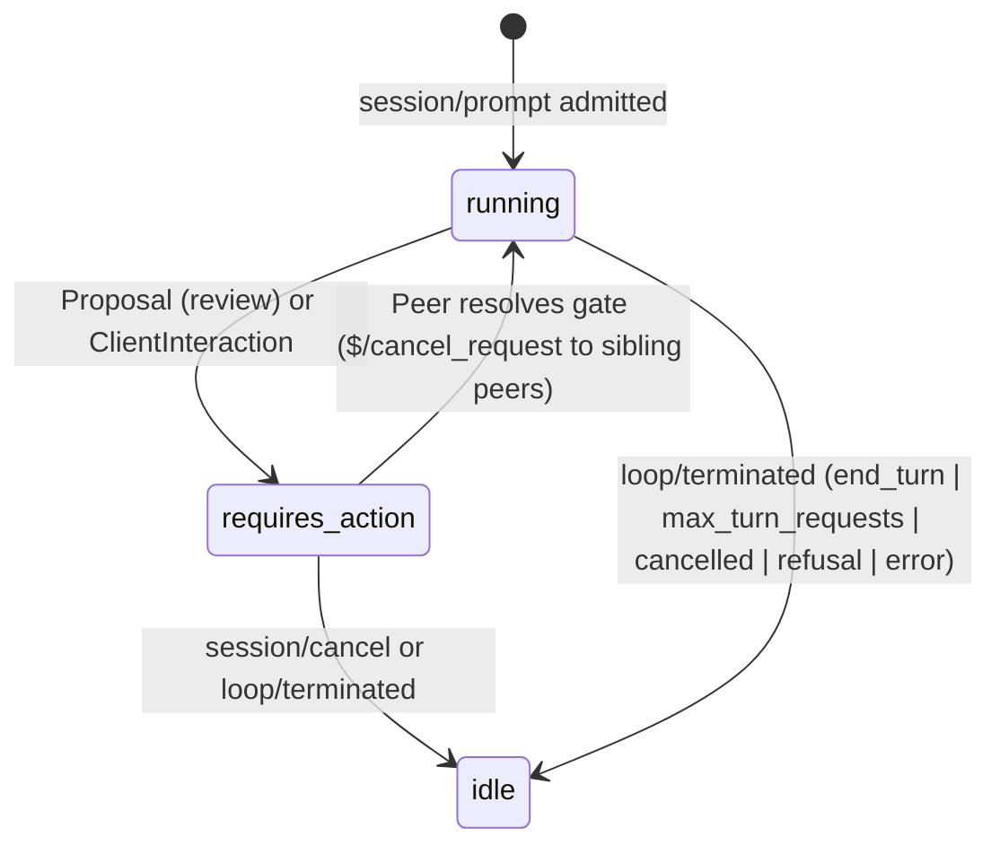

# @plurnk/plurnk-acp — ACP v2 Server Module Specification

The module is the daemon's Standard ACP v2 (`@agentclientprotocol/sdk/experimental/v2/unstable`) server interface. It consumes `ApplicationPort` ({§application-session-observation}) and mounts `/acp` on the daemon's listener via `AcpServer` (`@agentclientprotocol/sdk/experimental/server`), serving Streamable HTTP and WebSocket JSON-RPC 2.0 connections alongside HTTP entry and history resources under one OAuth 2.1 perimeter.

## §acp-daemon-client 1. Architecture, Client Types, and Session Binding

- **Daemon module (`@plurnk/plurnk-acp/module`):** Composed statically by `@plurnk/plurnk-service` ({§module-lifecycle}), claims only `/acp` on the shared HTTP/WebSocket listener ({§http-host}), registers the `acp` `MessageScheme` in `setup`, and mounts `/acp` at `start` (answering `503 service-starting` before activation and `503 service-stopping` from `stop`). A daemon without a listener omits it.
- **Runtime-neutral client contract (`@plurnk/plurnk-acp/client`):** Exports runtime-neutral types for `_meta.plurnk` state and action outcomes, type-checked under DOM libraries without Node globals (`tsconfig.browser.json`, {§whitespace-contract}).
- **Standard ACP v2 authority:** `initialize` negotiates `protocolVersion: 2` (`PROTOCOL_VERSION`), reports `info.version` (`ApplicationPort.serviceVersion` when supplied, otherwise package `version`), and advertises `capabilities` (`session: { prompt: { image: {}, audio: {}, embeddedContext: {}, skill: { inline: {} } }, mcp: { acp: {} }, archive: {}, delete: {}, fork: {}, options: {}, status: {}, title: {}, additionalDirectories: {}, systemPrompt: {} }`, `auth: { status: {} }`, `providers: {}`).

| Binding surface | Contract |
|---|---|
| Qualified address (`<workspace>#<sessionName>`) | Positive safe decimal integer (`<workspaceId>`) or valid workspace name (`<workspaceName>`, {§execution-output-identity}) + `#` + native model-session name (`400 session-address-invalid` on leading-zero integer prefixes, out-of-range ID, or invalid name). |
| Workspace resolution | `session/new` attaches or creates the workspace for `cwd` (`AbsolutePath`) or `_meta.plurnk.workspace`; `session/resume` and `session/list` attach an existing workspace (`404 workspace-not-found` when absent). Concurrent first workspace acquisitions are serialized without caching failures. |
| Session admission options | `additionalDirectories` on `session/new` and `session/resume` register `<dir>/**` in `workspace.members.add`. `mcpServers` entries of `type: "acp"` (`isMcpServerAcp`) on `session/new`, `session/resume`, and `session/fork` bridge over `mcp/message` (`McpOverAcpCaller` + `McpOverAcpHttpBridge`) into `workspace.mcp.replace`. `systemPrompt` with `mode: "append"` (`text`, text `resource`, and `resource_link`) materializes at `session://<sessionName>/AGENTS.md` ({§packet-inject}). `configOptions` (`InitialSessionConfigOption[]`) on `session/new`, `session/resume`, and `session/fork` applies recognized, type-matching, allowed entries in list order before replay or response without emitting `config_option_update` on the requesting connection (emitting `config_option_update` on other connections bound to that session when `session/resume` changes stored options, rejecting malformed payloads or duplicate `configId` entries with `-32602`, and ignoring unknown, type-mismatched, or disallowed entries). Client-supplied `stdio`/`http` MCP servers and `systemPrompt` `mode: "override"` are rejected. |
| Session resolution | Resolves model-origin sessions only (`_plurnk` is never bound as a conversation session). `session/new` creates the session; `session/resume` attaches an existing session (unless `_meta.plurnk.create === true`, returning `404 session-not-found` when absent). Unqualified opaque `sessionId` values resolve through Core's `acp` external reference ({§session-external-reference}) or as a session name in the `cwd` workspace. Process-local bindings key on `(workspaceId, sessionId)`. |

## §acp-session-owner 2. Approval Ownership and Connection Lifetime

- **Workspace-scoped owner (`acp://operator`):** Shared across ACP sessions in the workspace. Control attachment (`session/new`, `session/prompt`, permission/elicitation responses, or `session/resume` with `_meta.plurnk.control !== false`) registers `acp://operator` with `interactive` (`_meta.plurnk.interactive ?? true`) and `tools` (`["request_approval", ...(_meta.plurnk.tools ?? (interactive ? ["question", "mcp_input_required"] : []))]`, {§machine-processes}), claims the bound session and its model descendants, and activates workspace Functionality when `_meta.plurnk.activate === true` or on `session/prompt` ({§methods}). Passive observation (`_meta.plurnk.control === false`, `session/list`, `/script`) claims and activates nothing.
- **Persistent observation & disconnect immunity:** Connections attached via `session/new`, `session/resume`, or `session/fork` receive live `session/update`, `session/request_permission`, and `elicitation/create` messages until `session/close` or disconnect. Each peer tracks `pendingGates` to avoid duplicate gate presentation. Closing a WebSocket/HTTP stream or calling `session/close` ends delivery only and never cancels admitted prompts, gate resolutions, or `/script` operations; only `session/cancel` (`ApplicationPort.cancelSession` / `cancelLoop`) or completion ends work.
- **Graceful shutdown:** `stop` refuses new requests with `503 service-stopping`; `close` closes `AcpServer` and all active streams after Core settlement ({§module-lifecycle}).

## §acp-body-reference 3. Bodies by Reference and Entry Route

- **Inline content and reference projection:** By default, a tool receipt carrying a non-empty `content` body projects to `tool_call_update` with inline `{ type: "content", content: { type: "text", text } }` content and a body-stripped `rawOutput` receipt (`content` and `lineAnchors`/`lineAnchorIdentity`/`lineNumberWidth` stripped when `_meta.plurnk.body` carries the entry route URL); file mutations with patches or `original` and `patched` include `{ type: "diff", changes, patch: { format: "git_patch", text } }` with `DiffChange` operations (`add`, `delete`, `modify`, `move`, `copy`); session-targeting operations (`work`, `fork`, and `session://<name>` `send`/`read`/`kill` targeting another session) include ACP v2 `SessionReference` `{ type: "session", sessionId: "<workspaceId>#<name>" }` preceded by `subagent_update` when first referenced. When a client negotiates `_meta.plurnk.bodies: "link"` (propagated onto `/messages` pagination links via `bodies=link`), settled tool receipts with `_meta.plurnk.body` replace inline text content with `{ type: "content", content: { type: "resource_link", name, uri, mimeType } }` (preserving any raster image channel lines), omit `patch` on settled `diff` items, and omit base64 `output` on settled `terminal_update` items. `user_message_chunk` and `agent_message_chunk` always carry inline `{ type: "text", text }` content alongside `_meta.plurnk.body` (`{ url, mimeType }`); `agent_thought_chunk` carries inline text by default and during live `reasoning/event` streaming, and under `_meta.plurnk.reasoning: "link"` (`reasoning=link` on `/messages`) projects settled/replayed reasoning and `reasoning/event` `end` notifications as `{ type: "resource_link", name, uri, mimeType: "text/plain" }` alongside `_meta.plurnk.body`.
- **Entry route (`GET`/`HEAD <origin>/acp/<workspaceId>/<sessionId>/entry?target=<address>[&channel=<ch>&offset=<n>&access_token=<token>]`):** Protected by {§acp-http-authorization} (accepting `Authorization: Bearer <token>` or `?access_token=<token>` on `GET` and `HEAD`); answers the selected channel ({§methods}) with `cache-control: no-store` and `content-length` (`HEAD` omits the body) — textual channels (`!MimetypeClassifier.isBinary`) stream UTF-8 bytes as `content-type: <mimetype>; charset=utf-8`, whereas binary channels (`MimetypeClassifier.isBinary`) decode base64 channel content and stream raw binary bytes as `content-type: <mimetype>` without `; charset=utf-8` (`400 entry-target-required` if `target` is missing; `400 entry-query-invalid` if parameters are invalid).

## §acp-plurnk-metadata 4. Standard ACP v2 Event Projection

Every daemon log entry and runtime notification projects to standard ACP v2 `SessionUpdate` variants on `session/update`, carrying Plurnk provenance in `_meta.plurnk` (`sessionId`, `sessionName`, `loopId`, `loopSeq`, `turnId`, `turnSeq`, `coordinate`, `addressOf(op, attrs)`, and body-stripped `attrs` on row updates; `{ status, budget, workspace, providers }` on `usage_update` and session responses; `{ terminal }` with physical-request accounting on idle `state_update`; `{ problem }` on `RequestError.data`):

| Daemon source | Standard ACP v2 `SessionUpdate` |
|---|---|
| `session/new`, `session/resume`, `session/fork` | Response carrying `configOptions` (`model`, `thought_level`, `spawn_model`, `persona`, `mode`, `<family>:<alias>`), `availableCommands`, and `_meta.plurnk`; `session/resume` emits current `state_update` (`idle` [without `stopReason`] \| `running` \| `requires_action`) and `usage_update` before returning. |
| `log/entry` arrival (`_plurnk` `send`, `kind=message`) | `user_message_chunk` under sender's `messageId` (or coordinate when external) with `_meta.plurnk` (including `voice` when the sender is a named `acp://<principal>/...` principal or `session://<workerName>` session). Live `session/prompt` admission updates `_meta.plurnk.status.inbox` without emitting a pre-publication `user_message_chunk`, so each prompt emits one `user_message_chunk` upon publication. |
| `log/entry` `wait` (model) | With body: `agent_message_chunk` carrying the body and receipt in `_meta.plurnk`; bodiless: `tool_call_update` (`kind: "other"`). |
| Successful `send`, `done`, or `fail` replying to this session | Optional `agent_thought_chunk`, then `agent_message_chunk` with `_meta.plurnk` (including `inReplyTo`, `repliedToMessageIds`, `receipt.repliedTo`, `receipt.repliedToMessageIds`, `receipt.repliedToSources`, and `voice` when replying to a named principal or worker session). Named non-operator principal peers (`peer.subject` other than `operator` / `anonymous`) receive only `user_message_chunk` and `agent_message_chunk` whose `_meta.plurnk.voice === peer.subject`, and receive `state_update` governed by `ApplicationPort.readOpenMessages` ({§methods}): `state: "running"` when submitting `session/prompt` or inspecting via `session/resume` / `session/status` while an open message from that principal remains in `readOpenMessages`; `state: "idle"` without `stopReason` when resuming / inspecting with no open message, or with `stopReason: "end_turn" \| "max_turn_requests" \| "cancelled" \| "refusal"` when `done`, `fail`, `runtime/telemetry` `loop_status = 202` (after `send` + `wait`), or `loop/terminated` resolves their last open message in the session; `operator` peers observe all voices. |
| `log/entry` model operation (`read`, `edit`, `copy`, `move`, `kill`, `find`, `note`, `work`, `fork`, runtime tags, scheme calls) | Optional turn `agent_thought_chunk` (if durable `reasoning` was not already streamed live), then `tool_call_update` (`toolCallId: coordinate`, `kind` [`"think"` for `note`], `title`, `locations` [with 1-based `line` when scoped], `rawInput`, `rawOutput`, `content`, `status: "completed" \| "failed" \| "in_progress"`). Model operations carrying a non-empty trimmed `aside` other than `fact`, `idea`, or `plan` (case-insensitive) project onto loop-scoped `plan_update` (`type: "items"`, `planId: "plan"`, `priority: "medium"`, `status: "in_progress" \| "completed" \| "cancelled"`), updating `status` when an active stream or proposal settles within the turn and discarding unresolved `"in_progress"` entries when the turn completes (`plan_update` over remaining entries, or `plan_removed` when empty). Internal `_plurnk` `ops://` emission `read`s and `entry_materialized` `edit`s are omitted. |
| Obligation-discharging `log/entry` / progress reply | `tool_call_update` updating the opening call's `toolCallId` to `status: "completed" \| "failed"` (`"failed"` on `fail`, `signal === 499`, or `rx.completion === 499`, including caller `'DOWN'` settlements under {§loop-completion}) with `_meta.plurnk.coordinate` naming the discharging row; intermediate progress replies emit `user_message_chunk`. |
| `log/entry` `error` row | Omitted when `attrs.retry === true` or `problem.type === "https://problems.plurnk.xyz/engine/rail/no-operation"`; `tool_call_update` (`status: "failed"`, `kind: "other"`, `rawInput: { text }`) when `origin === "model"` and `attrs.attempt.verb` is present; otherwise `notice` carrying `_meta.plurnk.notice` (`LogCoordinate`), with `severity: "warning"` on recoverable turn strikes (`origin === "model"`, `source === "rail"`, or `source === "provider"` `generation_failed` / `invalid_response`) and `severity: "error"` on terminal/parked `_plurnk` error rows. |
| `reasoning/event` | Live `agent_thought_chunk` deltas (`messageId: "model-call-<call>/request-<n>/reasoning"`) carrying inline text content and `_meta.plurnk: { sessionId, sessionName, loopId, loopSeq, turnId, turnSeq, coordinate, body: { url, mimeType } }` (matching replayed `agent_thought_chunk` metadata). No encrypted reasoning is emitted or stored ({§provider-interface}). |
| `stream/event` + `stream/concluded` (`exec:///sh/<id>`) | Opening `tool_call_update` includes `{ type: "terminal", terminalId }`; live stream events emit `terminal_update` (`terminalId`, `command`, `cwd`, `exitStatus`) and `terminal_output_chunk` (`terminalId`, base64 `data`, `_meta.plurnk.stream`). |
| `loop/packet` / `loop/terminated` / pre-loop refusal | `loop/packet` (and `session/prompt` admission) emits `usage_update` (`used`, `size`, `cost`, `_meta.plurnk`) + `state_update` (`state: "running"`). `loop/terminated` (or a pre-loop `runLoop` refusal) emits `usage_update` + `state_update` (`state: "idle"`, `stopReason: "end_turn" \| "max_turn_requests" \| "cancelled" \| "refusal" \| "error"`, `_meta.plurnk.terminal` with `usage.accounting` verbatim from {§provider-request-accounting}). |
| `functionality/changed` & `session/policy` | `functionality/changed` (`{ workspaceId, sessionId, family }`) rebuilds capability-filtered `availableCommands` (`available_commands_update` when `family` is `"skills"`, `"mcp"`, or `"personas"`) and refreshes `configOptions` (`config_option_update` across all bound sessions in `workspaceId` when `sessionId === null`, or matching `(workspaceId, sessionId)` otherwise). `session/policy` (`{ sessionId, model, spawnModel, persona }`) recomputes `configOptions` and emits `config_option_update` (`model`, `thought_level`, `spawn_model`, `persona`) to bound sessions matching `(workspaceId, sessionId)`. |
| `notice/event`, `runtime/telemetry`, `workspace/preparation`, `workspace/renamed`, and ambient rows | User-facing `notice/event` notifications carrying a non-empty `message` (and ambient `emissionAttempt` rows) emit standard ACP v2 `notice` (`severity: "info" \| "warning" \| "error"`, `title`, `description`, `_meta.plurnk`); `workspace/renamed` and `session/titled` emit standard `session_info_update` with `title`; internal PLURNK telemetry on `runtime/telemetry` (`engine:turn:turn_awaiting_model`, `turn_generated`, `results_pending`, `engine:lifecycle:loop_status`, `search_progress`) and `workspace/preparation` (plus workspace/inbox/descendant state updates) emit the ACP v2 custom `_plurnk_telemetry` `SessionUpdate` (`SessionUpdate.isCustom`, scoped to operator peers; `engine:emission` telemetry is suppressed). |

### §acp-status-descendants 4.1 Status, Gauge, and Provider Metadata

| Metadata path | Daemon source & projection contract |
|---|---|
| `_meta.plurnk.status.descendants` & `subagent_update` | Projected from `listSessions`, `pendingProposals`, and `pendingClientInteractions` as `subagent_update` (`sessionId: "<workspaceId>#<name>"`, `title`, `state: "running" \| "idle" \| "requires_action"`, `capabilities: { cancel: {} }`, `_meta.plurnk: { id, name, parentSessionId, kind, lifecycle, gates }`). |
| `_meta.plurnk.status.spend` & `usage_update.cost` | From `sessionAccounting({ workspaceId, sessionId })`: `cost: { amount: costUsd, currency: "USD" }` and `spend: { requests, usage, knownUsage, costUsd, knownCostUsd }`. |
| `_meta.plurnk.status.streams` | Active execution streams from `readStreams`. |
| `_meta.plurnk.status.claimedAt` / `terminatedAt` / `loopSeq` / `waitUntil` | Latest loop's timestamps, sequence `L` (`null` when `loopId` is `null`), and parked deadline (`null` when unparked) from `listSessionLoops`. |
| `_meta.plurnk.status.model` | Durable resolved model route from `readSessionModel`, mirrored in `model`/`spawn_model` `configOptions` and `config_option_update`. |
| `_meta.plurnk.budget` & `usage_update.used`/`size` | Verbatim from `sessionGauge`: `{ curationWeight, curationBudget, contextTokens, contextCapacity }`. |
| `_meta.plurnk.providers[*]` | From `listProviders().aliases[*]`: `{ alias, provider, model, effort, effortSource, active, inputCapacity }`, also exposed via `providers/list`. |
| `_meta.plurnk.workspace` | `{ id, name, projectRoot, projectLabel, preparation, activity }` from workspace preparation and derivation status. |

### §acp-event-translation 4.2 Event Seam Split and Live Policy Synchronization

`Module.start` subscribes to both `ApplicationPort` observation seams ({§application-session-observation}) and releases both unsubscribes in `Module.close`:

| Seam | Events consumed & ACP dispatch |
|---|---|
| `subscribeToEvents` (`DAEMON_NOTIFICATION_EVENTS`, `workspaceId !== null`) | Discrete state transitions: `log/entry`, `stream/concluded`, `loop/started`, `loop/parked`, `loop/terminated`, `loop/proposal`, `loop/interaction`, `loop/gate-settled`, `functionality/changed`, `session/policy`, user-facing `notice/event`, `workspace/renamed`, and `session/titled` (within the 18 discrete `DAEMON_NOTIFICATION_EVENTS`). |
| `subscribeToRuntimeStream` (`APPLICATION_RUNTIME_STREAM_EVENTS`) | In-process sub-turn streaming and telemetry: `reasoning/event`, `stream/event`, `loop/packet`, `workspace/preparation` (emitting `available_commands_update` once `preparation` settles empty), and `runtime/telemetry` (`_plurnk_telemetry`, parked `loop_status = 202` principal idle checks, and ancestor descendant/spend refreshes). |

## §acp-history-window 5. Replay and History Pagination

- **Inference-free `session/resume` replay:** When `replayFrom` is `{ type: "start" }`, holds live updates and gate dispatches on the bound session until replay finishes, replays all retained conversation history visible to `peer.subject` (or, when windowed pagination is opted into via `_meta.plurnk.window === true` or explicit `_meta.plurnk.historyLoops` / `historyPageChars`, queries `ApplicationPort.readLog` bounded to the newest `PLURNK_ACP_HISTORY_LOOPS` loops and `PLURNK_ACP_HISTORY_PAGE_CHARS` characters, dropping older loops when multiple loops exceed the ceiling and trimming older turns within a single oversized loop after its opening prompt while setting `history.older` to `?loop=<sequence>`) as exact live-ordered `session/update` notifications (pairing obligation discharges and stream conclusions after their opening calls, and appending unobserved inbox messages visible to `peer.subject` with `_meta.plurnk.published: false`), emits `{ sessionUpdate: "replay_complete" }` (even when history is empty), flushes any held live updates, and then emits current `usage_update`, `state_update`, and pending gates; when `replayFrom` is omitted or `null`, skips history replay and `replay_complete` and emits current state and pending gates only (rejecting unsupported `replayFrom` cursors with `-32602`). `_meta.plurnk.history` carries `{ older?, newer? }` pagination URLs when preceding or following loops (or trimmed intra-loop turns) exist.
- **History pagination routes (`GET <origin>/acp/<workspaceId>/<sessionId>/messages`):** Protected by {§acp-http-authorization} and scoped to the caller's authenticated `subject` (named principals observe only their own `user_message_chunk` and `agent_message_chunk` entries), answering `application/json` (`{ session, updates, history: { older?, newer? } }`):
  - `?session=<sessionId>&before=<loopSeq>` / `?session=<sessionId>&after=<loopSeq>`: Replays up to `PLURNK_ACP_HISTORY_LOOPS` loops preceding or following `<loopSeq>` bounded by `PLURNK_ACP_HISTORY_PAGE_CHARS` (defaulting `session` to `<workspaceId>#session1` when omitted).
  - `?session=<sessionId>&loop=<sequence>`: Returns that loop's complete `updates` array without character-ceiling truncation.

## §acp-overview 6. Session Directory and Client Conformance

- **Side-effect-free `session/list`:** Calls `readSessionOverview`, `listWorkspaces`, and (for archived sessions) `listSessions` without binding/creating a workspace or session, claiming ownership, or running inference (`400 overview-invalid` on invalid `archived` filter or `_meta.plurnk.workspaceId`, `workspaceName`, `limit`, or `excerptChars`; `404 workspace-not-found` on unknown workspace). Supports `archived: "exclude" | "include" | "only"` (default `"exclude"`). Returns `SessionInfo[]` (`{ sessionId: "<workspaceId>#<name>", cwd, additionalDirectories, title, updatedAt, archived, _meta: { plurnk: { workspaceId, workspaceName, id, sessionId, name, sessionName, parentSessionId, kind, lifecycle, gates, archived, title?, projectRoot, projectLabel, reply } } }`) bounded by `PLURNK_ACP_OVERVIEW_SESSIONS` (or `_meta.plurnk.limit`) with `reply` excerpts bounded to `PLURNK_ACP_EXCERPT_CHARS` (or `_meta.plurnk.excerptChars`) and linked to the entry route (`body: { url, mimeType: "text/plain" }`), alongside top-level `_meta.plurnk: { scope, workspaces, omitted, recent?, recentOmitted? }`.
- **Session lifecycle, options, status, titling, and cancellation (`session/archive`, `session/unarchive`, `session/delete`, `session/options`, `session/status`, `session/set_title`, `tool_call/cancel`, `terminal/cancel`, `auth/status`, `auth/logout`):** `session/archive` cancels any active work on the session and its descendants, closes open bindings, and marks the subtree archived (`setSessionArchived(archived: true)`); `session/unarchive` clears the archive mark (`setSessionArchived(archived: false)`) without loading the session into memory; `session/delete` cancels active work and permanently removes the session and its descendant subtree (`deleteSession`). `session/options` returns initial `configOptions` and `availableCommands` for `cwd` when `sessionId` is omitted or `null`, or the stored session's `configOptions` and `availableCommands` when `sessionId` is provided, without creating, resuming, or mutating a workspace or session or emitting `session/update` (`-32602` on non-absolute `cwd` or `additionalDirectories`; `-32002` on unknown `sessionId`). `session/status` returns `{ status: "open", state }` when bound in memory or `{ status: "saved" }` when persisted only (`-32002` when unknown). `session/set_title` stores a trimmed non-empty title (`setSessionTitle`) and emits `session_info_update`. `tool_call/cancel` and `terminal/cancel` cancel active proposals, interactions, streams (`cancelStream`), or child sessions (`cancelSession`), emitting `capabilities: { cancel: null }` on settlement (`-32602` when unknown or already final). `auth/status` reports `state: "authenticated" | "unauthenticated"` and configured provider/alias `accounts`, environment mutations emit `auth/status_update` when the snapshot changes, and `auth/logout` revokes the caller's OAuth 2.1 credential family when present (`revokeFamily`).

### §acp-first-party-client-conformance 6.1 First-Party and Stock Client Conformance

The integration gate runs a stock `@agentclientprotocol/sdk` v2 `ClientApp` over both `createWebSocketStream` and `createHttpStream` against the daemon (`initialize`, `auth/status`, `auth/logout`, `session/new`, `session/resume`, `session/fork`, `session/list`, `session/archive`, `session/unarchive`, `session/delete`, `session/options`, `session/status`, `session/set_title`, `session/close`, `session/prompt`, `session/cancel`, `session/set_config_option`, `tool_call/cancel`, `terminal/cancel`, `providers/list`, `session/request_permission`, `elicitation/create`, and all `SessionUpdate` variants), and the platform drill verifies both `PLURNK_CLIENT_CHECKOUT` (`../plurnk`) and `PLURNK_WEB_CHECKOUT` (`../plurnk-web`) against the packed candidate service.

## §acp-proposal-resolve 7. Human-in-the-Loop: Permissions and Elicitations

When a bound session (or observed descendant owned by `acp://operator`) pauses on a `ProposalProjection` (`disposition: "review"`; `accept`/`reject` are settled automatically by Core) or `ClientInteractionProjection`, the module emits `state_update: { state: "requires_action" }` and sends the gate to every peer observing the owning session:

- **Proposals (`session/request_permission`):** For a proposal on the bound session, emits a preceding `tool_call_update` (`status: "pending"`, `toolCallId: proposal.coordinate`) before `session/request_permission` (delegated descendant proposals emit `subagent_update` with `state: { state: "requires_action" }` before `session/request_permission` without emitting a child `tool_call_update` onto the parent stream). `sh` proposals use `subject: { type: "command", command, cwd, toolCallId: proposal.coordinate, terminalId }`; file/scheme/MCP proposals use `subject: { type: "tool_call", toolCall }` (`toolCall.toolCallId === proposal.coordinate`); `options` are `allow_once`, `allow_always`, `reject_once`, `reject_always` (`optionId === kind`); `_meta.plurnk.proposal` holds the projection. Selecting an option calls `ApplicationPort.resolveProposal(logEntryId, { decision, scope, outcome, ...(body !== undefined ? { body } : {}) }, owner)` (`allow_always`/`reject_always` pass `scope: "always"`, and `_meta.plurnk.body` on `allow_once`/`allow_always` forwards an operator-edited proposal body); `cancelled` cancels the proposal.
- **Client interactions (`elicitation/create`):** Question/form interactions use `mode: "form"` (`elicitationId`, `scope: "session"`, `sessionId`, `toolCallId`, `message`, `requestedSchema`); OAuth consent URLs (including `workspace.mcp.oauth.begin`) use `mode: "url"` (`url`). Answering or completing via `workspace.mcp.oauth.complete` calls `resolveClientInteraction` (when runtime-initiated) and emits `elicitation/complete` (`{ elicitationId }`).
- **Cross-peer & external cancellation (`loop/gate-settled`):** Settling a gate via ACP or externally through `ApplicationPort.resolveProposal` / `resolveClientInteraction` (`loop/gate-settled`) sends JSON-RPC `$/cancel_request` for that request ID to all peers where the gate was in flight; external `kind === "interaction"` settlements (`accept` \| `decline` \| `cancel`) also emit `state_update: { state: "running" }` (when no other gate remains open on the session), `elicitation/complete` (`{ elicitationId }`), and terminal `tool_call_update` (`status: "completed" \| "failed"`, `capabilities: { cancel: null }`) without duplicating updates when settled by an ACP peer (`409 interrupt-not-pending` responses settle idempotently without emitting a duplicate error notice). Terminating a loop (`loop/terminated`) cancels all held gates for that session across connected peers. Prompts submitted via `session/prompt` while a gate is pending are durably queued in Core's inbox before re-presenting the gate. Invalid or stale gate resolutions fail at Core's boundary (`400 interrupt-invalid`, `400 interrupt-duplicate`, `400 session-scope-invalid`, `409 interrupt-not-pending`, `403 proposal-not-owned`).

## §acp-action-binding 8. Configuration Options, Commands, and Module Actions

| Surface | Contract |
|---|---|
| `session/set_config_option` & `providers/list` | Advertises and updates `model`, `spawn_model` (`readSessionModel`/`setSessionModel`/`setSessionSpawnModel`, {§alias-parse}; `model` and `spawn_model` options list declared operator aliases plus the session's active `model`/`spawnModel` route, defaulting `model.currentValue` to `"none"` with a `"none"` option when unselected and `spawn_model.currentValue` to `"inherit"`, while `session/set_config_option` and initial `configOptions` accept any declared alias or ready `<provider>/<model>` catalog selector), `thought_level` (`readSessionEffort`/`setSessionEffort`), `mode` (`review` \| `accept` \| `reject`, `readSessionProposalPolicy`/`setSessionProposalPolicy`), `persona` (`category: "_persona"`, `"none"` \| discovered `<name>` from `listPersonas` and `session.persona`, {§persona-discovery}; selecting `<name>` calls `setSessionPersona` to bind `sessions.persona` and apply optional `persona.model`/`persona.effort` defaults when not explicitly set, while `"none"` clears `sessions.persona` without mutating `session://<sessionName>/AGENTS.md`), and `<family>:<alias>` toggles (`mcp`, `skills`, `schedule`, `personas`), emitting `config_option_update` to attached peers. |
| `availableCommands`, `Command`, & `SkillReference` prompt blocks | Advertises built-in slash commands (`type: "command"`, `/mcp`, `/skills`, `/personas`, `/members`, `/env`, `/schedule`, `/learn`, `/rollback`, `/share`, `/script`, `/update`), active workspace MCP prompts (`type: "command"`, `<server>:<prompt>`), and — when the client advertises `capabilities.session.commands.skill` in `initialize` — enabled workspace Agent Skills (`type: "skill"`, `<alias>` or `skill:<alias>` on collision, with `path` set to `provenance.source` when backed by an absolute local file path), emitting capability-filtered `available_commands_update` per peer on mutation or preparation settlement. On `session/prompt`, a `Command` block (`{ type: "command", name, input }`) or leading `/<command>` dispatches built-in commands directly, expands `/learn [--scope project\|plurnk] [instructions]` according to workspace folder availability, or resolves MCP prompts into `openPaths` (`<server>:///prompts/<name>[?<query>]`), and inline `SkillReference` blocks (`{ type: "skill", name }`, advertised via `session.prompt.skill.inline`) resolve enabled workspace skills into `openPaths` (`skill://<alias>/SKILL.md`) and `$<alias>` inline references (rejecting unknown, disabled, or unavailable skill names with `-32602`). |
| `_plurnk/action` (daemon scope) | Binds no workspace/session: `ping` (`{}`), `discover` (`{ schemaVersion: 1, actions, notifications, display }` from `listClientDisplayCapabilities()`), `models.list` (`limit` `1..100` matching `ModelCatalogQuery.json`), `service.update` (`/update`), `workspace.list` (omits archived unless `includeArchived: true`), `workspace.create`. |
| `_plurnk/action` (workspace/session scope) | Attaches workspace without creating a model session: `workspace.attach`, `workspace.rename`, `workspace.archive` (`setWorkspaceArchived`, defaulting `archived` to `true`, returning `{ id, archivedAt }`), `workspace.sessions` (omits archived unless `includeArchived: true` or explicit `archived: true`), `session.loops` (`{ id, sequence, lifecycle, source, opening, continued }` with `opening` bounded to `PLURNK_ACP_EXCERPT_CHARS`), `log.read`, `entry.read`, `workspace.prompts`, `workspace.share` (`/share`), `session.rollback` (`/rollback`, `scope: "session"`, `RollbackReport`), `op.exec` (`/script`, parsed via `parseStatements` and executed in `_plurnk` without permission prompts, settling after non-detached streams conclude, or returning a `400 https://problems.plurnk.xyz/acp/parse-failed` `OperationResult`), and extension actions (`workspace.mcp.*`, `workspace.skills.*`, `workspace.personas.*`, `workspace.members.*`, `workspace.env.*`, `session.env.*`, `workspace.schedule.*` from `listModuleActions()`). |
| Action validation | Colliding extension action names fail startup; unknown actions, schema failures, and unexpected handler throws fail with `Action '<name>' is not registered. Recovery: Use an action advertised by discover.`, `Action '<name>' rejected parameters. <schema path>: <reason>.`, and `500 action-failed` (`The action failed unexpectedly.`). |

## §acp-topology-scope 9. Topology Scope and Subagents

A session observes its bound session and, when `_meta.plurnk.descendants !== false`, its delegated subagent tree (sibling sessions never leak across {§actor-boundary}). Delegated child updates are serialized per workspace, carry `session://<name>#L/T/S` coordinates and `_meta.plurnk.subagentRunId` (`ops://<session>/<loop>`), emit `subagent_update` before any child `session_message` / `session_message_chunk` (`senderSessionId`, `recipientSessionId`), gate, or terminal state update, and never settle the parent session's `session/prompt`.

## §acp-http-authorization 10. Event Fan, Configuration, and HTTP Boundary

- **Event fan, SSE open flush & input:** One `subscribeToEvents` subscription and one `subscribeToRuntimeStream` subscription ({§acp-event-translation}) fan out to all attached connections. Opening `GET /acp` (`text/event-stream`) sets `X-Accel-Buffering: no`, flushes headers, and immediately writes an initial `: heartbeat\n\n` SSE comment before awaiting outbound messages. `session/prompt` requires non-empty text or attachment content (`400 user-message-text-required`); `resource_link` blocks become read targets (a `file:` URI as its host path), while embedded `resource`, `image`, and `audio` blocks become attachments named by their URI's last decoded path segment (`resource`, `image`, or `audio` when the URI has none) with the whole URI kept as `target`. It passes `messageId` as Core's idempotency key (`422 message-address-reused` on conflicting reuse), addresses the causal sender as `acp://<subject>/sessions/<sessionId>/messages/<messageId>` (where `<subject>` is the authenticated credential subject, defaulting to `operator`), returns `{ messageId, _meta: { plurnk: { workspaceId, sessionId, loopId, resource, workspace } } }` where `resource` is the message's `message://<session>/<key>` address, and tracks unobserved messages in `_meta.plurnk.status.inbox` (`{ path, id, loopId, lifecycle, body: { url, mimeType } }`).
- **OAuth perimeter, public origin & revocation:** Advertised HTTP entry and history URLs (`_meta.plurnk.body.url`, `history.{older,newer}`) resolve `<origin>` from an explicit configured `credentials.face()?.issuer(req)` origin (`PLURNK_AUTH_ISSUER`, {§auth-oauth}) when set, else `https://<host>` when `X-Forwarded-Proto: https` arrives over a loopback listener socket (`127.0.0.1` / `::1`), else `http://<host>` ({§http-host}). Under `port.credentials.face() !== null`, every non-preflight HTTP request and WebSocket upgrade on `/acp*` requires `Authorization: Bearer <token>` (or `?access_token=<token>` on WebSocket `/acp` upgrades and `GET`/`HEAD /acp/<workspaceId>/<sessionId>/entry`) with scope `acp` (`401 bearer-token-required` with `WWW-Authenticate: Bearer` when missing; `401 bearer-token-invalid` / `401 bearer-token-revoked` with `error="invalid_token"` when invalid/expired/revoked; `403 bearer-scope-insufficient` with `error="insufficient_scope"` when lacking `acp`). Revoking a token family closes active streams admitted under that family with `401 credential-revoked` without cancelling running loops. Under `PLURNK_AUTH=0`, all requests are admitted as `acp://operator`.
- **CORS & Problem Details:** When `PLURNK_ACP_ALLOW_ORIGIN` is non-empty, responses set `access-control-allow-origin`, `access-control-allow-headers: content-type, authorization, acp-connection-id, acp-session-id`, and `access-control-expose-headers: acp-connection-id, acp-session-id`, and `OPTIONS /acp*` answers `204` before auth. HTTP errors return `application/problem+json` and JSON-RPC errors carry the RFC 9457 Problem in `error.data.problem`:

| Problem code (`https://problems.plurnk.xyz/acp/<code>`) | Status | Trigger & recovery contract |
|---|---|---|
| `bearer-token-required` / `bearer-token-invalid` / `bearer-token-revoked` / `credential-revoked` | 401 | Missing, malformed, expired, or revoked OAuth 2.1 access token (`WWW-Authenticate: Bearer`) |
| `bearer-scope-insufficient` / `proposal-not-owned` / `operator-required` | 403 | Token lacks `acp` scope, proposal belongs to another owner, or non-operator principal invoked an operator-only daemon action |
| `invalid-json` / `invalid-json-rpc` / `parse-failed` | 400 | Malformed JSON body, JSON-RPC envelope, or `/script` (`op.exec`) statement syntax |
| `session-address-invalid` / `invalid-session-metadata` / `session-scope-invalid` | 400 | Invalid `<workspaceId>#<sessionName>`, `_meta.plurnk` payload, or session scope |
| `user-message-text-required` / `entry-target-required` / `entry-query-invalid` / `overview-invalid` | 400 | Missing or invalid prompt content, entry route query parameter, or overview filter |
| `route-not-found` / `session-not-found` | 404 | Unknown HTTP subroute or session address |
| `interrupt-invalid` / `interrupt-duplicate` / `interrupt-not-pending` | 400 / 409 | Malformed, duplicate, or already-settled permission/elicitation resolution |
| `request-cancelled` | 499 | Request or stream cancelled by caller (`$/cancel_request` or `session/cancel`) |
| `overview-read-failed` / `request-failed` / `action-failed` | 500 | Unexpected internal failure while reading overview or executing request/action |
| `service-starting` / `service-stopping` | 503 | Request arrived before `start` completed or after `stop` began (`retryable: true`) |

| Environment key | Default | Accepted value | Effect |
|---|---|---|---|
| `PLURNK_ACP_ALLOW_ORIGIN` | `*` | Empty, `*`, or one origin | CORS `access-control-allow-origin` header. |
| `PLURNK_ACP_MAX_TURNS` | empty | Empty, `-1`, or non-negative safe integer | Default `maxTurns` passed to `runLoop` when omitted on `session/prompt`. |
| `PLURNK_ACP_HEARTBEAT_MS` | `15000` | Safe integer `0..2147483647` | Transport keepalive cadence in milliseconds (`0` disables). |
| `PLURNK_ACP_HISTORY_LOOPS` | `2` | Positive safe integer | Newest loops included in a `session/resume` replay window ({§acp-history-window}). |
| `PLURNK_ACP_HISTORY_PAGE_CHARS` | `200000` | Positive safe integer | Character ceiling per replay window or history page ({§acp-history-window}). |
| `PLURNK_ACP_EXCERPT_CHARS` | `240` | Positive safe integer | Maximum excerpt length in `session.loops` ({§acp-action-binding}) and `session/list` ({§acp-overview}). |
| `PLURNK_ACP_OVERVIEW_SESSIONS` | `200` | Positive safe integer | Maximum non-gated sessions returned in `session/list` ({§acp-overview}). |
