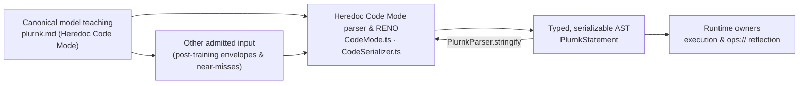
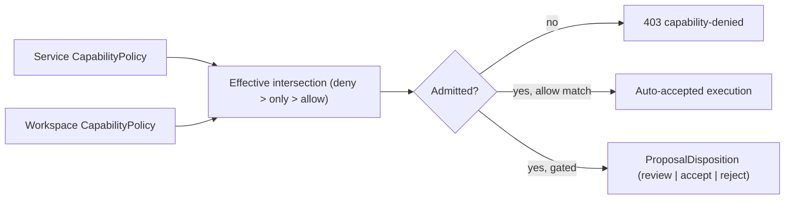

# PLURNK Contracts Specification

## §contract-representations 1. Overview and schema representations

`@plurnk/plurnk-contracts` is the single authority for PLURNK's model-facing language specification, JSON Schemas (`schema/*.json`), generated TypeScript types, and runtime-neutral wire envelopes. `@plurnk/plurnk-parser` implements the language it specifies ({§parser-build}).

| Surface | Canonical export or artifact |
| --- | --- |
| AST, validators, Problems, results, Notices, text regions and extents | `@plurnk/plurnk-contracts` |
| Capability admission and approval ownership | `CapabilityPolicy`, `SessionOwner`, `ProposalPolicy`, `PROPOSAL_POLICIES` |
| Durable effort and model catalog discovery | `Effort`, `EFFORTS`, `ModelRoute`, `ModelCatalogQuery`, `ModelCatalogPage`, `ModelReadiness` |
| Stopped-world proposals and client interactions | `ProposalDisposition`, `ProposalProjection`, `ClientInteractionRequest`, `ClientInteractionProjection`, `ClientInteractionResolution` |
| Client capability presentation | `ClientDisplayCapabilities` |
| Daemon module application port (package dependency-direction seam) | `ApplicationPort`, from `@plurnk/plurnk-contracts/port` |
| Workspace MCP and Agent Skills definitions | `McpServerDefinition`, `McpOAuth`, `SkillDefinition` |
| Session Functionality lifecycle projections | `FunctionalityProvenance`, `FunctionalityCandidate`, `FunctionalityDiscoverQuery`, `FunctionalityDiscoverResult`, `FunctionalityDefinitionState`, `FunctionalityListResult`, `FunctionalityMutationResult` |
| ACP discovery manifest | `AcpDiscovery` |
| JSON Schemas and JSON rendering | `@plurnk/plurnk-contracts/schema/*.json`, `renderJsonResult`, `formatJsonDocument` |
| Model language reference | `plurnk.md` in the package |



| Layer | Owner or artifact | Contract |
| --- | --- | --- |
| Stable current law | `SPEC.md` | Owns invariants and boundaries; forge issues retain history |
| Canonical model teaching | `plurnk.md` | Teaches the lean Heredoc Code Mode call syntax and operational model the model should emit |
| Accepted syntax & RENO | `CodeMode.ts`, `ChunkScanner.ts`, `CallExpressionParser.ts`, `OptionCoercion.ts`, `StatementLowering.ts`, `CodeSerializer.ts`, `NativeEnvelopes.ts`, `XmlEnvelopes.ts`, `HeredocSyntax.ts`, `MatcherSyntax.ts`, `ScopeSyntax.ts`, `TargetSyntax.ts` | Recognizes declarative `<service>.<tool>(args)` calls (and tolerated `await <service>.<tool>(args)`) with `<<<EOF` heredocs, normalizes deterministic post-training tool-call envelopes and argument near-misses on admission, and serializes canonical Heredoc Code Mode for `ops://` reflection |
| Typed admission | `PlurnkStatement` AST | Produces JSON-serializable unions and validates deterministic path/scope/matcher syntax |
| Shared wire data | `schema/*.json` | Defines runtime-neutral data shapes projected into generated TypeScript |
| Stateful behavior | consuming runtime | Resolves addresses, permissions, selection arithmetic, effects, and lifecycle |

- **Authoritative representations**: JSON Schema is authoritative for shared wire data shapes; TypeScript types are generated from `schema/*.json`; `@plurnk/plurnk-parser` is authoritative for accepted Heredoc Code Mode syntax and Reflective Emission Normalization (RENO).
- **ACP discovery and schema enforcement**: `AcpDiscovery` enumerates the installed ACP v2 actions (`scope`, `inputSchema`, `outputSchema`), notifications (`payloadSchema`), and `display` capabilities. Boundary validators enforce these schemas without mutating them and report structured validation `issues` in RFC 9457 Problem `detail`.
- **JSON result and document presentation**: `renderJsonResult` formats compact aggregate operation rows (placing top-level array items on individual lines without rewriting stored JSON coordinates). `formatJsonDocument` performs two-space whitespace-only formatting of complete strict JSON documents before representation storage.

### §capability-policy-cascade Capability admission, proposals, and model catalog



| Contract | Shape invariant | Runtime responsibility |
| --- | --- | --- |
| `CapabilityDescriptor` | One routed operation demand with its operation, access class (`read \| write \| exec \| network \| session \| interact`), resource/runtime/tool coordinates, and declared traits | Derive every demand before dispatch |
| `CapabilityPolicy` | Exact `allow`/`only`/`deny` selectors; omitted `only` is unrestricted, present empty `only` denies all, and `allow` pre-approves admitted proposals | Intersect service and workspace policies |
| `CapabilityProjection` | Durable `service`, client-mutable `workspace`, and normalized `effective` policies | Expose effective authority without storing session/loop policy copies |
| `ProposalPolicy` | `review`, `accept`, or `reject` (`PROPOSAL_POLICIES`) | Read the server's disposition knob at the proposal boundary |
| `ProposalDisposition` | Review, or automatic accept/reject with optional outcome | Select once for the pending gate |
| `ProposalProjection` | Identity, review target, body/attrs, owner, capability selector, ACP v2 subject, stale signal, disposition | One validated projection for live delivery and reconnect |

- **Exact selector conjunction**: A capability selector matches a `CapabilityDescriptor` when every declared field equals the descriptor and every declared `trait` occurs in the descriptor's trait set. Within a policy layer, `deny` wins over `only` and `allow`; when `only` is present, at least one selector must match. An empty policy admits everything; an empty `only` list admits nothing.
- **Subtractive cascade**: Capability admission is purely subtractive and order-independent: a descriptor is admitted only when every active layer (`service` and `workspace`) admits it. Workspace policy cannot restore authority denied by the service. A demand is pre-approved across layers only when it is admitted across every layer and matches at least one layer's `allow` selector. Log/program control (`plurnk.kill` on `log:///...`, native dispositions `wait`/`note`/`todo`, `done`, `fail`, and targetless `send`) creates no capability demand.
- **Proposals and session ownership**: `ProposalPolicy` (`review | accept | reject`) and `SessionOwner` (`address`, `clientTools`, `interactive`) govern stopped-world approval after capability admission succeeds.
- **Effort and model catalog wire**: `Effort` is `off | adaptive | low | medium | high | xhigh | max`. `ModelRoute`, `ModelCatalogPage`, and `ModelReadiness` expose provider/model identity, capabilities (including supported `efforts`), physical limits, and alternative required environment-variable name sets (names only, never values, credentials, or tuning internals).

### §provider-request-accounting Client interactions and provider request accounting

| Contract | Shape invariant |
| --- | --- |
| `ClientInteractionRequest` | Non-empty `toolName`, `mode: "form"` with non-empty `message` and object `requestedSchema`, or `mode: "url"` with non-empty `message`, non-empty `elicitationId`, and URI `url` |
| `ClientInteractionProjection` | Positive interaction, session, loop, and turn identities plus the exact request; workspace scope remains the containing transport envelope |
| `ClientInteractionResolution` | Exactly `{ action: "accept", content? }`, `{ action: "decline" }`, or `{ action: "cancel" }` |

| Projection | Complete total | Known subtotal |
| --- | --- | --- |
| Tokens (`ProviderUsage`) | Each `usage` field (`inputTokens`, `outputTokens`, `totalTokens`, cache and reasoning details) is present only if every request reports that quantity; `totalTokens === inputTokens + outputTokens` when all three are present | `knownUsage` sums each reported non-negative safe-integer field, omitting wholly unknown quantities without substituting zero for unknown |
| Monetary (`ProviderCost`) | `costUsd` is `null` if any request lacks USD-expressible cost (`charged` or `estimated` decimal string; `unknown` requires a `reason`) | `knownCostUsd` sums expressible USD costs as an exact decimal string, or is `null` when none are known |

- **Indivisible request accounting and evidence**: `ProviderRequestAccounting` binds one physical request's provider, model, outcome, optional protocol status, `ProviderUsage`, and `ProviderCost` in issue order across retries and capacity failover; a later response never replaces an earlier request. JSON-serializable forensic response/failure payloads travel alongside as separate evidence without entering client events.

---

## §operation-fences 2. Canonical Heredoc Code Mode statement form

```ts
plurnk.<op>({ ... }) // optional aside

<service>.<tool>({ ... })
```

- **Declarative top-level tool calls**: Every canonical Heredoc Code Mode statement is an unwrapped TypeScript/JavaScript `<service>.<tool>(args)` call (with leading `await` and trailing `;` tolerated on input and stripped in canonical serialization). `plurnk` is the built-in runtime service (`plurnk.read`, `plurnk.find`, `plurnk.edit`, `plurnk.copy`, `plurnk.move`, `plurnk.kill`, `plurnk.note`, `plurnk.todo`, `plurnk.work`, `plurnk.fork`, `plurnk.bare`, `plurnk.send`, `plurnk.done`, `plurnk.fail`, `plurnk.wait`, REPL tools `plurnk.sh`, `plurnk.js`, `plurnk.python3`, and Functionality tools `plurnk.env`, `plurnk.mcp`, `plurnk.members`, `plurnk.personas`, `plurnk.schedule`, `plurnk.skills`, `plurnk.question`). External MCP servers are peer top-level namespaces (`<service>.<tool>(args)`).
- **Bracket property access**: Non-identifier tool names use bracket notation (`gitea["issue-read"]({ ... })`).
- **No free JavaScript execution in the parser**: Top-level statements are parsed as declarative calls with literal arguments (`{ ... }`, `[ ... ]`, strings/backticks, `<<<EOF ... EOF` heredocs, numbers, booleans, `null`); variable declarations and control-flow constructs (`const`, `let`, `var`, `if`, `for`, `while`, `function`, `try`) invoking `plurnk` or tool calls are refused with a parser diagnostic directing JavaScript logic to `plurnk.js({ text: "..." })`, while unfenced general JavaScript snippets in model prose that do not invoke `plurnk`, a registered executor, or a literal-object tool call remain outside text.

### §fence-pairing Statement boundaries, RENO admission tolerances, and reflective rendering

| Rule | Contract |
| --- | --- |
| Balanced call boundaries & heredocs | A statement spans from its `<service>.<tool>(` head through its matching closing `)` and optional `;` and trailing `// aside` comment. In any value position, `<<<TAG\n...\nTAG` (where `TAG` matches `[A-Za-z][A-Za-z0-9_-]{0,16}`, optionally single- or double-quoted on the opener, or placed after `})` as a statement-trailing heredoc) captures raw unescaped text between its opener newline and closer line. Multi-line strings and template literals (`` `...` ``) preserve embedded newlines and treat unescaped `${...}` as literal text. |
| Markdown fence unwrapping & `await` tolerance | Heredoc Code Mode statements require neither a Markdown fence nor `await`; if a model prefixes `await` or wraps `plurnk.<op>(...)` or a registered `<service>.<tool>(...)` (or `await <service>.<tool>(...)`) inside a balanced `ts`, `js`, or plain Markdown code fence, the parser normalizes the statement silently under RENO. |
| Native and markup tool-call translation | Tool-call wrapper tags (`<tool_call>`, `<tool_calls>`, `<function_call>`, `<function_calls>`, `<｜DSML｜function_calls>`, `<｜｜DSML｜｜ function_calls>`, `<\|tool_call\|>`, `<｜tool▁calls▁begin｜>`, `<\|tool_calls_section_begin\|>`, `<\|python_tag\|>`, `[TOOL_CALLS]`) around Code Mode statements unwrap silently, and structured XML/DSML/token-delimited (`<function=...>`, `<invoke name="...">`, `<｜DSML｜invoke name="...">`, `<plurnk.<op> ... />`, `<｜tool▁call▁begin｜>`, `<\|tool_call_begin\|>`, `<\|tool_call\|>name`, `<\|channel\|>... to=name`) or JSON tool calls targeting `plurnk` operations or `<service>.<tool>` translate silently into canonical Heredoc Code Mode statements. |
| Case-insensitive method recovery | Uppercase or mixed-case method names (`plurnk.READ(...)`, `plurnk.SH(...)`) recover silently to their lowercase canonical tool name. |
| Reflective statement rendering | `PlurnkParser.stringify` formats AST statements back into canonical `plurnk.<op>({ ... })` or `<service>.<tool>({ ... })` Heredoc Code Mode statements for `emission` / `emission-history` (`assistant` turn) reflection, normalizing empty optional bodies to `null` and rendering every `pattern` field and any string value containing `\n` (as well as the Turn 0 `Resolve all Open Work.` todo seed) as an inline `<<<EOF\n...\nEOF` heredoc (stepping `EOF1`, `EOF2`, … when the string contains the delimiter). |

### §slot-order Argument shapes, target groups, and endpoint options

| Construct | Contract |
| --- | --- |
| Object and positional argument forms | Core operations accept their canonical `{ ... }` options object (`{ path, range?, pattern?, text?, ... }`) as well as concise positional string/array shorthands (`plurnk.read("a.ts")`, `plurnk.copy("a.ts", "b.ts")`, `plurnk.note("text")`). |
| Target groups and multi-target lists | `plurnk.read`, `plurnk.find`, and `plurnk.kill` accept `path` or `paths` as a string or array of strings; comma/pipe/whitespace-separated `scheme://` URI lists and comma/pipe-separated local path/glob lists outside brackets/braces expand into one statement per target in authored order. |
| `note` annotation on retrievals | Providing `note` on `plurnk.read` or `plurnk.find` emits a preceding `note` statement before the retrieval(s). |
| Endpoint and message options | `headers` (`Record<string, string>`) passes HTTP(S) request headers on `plurnk.read`, `plurnk.find`, `plurnk.edit`, `plurnk.send`, `plurnk.kill`, and `plurnk.copy`/`plurnk.move` (`fromHeaders`/`toHeaders`); `remote` (`boolean`) confirms remote HTTP `DELETE` on `plurnk.kill`; `attachments` (`string[]`) attaches resources to `plurnk.send`, `plurnk.done`, and `plurnk.fail`. Unknown option keys on `plurnk.<op>({ ... })` are refused with a parser diagnostic. |
| Operation aside | A trailing `// aside` comment after `;` or `)` on the closing line of a statement is captured into `aside` (`string` or `null`) as descriptive commentary, splitting before any glued transcript heading (`### log:///` or `**<service>: <label>**`). |

---

## §op-shapes 3. Per-operation semantics and dispositions

| Call | Target field | Scope / matcher / endpoint fields | Content / payload fields |
| --- | --- | --- | --- |
| `plurnk.find` | required `path` / `paths` | optional `range`, `pattern`, `headers` | optional `note` normalized to preceding `note` |
| `plurnk.read` | required `path` / `paths` | optional `range`, `pattern`, `headers` | optional `note` normalized to preceding `note` |
| `plurnk.edit` | required `path` | `range` or `pattern` or `oldText`/`newText` or `edits` for existing target; `text` alone creates; optional `headers` | `text` (or tolerated `content`, `replacement`, `newText`, `body`), or `edits` array |
| `plurnk.copy` / `plurnk.move` | required `from` and `to` | optional `fromRange` / `toRange`, `fromHeaders` / `toHeaders` | none |
| `plurnk.sh` / `plurnk.js` / `plurnk.python3` | optional `script`, `cwd` | none | `text` (or tolerated `code` / `command` / `cmd` / `body` / `source` / `prompt`), optional `args` |
| `plurnk.<functionality>` | tool name (`env`, `mcp`, `members`, `personas`, `schedule`, `skills`, `question`) | none | JSON arguments object |
| `<service>.<tool>` | external MCP `<service>` and `<tool>` | optional second `{ range }` options arg | JSON arguments object or string |
| `plurnk.bare` | none | none | required `text` (or tolerated `prompt` / `body` / `content` / `message`) |
| `plurnk.work` / `plurnk.fork` | optional `target` (`session://name`) | none | required `text` (or tolerated `prompt` / `body` / `content` / `message`) |
| `plurnk.kill` | required `path` / `paths` | optional `range`, `pattern`, `remote`, `headers` | optional `note` distillation on `log:///` |
| `plurnk.send` | optional `target` recipient (caller aliases `user`/`client`/`human`/`operator`/`caller` normalize to `null`) | optional `headers`, `attachments` | required `text` message body |
| `plurnk.done` | optional `target` (`message://`; caller aliases normalize to `null`) | optional `attachments` | optional `text` final deliverable (`plurnk.done()` / `plurnk.done({})` resolves silently when empty) |
| `plurnk.fail` | optional `target` (`message://`; caller aliases normalize to `null`) | optional `attachments` | optional `text` final failure explanation (`plurnk.fail()` / `plurnk.fail({})` cancels silently when empty) |
| `plurnk.note` | none | none | `text` distilled discoveries, derivations, and decisions |
| `plurnk.todo` | none | none | required `items` remaining step list (or tolerated `todos` / `text`) |
| `plurnk.wait` | none | optional `seconds` | none (uses trailing `// aside`; tolerated `text` normalizes to `aside`) |

- **Retrieval annotations**: Nonblank `note` options on `find` or `read` normalize into a preceding `note` statement.
- **Text range algebra**: `"N"` selects whole line `N` (`"0"` prepends, `"-1"` appends on mutation); `"N,M"` selects inclusive lines `N..M`; `"SL,SC,EL,EC"` selects an exact 1-based Unicode code-point region with exclusive end (three-integer ranges normalize to four).
- **Local path fragments**: Bare paths decompose `#channel` into `fragment` just like `scheme://` URLs so channel selectors round-trip identically.
- **Turn dispositions (`wait`, `done`, and `fail`)**: Dispositions may appear anywhere in a turn; multiple `wait` statements coalesce to the shortest `seconds` bound, and `done` (`200`) or `fail` (`499`) resolves an Open Message once all earlier operations in the turn settle.

---

## §path-syntax 4. Target and path grammar

- **URL vs. local path decomposition**: Targets matching `[a-z][a-z0-9+._-]*://` decompose via WHATWG `URL` into `UrlPath` (preserving lossless serialized `query` and `fragment`); all other targets become `LocalPath { kind: "local", raw, fragment? }`.
- **Parenthesis escaping**: An unescaped depth-zero `)` closes `(path)`; balanced parentheses are tolerated and `\\`, `\(`, `\)` provide lossless escaping via `PathSyntax`.
- **Glob classification and session names**: `PathSyntax.hasGlob` and `globMagicIndex` classify glob metacharacters vs. exact paths. `SESSION_NAME` (`[A-Za-z0-9][A-Za-z0-9_-]{0,62}`) validates minted session authority names (excluding `_plurnk`).

---

## §matcher-prefix-claims 5. Bulk pattern matching and scope markers

`plurnk.find`, `plurnk.read`, `plurnk.kill`, and `plurnk.edit` accept a `pattern` matcher classified by leading sigil (`glob` and `regex` may span multiple lines; `xpath`, `jsonpath`, `fts`, and `graph` are single-line):

| Prefix | Dialect | Validation & tolerance |
| --- | --- | --- |
| `//` | `xpath` | Validated with XPath 1.0 parser before regex classification (also silently normalizes single-slash absolute XPath location paths such as `/root/item[@id='old']/@id` or `/root/item/text()`, regex-wrapped or trailing-slash XPath selectors such as `///item[@id='old']/`, `//item[@id='old']/`, or `/\/\/item[@id='old']/`, and vacuous `/text()` after `@attr` steps) |
| `/` or `^` | `regex` | ECMAScript `RegExp`; tolerates `\|` alternation, trailing `-flags`, `/~.../` mixed prefix, unbalanced unescaped `(`, `)`, or `[`, and glob-shaped `/*text*/` |
| `$` | `jsonpath` | Validated with RFC 9535 `json-p3` |
| `~` | `fulltext` | Single-line FTS5 query string |
| `&` | `graph` | `&symbol`, `&<symbol`, or `&>symbol` relation query |
| none | `glob` | Fallback shell glob or single/multiline literal substring (`<<<EOF...EOF`) |

- **Soft matcher refusal**: An invalid matcher expression is admitted as `matcher.dialect = "unreadable"` with its diagnostic and working-form `recovery` so only that operation fails `400 grammar/matcher/unreadable-pattern` while sibling statements in the turn still execute.
- **Statement recovery and argument tolerances**: Statement errors recover at the next top-level call; an inline `<L,M>` range written inside `path<L,M>` is lifted silently; extra positional arguments beyond the operation's arity fail only that statement.
- **Line anchors and range recovery**: `TextLineMarker` accepts `@<5 Base62 chars>` line anchors (with optional `[+-]K` offsets or surrounding `<...>`) in line positions; reversed or count two-number ranges (`"M,N"` with `M > N`, `"N,+K"`) and unambiguous anchor forms (`"@hash,1"` as `"@hash"`, `"@hash,0"` as `"@hash,1,@hash,1"`, and `"@start,@end,SC[,EC]"` as `"@start,SC,@end[,EC]"`) normalize silently under RENO.

---

## §whitespace-contract 6. Parser architecture, whitespace, and public API

- **Statement scanning and outside text**: `PlurnkParser.parse` partitions a model turn into ordered `statement`, `error`, and outside `text` items (`emptyTurn` is `true` when no `statement` or `error` items are produced).
- **Tier entry points and runtime-neutral root**: `PlurnkParser.parse` (model turn), `PlurnkParser.parseStatements` (protocol statements), and `PlurnkParser.stringify` (canonical Code Mode rendering) are exported by `@plurnk/plurnk-parser`. The `@plurnk/plurnk-contracts` root is closed (verified by `src/index.test.ts`) and browser/DOM runtime-neutral (`tsconfig.browser.json`), with Node HTTP host types isolated in `@plurnk/plurnk-contracts/port`.

---

## §text-region 7. Runtime-neutral wire contracts, text regions, and entry reads

| Contract | Fields & Invariants |
| --- | --- |
| `TextRegion` | `{ startLine, startColumn, endLine, endColumn }` — 1-based positive safe integers counting Unicode code points (`LF`, `CRLF`, `CR` line separators; `CRLF` is one indivisible separator). `end` is exclusive; equal start and end identify a zero-length insertion point. Validated by `Validator.assertTextRegion`. |
| `RangeExtent` | `{ unit: "line" \| "result" \| "byte", total, requested: [first, last], returned?: [first, last] }` — `requested` preserves the numeric request; `returned` names inclusive positive ordered positions (`<= total`) and is omitted on empty or failed selections. Validated by `Validator.assertRangeExtent`. |
| `EntryReadResult` | `{ status: 200, entry: ClientEntry } \| { status: 400..599, problem: ProblemDetails, entry: null }` — `ClientEntry` carries `{ entryId: number \| null, target: string, channels: Record<string, ClientEntryChannel> }`. Every returned channel (`content`, `contentOffset`, `contentLength`, `mimetype`, `weight`, `state: "static" \| "active" \| "closed" \| "errored"`) satisfies `contentOffset + codePointLength(content) === contentLength`. |

### §diagnostic-observation Operation results, Problem Details, and Notices

| Envelope / Method | Contract |
| --- | --- |
| `OperationResult` | Status `100..399` forbids `problem`; status `400..599` requires one RFC 9457 `ProblemDetails` object whose `status` equals the containing operation status. |
| `ProblemDetails` | Requires `type` (stable absolute URI), `title` (stable summary with no occurrence data), `status`, and `detail` (failed subject, observed fact, and violated constraint); optional `instance`, `stage`, `recovery` (one working-form next action), `retryable`, and factual producer extensions. |
| `Problems.fromError(error)` | If `error.result` is present, validates the complete `OperationResult` and returns its `problem`; otherwise if `error.problem` is present, validates and returns `ProblemDetails` unchanged; otherwise returns `null`. |
| `Problems.project(problem, context)` | Produces `ProblemProjection` for model packets: retains `type` and `detail`, retains `stage`/`recovery`/`retryable`/extensions when not duplicated by the enclosing row, and strips `title`, `status`, and `instance`. |
| `Notice` | Transient, non-terminal observation (`level`, `source`, `kind`, `message`, optional `directive` starting with `YOU MUST` / `YOU MUST NOT` / `YOU MUST ONLY` / `YOU SHOULD` / `YOU SHOULD NOT` for model-output advisories). |

- **Diagnostic observation**: Every Problem `detail` and `recovery`, parse diagnostic, and `Notice` states what was read, what was done with it, and where, and may show the working form of the construct it read or refused — never guessing author intent or why.

### §mcp-server-definition Client display capabilities, MCP servers, and skills

- **`ClientDisplayCapabilities`**: Ordered array of closed discriminated objects (`{ kind: "scheme", scheme, display }` or `{ kind: "mimetype", mimetype, display }`), where `display.glyph` is an optional non-empty opaque string.
- **`McpServerDefinition` and `McpOAuth`**: Closed union of `stdio` (`command`, optional `args`, `env`, `cwd`, `plurnkWorkspace`, `plurnkSession`) and `streamable-http` (`url`, optional `headers`, `authorization`, `plurnkWorkspace`, `plurnkSession`) definitions. `McpOAuth` (`Validator.assertMcpOAuth`) validates interactive OAuth (`callbackUrl`, mutually exclusive HTTPS Client ID Metadata Document URL / pre-registered client ID + `${NAME}` secret / Dynamic Client Registration, optional `issuer` and `authorizationParams`) and `client_credentials` grants.
- **`SkillDefinition`**: Workspace skill definition (optional `source`, `ref`, `commit`; skill alias validated against `SKILL_NAME`) validated by `Validator.assertSkillDefinition`.

### §application-session-observation Daemon application port and session/loop observation

| Projection / Helper | Contract |
| --- | --- |
| `ApplicationPort` | Transport-neutral interface in `@plurnk/plurnk-contracts/port` driving workspaces, sessions, loops (`runLoop` with causal `source`, `attachments`, `envelope`), operations, proposals, client interactions, and filtered event subscriptions (`subscribeToEvents(handler, filter?)`). |
| `DaemonNotification` / `NotificationFilter` | Closed discriminated union over the 20 `DAEMON_NOTIFICATION_EVENTS` (`{ id, event, timestamp, workspaceId, sessionId, data }`), constructed by `toDaemonNotification` and filtered at source by `matchesNotificationFilter(notification, { events?, workspaceId?, sessionId? })`. |
| `admitBearerRequest` | Runtime-neutral OAuth 2.1 Bearer and optional `?access_token=` admission helper over `CredentialAuthority` returning `{ ok: true, family, subject }` or `{ ok: false, problem, challenge }`. |
| `selectSessionLoop` | Chooses `running` before `parked` before `queued` (oldest unresolved sequence wins ties); with no live work, the latest terminal settlement wins. Maintenance-only loops do not change this projection. |
| `lifecycleOfLoopStatus` | Maps loop status to client lifecycle vocabulary: no loop `idle`; `100` `queued`; `102` `running`; `202` `parked`; `< 400` `completed`; `499` `cancelled`; `>= 400` `failed` (`413` budget, `429` turn ceiling, `500` fail, `504` timeout, `508` runaway). |
| `excerptOf` | Extracts the first non-blank line of a message truncated to at most `N` code points without splitting a character, with trailing whitespace trimmed and `continued: boolean`. |
| `ApplicationSessionOverview` | Projects non-archived model-origin sessions (`{ workspaceId, id, name, parentSessionId, kind, lifecycle, gates, reply, title }`) ordered by most recently finished reply row first, then newest unreplied sessions, always including all gated sessions before applying `limit` and reporting `omitted`. |

---

## §parse-recovery 8. Reflective Emission Normalization (RENO), tolerances, and error shapes

`PlurnkParseError` is a JSON-serializable `Error` carrying `{ line, column, source: "lexer" | "parser" | "visitor", severity: "error" | "warning", recovery?, attempt?, operationOmitted }`:

| Representation | Line | Column | Absence or extent |
| --- | --- | --- | --- |
| Parser/AST `Position` | 1-based | 0-based Unicode code points | `UNKNOWN_POSITION = { line: 0, column: 0 }` is the sole unknown sentinel |
| Notice `content-offset` | 1-based | 0-based Unicode code points | Omit or set `position` to `null` when unknown |
| Contracts `TextRegion` | 1-based | 1-based Unicode code points | Start included, end excluded; equality is zero-width |
| SARIF 2.1.0 region | 1-based | 1-based (`columnKind: "unicodeCodePoints"`) | End excluded; parser point adapters add 1 to `column` |

| Mechanism | Contract |
| --- | --- |
| Working-form recovery & attempt | Every hard error (`severity: "error"`) populates `recovery` with the canonical Heredoc Code Mode syntax of the refused construct and `attempt` (`{ text, verb }`) with the refused statement's source text; `operationOmitted` marks unexecuted call fragments. Each malformed statement produces at most one hard error. |
| Regex and matcher tolerances | Lifts leading PCRE inline flags `(?ims)` with a warning; recognizes unslashed line-anchored regexes opening with `^` or closing with `$`; folds comma-separated `/pattern/` lists on `find` and `read` into alternation with a warning while refusing numeric/open sed ranges (`/a/,+N`, `/a/,-1`, `/a/,`) and mutating `/a/,/b/` ranges; diagnoses trailing text after `/pattern/flags`; recovers unclosed `/pattern` at EOL. |
| Statement & argument tolerances (RENO) | Lifts inline `<L,M>` ranges from `path<L,M>` strings with a warning; recovers bare `edit` anchors (`@abcde`), combined `42<@abcde>` ranges, trailing commas in range lists (`"17,18,"`), unbalanced angle brackets around `@hash` ranges (`"<@abcde,@fghij"`), anchor-first column tuples (`"@SL,@EL,SC[,EC]"`), and packet-header line counts (`"N lines"`); recovers extra or transposed delimiters on heredoc closers (`EOF)})`, `EOF)}`, `EOF)]`) and closing `}}` call braces; unwraps nested parameter wrappers (`params`, `parameters`, `arguments`, `args`, `input`, `options`, `properties`, `text`); transduces foreign native tool-call envelopes (`<tool_call>`, `<TOOLCALL>`, `<\|tool_call_start\|>`, `<\|python_tag\|>`, `[TOOL_CALLS]...[ARGS]`, `Action:` JSON fences, `<arg_key>`/`<arg_value>`, `<seed:think>`, `<mm:think>`); unwraps Markdown-fenced Code Mode statements and accepts redundant `await` prefixes silently; suppresses standalone `**<service>: <label>**` transcript-echo headings and trailing canonical duplicate statements in model emissions; and sets `unparsedTail` when an unclosed string, comment, parenthesis, bracket, or brace reaches end of input. |
