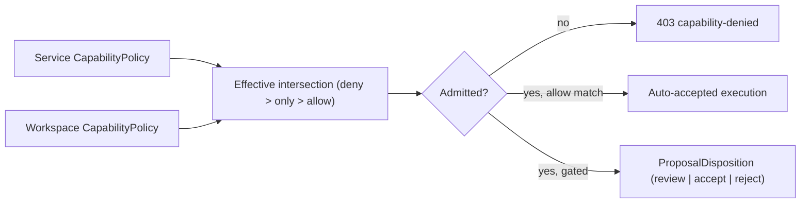

# PLURNK Contracts Specification

## §contract-representations 1. Overview and schema representations

`@plurnk/plurnk-contracts` is the single authority for PLURNK's model-facing language specification, JSON Schemas (`schema/*.json`), generated TypeScript types, and runtime-neutral wire envelopes. `@plurnk/plurnk-parser` implements the language it specifies ({§parser-build}).

| Surface | Canonical export or artifact |
| --- | --- |
| AST, validators, Problems, results, Notices, text regions and extents | `@plurnk/plurnk-contracts` |
| Capability admission and approval ownership | `CapabilityPolicy`, `SessionOwner`, `ProposalPolicy`, `PROPOSAL_POLICIES` |
| Durable effort and model catalog discovery | `Effort`, `EFFORTS`, `ModelRoute`, `ModelCatalogQuery`, `ModelCatalogPage`, `ModelReadiness` |
| Stopped-world proposals and client interactions | `ProposalDisposition`, `ProposalProjection`, `ClientInteractionRequest`, `ClientInteractionProjection`, `ClientInteractionResolution` |
| Client capability presentation | `ClientDisplayCapabilities` |
| Exterior adapter application calls | `ApplicationPort`, from `@plurnk/plurnk-contracts/port` |
| Workspace MCP and Agent Skills definitions | `McpServerDefinition`, `McpOAuth`, `SkillDefinition` |
| Session Functionality lifecycle projections | `FunctionalityProvenance`, `FunctionalityCandidate`, `FunctionalityDiscoverQuery`, `FunctionalityDiscoverResult`, `FunctionalityDefinitionState`, `FunctionalityListResult`, `FunctionalityMutationResult` |
| ACP discovery, client accounting, and conformance specimens | `AcpDiscovery`, `AcpClientConformance`, `AcpConformanceKit` |
| JSON Schemas and JSON rendering | `@plurnk/plurnk-contracts/schema/*.json`, `renderJsonResult`, `formatJsonDocument` |
| Model language reference | `plurnk.md` in the package |

- **Authoritative representations**: JSON Schema is authoritative for shared wire data shapes; TypeScript types are generated from `schema/*.json`; ANTLR grammars in `@plurnk/plurnk-parser` are authoritative for accepted model-language syntax.
- **ACP discovery and schema enforcement**: `AcpDiscovery` enumerates the installed ACP v2 actions (`scope`, `inputSchema`, `outputSchema`), notifications (`payloadSchema`), and `display` capabilities. Boundary validators enforce these schemas without mutating them and report structured validation `issues` in RFC 9457 Problem `detail`.
- **ACP client conformance and conformance kit**: `AcpClientConformance` accounts for every action and notification in `AcpDiscovery` as `native`, `generic`, or `unsupported` with verified evidence paths checked by `acpConformanceReport`. `AcpConformanceKit` provides the shared corpus of SSE framing and lifecycle sequences.
- **JSON result and document presentation**: `renderJsonResult` formats compact aggregate operation rows (placing top-level array items on individual lines without rewriting stored JSON coordinates). `formatJsonDocument` performs two-space whitespace-only formatting of complete strict JSON documents before representation storage.

### §capability-policy-cascade Capability admission, proposals, and model catalog



- **Exact selector conjunction**: A capability selector matches a `CapabilityDescriptor` when every declared field equals the descriptor and every declared `trait` is present in the descriptor's trait set. Within a policy layer, `deny` wins over `only` and `allow`; when `only` is present, at least one selector must match.
- **Subtractive cascade**: A descriptor is admitted only when every active layer (`service` and `workspace`) admits it. Workspace policy cannot widen service policy. `CapabilityProjection` exposes `service`, `workspace`, and normalized `effective` policies.
- **Proposals and session ownership**: `ProposalPolicy` (`review | accept | reject`) and `SessionOwner` (`address`, `clientTools`, `interactive`) govern stopped-world approval after capability admission succeeds.
- **Effort and model catalog wire**: `Effort` is `off | adaptive | low | medium | high | xhigh | max`. `ModelRoute`, `ModelCatalogPage`, and `ModelReadiness` expose provider/model identity, capabilities (including supported `efforts`), physical limits, and required environment-variable name sets without exposing credentials or tuning internals.

### §provider-request-accounting Client interactions and provider request accounting

- **Client-owned interaction wire**: `ClientInteractionRequest` (`mode: "form"` with `requestedSchema` or `mode: "url"` with `elicitationId` and `url`), `ClientInteractionProjection`, and `ClientInteractionResolution` (`accept | decline | cancel`) carry structured user elicitation without leaking upstream transport state.
- **Provider usage and cost**: `ProviderUsage` records non-negative safe integers (`inputTokens`, `outputTokens`, `totalTokens`, cache and reasoning details) without substituting zero for unknown fields. `ProviderCost` records `charged` or `estimated` decimal amounts (with optional USD equivalent) or `unknown` with a reason.
- **Indivisible request accounting and evidence**: `ProviderRequestAccounting` binds one physical request's provider, model, outcome, status, usage, and cost in issue order across retries and failover; forensic response/failure payloads travel alongside as separate evidence. `ProviderAccounting` derives complete totals (`usage`, `costUsd`) and partial subtotals (`knownUsage`, `knownCostUsd`) from `requests`.

---

## §operation-fences 2. Canonical statement form and operation fences

`````text
```OP (path)? <scope>? [metadata]? <!-- aside -->?
body
```

```executor (program-or-tool)?
input
```
`````

- **Backtick block boundaries**: Every canonical statement is a fenced block opened at column 0–3 by three or more backticks (`PLURNK_FENCE` is ``` ``` ```) followed on the same physical line by an operation keyword (`FIND`, `READ`, `EDIT`, `COPY`, `MOVE`, `SEND`, `BARE`, `WORK`, `FORK`, `KILL`, `NOTE`, `WAIT`) or a runtime executor name.
- **Fence width and nesting**: The parser accepts three or more backticks and renders three; a wider outer fence encloses narrower inner fences verbatim without dispatching them. A block closes at a line with at least the opening backtick count and only horizontal whitespace (or an optional closer aside), or falls back at the next outer operation heading or end of input.
- **Naked operation recovery**: A column-zero line outside any block containing only a native operation name and optional `<!-- aside -->` opens that operation with a warning-severity advisory naming three backticks as the taught form.

### §fence-pairing Fence pairing, quotations, and native tool calls

`FencePairing` runs ahead of the lexer as a least-cost bracket parse over all fence lines in the turn so nested code blocks, unclosed blocks, and quoted examples resolve globally:

| Rule | Contract |
| --- | --- |
| Complete vs. repaired readings | Complete nested interpretations take precedence over missing-closer repairs; among repaired readings, preserving authored operations outranks repair count. |
| Unclosed mutation yields | An `EDIT` body never swallows a same-width native operation heading; a missing closer is supplied before the next native heading so both operations run. |
| Prose code blocks and message run-on | Inside `SEND`, `WORK`, `FORK`, or `BARE` bodies, executor headings (` ```sh `, ` ```python3 `) are literal code blocks shown in the message, and an unclosed message body runs to the end of the turn. |
| Quotations and indented fences | A bare fence or non-operation info string opens an inert quotation block; fences indented by 4+ spaces or a tab are literal CommonMark indented code. |
| Near-miss tolerances | Inline chains on a closer line, transparent mid-heading closers, case-insensitive executor names, `js`/`ts`/`node` alias fallback, forgotten tag on the line below a bare fence, unclosed header asides, and `@<1-4 digits>` line anchors are recovered with deterministic advisories. |
| Native tool-call recovery | When a model emits provider-native tool-call markup (`<tool_call>`, `<function=...>`, JSON tool calls) instead of fenced operations, the parser recovers recognizable PLURNK operations or emits a warning receipt for unexecuted markup. |
| Statement rendering | `PlurnkParser.stringify` formats AST statements back into canonical three-backtick blocks (or wider when the body contains fences), normalizing empty optional bodies to `null`. |

### §slot-order Heading slot order, target groups, and metadata modifiers

Producers write `(target) <scope> [metadata] <!-- aside -->` separated by single ASCII spaces; ANTLR tolerates adjacent slots and scope/metadata permutations within a resource selection.

| Construct | Contract |
| --- | --- |
| Target groups (`READ` / `KILL`) | A `READ` or `KILL` heading may carry multiple `(path)` slots (or a comma/whitespace-separated list of explicit `scheme://` URIs inside one slot), compiling into one statement per target in authored order. |
| Scope on scopeless OPs | A `<scope>` written on `WORK`, `FORK`, `BARE`, `NOTE`, or targetless `SEND` is dropped with a warning advisory while the operation still runs. |
| Heading inline body & bare options | Trailing text on the heading line is read as the matcher on `FIND`/`READ`/`KILL` (and sigil-led `EDIT`), as `[{...}]` metadata when a bare JSON object appears on `SEND`/`WORK`/`FORK`/`BARE`, or as the first body line with a warning advisory. |
| Scheme metadata modifier | `[metadata]` preserves balanced brackets and quoted strings as raw inner text for the target scheme or executor (`MetadataOptions` parses first-party arrays of option objects and reserves `env`). |
| Operation aside | A trailing `<!-- aside -->` comment on the heading line is stripped into `aside` (`string` or `null`) as descriptive metadata. |

---

## §op-shapes 3. Per-operation semantics and dispositions

| OP | `(path)` | `<scope>` | `body` |
| --- | --- | --- | --- |
| `FIND` | required target or glob | optional result range | annotation normalized to `NOTE` |
| `READ` | required target (exact or glob fan-out) | optional text region | annotation normalized to `NOTE` |
| `EDIT` | required file or entry | required for existing target; omitted only for creation | literal replacement/creation text |
| `COPY` / `MOVE` | required source and destination | optional region after each path | empty (any body is ignored with a warning) |
| execution | fence name is runtime; optional `(program-or-tool)` | none (lifetime in `[metadata]`) | optional program/tool input |
| `BARE` | optional prompt resource | none | prompt text |
| `WORK` / `FORK` | optional `session://name` or prompt resource | none | task prompt |
| `KILL` | required target | optional text region | distillation `NOTE` on `log:///`; empty otherwise |
| `SEND` | optional recipient | recipient-defined; none for sessions | message body |
| `NOTE` | none | none | literal working memory |
| `WAIT` | optional label | none (`[seconds]` in metadata) | wait explanation |

- **Retrieval annotations and reasoning operations**: Nonblank bodies beneath `FIND` or `READ` normalize into a preceding `NOTE` statement. `PlurnkParser.parseReasoningOperations` extracts complete line-leading `NOTE`, `FIND`, and `READ` blocks from exposed model reasoning to run before the content program.
- **Text scope algebra**: `<N>` selects whole line `N` (`0` prepends, `-1` appends on mutation); `<N,M>` selects inclusive lines `N..M`; `<SL,SC,EL,EC>` selects an exact 1-based Unicode code-point region with exclusive end (three-integer scopes normalize to four).
- **Local path fragments**: Bare paths decompose `#channel` into `fragment` just like `scheme://` URLs so channel selectors round-trip identically.
- **Turn dispositions (`WAIT` and `SEND`)**: Dispositions may appear anywhere in a turn; multiple `WAIT` statements coalesce to the shortest `[seconds]` bound, and `SEND [200]` (or `[202]` park) governs loop completion once all earlier operations in the turn settle.

---

## §path-syntax 4. Target and path grammar

- **URL vs. local path decomposition**: Targets matching `[a-z][a-z0-9+.-]*://` decompose via WHATWG `URL` into `UrlPath` (preserving lossless serialized `query` and `fragment`); all other targets become `LocalPath { kind: "local", raw, fragment? }`.
- **Parenthesis escaping**: An unescaped depth-zero `)` closes `(path)`; balanced parentheses are tolerated and `\\`, `\(`, `\)` provide lossless escaping via `PathSyntax`.
- **Glob classification and session names**: `PathSyntax.hasGlob` and `globMagicIndex` classify glob metacharacters vs. exact paths. `SESSION_NAME` (`[A-Za-z0-9][A-Za-z0-9_-]{0,62}`) validates minted session authority names (excluding `_plurnk`).

---

## §matcher-prefix-claims 5. Bulk pattern matching and scope markers

`FIND`, `READ`, `KILL`, and `EDIT` accept a single-line matcher on the heading line classified by leading sigil:

| Prefix | Dialect | Validation & tolerance |
| --- | --- | --- |
| `//` | `xpath` | Validated with XPath 1.0 parser before regex classification |
| `/` or `^` | `regex` | ECMAScript `RegExp`; tolerates `\|` alternation, trailing `-flags`, and glob-shaped `/*text*/` with advisories |
| `$` | `jsonpath` | Validated with RFC 9535 `json-p3` |
| `~` | `fulltext` | Single-line FTS5 query string |
| `&` | `graph` | `&symbol`, `&<symbol`, or `&>symbol` relation query |
| none | `glob` | Fallback shell glob or literal substring |

- **Soft matcher refusal**: An invalid matcher expression is admitted as `matcher.dialect = "unreadable"` with its diagnostic and working-form `recovery` so only that operation fails `400 grammar/matcher/unreadable-pattern` while sibling statements in the turn still execute.
- **Heading recovery and slot tolerances**: Statement errors recover at the next column-0 heading; a `<scope>` written inside `(path<L,M>)` is lifted with a warning; extra `(path)` slots beyond the operation's arity fail only that statement.
- **Line anchors and scope range recovery**: `TextLineMarker` accepts `@<5 Base62 chars>` line anchors in line positions; reversed or zero-based two-number scopes (`<0,N>`, `<M,N>` with `M > N`, `<N,+K>`) normalize with a warning advisory.

---

## §whitespace-contract 6. Parser architecture, whitespace, and public API

- **Body framing and outside text**: Body framing strips only the opening header newline and the single newline before the closing fence. `PlurnkParser.parse` partitions a model turn into ordered `statement`, `error`, and outside `text` items, flagging unfenced operation-like lines at column 0 with `Unfenced \`OP\` ignored.` warnings.
- **Recorded emissions corpus**: `test/fixtures/recorded-emissions.jsonl` regresses the parser against real model emissions across live and demo runs.
- **Tier entry points and runtime-neutral root**: `PlurnkParser.parse` (model turn) and `PlurnkParser.parseStatements` (protocol statements) are exported by `@plurnk/plurnk-parser`. The `@plurnk/plurnk-contracts` root is closed (verified by `src/index.test.ts`) and browser/DOM runtime-neutral (`tsconfig.browser.json`), with Node HTTP host types isolated in `@plurnk/plurnk-contracts/port`.

---

## §text-region 7. Runtime-neutral wire contracts, text regions, and entry reads

- **`TextRegion`**: 1-based safe-integer `{ startLine, startColumn, endLine, endColumn }` counting Unicode code points with exclusive end; validated by `Validator.assertTextRegion`.
- **`RangeExtent`**: `{ unit, total, requested: [first, last], returned?: [first, last] }` for line, result, or byte pagination; validated by `Validator.assertRangeExtent`.
- **`EntryReadResult`**: Transport-neutral `{ status: 200, entry: ClientEntry } | { status: 400..599, problem, entry: null }` where every returned channel satisfies `contentOffset + codePointLength(content) === contentLength`.

### §diagnostic-observation Operation results, Problem Details, and Notices

- **`OperationResult`**: Status `100..399` forbids `problem`; status `400..599` requires one RFC 9457 `ProblemDetails` object.
- **Diagnostic observation**: Every Problem `detail`/`recovery`, parse diagnostic, and `Notice` states what was read, what was done with it, and where, plus the construct's working form — never guessing author intent or why.
- **`Problems` and `Notice`**: `Problems.create`, `Problems.fromError`, and `Problems.project` (which strips `title`, `status`, and `instance` for compact packet rows) manage RFC 9457 problems; `Notice` carries transient non-terminal observations with optional `YOU MUST...` directives for model-output advisories.

### §mcp-server-definition Client display capabilities, MCP servers, and skills

- **`ClientDisplayCapabilities`**: Ordered array of `scheme` and `mimetype` descriptors with optional non-empty `display.glyph` strings.
- **`McpServerDefinition` and `McpOAuth`**: Closed union of `stdio` and `streamable-http` server definitions and client-managed OAuth configurations (`Validator.assertMcpOAuth`), with secrets referenced as `${NAME}`.
- **`SkillDefinition`**: Workspace skill definition (`name` matching `SKILL_NAME`, optional `source`, `ref`, `commit`) validated by `Validator.assertSkillDefinition`.

### §application-session-observation Exterior application port and session/loop observation

- **`ApplicationPort`**: Transport-neutral interface in `@plurnk/plurnk-contracts/port` through which ACP and other adapters drive workspaces, sessions, loops, operations, proposals, client interactions, and event subscriptions (`ApplicationOperationEvent`).
- **Session and loop observation**: `selectSessionLoop` and `lifecycleOfLoopStatus` (`idle | queued | running | parked | completed | cancelled | failed`) project durable session and loop state; `excerptOf` produces single-line message excerpts for session overviews (`application-session-overview`) and loop lists.

---

## §parse-recovery 8. Parse diagnostics, tolerances, and error shapes

`PlurnkParseError` is a JSON-serializable `Error` carrying `{ line, column, source: "lexer" | "parser" | "visitor", severity: "error" | "warning", recovery?, attempt?, operationOmitted }`:

| Mechanism | Contract |
| --- | --- |
| Working-form recovery & attempt | Every hard error (`severity: "error"`) populates `recovery` with the canonical syntax of the refused construct and `attempt` with the refused statement's source text; `operationOmitted` marks unexecuted unfenced or native-call fragments. |
| Point positions | Parser `Position` uses 1-based line and 0-based Unicode code-point column (`UNKNOWN_POSITION = { line: 0, column: 0 }`). |
| Regex and matcher tolerances | Lifts leading PCRE inline flags `(?ims)` with a warning; diagnoses trailing text after `/pattern/flags` and sed ranges (`/a/,/b/`); recovers unclosed `/pattern` at EOL; lifts matchers written in the body of a bodyless retrieval/KILL to the heading with an advisory. |
| Heading & slot tolerances | Reads bare heading patterns (`naked-pattern`), peels trailing `<scope>`/`[metadata]`/`<!-- aside -->` slots from the right of a matcher, accepts log-heading notation (`OP target <scope>` without parens), recovers bare EDIT anchors (`@aB3dE`) and combined `12@aB3dE` scopes, and sets `unparsedTail` when an unclosed `(target` or `[metadata` destroys statement boundaries. |
