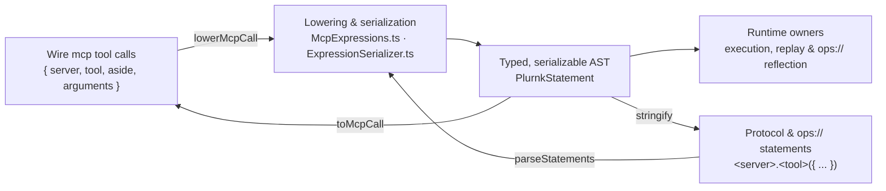

# PLURNK Contracts Specification

## §contract-representations 1. Overview and schema representations

`@plurnk/plurnk-contracts` is the single authority for PLURNK's model-facing contract, JSON Schemas (`schema/*.json`), generated TypeScript types, and runtime-neutral wire envelopes. `@plurnk/plurnk-parser` implements lowering and serialization between wire `mcp` tool calls, protocol statements, and `PlurnkStatement` ASTs ({§parser-build}).

| Surface | Canonical export or artifact |
| --- | --- |
| AST, validators, Problems, results, Notices, text regions and extents | `@plurnk/plurnk-contracts` |
| Approval ownership and proposal policies | `SessionOwner`, `ProposalPolicy`, `PROPOSAL_POLICIES` |
| Durable effort and model catalog discovery | `Effort`, `EFFORTS`, `ModelRoute`, `ModelCatalogQuery`, `ModelCatalogPage`, `ModelProvidersResult`, `ModelReadiness` |
| Stopped-world proposals and client interactions | `ProposalDisposition`, `ProposalProjection`, `ClientInteractionRequest`, `ClientInteractionProjection`, `ClientInteractionResolution` |
| Client capability presentation | `ClientDisplayCapabilities` |
| Exterior actor parsing and attribution | `parseExteriorActor`, `extractActor`, `extractExteriorActorId`, `normalizeExteriorActorProfiles`, `actorsMatch`, `isDefaultExteriorActor`, `sanitizeActorHandle`, `sanitizeActorDisplayName`, `formatExteriorActorInput`, `ExteriorActor`, `ExteriorActorProfile`, `ExteriorActorInput` |
| Daemon module application port (package dependency-direction seam) | `ApplicationPort`, from `@plurnk/plurnk-contracts/port` |
| Workspace MCP and Agent Skills definitions | `McpServerDefinition`, `McpOAuth`, `SkillDefinition` |
| Session Functionality lifecycle projections | `FunctionalityProvenance`, `FunctionalityCandidate`, `FunctionalityDiscoverQuery`, `FunctionalityDiscoverResult`, `FunctionalityDefinitionState` (`origin: "host" \| "service" \| "workspace" \| "session"`), `FunctionalityListResult`, `FunctionalityMutationResult` |
| Dedicated client configuration plane | `ConfigEntry`, `ConfigListQuery`, `ConfigListResult`, `ConfigMutationResult`, `ApplicationConfigPolicy` |
| Interactive client contracts ({§client-interactive-commands}) | `INTERACTIVE_COMMANDS`, `FAMILY_SUBCOMMANDS_BY_FAMILY`, `SCHEDULE_ADD_FLAGS`, `SCHEDULE_USAGE`, `completeInteractiveCommand`, `longestCommonPrefix`, `classifyComposerInput`, `buildPromptBlocks`, `tokenizeSlashArgs`, `parseFamilyCommand`, `formatFamilyRows`, `formatFamilyResult`, `formatScheduleInspect`, `formatScheduleStepReceipts`, `extractScheduleProblem`, `expandLearnCommand`, `SingleFlightRefresh`, `discoverProtectedResourceMetadata`, `discoverAuthorizationServerMetadata`, `generatePkcePair`, `resolveTokenExpiresAt`, `parseSessionConfigOptions`, `rankModelChoices`, `projectSessionStatus`, `formatProblemSummary`, `summarizeOperation` |
| ACP discovery manifest | `AcpDiscovery` |
| JSON Schemas and JSON rendering | `@plurnk/plurnk-contracts/schema/*.json`, `renderJsonResult`, `formatJsonDocument` |
| Session operating card | `plurnk.md` in the package |



| Layer | Owner or artifact | Contract |
| --- | --- | --- |
| Stable current law | `SPEC.md` | Owns invariants and boundaries; forge issues retain history |
| Session operating card | `plurnk.md` | Minimal operating guidance injected into `definition` |
| Lowering & serialization | `@plurnk/plurnk-parser` ({§parser-boundary}, {§parser-lowering}) | Lowers wire `mcp` tool calls (`lowerMcpCall`), inbound `/mcp` tool calls (`lowerToolCall`), and client/internal MCP statement blocks (`parseStatements`) into `PlurnkStatement` ASTs, projects statements to `McpToolCallPayload` (`toMcpCall`), and renders canonical MCP expressions for `ops://` (`stringify`) |
| Typed admission | `PlurnkStatement` AST | Produces JSON-serializable unions and validates deterministic path/scope/matcher syntax |
| Shared wire data | `schema/*.json` | Defines runtime-neutral data shapes projected into generated TypeScript |
| Stateful behavior | consuming runtime | Resolves addresses, permissions, selection arithmetic, effects, and lifecycle |

- **Authoritative representations**: JSON Schema is authoritative for shared wire data shapes; TypeScript types are generated from `schema/*.json`; `@plurnk/plurnk-parser` is authoritative for lowering `mcp` tool calls and statement blocks into `PlurnkStatement` ASTs.
- **ACP discovery and schema enforcement**: `AcpDiscovery` enumerates the installed ACP v2 actions (`scope`, `inputSchema`, `outputSchema`) and `display` capabilities. Boundary validators enforce these schemas without mutating them and report structured validation `issues` in RFC 9457 Problem `detail`.
- **JSON result and document presentation**: `renderJsonResult` formats compact aggregate operation rows (placing top-level array items on individual lines without rewriting stored JSON coordinates). `formatJsonDocument` performs two-space whitespace-only formatting of complete strict JSON documents before representation storage.

### §proposal-and-model-contracts Proposals, effort, and model catalog

| Contract | Shape invariant | Runtime responsibility |
| --- | --- | --- |
| `ProposalPolicy` | `review`, `accept`, or `reject` (`PROPOSAL_POLICIES`) | Read the server or workspace approval disposition at the proposal boundary |
| `ProposalDisposition` | Review, or automatic accept/reject with optional outcome | Select once for the pending gate |
| `ProposalProjection` | Identity, review target, body/attrs, owner, ACP v2 subject, stale signal, disposition | One validated projection for live delivery and reconnect |

- **Proposals and session ownership**: `ProposalPolicy` (`review | accept | reject`) and `SessionOwner` (`address`, `tools`, `interactive`) govern stopped-world approval and standing `allow_always` / `reject_always` permission decisions.
- **Effort and model catalog wire**: `Effort` is `off | adaptive | low | medium | high | xhigh | max`. `ModelRoute`, `ModelCatalogQuery`, `ModelCatalogPage`, `ModelProvidersResult`, and `ModelReadiness` expose provider/model identity, capabilities (including supported `efforts`), physical limits, optional USD-per-1M-token `cost` (`inputPer1M`, `outputPer1M`, optional `reasoningPer1M`, `cacheReadPer1M`, `cacheWritePer1M`), optional input-price bounds (`minInputPer1M`, `maxInputPer1M`) and deterministic ordering (`sort`: `selector | cost-asc | cost-desc | context-desc`), and alternative required environment-variable name sets and key editability metadata (names only, never secret values).

### §provider-request-accounting Client interactions and provider request accounting

| Contract | Shape invariant |
| --- | --- |
| `ClientInteractionRequest` | Non-empty `toolName`, `mode: "form"` with non-empty `message` and object `requestedSchema`, or `mode: "url"` with non-empty `message`, non-empty `elicitationId`, and URI `url` |
| `ClientInteractionProjection` | Positive interaction, session, loop, and turn identities plus the exact request; workspace scope remains the containing transport envelope |
| `ClientInteractionResolution` | Exactly `{ action: "accept", content? }`, `{ action: "decline" }`, or `{ action: "cancel" }` |

| Projection | Complete total | Known subtotal |
| --- | --- | --- |
| Tokens (`ProviderUsage`) | Each `usage` field (`inputTokens`, `outputTokens`, `totalTokens`, cache and reasoning details) is present only if every request reports that quantity; `totalTokens === inputTokens + outputTokens` when all three are present | `knownUsage` sums each reported non-negative safe-integer field, omitting wholly unknown quantities without substituting zero for unknown |
| Monetary (`ProviderCost`) | `costUsd` is `null` if any request lacks USD-expressible cost (`charged` or `estimated` decimal string; `unknown` requires a `reason`) | `knownCostUsd` sums expressible USD costs as an exact decimal string, or is `null` when none are known |

- **Indivisible request accounting and evidence**: `ProviderRequestAccounting` binds one physical request's provider, model, outcome, optional protocol status, `ProviderUsage`, and `ProviderCost` in issue order across retries and capacity failover; a later response never replaces an earlier request. JSON-serializable forensic response/failure payloads travel alongside as separate evidence without entering client events.

---

## §mcp-expressions 2. Universal `mcp` wire tool and internal statement form

```json
{
  "name": "mcp",
  "parameters": {
    "type": "object",
    "required": ["server", "tool", "aside", "arguments"],
    "properties": {
      "server": { "type": "string" },
      "tool": { "type": "string" },
      "aside": { "type": "string", "description": "Terse intent note." },
      "arguments": { "type": "object", "additionalProperties": true }
    },
    "additionalProperties": false
  }
}
```

- **Universal `mcp` wire tool**: Every emission-capable model turn exposes a single native wire tool named `mcp` taking `{ server, tool, aside, arguments }`, placing the terse intent `aside` ahead of `arguments` so models commit intent before payload while `lowerMcpCall` tolerates omitted/empty `aside` on the model tier and replays omitted asides as `aside: ""` ({§parse-recovery}). `plurnk` is the built-in MCP server (`read`, `find`, `edit`, `copy`, `move`, `kill`, `note`, `work`, `fork`, `bare`, `send`, `done`, `fail`, `wait`, runtime tools `sh`, `js`, `python3`, and Functionality tools `env`, `mcp`, `members`, `personas`, `schedule`, `skills`, `question`); external MCP servers are peer `server` names (`server: "<mcp>"`, `tool: "<tool>"`). Keeping `tools[]` fixed to `MCP_WIRE_TOOL` (`arguments.additionalProperties: true`) holds the request tool prefix constant across mid-session capability changes while deferring per-tool schemas to `mcp:///` and validation/coercion to `lowerMcpCall` ({§parse-recovery}).
- **Statement protocol and `ops://` representation**: Client-authored `: <statements>` blocks and `ops://` turn-source archives use `<server>.<tool>({ ... }) // aside` statement syntax (`gitea["issue-read"]({ ... })` for non-identifier tool names), parsed by `PlurnkParser.parseStatements` and rendered by `PlurnkParser.stringify` ({§expression-boundaries}, {§slot-order}).

---

## §op-shapes 3. Per-operation semantics and dispositions

| Server & tool | Target field | Scope / matcher / endpoint fields | Content / payload fields |
| --- | --- | --- | --- |
| `plurnk` / `find` | required `path` / `paths` | optional `range`, `pattern`, `headers` | optional `note` normalized to preceding `note` |
| `plurnk` / `read` | required `path` / `paths` | optional `range`, `pattern`, `headers` | optional `note` normalized to preceding `note` |
| `plurnk` / `edit` | required `path` | `range` or `pattern` or `oldText`/`newText` (`old`/`new`, `find`/`replace`, `original`) or `edits` for existing target; `text` alone creates; optional `headers` | `text` (or tolerated `content`, `replacement`, `replace`, `newText`, `new`, `body`), or `edits` array |
| `plurnk` / `copy`, `move` | required `from` and `to` | optional `fromRange` / `toRange`, `fromHeaders` / `toHeaders` | none |
| `plurnk` / `sh`, `js`, `python3` | optional `script`, `cwd` | optional `env` | `text` (or tolerated `code` / `command` / `cmd` / `body` / `source` / `prompt`), optional `args` |
| `plurnk` / `<functionality>` | tool name (`env`, `mcp`, `members`, `personas`, `schedule`, `skills`, `question`, or module-registered family when `plurnk` is in `executors`) | none | JSON arguments object |
| `<server>` / `<tool>` | external MCP `<server>` and `<tool>` | optional `range` | JSON arguments object |
| `plurnk` / `bare` | none | none | required `text` (or tolerated `prompt` / `body` / `content` / `message`) |
| `plurnk` / `work`, `fork` | optional `target` (`session://name`) | optional `persona`, `model`, `effort` | required `text` (or tolerated `prompt` / `body` / `content` / `message`) |
| `plurnk` / `kill` | required `path` / `paths` | optional `range`, `pattern`, `remote`, `headers` | none |
| `plurnk` / `send` | optional `target` recipient (caller aliases `user`/`client`/`human`/`operator`/`caller` normalize to `null`) | optional `headers`, `attachments`, client-only `actor` (bare ID/URI string or `{ id, handle?, name? }` object; refused on `model` origin and non-`session://` targets) | required `text` message body |
| `plurnk` / `done` | optional `target` (`message://`; caller aliases normalize to `null`) | optional `attachments` | `text` final deliverable (required in tool schema; parser tolerates empty to resolve silently) |
| `plurnk` / `fail` | optional `target` (`message://`; caller aliases normalize to `null`) | optional `attachments` | `text` final failure explanation (required in tool schema; parser tolerates empty to cancel silently) |
| `plurnk` / `note` | none | none | `text` conclusions, findings, and plans |
| `plurnk` / `wait` | none | optional `seconds` | none (tolerated `text` normalizes to `aside`) |

- **Retrieval annotations**: Nonblank `note` options on `find` or `read` normalize into a preceding `note` statement.
- **Text range algebra**: `"N"` selects whole line `N` (`"0"` prepends, `"-1"` appends on mutation); `"N,M"` selects inclusive lines `N..M`; `"SL,SC,EL,EC"` selects an exact 1-based Unicode code-point region with exclusive end (three-integer ranges normalize to four).
- **Local path fragments**: Bare paths decompose `#channel` into `fragment` just like `scheme://` URLs so channel selectors round-trip identically.
- **Turn dispositions (`wait`, `done`, and `fail`)**: Dispositions may appear anywhere in a turn; multiple `wait` statements coalesce to the shortest `seconds` bound, and `done` (`200`) or `fail` (`499`) resolves an Open Message once all earlier operations in the turn settle.

---

## §path-syntax 4. Target and path grammar

- **URL vs. local path decomposition**: Targets matching `[a-z][a-z0-9+._-]*://` decompose via WHATWG `URL` into `UrlPath` (preserving lossless serialized `query` and `fragment`); all other targets become `LocalPath { kind: "local", raw, fragment? }`.
- **Parenthesis tolerance and backslash escaping**: Literal parentheses render verbatim in targets and receipts; `%28`/`%29` in pathnames decode to `(` / `)`, and `\\`, `\(`, `\)` unescape losslessly via `PathSyntax`.
- **Glob classification and session names**: `PathSyntax.hasGlob` and `globMagicIndex` classify glob metacharacters vs. exact paths. `SESSION_NAME` (`[A-Za-z0-9][A-Za-z0-9_-]{0,62}`) validates minted session authority names (excluding `_plurnk`).

---

## §matcher-prefix-claims 5. Bulk pattern matching and scope markers

`find`, `read`, `kill`, and `edit` accept a `pattern` matcher classified by leading sigil (`glob` and `regex` may span multiple lines; `xpath`, `jsonpath`, `fts`, and `graph` are single-line):

| Prefix | Dialect | Validation & tolerance |
| --- | --- | --- |
| `//` | `xpath` | Validated with XPath 1.0 parser before regex classification (also silently normalizes single-slash absolute XPath location paths such as `/root/item[@id='old']/@id` or `/root/item/text()`, regex-wrapped or trailing-slash XPath selectors, and vacuous `/text()` after `@attr` steps; on `find` and `read`, invalid non-XPath `//<ident>...` patterns with regex operators recover as `regex`) |
| `/` or `^` | `regex` | ECMAScript `RegExp` (escaped pipe is literal, unescaped pipe is alternation); tolerates PCRE `\A`/`\z`/`\Z` anchors, Python `(?P<name>...)` / `(?P=name)` named groups and backreferences, empty code brackets `[]`, trailing `-flags`, `/~.../` mixed prefix, unbalanced unescaped `(`, `)`, or `[`, and glob-shaped `/*text*/` |
| `$` | `jsonpath` | Validated with RFC 9535 `json-p3` |
| `~` | `fulltext` | Single-line FTS5 query string (`~^...` and `~/...` regex-prefixed queries recover as `regex`) |
| `&` | `graph` | `&symbol`, `&<symbol`, or `&>symbol` relation query (strips leading declaration keywords such as `&def symbol` or `&class Symbol`) |
| none | `glob` | Fallback shell glob or single/multiline literal substring (unslashed `a\|b` pipe alternations excluding extglobs and `\|\|` recover as `regex` on `find` and `read`) |

- **Soft matcher refusal**: An invalid matcher expression is admitted as `matcher.dialect = "unreadable"` with its diagnostic and working-form `recovery` so only that operation fails `400 grammar/matcher/unreadable-pattern` while sibling statements in the turn still execute.
- **Statement recovery and argument tolerances**: Statement errors fail only the offending call while admitting valid sibling calls; an inline `<L,M>` range written inside `path<L,M>` is lifted on the model tier.
- **Line anchors and range recovery**: `TextLineMarker` accepts `@<5 Base62 chars>` line anchors (with optional `[+-]K` offsets or surrounding `<...>`) in line positions; reversed or count two-number ranges (`"M,N"` with `M > N`, `"N,+K"`) and unambiguous anchor forms (`"@hash,1"` as `"@hash"`, `"@hash,0"` as `"@hash,1,@hash,1"`, and `"@start,@end,SC[,EC]"` as `"@start,SC,@end[,EC]"`) normalize silently on the model tier.

---

## §whitespace-contract 6. Parser architecture, whitespace, and public API

- **Structured lowering and statement parsing**: `PlurnkParser.lowerMcpCall` lowers a structured `mcp` wire tool call into `statement` and `error` items; `PlurnkParser.parseStatements` parses client/internal statement blocks without prose interleaving.
- **Tier entry points and runtime-neutral root**: `PlurnkParser.lowerMcpCall` (model wire tool call), `PlurnkParser.lowerToolCall` (inbound `/mcp` tool call), `PlurnkParser.parseStatements` (protocol/internal statements), `PlurnkParser.toMcpCall` (structured `mcp` tool-call projection), and `PlurnkParser.stringify` (canonical statement rendering) are exported by `@plurnk/plurnk-parser`. The `@plurnk/plurnk-contracts` root is closed (verified by `src/index.test.ts`) and browser/DOM runtime-neutral (`tsconfig.browser.json`), with Node HTTP host types isolated in `@plurnk/plurnk-contracts/port`.

---

## §text-region 7. Runtime-neutral wire contracts, text regions, and entry reads

| Contract | Fields & Invariants |
| --- | --- |
| `TextRegion` | `{ startLine, startColumn, endLine, endColumn }` — 1-based positive safe integers counting Unicode code points (`LF`, `CRLF`, `CR` line separators; `CRLF` is one indivisible separator). `end` is exclusive; equal start and end identify a zero-length insertion point. Validated by `Validator.assertTextRegion`. |
| `RangeExtent` | `{ unit: "line" \| "result" \| "byte", total, requested: [first, last], returned?: [first, last] }` — `requested` preserves the numeric request; `returned` names inclusive positive ordered positions (`<= total`) and is omitted on empty or failed selections. Validated by `Validator.assertRangeExtent`. |
| `EntryReadResult` | `{ status: 200, entry: ClientEntry } \| { status: 400..599, problem: ProblemDetails, entry: null }` — `ClientEntry` carries `{ entryId: number \| null, target: string, channels: Record<string, ClientEntryChannel> }`. Every returned channel (`content`, `contentOffset`, `contentLength`, `mimetype`, `weight`, `state: "static" \| "active" \| "closed" \| "errored"`) satisfies `contentOffset + codePointLength(content) === contentLength`. |

### §diagnostic-observation Operation results, Problem Details, and Notices

| Envelope / Method | Contract |
| --- | --- |
| `OperationResult` | Status `100..399` forbids `problem`; status `400..599` requires one RFC 9457 `ProblemDetails` object whose `status` equals the containing operation status. |
| `ProblemDetails` | Requires `type` (stable absolute URI), `title` (stable summary with no occurrence data), `status`, and `detail` (failed subject, observed fact, and violated constraint); optional `instance`, `stage`, `recovery` (one working-form next action), `retryable`, and factual producer extensions. |
| `Problems.fromError(error)` | If `error.result` is present, validates the complete `OperationResult` and returns its `problem`; otherwise if `error.problem` is present, validates and returns `ProblemDetails` unchanged; otherwise returns `null`. |
| `Problems.project(problem, context)` | Produces `ProblemProjection` for model packets: retains `type` and `detail`, retains `stage`/`recovery`/`retryable`/extensions when not duplicated by the enclosing row, and strips `title`, `status`, and `instance`. |
| `Notice` | Transient, non-terminal observation (`level`, `source`, `kind`, `message`, optional `directive` starting with `YOU MUST` / `YOU MUST NOT` / `YOU MUST ONLY` / `YOU SHOULD` / `YOU SHOULD NOT` for model-output advisories). |

- **Diagnostic observation**: Every Problem `detail` and `recovery`, parse diagnostic, and `Notice` states what was read, what was done with it, and where, and may show the working form of the construct it read or refused — never guessing author intent or why.

### §mcp-server-definition Client display capabilities, MCP servers, and skills

- **`ClientDisplayCapabilities`**: Ordered array of closed discriminated objects (`{ kind: "scheme", scheme, display }` or `{ kind: "mimetype", mimetype, display }`), where `display.glyph` is an optional non-empty opaque string.
- **`McpServerDefinition` and `McpOAuth`**: Closed union of `stdio` (`command`, optional `args`, `env`, `cwd`, `plurnkWorkspace`, `plurnkSession`) and `streamable-http` (`url`, optional `headers`, `authorization`, `plurnkWorkspace`, `plurnkSession`) definitions. `McpOAuth` (`Validator.assertMcpOAuth`) validates interactive OAuth (`callbackUrl`, mutually exclusive HTTPS Client ID Metadata Document URL / pre-registered client ID + `${NAME}` secret / Dynamic Client Registration, optional `issuer` and `authorizationParams`) and `client_credentials` grants.
- **`SkillDefinition`**: Workspace skill definition (optional `source`, `ref`, `commit`; skill alias validated against `SKILL_NAME`) validated by `Validator.assertSkillDefinition`.

### §application-session-observation Daemon application port and session/loop observation

| Projection / Helper | Contract |
| --- | --- |
| `ApplicationPort` | Transport-neutral interface in `@plurnk/plurnk-contracts/port` exposing optional `serviceVersion`, workspaces, sessions, loops (`runLoop` with causal `source`, `actor`, `attachments`, `envelope`), operations, proposals, client interactions, scoped overview snapshots (`readSessionOverview({ workspaceId?, sessionId?, limit, excerptChars })`), filtered discrete Watch subscriptions (`subscribeToEvents(handler, filter?)` and `replayNotifications({ lastEventId, filter? })` under `notificationEpoch` and `notificationLatestId`), and in-process journal and sub-turn runtime streaming (`subscribeToRuntimeStream(handler)` over `APPLICATION_RUNTIME_STREAM_EVENTS`, including `log/entry`). |
| `DaemonNotification` / `WatchState` | Closed discriminated union (`DaemonNotificationStreamEnvelope`) validated by `Validator.assertDaemonNotification` against `DaemonNotificationEnvelope.json` over Watch control frames (`notifications/snapshot`, `notifications/resync`, constructed by `toDaemonControlEnvelope`) and the 19 discrete `DAEMON_NOTIFICATION_EVENTS` (`{ id, event, timestamp, workspaceId, sessionId, data }`, constructed by `toDaemonNotification` and filtered by `matchesNotificationFilter`). `createWatchState`, `hydrateWatchState`, `reduceWatchNotification`, and `projectWatchOverview` maintain an idempotent, runtime-neutral Watch store satisfying `Snapshot ⊕ Deltas === Snapshot'`. `isRuntimeTelemetryNotice` separates internal turn/lifecycle/derivation telemetry onto `runtime/telemetry`. |
| `admitBearerRequest` / `admitBrowserOrigin` | Runtime-neutral async OIDC/OAuth 2.1 Bearer (`Authorization: Bearer`, `Sec-WebSocket-Protocol: bearer.<token>`, or optional `?access_token=`) and browser same-origin / loopback `Host` admission helpers over `CredentialAuthority`, returning `{ ok: true, subject, handle?, name?, canDelegateActor? }` or `{ ok: false, problem, challenge }`. |
| `selectSessionLoop` | Chooses `running` before `parked` before `queued` (oldest unresolved sequence wins ties); with no live work, the latest terminal settlement wins. Maintenance-only loops do not change this projection. |
| `lifecycleOfLoopStatus` / `isActiveLoopLifecycle` | Maps loop status to client lifecycle vocabulary: no loop `idle`; `100` `queued`; `102` `running`; `202` `parked`; `< 400` `completed`; `499` `cancelled`; `>= 400` `failed` (`413` budget, `429` turn ceiling, `500` fail, `504` timeout, `508` runaway); `isActiveLoopLifecycle` classifies `running`, `parked`, and `queued` as live work. |
| `excerptOf` | Extracts the first non-blank line of a message truncated to at most `N` code points without splitting a character, with trailing whitespace trimmed and `continued: boolean`. |
| `ApplicationSessionOverview` | Projects all non-archived workspaces in scope, non-archived model-origin sessions (`{ workspaceId, id, name, parentSessionId, parentName, parentOrigin, kind, lifecycle, gates, opening?, reply, title?, persona? }`) ordered by most recently finished reply row first then newest unreplied sessions (always retaining all active `running`/`parked`/`queued` sessions and all gated sessions past `limit` before reporting `omitted`), and open review `proposals` + `interactions`. |

### §http-admission HTTP origin, CORS, scoped routing, and transport Problem helpers

| Helper | Owner | Contract |
| --- | --- | --- |
| `isLoopbackHost`, `requestOrigin`, `resolvePublicOrigin` | `@plurnk/plurnk-contracts` | Recognizes IPv4/IPv6 and IPv4-mapped loopback hosts; resolves the daemon's public HTTP(S) origin honoring explicit `CredentialAuthority` issuers, loopback reverse-proxy `X-Forwarded-Proto` / `X-Forwarded-Host`, or request `Host` / listener fallback. |
| `buildCorsHeaders`, `parseScopedRoute` | `@plurnk/plurnk-contracts` | Emits lowercase CORS response headers only when `allowOrigin` is non-empty; parses `/<mount>[/<workspace>[/<session>]]` pathnames with URI decoding and `404` / `400` RFC 9457 Problem refusals. |
| `writeHttpProblem`, `writeUpgradeProblem`, `attachSseKeepAlive`, `InFlightTracker` | `@plurnk/plurnk-contracts/port` | Writes `application/problem+json` HTTP and HTTP/1.1 WebSocket-upgrade refusals, manages `.unref()`ed SSE `: heartbeat\n\n` intervals with socket idle timeout disabled, and drains in-flight route promises on `close()`. |

---

## §parse-recovery 8. Parse error contract and coordinate systems

`PlurnkParseError` is a JSON-serializable `Error` carrying `{ line, column, source: "lexer" | "parser" | "visitor", severity: "error" | "warning", recovery?, attempt?, operationOmitted }` (lowered and populated by `@plurnk/plurnk-parser`, {§parser-lowering}):

| Representation | Line | Column | Absence or extent |
| --- | --- | --- | --- |
| Parser/AST `Position` | 1-based | 0-based Unicode code points | `UNKNOWN_POSITION = { line: 0, column: 0 }` is the sole unknown sentinel |
| Notice `content-offset` | 1-based | 0-based Unicode code points | Omit or set `position` to `null` when unknown |
| Contracts `TextRegion` | 1-based | 1-based Unicode code points | Start included, end excluded; equality is zero-width |
| SARIF 2.1.0 region | 1-based | 1-based (`columnKind: "unicodeCodePoints"`) | End excluded; parser point adapters add 1 to `column` |

- **Working-form recovery & loss independence**: Every hard error (`severity: "error"`) carries `recovery` with the working `mcp({ server, tool, aside, arguments })` form of the refused construct and `attempt` (`{ text, verb }`) with the refused call's source text; `operationOmitted` records whether an attempted operation was omitted independently of `severity` ({§diagnostic-observation}).

---

## §client-interactive-commands 9. Shared interactive client contracts

All first-party interactive surfaces (CLI, Term, and Web) share one DOM-safe, runtime-neutral command, completion, OAuth PKCE, config-option, status, and diagnostic projection layer in `@plurnk/plurnk-contracts` ({§whitespace-contract}):

| Export | Surface contract |
| --- | --- |
| `INTERACTIVE_COMMANDS`, `FAMILY_SUBCOMMANDS_BY_FAMILY` | Authoritative slash-command inventory (`clientOnly?: "term" \| "web"` isolates local terminal/editor commands such as `/quit`, `/editor`, `/import`, `/script`, `/login`; `/logout` is available on both `"term"` and `"web"`) and per-family subcommands (`members` omits `replace`; `env` on `"web"` omits local dotenv `import`). |
| `completeInteractiveCommand`, `longestCommonPrefix` | Deterministic multi-token prefix completion over commands, advertised MCP prompts, selector-scoped `/model <selector> <effort>`, `/child` (`inherit` first), `/mode` (`PROPOSAL_POLICIES`), folder-aware `/learn --scope`, family subcommands/aliases, gates, loops, sessions, workspaces, inline `$<skill>`, and `plurnk.<op>`; `longestCommonPrefix` computes shared prefixes on Unicode code-point boundaries. |

### §client-composer-sigils Composer sigils, inline skills, and learn expansion

| Sigil / Input | `classifyComposerInput` / helper contract |
| --- | --- |
| Blank | `{ kind: "empty" }` |
| `?` / `? <text>` | `{ kind: "help" }` on bare `?`; `{ kind: "review", text }` when followed by text |
| `...` / `... <text>` | `{ kind: "continue", text }` |
| `:` / `: <stmt>` / `[await ]plurnk.<op>(` | `{ kind: "statement-empty" }` on bare `:`; `{ kind: "statement", text }` for `_plurnk/action` `op.exec` |
| `!` / `! <cmd>` | `{ kind: "shell-empty" }` on bare `!`; `{ kind: "shell", command }` |
| `/<name>[ <args>]` | `{ kind: "slash", name, argsText }` |
| Ordinary text | `{ kind: "prompt", text }`; `buildPromptBlocks(text, availableSkills)` splits enabled `$<skill>` references into interleaved `{ type: "text", text }` and `{ type: "skill", name }` ACP v2 blocks while keeping unknown `$tokens` as text; `expandLearnCommand` resolves `/learn [--scope project\|plurnk] [instructions]` (`plurnk` default when `projectRoot === null`, refusing `--scope project` without a folder). |

### §client-family-commands Slash argument tokenization and family command translation

- **Quote-preserving tokenization**: `tokenizeSlashArgs` preserves single-quoted literals, double-quoted strings with `\"`, `\\`, `\$`, `` \` `` escapes, and backslash-escaped whitespace while refusing unclosed quotes with a `400 https://problems.plurnk.xyz/client/usage` `ProblemDetails`.
- **Canonical family translation and formatting**: `parseFamilyCommand`, `formatFamilyRows`, and `formatFamilyResult` translate `mcp` (`--scope service\|workspace`, `oauth`, `secrets`, `skills`, `complete`), `skills` (`--scope service\|workspace`), `personas` (`--scope service\|workspace`), `members`, `env` (`--scope service\|session\|workspace`, `set`/`unset`), and `schedule` slash invocations to `_plurnk/action` calls and render identical tabular, pagination, and mutation summaries across CLI, Term, and Web.

### §client-collection-browsing Bounded collection filtering, pagination, and live candidate preview

- **Unified list contract (`FunctionalityListQuery` / `FunctionalityListResult`)**: Every `<scope>.<family>.list` action accepts `{ query?, state?, origin?, offset?, limit? }` (`limit` 1..100; omitting `limit` returns all matching definitions from `offset` onward). Responses carry `{ family, definitions, offset, total, nextOffset? }` with the same deterministic bounds invariant as `ModelCatalogPage` (`offset + definitions.length <= total`; `nextOffset` is present iff `offset + definitions.length < total`).
- **Unified discovery contract (`FunctionalityDiscoverQuery` / `FunctionalityDiscoverResult`)**: `discover` accepts optional `cursor` (opaque continuation token, 1..512 chars) and `limit` (1..100) alongside each family's declared filter/source inputs (`FunctionalityDiscovery.required` names inputs that stay mandatory alongside optional filters, e.g. `skills` requiring `source` with optional `query`; `mcp` allows empty-query registry browsing). Responses carry `{ family, candidates, total?, nextCursor? }`, and each `FunctionalityCandidate` may carry structured `detail` (e.g. `members` glob preview match counts and bounded sample paths) for inline live previews.
- **Three-face client parity**: `parseFamilyCommand` parses `[query...]`, `--query`, `--state`, `--origin`, `--offset`, and `--limit` on `list` and `--source`, `--query`, `--rule`, `--cursor`, and `--limit` on `discover`; `formatFamilyRows` and `formatFamilyResult` append concise `Showing X–Y of Z (next: --offset N)` / `Showing N[ of T] (next: --cursor C)` footers whenever a page is sliced; interactive slash completion exposes list, discover, and `/models` options uniformly across CLI, Term, and Web.

### §client-schedule-command Schedule slash grammar, inspect, receipts, and reopen recovery

- **Unified prompt & macro grammar**: `parseScheduleFamilyArgs` (`SCHEDULE_USAGE`, `SCHEDULE_ADD_FLAGS`) parses `list`, `show`/`inspect`, `discover`, `add`/`replace` (`--manual` \| `--once` \| `--rule <r>`, prompt `--target`/`--prompt`/`--persona`/`--catchup` or macro `--step <server>.<tool> ['<json>'] [--aside <label>]` / `--run '<json>'`), `run`, `done`, `reopen`, `enable`, `disable`, and `remove`.
- **Inspect, receipts, and `409 already-done` recovery**: `formatScheduleInspect` and `formatScheduleStepReceipts` render single-alias definitions and per-step macro `results[]`; `extractScheduleProblem` unwraps RFC 9457 `ProblemDetails` from client or JSON-RPC errors and supplies `recovery: "/schedule reopen <alias>"` on `409 already-done` conflicts when absent.

### §client-oauth-pkce OAuth 2.1 PKCE discovery, JWT expiry, and single-flight refresh

| Helper | Contract |
| --- | --- |
| `isAllowedOAuthUrl`, `parseWwwAuthenticateResourceMetadata` | Admits only credential-free `https:` URLs and loopback `http:` URLs (`127.0.0.1`, `localhost`, `::1`, {§http-admission}); extracts validated `resource_metadata` URLs from `WWW-Authenticate: Bearer`. |
| `discoverProtectedResourceMetadata`, `buildAuthorizationServerMetadataUrls`, `discoverAuthorizationServerMetadata` | Fetches RFC 9728 Protected Resource Metadata and discovers path-aware RFC 8414 / OIDC Authorization Server Metadata, enforcing exact issuer equality and PKCE `S256` support. |
| `generatePkcePair`, `parseJwtExpiresAt`, `resolveTokenExpiresAt`, `SingleFlightRefresh` | Generates Web Crypto `S256` PKCE verifiers/challenges; preserves short-lived `expires_in` (`<= 10s`) and JWT `exp` timestamps faithfully without fabricating TTLs for opaque tokens; deduplicates concurrent 401 token-refresh calls per origin key. |

### §client-config-options Session config option flattening, model ranking, and per-model effort

- **Option projection**: `flattenConfigSelectOptions` flattens ungrouped `SessionConfigSelectOption` entries and grouped ACP v2 `SessionConfigSelectGroup` (`{ groupId, name, options }`) entries into one ordered list; `parseSessionConfigOptions` extracts `model`, `child`, `thought_level` (`thoughtLevel`), `mode`, `persona`, and `<family>:<alias>` `familyToggles`.
- **Deterministic 4-tier model ranking**: `rankModelChoices` orders matches by exact alias (`0`), prefix alias (`1`), exact `provider/model` (`2`), prefix `provider/model` (`3`), and selector/label substring (`4`), breaking ties lexicographically (`aliases` precede `catalog` entries when query is empty).

### §client-session-status Session clock, turn phase, and causal actor attribution

- **Daemon-anchored status & clock**: `projectSessionStatus` derives `phase` (`requires_action` > `parked` > `queued` > `awaiting_model` > `running` > `idle`), `elapsedMs` from daemon `claimedAt`/`terminatedAt` timestamps, and `waitRemainingMs` from `waitUntil` without client-local wall-clock fabrication.
- **Causal actor attribution**: `parseExteriorActor` normalizes bare IDs, authority-only `acp://` / `mcp://` URIs, and structured `{ id, handle?, name? }` profiles into `{ id, handle, name?, scheme, uri }` (keeping `id` as the durable authority and `handle` as the readable key/display handle), `actorsMatch` compares normalized `id` values across string and object inputs, `extractExteriorActorId` extracts URL-decoded non-default durable `id` values from `acp://` / `mcp://` URIs, `normalizeExteriorActorProfiles` validates and deduplicates ordered `ExteriorActorProfile` lists by durable `id`, and `extractActor(sourceOrAddress, actorProfile?)` prefers a non-default `actorProfile.handle` before extracting non-default speaker or trigger names uniformly across `acp://<actor>`, `mcp://<actor>`, `session://<worker>`, `message://<session>/<actor>_<seq>`, and `schedule:///[rules/]<alias>` (omitting default unnamed exterior principals and `_plurnk`).

### §client-diagnostics Problem summary preservation and operation glyphs

- **Lossless Problem formatting**: `formatProblemSummary` renders RFC 9457 `title`, `detail` (avoiding duplicated prefix when `detail` already starts with `title`), and `Recovery: <recovery>` without discarding `detail` or `recovery` when `title` is present ({§diagnostic-observation}).
- **Canonical operation headlines**: `summarizeOperation` maps every core verb and executor tag to one glyph, extracts primary target (`target`, `attrs.destination`, or `attrs.pathname`), flags `log:///` `kill` rows as `curated: true` ({§tokenomics}), and formats `<glyph> <verb>[ <target>][ — <aside>]`.
