# plurnk-service — Specification

Canonical contracts plurnk-service exposes, architecture it implements, promises it makes to the constellation (`plurnk-contracts`, `plurnk-providers`, `plurnk-schemes`, `plurnk-mimetypes`, `plurnk-execs`, the user-facing `plurnk` CLI). `AGENTS.md` covers process; this file covers contract.

## Contents

- [Glossary](#glossary)
- [Architecture](#architecture)
- [Sessions and workspace boundaries](#actor-boundary-sessions-and-workspace-boundaries)
- [File membership and project roots](#membership-file-membership-and-project-roots)
- [Loop scheduling and lifecycle](#session-loop-lifecycle-loop-scheduling-and-lifecycle)
- [Provider Contract](#provider-surface-provider-contract)
- [Scheme Contract](#scheme-scheme-contract)
- [Mimetype Contract](#mimetype-mimetype-contract)
- [Search indexing](#persistent-search-index-search-indexing)
- [Channel Topology](#channels-channel-topology)
- [Op Surface](#op-surface)
- [Text line anchors](#line-anchors-text-line-anchors)
- [EDIT](#edit-edit)
- [READ](#read-read)
- [The Log](#log-history-projection-the-log)
- [COPY](#copy-copy-engine-orchestrated)
- [MOVE](#move-move-engine-orchestrated)
- [FIND](#find-find)
- [Messaging and turn disposition](#send-messaging-and-turn-disposition)
- [Executions](#exec-executions)
- [Proposals and client interactions](#proposal-proposals-and-client-interactions)
- [Stream Model](#stream-stream-model)
- [Storage Model](#storage-model)
- [Extension composition](#core-extension-composition-extension-composition)
- [Bundled Set](#bundled-set-bundled-set)
- [Grammar Dependency](#grammar-dependency)
- [Operator Configuration](#operator-config-operator-configuration)
- [Module seam](#rpc-module-seam)
- [Workspace Functionality](#workspace-functionality)
- [Application interface](#methods-application-interface)
- [Packet assembly](#packet-assembly-packet-assembly)
- [Packet shape](#packet-packet-shape)
- [Matcher selection and text regions](#matcher-selection-and-text-regions)
- [Testing and evidence](#testing-and-evidence)

---

## Glossary

### §lifecycle-terms Lifecycle, storage, execution, and packet vocabulary

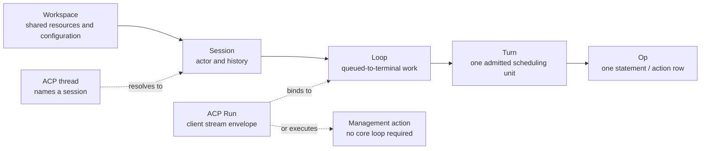

| Term | Layer | Meaning |
|---|---|---|
| **agent** | PLURNK | The plurnk runtime acting in-workspace as the `_plurnk` session ({§actor-boundary}), never a privileged singleton owning entries ({§execution-output-identity}, {§machine-processes}). |
| **workspace** | Core | Durable shared resources, configuration, and optional `project_root`. Identity: `workspaces.id`; mutable label: unique `workspaces.name`. |
| **session** | Core | Durable actor and history over one workspace (`parent_session_id` optional, one process-local cancellation scope while active). |
| **loop** | Core | Queued-to-terminal unit of work within a session (`100` pending · `102` running · `200` done · `202` waiting, {§send} · `413` input-capacity · `429` turn ceiling · `499` cancelled · `500` failed · `504` timeout, {§operator-config-loop-timeout} · `508` runaway). |
| **turn** | Core | One durable, producer-neutral batch of ordered operations (`(loop_id, sequence)`) authored by `model`, `client`, or `_plurnk`; only a model turn assembles a packet and owns an emission call. |
| **model call** | Core/provider | One logical `provider.generate` invocation (`(turn_id, sequence)`); emission attempts and BARE inferences share this owner while retries are physical requests beneath it. |
| **op / statement / action / dispatch** | Core | An op is one submitted DSL operation ({§turn-record}), parsed into a `PlurnkStatement` AST, dispatched to its scheme handler, and recorded as a `log_entries` action row at `log:///<L>/<T>/<S>/<op>` (or `op='error'`, {§operation-results}). |
| **ACP Run / ACP thread** | ACP | A client stream envelope (`runId`) bound to a core loop or management action; within a workspace, `threadId` resolves to one model session. |
| **entry / channel** | Storage | Canonical state unit `(workspace_id, scheme, authority, pathname)` ({§entry-identity-no-null}) holding named `channels` (`body`, `stdout`, `stderr`, `headers`, `symbols` with `content`, `mimetype`, `weight`, and `state`: `static \| active \| closed \| errored`) plus scheme `attributes`. |
| **scheme / mimetype / provider** | Extensions | Addressable namespace handler ({§scheme-surface}), content-type structural projector ({§mimetype}), and LLM transport adapter ({§provider-surface}). |
| **status / proposal state / outcome** | Execution | Operation HTTP status on `log_entries.status_rx` ({§operation-results}); proposal lifecycle `proposed \| resolved \| failed \| cancelled` ({§proposal}); short terminal reason string (`outcome`). |
| **writer / origin / writable_by** | Authority | Identity authoring a write (`model \| client \| _plurnk`, logged as `log_entries.origin`); engine enforces scheme `manifest.writableBy` with `403` ({§subscriptions}). |
| **verdict / strike / emission attempt / cycle** | Engine | End-of-turn ruling ({§loop-terminals}); turn matching a rail ({§engine-rails}); provider exchange under {§emission-admission}; repeated operational inputs/results ({§engine-rails}). |
| **BARE inference** | Engine | Isolated child-provider model call whose response becomes an ordinary BARE log result without session, packet, tools, or output grammar ({§op-methods-op-dispatch}). |
| **capability policy / approval owner / proposal / resolution** | Governance | Subtractive `only`/`deny` selector layers; workspace-scoped approval recipient ({§session-ownership}); deferred side-effecting action ({§proposal-disposition}); client decision settling a proposal ({§methods-proposal-resolve}) or interaction ({§methods-client-interaction-resolve}, {§acp-proposal-resolve}). |
| **packet / log / render** | Packet | Turn's optional model-exchange record (`sections`, plus `assistant`/`assistantRaw` on admitted emission); chronological `log` section of in-scope `log_entries`; packet computation under {§packet-assembly} and {§packet-markdown}. |

---

## Architecture

### §observability-boundary Observability and package boundaries

OpenTelemetry may observe PLURNK; it never becomes product state, failure transport, scheduler input, model teaching, or client protocol. Domain and client activity remain on ACP. Reusable packages and the daemon depend on the OTel API only; `@plurnk/plurnk-otel` constructs configured trace and metric providers from standard `OTEL_*` variables ({§otel-module}, {§otel-contained}), while unconfigured or disabled processes keep no-op behavior and OTel Logs have no provider path. Telemetry shutdown runs at module `stop` ({§module-shutdown-order}); exporter failure never alters product results.

| Surface | Contract |
|---|---|
| HTTP & general spans | HTTP spans carry only an ACP-owned bounded route class (never pathname/query); other spans carry high-cardinality IDs while metric labels stay low-cardinality; prompts, reasoning, file bodies, arbitrary URLs, secrets, and extension payloads are never recorded by default. |
| GenAI convention projection | Provider request spans follow the GenAI registry (`c88d504` on core v1.44.0): a `CLIENT` `chat {model}` span with `gen_ai.operation.name="chat"`, `gen_ai.provider.name` (constructed route provider ID, or `other`), `gen_ai.request.model`, settled `gen_ai.usage.input_tokens`/`output_tokens` ({§tokenomics-provider-usage}), `gen_ai.response.finish_reasons`, and failure `error.type` alongside Plurnk attempt/kind/status/loop/turn attributes. |
| Service session composition | Both the service launcher and live/demo workspace helper discover ACP, MCP, Schedule, and command hooks ({§module-discovery}); management families and reference docs exist even with no enabled definitions, governed by workspace capability policy and {§operator-config-real-model-profile}. The launcher binds the one listener ({§http-host}); the helper binds none ({§module-http-mounts}). |
| Package export surface | `@plurnk/plurnk-service` exports only `./launch` ({§startup-admission}), `./evidence` ({§digest-evidence-reader}), and `./package.json`. |

### §startup-admission Startup, listener admission, and service commands

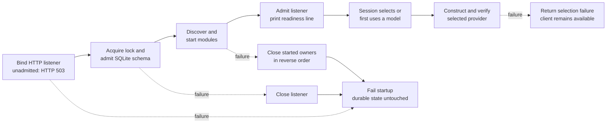

- **Runtime floor**: Before any other module of `plurnk-service` evaluates, it checks `process.versions.node` against `engines.node`; below the floor it writes one stderr line naming both versions and exits `1` before binding a listener or touching durable state.
- **Listener and admission order**: The production service binds its listener ({§http-host}) before creating, opening, migrating, or mutating anything in the durable data directory; losing the bind race leaves storage byte-identical. Core answers `503 service-starting` until database admission and all module starts complete ({§module-http-mounts}). Startup validates model selectors without provider I/O; provider construction and endpoint verification happen on session selection or first use. Any startup failure closes started resources in reverse order (`daemon`, `observability`, `database`, `listener`).
- **Readiness line**: Once admitted, the service prints one stdout line `plurnk-service acp=<url> db=<json string> route=<json string>` (with IPv6 hosts bracketed and `db`/`route` JSON-encoded). After readiness, `discover` distinguishes this daemon from any other listener.
- **Daemon launcher (`@plurnk/plurnk-service/launch`)**: Spawns a daemon argv with caller-supplied `readyTimeoutMs` and `stopGraceMs` ({§state-root}), resolving on the readiness line with `{ acpUrl, dbPath, route, logFile, stop }`. Failed starts stop and await the child before throwing with both output streams. `"private"` lifetime pipes streams to the parent and terminates with it; `"shared"` runs in its own process group, appends streams to `logFile` (default `<state dir>/service.log`), reads readiness from that file, and unrefs the child.
- **`plurnk-service stop`**: Reads the owning PID from the database lock, sends `SIGTERM`, and returns `0` once the process exits ({§crash-only-stop}); an unlocked database reports not running and exits `0`.
- **Explicit update (`PLURNK_SERVICE_UPDATEABLE`)**: Nothing phones a third party or installs packages automatically. Startup loads `$XDG_CACHE_HOME/plurnk/models.json` if present ({§model-catalog-cache}). When `PLURNK_SERVICE_UPDATEABLE=1` (default), `plurnk-service update`, `updateService()`, `service.update`, or `/update` atomically refreshes `models.json`, hot-swaps the active catalog, and updates installed `@plurnk/plurnk-service` (and co-installed `@plurnk/plurnk`) via `npm` (or reports `status: "source"` in a checkout). When `0`, update requests fail with `403 update-disabled`.

### §http-host Shared HTTP host and request origin

Core binds one HTTP listener on `PLURNK_HOST:PLURNK_PORT` and exposes `registerHttpRoute(prefix, handler)`, `registerHttpUpgrade(prefix, handler)`, and `httpAddress()` on the application port ({§application-port}, {§module-host-capabilities}).

| Aspect | Rule |
|---|---|
| Prefix matching | Absolute pathnames claiming themselves and their subtree (`/` is root); longest mounted prefix with the matching handler kind (`route` vs `upgrade`) wins without falling through to a shorter prefix. |
| Admission & errors | Before activation every request gets `503 service-starting`; unparsable targets get `400 request-target-invalid`; unmatched paths get `404 route-not-found`; throwing handlers return `500 route-failed` (or abort in-flight streams) without crashing the listener ({§module-http-mounts}). |
| Request origin | `requestOrigin` is the configured public origin, else the request's `Host` over HTTP, else the listener's own address. Every advertised URL (including OAuth issuer, {§auth-oauth-endpoints}) uses `requestOrigin`, and no request is refused for the hostname it used. |

### §credential-authority Credential authority

Every credential presented to the listener is an opaque in-memory token (`access`, `refresh`, or browser `session`) issued by the daemon's `credentials` authority ({§application-port}) with subject, client, scopes, family, and expiry. Restart revokes all credentials; revoking a family revokes its access, refresh, and browser session tokens together, and replaying a consumed refresh token revokes its family. The issuing module publishes `{ issuer }` at setup ({§module-phases}, {§acp-http-authorization}, {§auth-oauth}).

| Surface | Rule |
|---|---|
| `PLURNK_AUTH` posture | When `1`, holds `PLURNK_SECRET` or mints a `0600` `secret` file beside the database before admitting mounts and requires a published auth face; when `0`, no secret file or face exists and mounts admit anonymously ({§operator-config-shared-keys}). |
| Confidential module clients | At setup a module calls `registerClient({ id, redirectPaths, scopes, stylesheetPath })` (`id` matching `[A-Za-z0-9._-]+` except `operator`; pathnames under its own mounts without query/fragment, {§auth-oauth-documents}, {§auth-oauth-endpoints}). The authority mints an in-memory secret for the registrant and verifies it in constant time (`authenticateClient`, {§auth-oauth-clients}); duplicate or malformed registrations throw. |
| Credential sessions | `sessions(subject)` lists families holding a live `session` credential ({§auth-oauth-session}), oldest first (family handle, subject, created timestamp, expiry, client IDs); `client_credentials` and code grants without a browser session are omitted. |

---

## §actor-boundary Sessions and workspace boundaries

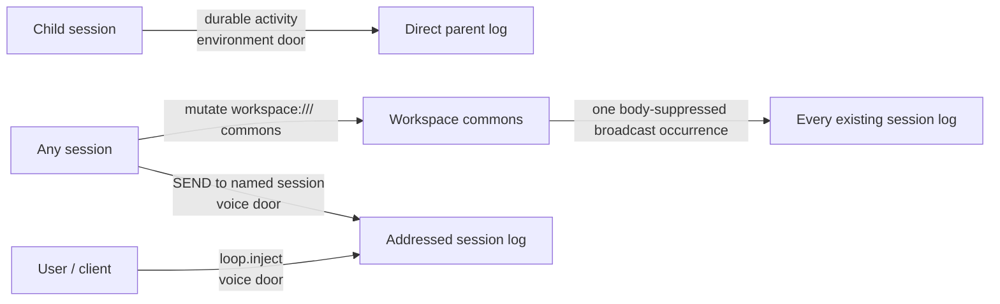

- **Session isolation & attribution**: A packet renders only the assembling session's log alongside shared workspace state ({§packet}, {§membership}). `origin` (`model \| client \| _plurnk`, {§scheme-surface}) records provenance ({§env-delta}) and never filters rows. Client management commands mutate workspace Functionality ({§module-workspace-capabilities}) while client ops journal in `_plurnk` ({§connection-lifecycle}).
- **Two cross-session doors**:
  1. *Environment door*: Direct child durable activity ({§env-delta-child-activity}) enters only the direct parent's log (never republished to grandparents), and successful mutations of `workspace:///` emit one broadcast occurrence to every existing session (unioned with parent lineage so a parent never gets duplicate rows). Intermediate child activity and commons broadcasts never wake; only a child's terminal disposition wakes a parked parent ({§session-loop-lifecycle}, {§env-delta}).
  2. *Voice door*: Directed `loop.inject`, `SEND (session://name)`, or exact-message replies ({§message-reply-delivery}) enter the addressed session's log and wake idle or waiting work.
- **No mutex & self-hosting**: Sessions share workspace state without session locks; stale writes reject at anchor or revision boundaries ({§line-anchors}, {§file-snapshot-revision}, {§file-snapshot-revision}). Work with an operation runs as the unmintable `_plurnk` session (`DispatchAsPlurnk` for reference materialization), while git membership ingestion, disk-divergence `source=file` narration, search derivation, and packet/budget rails stay in the kernel.

### §session-ownership Session ownership and client interaction routing

Every session has one durable workspace-scoped approval owner (`session_owners`), enforced by database invariant. Root sessions take an explicit owner or default to `_plurnk`; `WORK`/`FORK` children inherit their parent's owner; `SEND` and scheduled messages preserve the recipient's owner; explicit client control attachment claims a model session and its model descendants (including pending interaction recipients) without ever claiming `_plurnk`.

- **Owner capabilities & proposals**: An owner declares its implemented client tools and whether it is `interactive` (attended by a person); `_plurnk` implements no tools and is non-interactive. Proposals record their session's owner and disposition (`review`, `accept`, or `reject`); `review` waits only for that owner, and capability policy precedes approval.
- **Client interactions**: Clarifications and questions route to the session's owner only when it is `interactive` and declares the tool; otherwise the request fails immediately with `501` without parking. Only the recorded recipient may resolve the pending interaction.

### §session-initialization-entry Turn-0 orientation and reference materialization

Workspace reference documents and projected instructions are materialized into `workspace:///_plurnk/` through `_plurnk` maintenance turns whose loops are excluded from `work_loops` ({§application-session-observation}, {§application-loop-observation}) and emit no ambient broadcasts.

- **Project instructions**: When `<projectRoot>/AGENTS.md` exists, LoopDocs materializes `workspace:///_plurnk/AGENTS.md` and turn 0 foists a `READ` of it (global XDG `AGENTS.md` stays in the system prompt, {§policy-sections}). When root `<projectRoot>/AGENTS.local.md` exists (regardless of git ignore status, unless excluded), LoopDocs materializes `workspace:///_plurnk/AGENTS.local.md` and turn 0 foists its `READ` immediately after. Absent files produce no entry and no `404`.
- **Catalog preview (`PLURNK_SERVICE_FILES_ITEMS`)**: When non-zero (`-1` for markerless page, positive `N` to cap `*`), turn 0 foists bodyless `FIND` surveys in order: `skill://*/SKILL.md` (`<1,-1>`, {§skills-resources}), `workspace:///_plurnk/plurnk/*.md` (`<1,-1>`), `workspace:///_plurnk/tools/*.md` (`<1,-1>`, {§tools-resource-materialization}), `workspace:///_plurnk/members/*.md` (`<1,-1>`, {§members-projection}), `*` (`project root member files`), `workspace:///*` (`workspace knowledgebase entries`), and `session://<session>/*` (`session knowledgebase entries`). Unregistered schemes and surveys selecting zero items are omitted before recording.
- **Turn-0 execution**: A model session's first loop starts with one packetless `{ producer="_plurnk", kind="initialization" }` turn (`init` rows) submitted through {§turn-record} and {§op-methods-op-dispatch}, framed by opening and closing `<!-- plan -->` `NOTE`s when any survey runs, with no fabricated emission row ({§turn-source-resources}). Initial messages arrive in the first model turn (sequence `2`, {§message-arrival}).

### §machine-processes Session topology, fork, and hiding

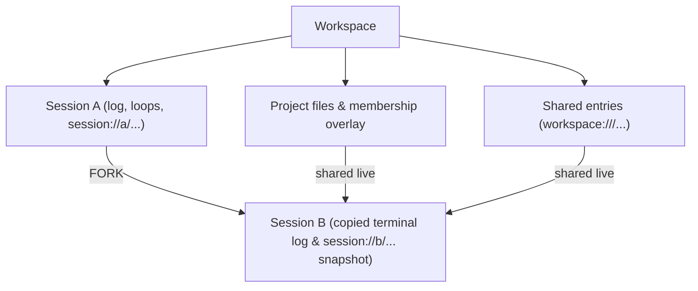

| State | Owner & Fork Behavior |
|---|---|
| Project filesystem, membership overlay, `workspace:///`, `sh://`, `http://` | Workspace-owned and shared live; never copied on fork. Workspaces themselves cannot be forked. |
| Named scratch (`session://<name>/...`) | Workspace-owned under literal namespace `<name>`. When the `sessions` row with `parent_session_id` and `forked_from_turn_id` is inserted, `sessions_fork_copies_history` ({§db-process-triggers}) snapshots quiescent `session://<parent>/...` entries into `session://<child>/...` without rewriting body text. |
| Log, loops, turns, curation, and accounting | Session-owned. Fork copies the parent's loops, turns, and `log_entries` up to `forked_from_turn_id` as settled terminal history (`100`/`102`/`202` clamped to `200`, open turns to `499`, pending proposals to `cancelled`, stream subscriptions omitted), preserving `weight`, `forget_The_Past`, and observation cursor while copying zero provider cost ({§tokenomics-turn-summary}). |
| Session identity & origin | Each session carries `origin` (`model` or `_plurnk`; `WORK`/`FORK` create `model` sessions regardless of operation producer, {§actor-boundary-client-operations}) and an immutable unique 128-bit hex `provider_identity` (`sessions.provider_identity`, {§provider-cache-identity}). |
| Place hiding (`hidden_at`) | Hiding a workspace marks the workspace alone; hiding a session marks it and its subtree (`hidden_by` naming the root of the hide group; `409 live-work` if any covered session holds a live loop, {§session-loop-lifecycle}, open stream, pending proposal, or pending question). Starting a live loop or selecting a workspace by its default folder name ({§execution-output-identity}) shows it; `listWorkspaces`, `listSessions`, and `overview` ({§methods-session-overview}) filter by `hidden_at` and emit `workspace/hidden` / `session/hidden`. |

### §session-scheme Session scheme addressing, delegation, and collection

- **Authority & scratch scope**: `session://<name>/<path>` keys workspace entries by literal `authority = <name>` (`workspace:///<path>` has `authority = ""`; `session:///<path>` is refused with `400 named-session-required` pointing to `workspace:///`). Any session in the workspace can `READ`, `FIND`, `EDIT`, `COPY`, `MOVE`, or `KILL` any `session://<name>/<path>` entry without ancestry checks ({§execution-output-identity}, {§scheme-address}), and entries outlive their namesake session. `workspace:///_plurnk/` is ordinary shared workspace scratch reconciled by `_plurnk` ({§tools-resource-materialization}, {§skills-resources}).
- **Minting & control addressing**: Minted session names must match `SESSION_NAME` ({§session-name}, `^[A-Za-z0-9][A-Za-z0-9_-]{0,62}$`, case-sensitive; `_plurnk` is unmintable, though readable by `readLog` / {§methods-session-read}). Session control addresses (`WORK`, `FORK`, `SEND`, `READ`, `KILL`) must be authority-only `session://<name>` with no userinfo, port, pathname, query, or fragment (`400 control-address-invalid`), `~` is never an alias, and `EDIT (session://<name>)` fails with `400 session-entity-not-editable`.
- **Delegation (`WORK`, `FORK`) and messaging (`SEND`, `KILL`)**:
  - `WORK (session://<name>)` spawns a fresh child if `<name>` is unused ({§actor-boundary-client-operations}), or delivers its non-empty body as a message to the existing session `<name>` (`attrs.delivered = "message"`). Omitting `(session://<name>)` auto-allocates an 8-hex-character name ({§execution-output-identity}). Passing a non-`session://` resource path on `WORK (<path>)` reads that resource whole (`<1,-1>`) as the prompt (composed with any inline body, {§bare-prompt-composition}) and auto-names the child.
  - `FORK (session://<name>)` (or addressless `FORK`) branches the calling session into a fresh name; if `<name>` already exists, `FORK` fails with `409 session-name-conflict` naming `WORK or SEND (session://<name>)`. Inherited loops are terminal so {§loop-completion} sees only the branch's new loop. Both `WORK` and `FORK` enforce `PLURNK_SERVICE_WORKSPACE_SESSIONS_MAX_ACTIVE` (`508`) and require a non-empty prompt (`422 spawn-prompt-empty`).
  - `SEND (session://<name>)` delivers a non-empty message or attachment ({§op-methods-op-dispatch}; `422 message-empty` when blank, `404` when absent) to `<name>`, folded into a running loop or queued as a new loop (`202` parked loops re-queue to `100` without firing terminal hooks). `KILL (session://<name>)` cancels the session's active tree (`404` when absent).
- **Collection (`READ (session://<name>)` and `ops://<name>/<L>`)**: Each concluded child loop reaches its direct parent as an `_plurnk` `READ` of `ops://<name>/<L>` ({§message-completion}, {§message-reply-delivery}, {§env-delta-child-termination}), and `READ (session://<name>)` (or `ops://<name>/<L>`) collects that same terminal result on demand without `lineAnchors` ({§session-loop-lifecycle}): `404` if absent, `425 loop-running` (`resource: "ops://<name>/<L>"`) while unresolved, `200` with answer content on completion, or the child's exact failure status and Problem on error.

### §child-orientation Open-work orientation and Session footer

Every model packet includes two orienting blocks in the status clump below `## Log` ({§packet-cache-monotone}), carrying no date, time, or timezone anywhere:

- **`## Session`**: Renders `{"path": "session://<name>", "parent": <"session://..." | null>, "loop": L, "turn": T, "owner": {"address": "<owner>", "interactive": <boolean>}}`, naming the actor, its parent, the `(L, T)` coordinate this packet's response will occupy (`reasoning://<session>/L/T`, `ops://<session>/L/T`, `log:///L/T/*`), and its owner's attendance ({§session-ownership}).
- **`## Open Work`**: Always renders (even when all lists are `[]`, as the deliberate exception to empty-section omission) as `{"sessions": [...], "streams": [...], "messages": [...]}`, listing unconcluded child sessions, active stream subscriptions, and sent messages awaiting completion ({§loop-completion}, {§schedule-delivery}). Each active stream pointer carries `detail: "elapsed <E>s; output unchanged <U>s; <channel> <lines> lines (+<growth> bytes)"` (or `output timing unknown` when `output_changed_at` is null); `opened_at` is fixed at subscription open, while `output_changed_at` resets atomically only when a published channel's content actually changes ({§exec-stream}).

## §membership File membership and project roots

A file is a member of a workspace when Git tracks it or a `members` definition includes it and none excludes it: `(tracked ∪ include ∪ created) − exclude`. Only members can be READ, found by FIND, or changed by EDIT, and every member path resolves under `workspaces.project_root` (null is headless). Internal entries do not participate in the project-file disk loop.

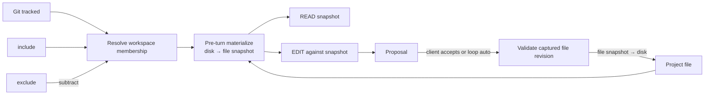

| Concern | Rule |
| --- | --- |
| Baseline and exceptions | To a workspace a project file is **invisible**, **added**, or **tracked by git**; ambient admission of untracked files is prohibited ({§fs-write-surface}). Exceptions enter only by exact creation records (`source: "create"`, origin `constraint` from accepted EDIT or COPY/MOVE destinations), standard instruction projection (`AGENTS.md` / `AGENTS.local.md` into `workspace:///_plurnk/…` unless ignored or excluded, {§session-initialization-entry}), or model `members` proposals under `PLURNK_SERVICE_MEMBERS_MODEL_SCOPE` ({§members-model-scope}) and `PLURNK_MEMBERS_AUTO_ADD` ({§membership-auto-add}). |
| Native Git and hermetic execution | Core Git reads (`git ls-files`, `git status`, `git check-ignore -v`) execute the installed Git binary with ambient `GIT_*` and global/system config scrubbed, `core.fsmonitor=false`, `core.hooksPath=/dev/null`, and only the daemon user's `core.excludesFile` preserved. Repositories declaring `filter.<name>.clean` or `filter.<name>.process` are skipped with a `git_inspection_refused` notice. `PLURNK_SERVICE_GIT_ALLOWED` gates `PLURNK_SERVICE_GIT_AUTO` ({§operator-config-git-ceiling}). |
| Ignore attribution and edit gate | An ignore refusal or `discover` verdict names its rule (`<file>:<line>`) from `git check-ignore -v`; negated patterns re-include paths. EDIT is bounded by membership: existing non-members refuse 403 before reading or writing bytes; accepted creations recursively create missing parent directories. |
| Web discovery and retrieval | Web search is an ordinary MCP concern ({§mcp-tool-presentation}); executors prefetch discovered pages through the generic `content: null` `entry()` request ({§execution-output-identity}) into `WebFetcher`, which materializes sanitized readable projections under canonical HTTP URLs ({§scheme-address}) and omits failed candidates. |

### §membership-auto-add Overlay, auto-add, and SQL reconciliation

`workspace_constraints` holds projected `members` definitions (`source: "members"` for human definitions, `source: "model"` for model definitions, `source: "create"` for accepted creations) and `!glob` exclusions ({§members-projection}). Only `source: "members"` inclusions override active Git ignore; exclusions mask creation records without deleting their provenance ({§fs-write-surface}).

- **Auto-add (`PLURNK_MEMBERS_AUTO_ADD=1`)**: Model READ and FIND see untracked, non-ignored files under `project_root` minus exclusions. Listing FIND rows mark candidates `untracked` without admitting them; content READ or text-matching FIND proposes a `202` host-effect admission (`{"files": [...]}`) under `PLURNK_SERVICE_MEMBERS_MODEL_SCOPE` ({§proposal-202-pauses}, {§proposal-accept-applies}, {§proposal-reject-fails}), emitting one `member_added` notice per admitted path ({§notice-directive}) and re-running the operation. Client operations and `PLURNK_MEMBERS_AUTO_ADD=0` read members only.
- **Set reconciliation and SQL globs**: Membership reconciles in two SQL set statements (`INSERT … SELECT FROM json_each` and `DELETE … WHERE pathname NOT IN (json_each) RETURNING`), recording EMI divergence only when a removed path also left disk truth. `glob_match(pathname, glob)` (`src/core/glob_match.ts`) evaluates {§find} directly in SQLite queries over `workspace_constraints`.

### §derivation-dedup-parallel Materialization, source projection, and search derivation

| Disk source | Durable body and materialization rule |
| --- | --- |
| Text within `PLURNK_SERVICE_FILE_MATERIALIZE_MAX_BYTES` (`1..104857600`) | Verbatim Unicode under the detected textual mimetype; READ and EDIT use the snapshot. |
| Binary with or without readable projection | Bounded by {§mimetype-binary-input}: readable projections store derived `text/markdown` (EDIT returns 415); unprojectable binaries store an empty marker under the binary mimetype (READ uses {§binary-parity}, EDIT returns 415). |
| Oversized or failed acquisition | Remains a member with an empty body channel carrying a durable 413/failure producer result; stat-gated until policy or file metadata changes, while whole-file KILL streams a digest without materializing the body. |

Search maintenance deduplicates by hashing the representation's `content_hash` ({§tokenomics-content-hash-identity}), mimetype, reader identity, and `PLURNK_SERVICE_SEARCH_EXCLUDE` pattern without loading unchanged channel bodies into the process:

- **Bounded parallel derivation**: Distinct pending artifacts sort smallest-first and run under `PLURNK_SERVICE_DERIVE_CONCURRENCY`, writing symbol graphs in `PLURNK_SERVICE_DERIVE_STORE_BATCH` batches and joining all launched siblings before settling. Changed passes emit `preparing`, `indexing` heartbeats (`PLURNK_SERVICE_DERIVE_PROGRESS_HEARTBEAT_MS`), and `complete`/`failed` notices; FTS reads text from `{§content-store}` and retains `{§mimetype-parse-issues}` and `{§mimetype-summary}` metadata.
- **Member-local derivation failures**: Each completed artifact records `indexed`, `excluded`, `unsearchable`, or `failed`. A handler defect on one member (`MimetypeDerivationError` under {§mimetype-derivation-evidence}, or `MimetypeInputError` under {§mimetype-error-policy}) attaches a terminal `failed` disposition for that representation and completes the pass with a `level: warn` `search_progress` notice naming the failed member; contract, persistence, missing-grammar, or abort failures remain fatal to the pass and leave the artifact `building` for retry.

### §file-snapshot-revision Snapshot revisions and serialized file commits

Materialization checks physical identity and raw-byte digest (never timestamps alone), publishing the revision and channels in one database statement and recording observed external changes as `source="file"` `EDIT` rows ({§env-delta-filesystem-narration}). Final validation, atomic temp-file-and-rename publication or deletion, and projection settlement serialize per physical path within the daemon:

| Commit boundary | Filesystem and settlement outcome |
| --- | --- |
| Captured revision matches disk | Publish staged bytes atomically (preserving mode/ownership on replacement) or unlink source (`KILL`/`MOVE`), stamping the new revision from written bytes so native writes are not narrated as external divergence. |
| Unknown baseline or observed drift | Return `409 edit-collision` without mutating disk ({§line-anchors} separately guards anchored neighborhoods before proposal). |
| Partial publication or rollback | If incorporation fails after existing-file replacement, report the partial update; if incorporation fails after new-file creation, unlink only the unchanged creation; if `MOVE` source drifts after destination publication, keep both and report conflict ({§move}). |

## §session-loop-lifecycle Loop scheduling and lifecycle

A session is a log plus a cancellation scope (`AbortController`) advanced by at most one registered per-session drain that claims queued loops (`100 → 102`). A Session is live while any of its loops is unresolved (`100`, `102`, or `202`).

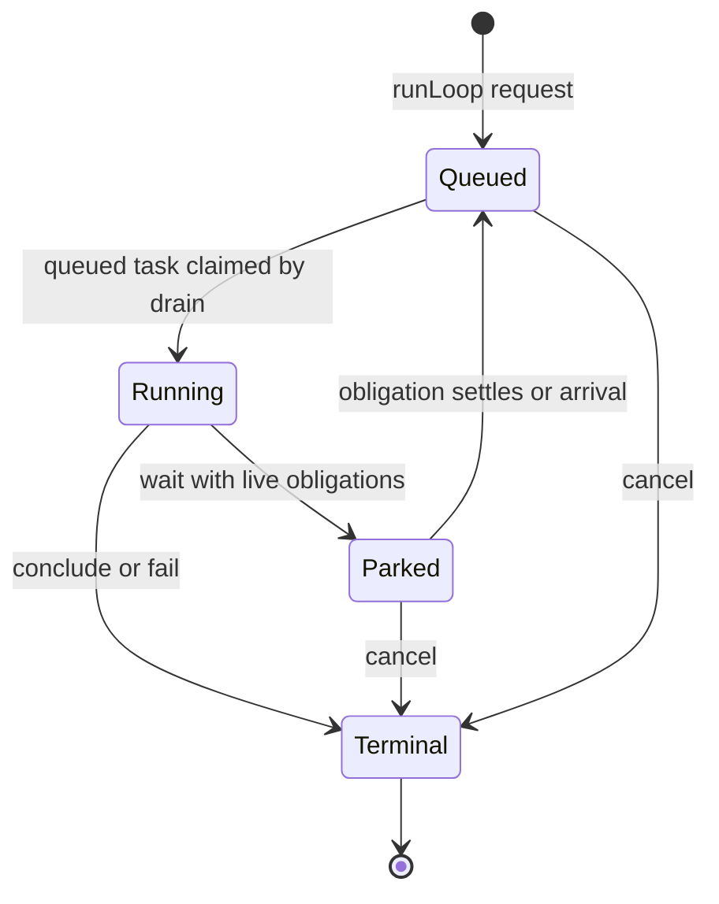

| Invariant | Contract |
| --- | --- |
| State machine and terminal result | Only `100 → 102`, `102 → 202`, `202 → 100`, and unresolved-to-terminal transitions are admitted; terminal rows are immutable and must carry `loops.terminal_result` (exact status and RFC 9457 Problem Details), while active rows have `terminal_result = NULL`. Completion and cancellation never borrow the last reply's body. |
| Independent collection (`425`) | Reading an unfinished child (`READ (session://<running-child>)`) returns `425 Too Early` without a strike or scheduler side effect; `WAIT` joins live obligations (`{§loop-completion}`). |
| Stream and child wake matrices | Streams are durable session subscriptions (`[0].stream: { state, ... }`, {§subscriptions}). At `WAIT`, open streams or live children park the loop (`202`); closed streams or terminated children with undelivered results continue immediately (`102`) to observe the terminal delta; `[0]` or `[{"lifetime":"turn"}]` streams reap at the next pre-turn boundary. |

### §session-wait-timing Durable waits, wake identity, and execution allowance

When a loop parks on live work, `PLURNK_SERVICE_WAIT_SEC` (or `WAIT [seconds]`, `{§send-wait-scope}`) commits `wait_until` atomically with the wait revision; `WAIT [0]` or an idle `WAIT` continues at `102` without parking.

- **Wake identity and completion revision**: Timers and wakes bind to the exact loop and wait generation. Each loop captures the session's completion revision and acknowledges it before inference only after every addressed reply/child terminal has crossed the observation cursor and every closed stream has published its terminal channels.
- **First-claim latency and execution allowance**: `loops.claimed_at` is stamped once by trigger on first entry to `102`. The first execution snapshots `PLURNK_SERVICE_LOOP_TIMEOUT` ({§operator-config-loop-timeout}) on the loop; active execution segments (inference, retries, turn-lock waits, proposal waits, optimistic holds) consume that allowance via a monotonic clock, while parked/queued/offline intervals do not. Exhaustion aborts execution with `504`.
- **Recipient selection and loop-addressed admission**: Unaddressed session arrivals select the running loop, else the oldest parked loop, else a new queued loop under the session's admission lock. When `runLoop` specifies an explicit `loopId`, admission requires that exact loop to belong to the session and remain unresolved, failing `409 daemon/admission/loop-not-open` rather than falling back to a new loop.

### §session-causal-admission Drains, cancellation, settlement, and restart recovery

`DrainSupervisor` serializes message admission, orphan-message recovery, and recursive subtree cancellation within the workspace, holding at most one active drain per session and re-checking the queue before relinquishing the drain slot.

| Mechanism | Rule |
| --- | --- |
| Recursive cancellation and epoch bound | `lifecycle_cancel_sessions` and the `sessions_cancel_live_loops` trigger atomically record `cancelled_through_sequence` and terminalize unresolved loops (`499`, `terminated_by = 'cancel'`) across the session subtree, while process-local teardown invokes every durable open subscription's live cancellation handle (`PLURNK_SERVICE_EXEC_KILL_GRACE_MS`) and aborts pending proposal waiters (`daemon_stopping`, {§proposal-cancel-aborts}). Streams bind to the cancellation scope captured at spawn; cancelled work never resurrects its scope. |
| Child wake and optimistic settlement | Every child task completion notifies its direct parent without injecting a prompt. Before model dispatch, `PLURNK_SERVICE_OPTIMISTIC_WAIT_MS` (default 5s; `0` disables) bounds both initiating-turn stream settlement and wake holds that coalesce sibling stream/child arrivals while another obligation remains live. |
| Durable disposition and idle rule | A loop concludes only under {§loop-completion}; a concluded session retains history and starts a new loop on a later addressed arrival. At turn boundaries, a committed `202` park survives a racing daemon-shutdown abort. |
| Daemon lock and restart recovery | Before opening transports, the daemon acquires an exclusive database-adjacent lock (`DaemonLock`), replacing dead-PID claims atomically. Boot recovery commits atomically: `100` loops restore drains; `102` loops, pending provider calls, proposed operations (`owner_vanished`, {§proposal-list}), and open subscriptions settle `500`; pending client interactions are removed ({§client-interactions}); and `202` loops requeue if obligations settled or restore guarded wait timers. |

### §turn-record Producer-neutral turn record

Every turn (`producer`: `model | client | _plurnk`; `kind`: `inference | initialization | operation | maintenance`) opens at status `102` (`completed_at = NULL`), orders operations by `(turn_id, sequence)`, preserves source-backed programs in `turn_sources` ({§log-history-projection}), and records `packet`/provider evidence only on `model`/`inference` turns.

- **Shared admission and selection snapshot**: Every admitted program parses once and dispatches through the same executor, which captures the session's log high-water mark before statement dispatch so log-targeted `KILL` operations cannot select rows emitted by their own turn (including `{§turn-source-resources}`).
- **Exceptional inference exits**: An exceptional exit completes any still-open turn it acquired without overwriting completed turns or fabricating provider evidence—settling `499` when caused by the owning abort signal, `504` on `LOOP_TIMEOUT_REASON`, and `500` on unrelated or `AggregateError` failures—and rethrows the original cause.

### Engine notifications: one bundle of daemon callbacks

The daemon's observation callbacks (stream, reasoning, outside-text and packet events, session wake, inject and cancel, operation settlement, and notices) are passed to `Engine` as one flat `EngineNotifications` bundle consumed directly by internal collaborators.

### §engine-rails Engine rails, cycle evidence, and provider recovery

After each admitted turn, the engine evaluates one inline rail verdict. Rail state (strike streak and cycle window) belongs to the durable loop across wakes and restarts, closing the cycle window on an actual `202` park or an output-allowance-cut turn ({§output-allowance-notice}).

| Mechanism | Rule |
| --- | --- |
| Strike sources and progress immunity | A turn earns at most one strike from: (1) a hard non-execution operation or parse failure (`status >= 400`, excluding soft `404`, `409`, `416`, `425`, `501` and `{§matcher-refusal}`), (2) an exact operation+result cycle across `MIN_CYCLES × MAX_CYCLE_PERIOD`, or (3) an empty turn ({§outside-text}). A turn where any task-acting operation succeeded (`status < 400`, excluding `NOTE`, `WAIT`, and targetless `SEND`) is immune to hard-result strikes and resets the streak. Crossing `PLURNK_SERVICE_MAX_STRIKES` terminates at `508` (cycle) or `500` (`output_allowance`, `repetition`, `no_operation`, or `operation`, citing `{§outside-text}`). |
| Cycle identity | Hashes ordered executed operations and results (operands, scopes, bodies, metadata, and `NOTE`/response bodies; or raw text for empty turns), ignoring source positions, asides, Problem `instance` URIs, and `NOTE` storage coordinates. |
| Provider recovery | Retryable provider failures ({§provider-retryable-truth}) record a `_plurnk` Problem row, emit `provider_unavailable`, back off (`PLURNK_SERVICE_PROVIDER_RECOVERY_BACKOFF` up to `PLURNK_SERVICE_PROVIDER_RECOVERY_BACKOFF_MAX`), and reissue against the frozen messages up to `PLURNK_SERVICE_PROVIDER_RECOVERY` without consuming emission attempts or scoring strikes (applicable to loop inference and `{§op-methods-op-dispatch}`). When recovery is exhausted, interactive sessions park at `202` ({§session-ownership}) while non-interactive sessions terminate with the provider's exact failure. |

## §provider-surface Provider Contract

Core consumes [`@plurnk/plurnk-providers`](../plurnk-providers/SPEC.md) through three entry points and one normalized inference ledger:

| Surface / Guarantee | Contract |
| --- | --- |
| `provider.generate(args)` | Invoked once per logical model call. Emission calls pass packet messages, session/turn coordinates, generation envelope, optional local grammar, attribution tags, and `callKind: "emission"`; `BARE` calls pass one user message plus call identity and `callKind: "bare"` ({§provider-call-kind}). Both wire `signal` to the session `AbortController` and supply `observeRequest({ provider, model })` to record each physical provider I/O before wire dispatch. |
| `provider.assessRequestCapacity` & `countPromptTokens` | Capacity verdicts ({§provider-capacity-admission}) govern context-envelope admission ({§tokenomics-context-envelope-admission}); `countPromptTokens` measures complete requests ({§provider-prompt-measurement}) without replacing the curation ruler. Provider capacity and identity are immutable per instance ({§provider-interface}). |
| Logical inference ledger | Every model call opens a `model_calls` row (`state = "pending"`), specialized by `turn_attempts` (turn-packet emissions) or `bare_inferences` (stateless `BARE` calls). Physical requests settle in `provider_requests`, and core verifies that returned `ProviderRequestAccounting` matches observed requests before accepting a response or classifying a `ProviderError`. |
| Metadata & `assistantRaw` | `generate` may return `meta: Record<string, unknown>` (defaulting to `{}`), persisted on `turns.meta` and forwarded opaque in `loopUsage(loopId).meta`. `assistantRaw` is opaque forensic evidence persisted on the attempt row. |

### §emission-admission Emission Admission, Retry, and Attribution

An emission attempt parses `assistant.content` as the operational turn program and `assistant.reasoning` for explicit `NOTE` blocks ({§reasoning-operations}):

| Outcome | Rule |
| --- | --- |
| Admitted response | Admitted when (a) `assistant.content` contains no fabricated log heading (`### log:///` outside a fenced block) and (b) either `parseStatements(assistant.content)` has no unparsed tail boundary ({§unparsed-tail-boundary}), at least one closed statement precedes the lost boundary, or `finishReason === "length"` ({§outside-text}). Admitted statements execute in source order; bounded parse errors record `400` log rows without resampling. |
| Private retry (`PLURNK_SERVICE_EMISSION_ATTEMPTS`) | When the entire emission is rejected before any statement closes (or fabricates a `### log:///` heading), core records `accepted = 0` on `turn_attempts` and re-invokes `generate` with the exact same `messages` up to `PLURNK_SERVICE_EMISSION_ATTEMPTS` (default `3`), keeping prompt caches warm. |
| Exhaustion & recovery turn | Exhausting private attempts completes the turn at `102` without fabricating an `error` log row, records a durable body-suppressed `_plurnk` `emissionAttempt` row, and scores one contract strike ({§session-loop-lifecycle}). If the strike rail does not terminate the loop, the next turn projects the latest rejected text and parser diagnostic once in `notices`. |
| Attribution & client metadata | Each attempt queries `attributions(context)` across schemes, executors, mimetypes, and the provider ({§extension-attribution}), passing the deduplicated sorted tags on `generate` and persisting them on `turn_attempts`. Workspace `settings.client` (`1..128` printable ASCII chars) is stored on `workspaces.settings` and never sent to providers. |

### §provider-instantiation Provider Instantiation and Operator Grammar

`ProviderInstantiate` resolves model selectors through `@plurnk/plurnk-aliases` ({§alias-env-contract}) and constructs providers via `ProviderRegistry` (`discoverExternal`, `register`, `has`, `list`), caching instances by canonical `(provider, model, baseUrl, alias)` spec. `Mock` from `@plurnk/plurnk-providers` serves deterministic integration suites ({§mock-provider}).

| Mechanism | Rule |
| --- | --- |
| Operator grammar (`PLURNK_PROVIDERS_GBNF[_<alias>]`) | Resolves per alias (empty string disables) as a filesystem path (absolute or relative to daemon `cwd`) read via `readFileSync` on each `generate` call and passed as `grammar`. Unreadable paths fail before inference; `ProviderInstantiate.validateGrammarConfiguration` refuses providers that do not set `constrainsOutput === true`. Turn `meta.railsAttached` records `"client"` or `"withheld"` from `ProviderResponse.grammarEvidence`. |

---

## §scheme Scheme Contract

Core mediates between the model and scheme handlers ([`@plurnk/plurnk-schemes`](../plurnk-schemes/SPEC.md)). Data and streaming schemes store resources in `entries` and `entry_channels`; control schemes (`session`, `plurnk`) act on runtime state without entry rows.

### §scheme-address Scheme Addressing and Entry Matrix

Core decomposes targets via RFC 3986 / WHATWG URL parsing ({§path-grammar}): namespace schemes fold authority into `pathname` (`authority = ""`), network schemes preserve `hostname[:port]` in `authority` and serialize `?query` into `pathname` ({§url-decomposition}), and `#fragment` selects the channel ({§channel-selection}). Client `entry.read` acquires addresses through the same exact-READ pipeline.

| Scheme | Category | Address & Ownership | Mutability & Scope |
| --- | --- | --- | --- |
| `file` | `data` | Project-relative or `../` canonical key (`authority = ""`); workspace-owned | Model/client `EDIT` (with `textEditScopes` & `lineAnchors`), `COPY`, `MOVE`, `KILL` (reviewed via `202` proposals) |
| `workspace` | `data` | `workspace:///<path>`; workspace-owned scratchpad | Model/client `EDIT` (`textEditScopes` & `lineAnchors`), `COPY`, `MOVE`, `KILL` |
| `session` | `data` / `control` | `session://[<handle>]/<path>` (entry) or `session://<handle>` (actor); session-owned | Entry: model/client `EDIT`, `COPY`, `MOVE`, `KILL`; Actor: `SEND`, `WORK`, `FORK`, `KILL` |
| `http`, `https` | `data` | `http(s)://<host>[:<port>]/<path>[?<query>]`; workspace-owned | Acquired on `READ`/exact `FIND`; outbound `SEND` proposes (`202`); `lineAnchors: true` |
| `<runtime>` (`sh`, etc.) | `streaming` | `<runtime>:///<id>`; workspace-owned execution output | Created by runtime invocation; `READ`/`FIND` streams (`lineAnchors: true`), `SEND` stdin, `KILL` process |
| `log` | `data` | `log:///<loop>/<turn>/<seq>/<op>`; session-owned log receipts | `READ`, `FIND`, and context-curation `KILL` |
| `message`, `ops`, `reasoning`, `note` | `data` | `<scheme>://[<session>]/<coordinate>`; session-owned turn sources | Immutable turn-source evidence; `READ` and `FIND` (`lineAnchors: true`) |
| `plurnk` | `control` | `plurnk (<noun>)`; control target | Administers `git`, `members`, `mcp`, or `update` |

### §fs-namespace Filesystem Namespace, Canonical Naming, and Refusals

All `file` operations resolve targets through `Namespace` and `plurnk-uri` before touching SQLite or disk:

| Rule | Contract |
| --- | --- |
| Name resolution & home expansion | Local paths and `file://` URLs (decoded once from percent-encoding; rejecting `%00`, `%2F`, invalid UTF-8, or non-empty hostnames with `400 invalid-file-url`) resolve against `project_root` (or `os.homedir()` for `~` / `~/...`). A literal in-root `~` segment is written `./~`. |
| Canonical key & wire canon | Inside `project_root`, the stored `entries.pathname` and wire address are the normalized relative path (`src/a.ts`); outside `project_root`, the stored key is the relative climb (`../sibling/a.ts`) while model-facing wire/problem rendering spells the absolute path. Model-authored non-canonical spellings (`/abs/in/root` or `~/...`) resolve to the canonical key and emit a `path_normalized` notice. |
| Visibility & directory targets | Only paths granted by `git` or `constraint` (`members` / `create`) exist in `file`. Addressing a directory on `READ` or `KILL` returns `404 path-is-directory` with recovery `FIND (<dir>/)`; on `EDIT` it returns `403 path-is-directory`; on `FIND (<dir>)` (with or without trailing `/` for in-root directories) it surveys member descendants. |
| Read/miss refusals | Inside `project_root`, a missing path returns `404 entry-not-found` naming `FIND`, `EDIT`, and `plurnk (members)`; an on-disk non-member returns `404 entry-not-member` naming either the active exclusion rule, the ignoring Git file and line (`.gitignore`, `.git/info/exclude`, user excludes), or `plurnk (members)`. Outside `project_root`, any miss or non-member returns the identical `404 entry-not-found` naming the absolute address without revealing disk presence. |

### §fs-write-surface Filesystem Write Surface and Creation Incorporation

Existing member writes follow their grantor (in-root members and constraint-granted outside members are read-write; Git-only outside members are read-only). Creating a new file is one producer-neutral transaction across `model`, `client`, and `_plurnk`:

| Stage / Case | Contract |
| --- | --- |
| Creation scope (`PLURNK_SERVICE_FILE_CREATE_SCOPE`) | Effective scope is `min(serviceScope, workspaceSettings.fileCreateScope)` over `none < root < namespace` (default `root`). `none` refuses all new files (`403`); `root` admits absent paths whose lexical and realpath parents stay inside `project_root`; `namespace` also admits absent `../` paths. |
| Exclusions & occupancy | Active member exclusions (`!glob`) always refuse creation (`403`). Git-ignored paths refuse creation (`403`) unless explicitly included by a `members` constraint. An existing non-member file on disk refuses creation with `403 path-occupied-by-nonmember`. |
| Atomic incorporation (`source = "create"`) | On proposal acceptance (re-verifying parent realpath against symlink swaps), core writes the file exclusively (`wx`), materializes the `file` entry, and inserts an exact literal `workspace_constraints` pick (`source = "create"` unless already covered by `members`) without running `git add`. If incorporation fails, disk and DB roll back together (`500 creation-incorporation-failed`). `KILL` or ambient disk deletion removes the `source = "create"` pick while preserving explicit `members` rules. |

### §scheme-manifest Scheme Manifest and Entry CRUD

Every scheme class declares a static `SchemeManifest` (`name`, `channels`, `defaultChannel`, `category`, `writableBy`, `volatile`, `modelVisible`, optional `textEditScopes`, `lineAnchors`, `unmanaged`), validated at registration by `SchemeRegistry`.

| Primitive | Contract |
| --- | --- |
| `EntryCrud` (`entries` & `entry_channels`) | `writeEntry` upserts the `entries` row (stamping `workspace_id` and `session_id` for session-owned schemes) and replaces/upserts `entry_channels` inside one transaction, preserving `deep_hash` when a channel's `(content_hash, mimetype)` is unchanged and clearing `deep_hash` (touching `updated_at`) only when representation changes. `deleteChannel` removes one channel and prunes the `entries` row only when no channels remain. |

### §op-methods-op-dispatch Operation Dispatch, Execution Order, and Bulk Targeting

Core executes admitted statements sequentially in authored order within a turn:

| Mechanism | Contract |
| --- | --- |
| Sequential execution & cancellation | Each statement observes the resource and log state committed by earlier statements in the same turn (except `log` `KILL`, which snapshots pre-program log rows so a turn cannot curate its own in-flight receipts). Runtime `plurnk (mcp)` mutations update parser executor tags for subsequent statements in the same turn. Aborting the loop signal stops dispatch after the current settled effect and marks the turn `499`. |
| `EDIT` batches & anchor continuity | Multiple `EDIT`s to the same resource or a single `EDIT` with multiple regions execute against successive states, carrying forward untouched `@hash` line anchors across numeric splices ({§line-anchors}), tolerating `@hash+N`/`@hash-N` offsets, and merging adjacent rendered prefix echoes when uniquely evidenced. |
| Bulk resource targeting (globs) | A glob target on `READ`, `EDIT`, or `KILL` expands against the full unpaged `FIND` match set in deterministic path order, subject to `maxCommands` (`PLURNK_SERVICE_MAX_COMMANDS`). Empty `EDIT`/`KILL` globs produce one `204` receipt. `COPY` and `MOVE` require each glob operand to match exactly one resource (`400 target-cardinality` otherwise). |
| `BARE` inference & `SEND` attachments | `BARE` resolves its prompt (inline body or single-resource target), selects the loop's child provider policy (`spawn_model_route_id`, `PLURNK_MODEL_CHILD`, or parent route), and runs one toolless, historyless inference call. `SEND` on entry schemes without a `send` handler returns `501`; `SEND` with `[path]` metadata attaches resolved resource snapshots into durable `message_envelopes`. |

### §scheme-surface Universal READ/FIND Composition and Scheme Guards

Core enforces `manifest.writableBy` before invoking mutation handlers (returning `403` on unauthorized producers) and catches unhandled scheme exceptions as `500` Problem rows.

| Composition | Contract |
| --- | --- |
| Universal `READ` | Resolves the target entry and channel (calling optional `prepareRepresentation` first for on-demand schemes like `http`/`https`), slices line/byte ranges or regex/structural matchers against the stored representation, and projects line anchors and sibling channel token weights. `http`/`https` responses honor shared-cache `Cache-Control`, `ETag`/`Last-Modified` `304` revalidation, and `no-store` / mutation-method provenance. |
| Universal `FIND` | Data schemes inherit standard catalog, regex, structural, FTS (`~query`), and symbol-graph (`&query`) `FIND` after optional `prepareFind` / `prepareRepresentation`. Non-data schemes without `find` return `501`. |

---

## §mimetype Mimetype Contract

`Daemon` owns and disposes the `@plurnk/plurnk-mimetypes` instance ([SPEC](../plurnk-mimetypes/SPEC.md)), exposing detection, binary classification, readable projection, and AST/symbol extraction:

| Boundary | Contract |
| --- | --- |
| Write-time detection vs. projection | Scheme writes resolve mimetypes via `PathMimetype` / `mimetypes.detect` and invoke handlers only to derive a sibling `#readable` Markdown channel when eligible ({§channel-selection}) — never invoking structural queries at write time. |
| Binary classification & source projection | `MimetypeBinary` uses `mimetypes.classify` to govern UTF-8 decoding, binary `EDIT` refusals (`415`), raw byte `READ` slicing ({§binary-parity}), and search exclusion. Binary files with a readable handler (e.g., PDF facts) persist derived Unicode and refresh when `projectionIdentity(mimetype)` changes; over-limit or unprojectable binary sources record `sourceProjection.disposition` (`"input-limit"` or `"unavailable"`) and remain byte-readable. |

---

## §persistent-search-index Search indexing

`SearchIndex` maintains workspace-shared, content-addressed derivations (`derivation_artifacts`, `derivation_fts`, `derivation_symbols`, `derivation_references`) keyed by `deep_hash = SHA-256(content_hash, mimetype, binary_classification, projection_identity)`:

| Invariant | Contract |
| --- | --- |
| Exact channel indexing & deduplication | Derivations index the exact stored channel content in its own coordinate space. Identical `deep_hash` inputs across entries or workspaces build once and attach the shared artifact without touching `entries.updated_at`. Concurrent channel mutations reject stale in-flight derivation attachments. |
| Eligibility & size bounds | `_search-exclusion` excludes binary channels (except HTML/readable text), lockfiles, minified/bundled assets, and channels exceeding `PLURNK_SERVICE_SEARCH_MAX_BYTES`, recording `disposition = "unsearchable"` so maintenance stays exhaustive without re-probing excluded content. |
| Exhaustive warming (`warmWorkspaceDerivations`) | Runs at workspace creation and before model turns (joining any in-flight warm before calling the provider), materializing repository members and streaming `search_progress` notices (`preparing` → `indexing` → `complete`, with `loopId: 0` when workspace-scoped). |

---

## §channels Channel Topology

Every entry in `entries` owns one or more named channels in `entry_channels` keyed by `(entry_id, name)`, each with its own `content`, `mimetype`, token `weight`, `content_hash`, `deep_hash`, and `state ∈ {static, active, closed, errored}`:

| Property | Contract |
| --- | --- |
| Per-channel mimetype & state | Mimetype is a `(scheme, channel)` property; cross-mimetype `COPY`/`MOVE` follows {§mimetype-verbatim-transfer}. `state` is lifecycle metadata owned by the scheme (e.g., `exec` transitions `active → closed`/`errored`) and never gates `READ` or `FIND`, which always serve accumulated content. Entries carry no visibility column. |

### §channel-selection Channel Selection and Readable Projections

URL fragments (`#channel`) select channels across `READ`, `FIND`, `EDIT`, `COPY`, `MOVE`, and `KILL`:

| Rule | Contract |
| --- | --- |
| Default vs. named fragment | Fragment-less targets select `manifest.defaultChannel` (`body` for data schemes, `stdout` for `exec`). A `#channel` fragment selects that named channel; `EDIT` with a fragment on a non-existent entry returns `404`, and `KILL (path#channel)` deletes only that channel. Unknown channels return `404 channel-not-found` listing `availableChannels` (and naming the execution stream URI when a `log` execution receipt is addressed with `#stdout`/`#stderr`). |
| `#readable` sibling channel | When an HTML or rich-text source is written or fetched into `body`, core derives its Markdown projection into the sibling `#readable` channel (`text/markdown`), refreshing or removing `#readable` whenever `body` changes. `#readable` is read-only (`400 channel-derived` on `EDIT`, `COPY`/`MOVE` destination, or `MOVE` source; `COPY` from `#readable` is allowed). |
| Decision-time visibility | Catalog `FIND` emits a resource's channel group with the default channel first and non-empty siblings (`#readable`, `#stderr`) beside it; channel-scoped `FIND` matches and ranks in the addressed channel's coordinates (omitting `channel` on match locations only when it is the default channel); and `READ` on a multi-channel entry returns sibling channel token weights in `channels` (e.g., `{"#readable": 420}`). |

---

## Op Surface

Per-op semantics. AST shapes come from `@plurnk/plurnk-contracts`'s `PlurnkStatement`. Engine dispatches by `op`; scheme implements per author contract ({§scheme}).

## §line-anchors Text line anchors

A scheme declaring `lineAnchors: true`, or `textEditScopes: true` with model write authority for the addressed resource, publishes the contracts-owned 5-character base62 anchor token `@xxxxx` on every rendered line (`<line><@xxxxx><content>`) and accepts `<@a>`, `<@a,@b>`, `<@a+N>`, and `<@a-N>` in scope slots ({§language-scopes}). Schemes without write authority render `<line>:<content>` without anchor tokens.

```text
hash_input = canonical_target_NFD + "\0" + prev_trim + "\0" + curr_trim + "\0" + next_trim
token      = base62( sha256(utf8(hash_input))[0..4] )   // 5 base62 chars from first 4 bytes
```

- Boundary lines use `""` for missing neighbors; `\r\n` is normalized to `\n` before splitting and trimming.
- If a token matches one line, it resolves to that 1-indexed line ordinal regardless of vertical shift; if 0 lines match, resolution fails `409` `edit-collision`; if 2+ lines match, resolution fails `409` `anchor-ambiguous` with candidate line numbers unless paired with a unique boundary or narrowed by a prior anchor in a range.
- Anchor offsets (`@a+N`, `@a-N`) resolve line `L ± N` after resolving `@a`; out-of-range offsets fail `416`.

## §edit EDIT

```text
EDIT (<target>) [<scope>] [<pattern>] [<!-- aside -->]
<body>
```

| Form | Behavior |
|---|---|
| Absent resource (no scope or `<0>`/`<1>`/`<-1>`/`<1,-1>`/`<1,M>`/`<1,1,1,1>`) | Creates resource (`201`) with `body`. Scopes beyond line 1 on empty content fail `416`. |
| Existing resource, no scope and no pattern | Refused `400` (`marker-required-on-existing`); full replacement requires `<1,-1>`. |
| `<L>` / `<L,M>` / `<@a>` / `<@a,@b>` | Replaces inclusive line span `L..M` with `body` (`200`, or `304` when unchanged). Empty body removes the selected lines. |
| `<0>` / `<-1>` | Prepends before line 1 (`<0>`) or appends after the last line (`<-1>`). |
| `<L1,C1,L2,C2>` | Splices exact half-open character span `[C1, C2)` across `L1..L2` ({§character-range-splicing}). `<L,1,L,1>` inserts before line `L` using the resource's line separator. |
| Consecutive same-target `EDIT`s in one turn | Validated and applied as one atomic batch against the pre-batch snapshot; overlapping regions fail `409`, and any failure rejects the whole batch. |

### §edit-pattern Pattern EDIT

An `EDIT (<target>) [<scope>] <pattern>` selects matching spans within the canonical source (bounded by `<scope>` when present) and replaces each matched span literally with `body` (no capture-group interpolation):

- **Regex / literal / FTS5 / structural (JSONPath, XPath, `&graph`)**: replaces each matched character region; a glob with metacharacters replaces each matched whole line.
- **Zero matches**: returns `204` with `matched: 0` and leaves the resource unchanged.
- **Unlocated structural match**: fails `422` `pattern-source-unlocated` without partial writes.
- **Binary target**: fails `415` `binary-edit-unsupported`.

## §read READ

```text
READ (<target>) [<scope>] [<pattern>] [<!-- aside -->]
```

| Form | Behavior |
|---|---|
| Exact target, no scope, no pattern | Returns first page (`PLURNK_SERVICE_PREVIEW_LINES` / `PLURNK_SERVICE_PREVIEW_CHARS`, {§context-fit}). |
| Exact target, `<L>` / `<L,M>` / `<1,-1>` / `<L1,C1,L2,C2>` | Returns the requested slice (`200`), clamped to the resource end when `L <= total < M`. Starts past `total` fail `416` (naming the execution stream when reading a bodyless invocation row). Empty resources return `204`. |
| Exact target, `<pattern>` (with optional `<scope>`) | Returns every line touched by a match within `<scope>` at its physical ordinal with line anchors, plus `matched` count and `matches` evidence (`204` when `matched: 0`). |
| Glob / folder target, `<pattern>` (with optional `<scope>`) | Fans out into one exact pattern `READ` receipt per matching resource in `FIND` order (with `attrs.fanout`), or one `204` receipt on the glob when none match. |
| Glob / folder target, no pattern | Fans out into one ordinary preview `READ` receipt per matched resource. |

### §binary-parity Binary parity and byte views

Binary resources participate in `READ`, `FIND`, `COPY`, `MOVE`, and `KILL` without base64 text corruption:

- **Storage & transfer**: DB entries store binary channels as base64 in `content` with their binary `mimetype`; `COPY` and `MOVE` transfer exact bytes (whole, by 1-indexed byte range `<B1,B2>`, by byte- insertion `<B>`, or by regex/glob/FTS byte pattern) across files and entries. Textual anchors (`@xxxxx`) and 4-position character spans on binary targets fail `416`.
- **Byte view (`#bytes` or default binary `READ`)**: projects one lowercase hex octet per line (`1:89\n2:50...`) with `unit: "byte"` while preserving the source `mimetype`.
- **Binary `FIND`**: searches raw decoded bytes for regex/glob byte runs and never indexes or matches base64 text.

## §log-history-projection The Log

The session log (`log:///<L>/<T>/<A>[/<leaf>]`) is an append-only SQLite ledger (`log_entries`) paired 1:1 with mutable active-context state (`log_entry_projection`):

- **Coordinates**: `L` (1-indexed loop sequence), `T` (1-indexed turn sequence within loop), `A` (1-indexed action sequence within turn). The optional `/<leaf>` suffix names the op or kind (`READ`, `EDIT`, `emission`, `reasoning`) and aliases the same row. Foreign session authorities (`log://other/...`) are refused `400`.
- **Immutability & redaction**: Core `log_entries` columns and `log_curation_effects` rows are protected by SQLite triggers and cascade only when containing history is deleted. Before any durable persistence, Packet assembly, fork hydration, or Digest export, URL `username`/`password` and `metadata` slots are replaced with `"__redacted__"` while query strings remain visible.
- **Direct curation**: `KILL (log:///...)` is an active-context meta-operation; a successful `log:///` `KILL` never renders its own receipt in the packet, whereas non-log `KILL` receipts (e.g., workspace/file deletions) render and remain visible.

### §log-kill-scope Scoped curation, distillation & readable projection

- **Row retirement vs. line trimming**: An unscoped `KILL (log:///<target>)` (including globs, folder scopes `log:///1/`, and brace sets `{READ,NOTE}`) retires matched rows (`active = 0`). A scoped `KILL (log:///<L>/<T>/<A>) <range|pattern>` folds the selected 1-indexed body lines into canonical merged intervals in `log_entry_projection.folded`. Scope `<0,-1>` fails `416` with recovery guidance.
- **Distillation**: A `KILL (log:///...)` with a non-whitespace body writes a model `NOTE` row at the next sequence with `attrs.distilled` naming the target as written (even if the `KILL` missed with `404`), retaining the note as a `note://` turn source.
- **Readable projection**: `READ`, `FIND`, `COPY`, and `MOVE` against `log:///` operate on the curated projection in original physical line coordinates—omitting folded lines, pricing only visible lines, invalidating stale search derivations on trim, and decomposing `MOVE` from `log:///` into `COPY` + `KILL`.

### §log-wire-format Wire format, patch, extent & native attachments

- **Packet headings & extents**: Each rendered log row opens with `### log:///<L>/<T>/<A>/<leaf> [(<target>)] · <tokens>`, followed by compact metadata lines (`status`, `range` formatted as `<a,b> of N lines|bytes|resources|match locations`, `trimmed`, `effect`, `change`, `extent`).
- **Mutation patch & rollback**: Every settled text mutation on a workspace file records a unified diff in `log_entries.patch` (readable via `#patch`, `404` on binary/patchless rows, preserved across `FORK`). Rollback reverses patches in reverse sequence order.
- **Native media attachments**: When a `READ` targets a media resource (`image/*`, `audio/*`, `application/pdf`) whose modality the route supports, `NativeContent` snapshots the complete original bytes by SHA-256 and attaches the file part beside the `READ` row on every subsequent turn until that `READ` row is `KILL`ed. Routes without the modality receive the text/hex projection only.

### §turn-source-resources Turn sources, emissions & reasoning

Every turn records immutable source evidence in `turn_sources`, addressable across the workspace by session name:

- `ops://<session>/<L>/<T>`: the turn's admitted operation program (including `_plurnk` initialization surveys). For model turns with admitted content operations, the engine records one born-folded `_plurnk` announcement row (`### log:///<L>/<T>/<A>/emission (ops://<session>/<L>/<T>)`) before the turn's operations; retained content operations replay as `assistant` messages. Rejected emission attempts record an actionless `emissionAttempt` row.
- `reasoning://<session>/<L>/<T>`: the turn's final exposed provider reasoning (`204` when the turn had none, `404` when the turn does not exist). Operations fenced inside reasoning execute once after the stream completes; content operations replay in `assistant` history while reasoning operations leave their receipts in the log. When `PLURNK_SERVICE_REASONING_ROWS=1` and context budget permits after required results, the engine inserts a `_plurnk` `reasoning` preview row (bounded by `PLURNK_SERVICE_REASONING_TRAILING_LINES` or the shared page) immediately before the emission row.
- `note://<session>/<L>/<T>/<A>`: each admitted `NOTE` body, distillation, or interstitial outside-text note. All three schemes (`ops`, `reasoning`, `note`) are read-only (`403` on write/kill), hash-free (`400` on line anchors), indexed for `FIND`, and preserved under local coordinates on `FORK`.

### §edit-result-receipt-projection Mutation receipts & reviewer replacement

Every settled text mutation (`EDIT`, `COPY`, `MOVE`) produces a structured `EditReceipt` showing:

- `effect`: `<requested> -> <landed>` line coordinates (with `last` beside the first on multi-span pattern edits), `change: lines -R +I`, `extent: lines before->after`, and `parseIssues` delta when grammar recovery changes.
- `context`: the landed lines plus bounded surrounding context framed with fresh `<line><@xxxxx>` anchors (or a removal window when lines were deleted).
- **Reviewer replacement**: When a proposal is accepted with a reviewer-modified body that differs from the proposed content, the receipt records `disposition: "superseded"` and projects the reviewer's landed replacement as a single effect.

## §copy COPY (engine-orchestrated)

```text
COPY (<source>) [<source-scope>] [<source-pattern>] (<destination>) [<dest-scope>] [<!-- aside -->]
```

- Reads `source` (sliced by `<source-scope>` and/or filtered by `<source-pattern>`) and writes the selected content or bytes into `destination` at `<dest-scope>` (`201` created, `200` updated, `204` zero pattern matches, `304` no-op, `404` missing source, `403` read-only destination, `409` self-overwrite without scope). Patterns on `destination` fail `400` `pattern-destination-unsupported`.
- **Mimetype & proposal gate**: Cross-scheme and file writes go through the destination scheme's proposal and membership contracts. Copying binary bytes into a known textual destination mimetype fails `415` `mimetype-mismatch`; untyped destinations preserve raw bytes.

## §move MOVE (engine-orchestrated)

```text
MOVE (<source>) [<source-scope>] [<source-pattern>] (<destination>) [<dest-scope>] [<!-- aside -->]
```

- Decomposes into destination write followed by source removal: whole-resource `MOVE` (unscoped or `<1,-1>` onto a new/whole destination) deletes/unlinks the source resource and transfers generated membership picks; scoped or pattern `MOVE` removes only the transferred spans/bytes from `source` (using pre-mutation coordinates when `source` and `destination` are the same channel).
- **Proposal ordering**: When `destination` proposes (e.g., a file write), source deletion is deferred until the destination proposal is accepted; rejecting the destination proposal leaves `source` untouched. When `source` proposes (e.g., moving from a file to `workspace:///`), rejecting the source-delete proposal after destination write returns `409` with `destinationWritten: true`.

## §find FIND

```text
FIND (<target>) [<scope>] [<pattern>] [<!-- aside -->]
```

- **Target scope**: An exact path inspects that single resource; a trailing slash (`folder/`) or single-segment `*` lists immediate children (summarizing subdirectories as `dir/**` with item counts and token weights); `**` traverses recursively. Path globs support `*`, `**`, `?`, `[...]`, `{a,b}`, and extglobs, resolved strictly within workspace membership.
- **Content matchers**: Glob, regex (with `^`/`$` anchoring each line), JSONPath, XPath (over native or universal deep-JSON/deep-XML projections), and `&graph` symbol queries run against channel content, never against the pathname. Catalog rows include a 256-character `aside` summary (or full fenced invocation menu for tool docs).

### §find-result-projection Result projection & full-text search

- **Resource mode vs. match-location mode**: A broad target (glob or folder) pages matched resources (`unit: "resource"`), reporting `matchLocationCount` per resource and promoting `region`/`locator` only when `matchLocationCount === 1`. An exact target with a content matcher pages flat match locations (`unit: "matchLocation"`) with exact `region`, `locator`, and `matched` evidence. Markerless `FIND` returns the first page (`PLURNK_SERVICE_PREVIEW_LINES`); `<1,-1>` returns all; 3- or 4-position scopes fail `416`.
- **Full-text search (`~query`)**: Queries the persistent SQLite FTS5 index ranked by BM25 with deterministic path tie-breaking, isolated by workspace and literal scheme/authority namespace. Words with inner punctuation (e.g., `inherited-members`, `c++`, `a/b`) rewrite as phrase queries while preserving native FTS5 operators (`AND`, `OR`, `NOT`, `NEAR`, `"phrases"`, `prefix*`); malformed FTS5 syntax returns `400` with the parser diagnostic.

## §send Messaging and turn disposition

SEND AST: `{ op: "SEND", target: ParsedPath | null, body: SendBody | null, metadata, lineMarker }`.

- **Message:** SEND delivers to an actor (`session://<name>`), a scheme that implements SEND (`https://` POST), or an exact message address. Targetless SEND selects the oldest published Open Message. A SEND to a non-recipient scheme (e.g., `log://`) is refused `400 send-target-not-a-recipient`; a scheme without SEND returns `501`.
- **Workflow:** WAIT yields. The loop concludes from resolved messages, settled work, and observed results ({§loop-completion}). NOTE retains memory without parking or creating an observation obligation; KILL names something to cancel or curate.

### §message-completion Reply delivery and message completion

| Reply metadata | Delivery | Message obligation |
| --- | --- | --- |
| No completion code | Deliver authored text and attachments | Remains open |
| `[200]` | Deliver final answer | Completed |
| `[499]` | Deliver cancellation explanation | Cancelled (no implicit session/execution cancellation) |

| Aspect | Rule |
| --- | --- |
| Targetless SEND | Selects the oldest published Open Message at dispatch time; progress leaves it open, `[200]`/`[499]` resolves it. With none open, delivers speech to the loop's latest published message without changing outcomes (refused only when the loop has no published message). Never broadcasts or answers unpublished arrivals. |
| Empty & sequential replies | Empty completion replies resolve selected messages without inventing speech or erasing an earlier answer. Replies execute and deliver in authored order; the latest explicit completion reply determines each message's outcome. |
| Receipt & history | A successful reply records `answers` (immutable message addresses answered) and remains recoverable in `message_history`. Actor-addressed SEND, WAIT, NOTE, asides, and ambient observations are not replies. |
| Latest finished reply | The session's newest model-authored delivered SEND (not copied history, {§machine-processes}) recording `completion` `200` or `499`; daemon abandonment `499` replies never count. |
| Loop answer (`ops://<session>/<loop>`) | READ resolves to the latest nonempty reply body to the loop's starting message. A failed terminal takes precedence and retains its exact Problem. Running without a reply returns `425`; concluded without speech returns `200` empty body. |

### §loop-completion Loop completion, obligations, and WAIT disposition

A model loop concludes only when all messages have explicit completion replies, every held child and non-detached stream (`session_obligations` / `loop_obligations`) has settled, and every required result has crossed a packet boundary. Every fired operation except SEND, NOTE, WAIT, and successful KILL requires a subsequent packet before completion. When all messages are resolved but new results require another packet, the engine emits `All Open Messages resolved. Review new results; emit no OPs if finished.` When a loop ends, any message another session sent it without completion is answered `499` by `_plurnk` (`Loop N ended with status S; this message was not answered.`, {§message-reply-delivery}) after re-homing unpublished arrivals ({§message-loop-containment}).

| Condition, in evaluation order | Outcome |
| --- | --- |
| Session/loop already terminal or administrative program | Preserve terminal result, or finish administrative transaction without adjudicating model obligations. |
| New unpublished message | Continue; publish in the next packet. |
| Fresh operation/parser failure or incomplete emission (no WAIT, or after empty WAIT) | Continue before any automatic parking. |
| Authored WAIT and live work | Park the loop; message arrival, child/stream settlement, or wait expiry wakes it ({§session-wait-timing}). |
| Authored WAIT with delivered reply SEND, results observed, no live work | Complete remaining published Open Messages with the turn's latest reply SEND and conclude ({§message-completion}). |
| Any unresolved message, or unobserved results/failures/conclusions | Continue to the next packet (empty turns receive {§outside-text} recovery). |
| All messages resolved and results observed, live work remains | Join live work via the bounded park; replies remain delivered. |
| All messages resolved, results observed, no live work | Conclude with the aggregate message outcome ({§message-completion}). |

External cancellation records `terminated_by = 'cancel'` ({§methods-loop-cancel}) and prepends a cancellation marker in COLLECT and termination deltas; engine failure terminals (**500**, **508**, {§engine-rails}) and model terminals keep `terminated_by = NULL`.

### §outside-text Outside text, empty turns, and terminal evidence

| Construct | Rule |
| --- | --- |
| Outside text beside fenced OPs | Each span from {§response-text} becomes one `NOTE` at its position, frozen in the emission ({§turn-source-resources}) and replayed in history ({§emission-history}) with no notice. |
| Outside text with no fenced OP | Stored verbatim as one `outside` turn source ({§turn-source-resources}) and surfaced once via `outside/event` ({§notifications-outside-event}, {§acp-outside-text}); never enters a packet or delivers a reply. |
| Empty turn (no content or reasoning OP) | When no boundary was lost ({§unparsed-tail-boundary}) and messages remain unresolved or emission is incomplete, counts one progress strike ({§engine-rails}) and records `422 The turn performed no operation.` ({§operation-result-uniform-error-channel}). |
| Terminal evidence (`unconcluded`) | If a failed terminal's last inference turn performed no authored operation and kept text, Problem Details carries `unconcluded: "ops://<session>/<loop>/<turn>"` citing that emission without re-sending or softening the terminal. |
| Ignored scheme metadata | READ, FIND, EDIT, KILL, WORK, or FORK carrying `[metadata]` for a scheme taking none runs without it and emits one `metadata_ignored` warning notice; SEND and executions validate their own metadata ({§op-methods-op-dispatch}). |

## §exec Executions

AST: `{ runtime, target, body: string | null, lineMarker }`. Execution refuses a non-null scope (`400 scope-unsupported`, {§exec-lifetime}).

### §exec-target-routing Target routing, scratch realization, and registry resolution

The engine routes unconditionally to `exec`, resolves `runtime` from the workspace snapshot at dispatch (installed base plus {§module-workspace-capabilities} overlays; unknown tag `400`, unavailable probe `501`, configuration failure `503` {§configuration-repair-path}), validates {§executor-invocation} or {§executor-tool-registry} before effect admission, and prepares metadata under {§executor-metadata} using `project_root` (or daemon cwd when headless) as default `cwd`.

| Target / Condition | Outcome |
| --- | --- |
| `script` target: file / directory + body / directory alone | Runs the file / uses directory as `cwd` for inline body / refused `400 target-not-a-program`. |
| Absent path on `script` target | Refused `400 target-not-found` ({§diagnostic-observation}), naming another executor's tool (`toolRuntimes`), another executor (`` `python3` is its own executor. ``), or requiring an existing program resource. |
| Bare shell command naming another runtime's tool | Exits 127 and records `404 program-is-a-tool` (`exitCode: 127`, `toolRuntimes`, `tool`); unknown programs keep `200` with `exitCode: 127`. |
| `workspace:///_plurnk/*` target | Refused `400 target-is-documentation` before realization. |
| Non-stream path in executor's own scheme (`sh:///daemon-env`) | With body, runs targetless; without body, refuses on source read. Wrong-runtime stream id on KILL/input names actual `<runtime>:///<id>` in recovery. |
| `resource` target realization | Native file from {§scheme-source-bytes} runs in place; any other resource/channel materializes an exclusive `0600` file under `PLURNK_SERVICE_EXEC_SCRATCH` (`0700`, default `$XDG_RUNTIME_DIR/plurnk` or `tmpdir()`; relative value fails boot; uncreatable dir refuses `400 scratch-unavailable`) for the run's lifetime. |

### §exec-lifetime Execution lifetime, effect admission, and concurrency

| Mechanism | Rule |
| --- | --- |
| `lifetime` metadata ({§service-metadata-keys}) | Duration (`30s`, `30m`, `2h`): aborts at deadline (polite signal then SIGKILL after `PLURNK_SERVICE_EXEC_KILL_GRACE_MS`) with `504 execution-timeout`. `loop` (default): reaped on loop terminal except `202` ({§notifications-loop-terminated}), or on client operation cancel/shutdown ({§connection-lifecycle}). `turn`: reaped at next pre-turn. `detached`: outlives loop `200`, imposes no obligation, reaped on KILL, session reap, or daemon stop. |
| Effect admission (`EffectPolicy`) | `PLURNK_SERVICE_EFFECT_HOST`, `_READ`, and `_PURE` map each declared effect to `propose` ({§proposal}, {§http-outbound-proposes}) or `auto`; invalid values fail boot. Initiating turns apply {§session-causal-admission} to their started streams. |
| Workspace concurrency | Bounded by `PLURNK_SERVICE_EXEC_CONCURRENCY` (`-1` unbounded; FIFO per workspace). Admitted runs create entry, channels, and subscription immediately, returning `200 { outcome: "started" }` or `202 { outcome: "queued", executionsAhead, concurrency }`. Queue wait excludes timeout; queued KILL cancels via {§stream-control}. |
| Turn-hold (`PLURNK_SERVICE_EXEC_HOLD`) | Holds cycle until stream conclusion up to `PLURNK_SERVICE_EXEC_HOLD_MS` (fail-open) for listed `<runtime>` or `<runtime>:<effect>` selectors. |

### §exec-stream Stream surfacing and page bounds

| State / Aspect | Rule |
| --- | --- |
| `active` stream | No Log row; `## Open Work` reports timing and channel growth ({§child-orientation}). Explicit READs carry `terminal: false`. |
| `terminal` stream | One `origin=_plurnk` markerless READ per non-empty channel (or one bodyless row on the default channel if all channels are empty), carrying `terminal: true`, any `exitCode`, and empty sibling counts (`channels: {"#stderr": 0}`). |
| Page bound & failures | Unrequested delivery is bounded by the first retrieval page ({§body-projection}, {§executor-page-receipt}) with an atomic per-subscription cursor. A failed execution attaches its Problem to the default (or first landed) channel row so Errors gets one pointer ({§operation-results}). Deleted channels owe no observation; KILL on a terminal stream returns `200` with `terminalStatus` ({§stream-control}). |
| Conclusion summary | `stream/concluded` ({§notifications-stream-concluded}) formats `<addr> completed (exit N); <ch>=<B> bytes` or the lowercase Problem title for clients. |

### §execution-output-identity Workspace entries, auto-names, and command environment

| Surface | Rule |
| --- | --- |
| Workspace entries & output | Every entry belongs to one workspace `(workspace_id, scheme, authority, pathname)` ({§entry-address-resolution}). Each execution claims an 8-hex path (`sh:///ab3d5678`) in the workspace commons; deleting a producer session keeps its output. Stored output stays readable when an attachment is disabled or removed, while live control/input binds the workspace resource and wakes the initiating session. |
| `entry()` sink ({§executor-entry-sink}) | Publishes textual, binary ({§binary-parity}), or HTTP-materialized ({§web-materialization-contract}, {§html-materialization}, {§http-materializer-extensions}) resources under `<invocation>/resources/` ({§resource-publication-names}) with one runtime `EDIT` row ({§env-delta-entry-materialization}). |
| Session & workspace names | Unnamed sessions allocate 8 random lowercase hex chars (`session://ab3d5678`). Workspace names are unique non-empty strings refusing digit-only (`[0-9]+`), ill-formed Unicode, or `.`/`..` segments (`400 name-invalid`). Default workspace name abbreviates daemon home to `~` (matching `projectLabel` / `project_label`), reusing an existing workspace of that name ({§methods-workspace-rename}, {§methods-workspace-attach}); headless unnamed workspaces draw 5 alphanumeric chars with at least one letter from {§line-anchors}. |
| Command environment | Layers: filtered ambient host (`PLURNK_SERVICE_EXEC_ENV_INHERIT` / `_EXCLUDE` over HostPaths-projected `HOME`/XDG {§host-path-layout}, {§state-root}, always excluding `PLURNK_*` and provider API key vars) → workspace `env` → session `env` ({§env-functionality}, {§configuration-definition-resolution}) → invocation `env`. Each spawn records provenance for the digest; MCP launches use {§module-seam-slices} and {§mcp-launch-environment}. |

## §proposal Proposals and client interactions

<!-- map -->
| Tag | Promise |
| --- | --- |
| {§proposal-202-pauses} | A 202 proposal pauses: |
| {§proposal-timeout-cancels} | Timeout is OPT-IN; an empty deadline WAITS |
| {§proposal-decision-evidence} | Each proposal has at most one immutable decision record, committed before application. |
| {§proposal-accept-applies} | accept — `resolved`, or `failed` when application fails |
| {§proposal-reject-fails} | reject — `failed` |
| {§proposal-cancel-aborts} | cancel — `cancelled` |
| {§proposal-outcome-terse-error} | A caller-supplied `outcome` overrides the default. |
| {§proposal-harness-settlement} | A settlement the harness itself decided names its condition and its recovery. |
| {§proposal-proposed-hidden} | A proposed row is invisible until it resolves. |
| {§proposal-projection} | One durable proposal, one client projection |
| {§client-interactions} | Client-owned interaction lifecycle |
| {§proposal-ownership-notification} | The notification carries the selected `ProposalDisposition`, not policy inputs. |
| {§proposal-disposition} | Proposal disposition: settlement authority and precedence |
| {§runtime-bookkeeping-policy} | Runtime bookkeeping cannot acquire new authority. |
<!-- /map -->

§proposal-202-pauses **A 202 proposal pauses:** a side-effecting op does not execute on dispatch — it **proposes**. The scheme returns **202** (an execution on a `host` runtime {§exec}, an EDIT to a member file {§membership}); the engine writes the log row `state='proposed'`, registers a waiter keyed by `logEntryId`, and **pauses `dispatch`** awaiting a resolution. The provider exchange and emitted operation are already durable, while the turn remains open until dispatch settles; {§engine-rails} therefore sees the *resolved* status, never the provisional 202. Acceptance runs the scheme's effect and settles with its result ({§proposal-accept-applies}).

**Resolution arrives through one lifecycle:**

- **Client disposition** ({§methods-proposal-resolve}) — a client interface delivers accept, reject, or cancel; ACP uses standard resume entries ({§acp-proposal-resolve}).
- **Loop disposition** ({§proposal-disposition}) — core applies the exact automatic accept/reject before observational subscribers run; automatic policy is not an event listener or client fallback.
- §proposal-timeout-cancels **Timeout is OPT-IN; an empty deadline WAITS** - an empty `PLURNK_SERVICE_PROPOSAL_TIMEOUT_MS` means a pending proposal - a file edit awaiting review - waits indefinitely for its human: absence is not an answer, so the service does not synthesize a cancellation. A finite positive millisecond value establishes the bound; then elapsing synthesizes `cancel` (outcome `timeout`), server-side, needing no client. Every other explicit value fails at the proposal lifecycle owner and terminalizes an already-written proposal rather than silently choosing an indefinite wait. Indefinite is with respect to the clock alone: the wait ends with its loop. A loop whose signal aborts — its own timeout, `cancelLoop` (`session/cancel`), session `KILL` — settles every proposal it is holding through {§proposal-cancel-aborts}, carrying the abort's reason as the outcome, because a cancelled loop is not a loop awaiting a decision.

§proposal-decision-evidence Each proposal has at most one immutable decision record,
committed before application. It contains the original accept/reject/cancel,
resolver identity, decision time, and any submitted body override and outcome.
Client decisions name the authenticated session owner; automatic policy, timeout,
abort, and shutdown decisions name `_plurnk`. This records the resolving authority,
not an assertion that a human reviewed the operation. A failed decision write
prevents application and surfaces its cause. The applied result is separate:
acceptance followed by failure remains acceptance. Restart preserves recorded
decisions, marks interrupted application uncertain, and never replays it
({§session-causal-admission}). Decision evidence follows its operation's
history lifetime, survives log curation, and appears in forensic output, not in
the model packet. Historical rows receive no invented decisions.

**The decision drives a one-way state transition** on `log_entries.state`.
A second resolution is refused with `409 proposal-not-pending`:

| decision                        | state | `status_rx` | default outcome | effect |
|---------------------------------|---|---|---|---|
| §proposal-accept-applies accept | `resolved`, or `failed` when application fails | applied result's status, otherwise 200 | — | runs the scheme's **`applyResolution`** — the real side effect (disk write, exec spawn). An unavailable handler returns `410 handler-unavailable`, never success. A failing apply (≥400) preserves its result and marks the row failed without changing the client's decision; its outcome is retained, or `apply_failed` when it names none. |
| §proposal-reject-fails reject   | `failed` | 400 | `rejected` | none — the action did not occur. |
| §proposal-cancel-aborts cancel  | `cancelled` | 499 | `loop_aborted` | none — the loop is abandoning. |

§proposal-outcome-terse-error A caller-supplied `outcome` overrides the default. On an **accept** it rides the result as the forensic `outcome` field; a **non-accept** is a Problem that carries the same `outcome` field (`write_failed` / `rejected` / `timeout` — one word) and names it in its detail, because "the action didn't occur" without the mechanical why leaves the model acting on a phantom success (the fan-out dead-park: an ENOENT apply rendered as a mute 400).

§proposal-harness-settlement **A settlement the harness itself decided names its condition and its recovery.** Nobody attending, no answer before a deadline, a loop or daemon ending while the proposal waited: each states that condition and an exit in its detail and `recovery`, because a reviewer's outcome is a reviewer's word but these have no author present to explain them; the one-word token stays as the forensic `outcome` either way ({§proposal-outcome-terse-error}).

§proposal-proposed-hidden **A proposed row is invisible until it resolves.** A `state='proposed'` / 202 row is withheld from both packet materialization and `log/entry`; it surfaces exactly once after resolution, carrying its terminal status — models and clients see outcomes, never pending proposals.

### §proposal-projection One durable proposal, one client projection

Core derives the contracts-owned `ProposalProjection` from the durable proposed log row and its loop. The live `loop/proposal` event and `pendingProposals()` reconnect discovery call the same projection function; Daemon and interface modules do not rebuild persistence fields. Reconnect discovery admits only rows still paired with this process's resolution waiter ({§proposal-list}); durable review material without its callable lifecycle owner is not a stopped world.

| Projection field      | Durable authority                                                                                                  |
| --------------------- | ------------------------------------------------------------------------------------------------------------------ |
| identity              | proposed log row `id`, `session_id`, `loop_id`, `turn_id`, and validated `op`                                       |
| `session`              | the session's name ({§session-name})                                                                                 |
| `coordinate`          | the row's log coordinate `L/T/S` ({§methods-log-coordinate})                                                       |
| `expiresAt`           | when the operator's decision deadline cancels the proposal ({§proposal-timeout-cancels}); absent for an untimed wait |
| `target`              | canonical `{ scheme, authority, pathname }` from `attrs.proposalTarget` for staged COPY/MOVE, otherwise the log row target |
| `body`                | proposed operation result `rx.body`; absent means the empty review body                                            |
| `attrs`               | proposed log row `attrs` object                                                                                    |
| `owner`               | the session's durable workspace-scoped approval owner ({§session-ownership}) |
| `disposition`         | {§proposal-disposition}; the same value drives automatic settlement and client presentation                        |
| `selector`            | the proposal's `CapabilitySelector` ({§capability-policy-matching}) for standing workspace policy rules            |
| `subject`             | the structured ACP v2 review subject (`{ type: "command", command, cwd }` or `{ type: "tool_call", kind, title, locations?, diff? }`) |

Workspace scope remains the event envelope / seam argument ({§notifications-envelope-carries-workspaceid}); it is not forged into `ProposalProjection`. Malformed durable JSON, target metadata, result envelopes, owner registration, or final projection fails at core with its cause; after insertion, core terminalizes that row as a 500 `policy_failed` before propagating the internal failure, so no waiter or durable stopped world is orphaned.

### §client-interactions Client-owned interaction lifecycle

A scheme or executor may pause its current operation on one
`ClientInteractionRequest` ({§client-interaction-wire}). Core first inserts a
pending-only `client_interactions` row bound to one exact
workspace/session/loop/turn ownership chain, then publishes the same validated
`ClientInteractionProjection` through `loop/interaction` and reconnect
discovery. The projection names its recipient ({§session-ownership}) but
contains no workspace id or private upstream
continuation state; those remain respectively in the event envelope and the
awaiting operation owner.

Only the live process-local waiter can make a durable row resolvable. Interaction
identities are never reused after settlement or owner loss. Resolution validates
one `ClientInteractionResolution` (`{ action: "accept", content? } | { action: "decline" } | { action: "cancel" }`)
and, when `action` is `"accept"`, validates `content` against the pending form
request's `requestedSchema` (or rejects any `content` on a URL request) before
deleting the row and releasing the owner exactly once. Invalid content returns
`400 interaction-response-invalid` with validation issues; the same request remains
pending and answerable. `"decline"` and `"cancel"` require no content. Owner abort deletes the row and rejects the
waiter with that owner's cancellation reason. An executor's waiter follows its
execution signal, including KILL and deadline, not just its enclosing loop.
Scheme and executor interaction requests may supply a narrower signal; Core
composes it with the existing owner signal before registering the same waiter.
Reconnect discovery intersects durable rows with live waiters; restart
removes ownerless rows without fabricating cancellation, payload, or replay.

### Server disposition and client YOLO

| Mechanism | Authority path |
| --- | --- |
| Server disposition | `PLURNK_SERVICE_PROPOSALS` selects review, accept, or reject. Core settles automatic decisions through the normal proposal lifecycle. |
| Client-side YOLO | The owning client accepts review requests through the same resolution path as human review. It cannot override server rejection or capability admission. |

§proposal-ownership-notification The notification carries the selected
`ProposalDisposition`, not policy inputs. Clients present only `decision: "review"`
addressed to their owner identity; they never reconstruct authority from the
operation, message sender, or attrs.

### §proposal-disposition Proposal disposition: settlement authority and precedence

| First applicable condition | Disposition |
| --- | --- |
| Runtime bookkeeping | reject, `runtime_bookkeeping` |
| Server `accept` | accept |
| Server `reject` | reject, `policy_veto` |
| Server `review`, a person's client operation ({§connection-lifecycle}) | accept, `client_operation` |
| Server `review`, pre-approved by capability `allow` ({§capability-policy-cascade}) | accept, `capability_allow` |
| Server `review`, owner implements `request_approval` | review |
| Server `review`, owner has no reviewer | reject, `no_review_channel` |

Core selects the disposition once for the pending gate. Its live event and
reconnect projection use that same decision. Automatic settlement precedes
observational notification; an observer failure cannot change authority or orphan
a waiter. Invalid configuration is diagnosed at the proposal boundary without
substituting authority ({§configuration-repair-path}). A person's client operation is
already that person's decision, so review never routes it; the server's `accept` and
`reject` still apply.

§runtime-bookkeeping-policy Runtime bookkeeping cannot acquire new authority.
Generated reference publication and audit narration have no reviewer and do not
depend on interactive defaults. An unexpected bookkeeping proposal rejects through
the ordinary lifecycle, even if the server would accept other operations.

A park requires a live obligation or an interactive owner. Connection presence
does not determine capability. Ordinary WAIT on streams or delegated work is
unchanged; a provider-recovery park whose owner is not interactive concludes on the
provider failure ({§engine-rails}).

---

## §stream Stream Model

<!-- map -->
| Tag | Promise |
| --- | --- |
| {§stream-no-engine-transaction-abstraction} | Streams are static content from the engine's perspective — content arrives over time, channels grow, mimetype… |
| {§subscriptions} | Subscriptions |
| {§subscriptions-subscription-registry-routes-cancellation} | READ on a streaming scheme is a subscription, not a one-shot. |
| {§subscription-finalization} | Executors and scheme subscriptions share the durable close boundary. |
| {§subscriptions-causal-resource} | A subscription's causal Session belongs to the entry's workspace. |
| {§subscriptions-fold-keeps-subscription} | A scoped KILL changes a log row's readable projection ({§log-kill-scope}), never the subscription registry. |
| {§chunk-accumulation-chunks-accumulate} | Chunks accumulate into named channels. |
| {§no-chunk-rows} | No per-chunk log rows |
| {§no-chunk-rows-log-captures-lifecycle-only} | Channels are the source of truth for chunk content. |
| {§stream-control} | Stream control and writes |
| {§stream-asked-stop} | A stop that was asked for is no failure. |
| {§stream-constraints} | Engine constraints |
| {§stream-constraints-engine-one-cap} | The engine imposes one cap. |
| {§live-updates} | Live updates for clients (between turns) |
| {§live-updates-stream-event-fires-on-chunk} | Daemon emits `stream/event` notifications ({§notifications}) when channel content changes; clients use them… |
<!-- /map -->

§stream-no-engine-transaction-abstraction Streams are static content from the engine's perspective — content arrives over time, channels grow, mimetype handlers render whatever's there at turn boundaries. No engine-level transaction abstraction; schemes own connection lifecycle.

### §subscriptions Subscriptions

§subscriptions-subscription-registry-routes-cancellation READ on a streaming scheme is a subscription, not a one-shot. The scheme establishes its protocol-specific acquisition boundary, returns `102 Processing`, and stays alive through the `StreamSubscription` returned by `subscriptions.open()`. The service commits that initial operation result normally; later chunk and terminal work cannot rewrite it. Durable terminal truth lives on the subscription and its channels. The service records durable subscription identity and metadata in SQLite and retains the callable `SubscriptionHandle` only in its process-local live registry. Session cancellation, turn-scoped reap, and shutdown all route through that one live registry; no handler-specific cancellation callback or database access is part of the extension contract.

The durable row is lifecycle evidence and the lookup key, not a serialized callback. `subscriptions.open()` establishes both halves before yielding a composed `StreamSubscription`: an `AbortSignal` whose fused `notifyChunk` and terminal `close` methods are safe to retain without the operation's general `SchemeCtx`. `close(result, summary?, channelResults?)` validates one universal terminal producer result plus exact named channel overrides. One SQLite transition closes the subscription and installs each channel's terminal `producerResult`; its lifecycle state derives from that result. The transition then wakes the session when appropriate and unregisters the live handle. `close_status` is a constrained relational projection of `close_result.status`, never an independent result, while `channel_results` preserves historical overrides after a later subscription replaces the channel's current evidence. A durable open row without a live handle is an explicit lifecycle failure, never a fabricated cancellation success. Channel state ({§channels}) + log entries ({§no-chunk-rows}) carry lifecycle.

§subscription-finalization Executors and scheme subscriptions share the durable
close boundary. Concurrent closes join one attempt; a committed close is
idempotent, including its completion wake.

| Boundary | Ownership and recovery |
| --- | --- |
| Persistence fails | Surface the cause, retain the terminal result and callable owner, and emit no completion wake. Another close or cancellation retries settlement, not execution. |
| Persistence commits | Release ownership before observational delivery. Attempt channel notifications and the completion wake even if another observer throws. |
| Observer fails after commit | Surface the cause without reverting terminal state, retaining a false live owner, or repeating delivery on another close. |

The owning session's pending stream announcements precede its loop's terminal
notification ({§notifications-loop-terminated}), even after durable closure has
released the live handle. This orders notification delivery, not subsequent wake
execution, and never waits on another session's announcements.

Cancellation remains coalesced while work is live. Failed cancellation or
failed settlement permits a subsequent cancellation attempt; it never converts
the producer's already obtained outcome into a fictitious cancellation result.

At process restart every still-open row is necessarily missing its callable owner. Boot
settles it as interruption (`500`) and errors active channels before evaluating parked
loops ({§session-causal-admission}); it never reports cancellation (`499`) or
pretends to reconstruct an opaque extension connection.

§subscriptions-causal-resource A subscription's causal Session belongs to the
entry's workspace. The active entry has
one subscription. Its initiating Session remains the polling, cancellation, and
wake recipient. Removing a Session requires its live work to be settled first;
closed subscriptions and channel outcomes remain with the resource, with no
dangling Session reference. Subscription identity and its optional causal log
`source` are immutable after opening. Stream observations use that recorded
source and the resource's stored default channel, never URI arithmetic or a
live executor's current declaration.

§subscriptions-fold-keeps-subscription A scoped KILL changes a log row's readable projection ({§log-kill-scope}), never the subscription registry. Curation of a streaming entry's log body leaves the live stream and its source running; it is not cancellation.

### Chunk accumulation

§chunk-accumulation-chunks-accumulate **Chunks accumulate into named channels.** SSE event types, WS message types, exec stdout/stderr each map to a named channel. Each stored channel carries `content`, `mimetype`, curation `weight`, and lifecycle `state` ({§channels}). The subscription registry owns durable subscription identity and process-local cancellation routing, not a second channel-state representation. Chunks accumulate into the channel as they arrive — not buffered until close.

### §no-chunk-rows No per-chunk log rows

§no-chunk-rows-log-captures-lifecycle-only Channels are the source of truth for chunk content. Log captures lifecycle events only: open (102), graceful close (200), cancel (499), errors (5xx), scheme-significant transitions.

Model sees lifecycle events in the `log` section per turn.

### §stream-control Stream control and writes

- **Cancel:** ```` ```KILL (https://feed.example/x) ```` — the service invokes the handle registered by `subscriptions.open()` and aborts the composed subscription signal.
- **Kill:** ```` ```KILL (sh:///ab3d5678) ```` — the model terminates the addressed workspace stream. This is stream control, not a write: the output scheme's `writableBy` never gates it. A stream that already ended, killed or not, answers 200 with its recorded `terminalStatus`: the process is not running, which is what KILL asks for (#757); a stream that never existed answers 404 ({§execution-output-identity}). A queued execution ({§exec-lifetime}) is cancelled the same way and never enters its executor.
- §stream-asked-stop **A stop that was asked for is no failure.** A stream stopped by a model KILL of either form from the session that holds it concludes 200, with its `exitCode` when its producer reported one: the producer's 499 cancellation is replaced before the subscription settles, so the KILL's 200 receipt is the record and the conclusion row brings nothing into Errors ({§operation-results}). A cancellation its holder did not ask for — a peer's or a client's KILL, loop end, session teardown, daemon stop — keeps its 499, and a lifetime keeps its 504.
- **WebSocket write:** ```` ```EDIT (wss://feed/x) ```` or ```` ```SEND (wss://feed/x) ```` with a body sends one whole text frame through the active owner. Either write can follow the opening READ in the same turn under {§op-methods-op-dispatch}.
- **Other stream write:** ```` ```SEND (…) ```` remains scheme-defined, including exec stdin.

### §stream-constraints Engine constraints

ONE engine-level constraint: **100 MiB char-length cap per channel body**. `CHECK (length(content) <= 104857600)` on `contents.content` and on an active stream's `entry_channel_rows.buffer` in `migrations/005_entries.sql` ({§content-store}). Violations → SQLITE_CONSTRAINT; action-entry captures rejection at status 500.

§stream-constraints-engine-one-cap **The engine imposes one cap.** All other limits are extrinsic — providers (request size, model context, fetch timeouts), schemes (per-call validation), mimetypes (render budgets). Engine does not throttle, batch, rate-limit, or cap anything else.

### §live-updates Live updates for clients (between turns)

§live-updates-stream-event-fires-on-chunk Daemon emits `stream/event` notifications ({§notifications}) when channel content changes; clients use them for live waterfalls without polling.

The model is NOT a stream/event consumer — turn-based only; sees whatever's in the channel at the next turn boundary.

---

## Storage Model

<!-- map -->
| Tag | Promise |
| --- | --- |
| {§persistence-via-sqlrite} | Every daemon read and write of a plurnk database goes through a SqlRite statement owned by the package that… |
| {§db-durability} | Connection durability |
| {§db-schema-baseline} | Baseline — Versions 1–8 of `migrations/` are the released baseline, as domain chapters — `001_workspaces`,… |
| {§db-migrations} | Migrations — A released version is frozen within its support envelope: only its comments may change. |
| {§validation-topology} | Validation topology: where an invariant is enforced — The SQL core owns each invariant: a chapter's CHECK… |
| {§db-process-triggers} | Processes beside their owners — A trigger that writes rows — a cascade, a capture, an ambient event, a… |
| {§db-fk-indexes} | Foreign-key indexes — Every foreign-key column a delete, cascade, or parent replacement can check carries an… |
| {§db-index-owners} | Every index has an owner — An explicit index earns its place one of three ways: a registry statement's plan… |
| {§db-maintenance-optimize} | Statistics at shutdown — The daemon's last database step before the caller closes SQLite is `PRAGMA optimize`… |
| {§db-space-reclamation} | Space reclamation: the daemon keeps its own file healthy — `PLURNK_SERVICE_AUTO_VACUUM` (`incremental` or… |
| {§content-store} | Every body is stored once — `contents` holds each settled body once, addressed by its SHA-256, however many… |
| {§retention-policy} | Retention separates evidence classes — `Retention` reads the owning `.env.defaults` policy at daemon start… |
| {§native-content-lifetime} | Native snapshots remain while any retained READ result, message attachment (inbound or outbound), or stored… |
| {§entry-identity-no-null} | Identity components are never NULL. |
| {§db-query-report} | Workload query report |
| {§sql-ts-boundary} | SQL/TS responsibility boundary |
<!-- /map -->

SQLite (`node:sqlite`) with WAL mode and STRICT tables. Hand-written DDL; CI-aligned against grammar schemas.

§persistence-via-sqlrite Every daemon read and write of a plurnk database goes through a SqlRite
statement owned by the package that owns the table ({§sql-ts-boundary}). `node:sqlite` is imported
only by a witness that inspects a database's catalog after the daemon has closed it; the lint gate refuses
every other import ({§lint-gate}), and each permitted one states its reason at the import.

### §db-durability Connection durability

The service launcher applies `PLURNK_SERVICE_SQLITE_SYNCHRONOUS` through SqlRite's
connection options before migrations or `INIT` write anything. The same policy
reaches the writer and read pool on every open, including `migrate` and reopening
an existing database. Its default lives in `.env.defaults`; an invalid value is
diagnosed by `config check` and refuses database admission, never silently choosing
a weaker mode. Configuration inspection and editing remain available.

| Mode | WAL guarantee |
| --- | --- |
| `FULL` | Each committed transaction is synchronized to storage, surviving application/OS crashes and power loss when the filesystem and device honor synchronization. |
| `EXTRA` | Same guarantee as `FULL` in WAL mode. |
| `NORMAL` | Consistent after a crash, but recent commits may be lost after an OS crash or power loss. |
| `OFF` | Unsynchronized writes; a crash may corrupt the database. |

These are [SQLite's guarantees](https://www.sqlite.org/pragma.html#pragma_synchronous),
not filesystem-write atomicity, external-effect rollback, a backup, or protection
against storage hardware that fails to honor synchronization.

### DDL strategy

No generator. SQLite-optimal: STRICT (3.37+), `INTEGER PRIMARY KEY` aliasing, explicit `NOT NULL`, indexed query paths, deliberate FK `ON DELETE`/`ON UPDATE`, `WITHOUT ROWID` where access pattern warrants, generated columns, FTS5.

| Concern | Rule |
|---|---|
| §db-schema-baseline Baseline | Versions 1–8 of `migrations/` are the released baseline, as domain chapters — `001_workspaces`, `002_sessions`, `003_loops`, `004_inference`, `005_entries`, `006_log`, `007_subscriptions`, `008_interactions` — each one `MIGRATE` block whose version is the file's numeric prefix. They create the 4.0.0 support-floor shape: tables, indexes, views, the constraint triggers that are a table's invariants (guards that only `RAISE`), and a view's `INSTEAD OF` write path. No migration holds an `INIT` block or a trigger that writes a row. |
| §db-migrations Migrations | A released version is frozen within its support envelope: only its comments may change. Every shape change is one new file at the next version, applied by sqlrite above the database's `PRAGMA user_version`, ascending, each in its own transaction with its version bump. A fresh database takes the same path as an existing one. Forward migration is supported from the previous major's floor (4.0.0) and within the current major; each major may squash pre-floor steps into the 8 baseline chapters, and opening a pre-floor database refuses naming its intermediate stepping-stone release (`@plurnk/plurnk-service@4.3.3`). Each post-floor migration carries upgrade coverage: `test/intg/machine-process.test.ts` pins the released shapes from the support floor forward and migrates a released database, asserting its rows survive. A process trigger's change needs no migration: its `INIT` block re-declares it on the next open ({§db-process-triggers}). Foreign keys stay enforced. Prefer column changes or guard-trigger replacement; rebuilding a referenced table requires copying its complete referencing subgraph first and replacing children before parents, with retained-row and foreign-key coverage. Dropping a parent alone would cascade away its children. |
| §validation-topology Validation topology: where an invariant is enforced | The SQL core owns each invariant: a chapter's CHECK constraints and guard triggers are its one statement, and a rule two tables share is the same expression over each column (`entry_channel_producer_result_contract` in `005_entries` and `subscriptions_result_contract_update` in `007_subscriptions` hold the settled-result rule as one text). Contracts (JSON Schema) are enforced at the gates: a scheme's result entering core (`Results` in plurnk-schemes) and the wire leaving to clients (plurnk-acp's `Validator` calls). Everything between trusts core and the gates and carries no defensive re-validation: a result read back from a row is parsed, never re-asserted. Witness: `test/intg/validation-topology.test.ts` applies one corpus of settled results to the gate, to chapter 5 and to chapter 7 and asserts the three agree on every row. |
| Open failure | A database from before the support floor is refused naming its stepping-stone release. A missing table or column after migration means the file's shape disagrees with its version: a database from a newer release, or one from an unreleased development build. The daemon refuses to open it and names the remedies. |
| §db-process-triggers Processes beside their owners | A trigger that writes rows — a cascade, a capture, an ambient event, a publication cursor, a landed curation — is a process, not shape. It is declared as an `-- INIT: <trigger name>` block in the `.sql` file beside the statements that fire it (`ambient.sql` for the ambient feed, `LoopLifecycle.sql`, `Turn.sql`, `Engine.sql` for model calls, `_entry-crud.sql`, `Log.sql`, `ChannelWrite.sql`), as `DROP TRIGGER IF EXISTS` then `CREATE TRIGGER`, so the definition is current on every open of a database whose shape is current. `MIGRATE` always precedes `INIT` and `INIT` runs on the writer only, so a process may reference any table regardless of file order and never runs on the read pool. `test/intg/schema-composition.test.ts` fails on a baseline trigger that writes, an `INIT` trigger that only guards, a block not named after its trigger or not dropping first, and a live trigger set that differs from the declared set after a first and a second open. |
| §db-fk-indexes Foreign-key indexes | Every foreign-key column a delete, cascade, or parent replacement can check carries an index (partial where the column is nullable), and no registry statement's plan scans a growing table: `test/intg/schema-query-plans.test.ts` runs `EXPLAIN QUERY PLAN` over every `-- PREP` statement against the baseline and fails on a `SCAN` of a growing table, except statements that read a whole table by design (digest, startup recovery, whole-workspace listings, scheduled-loop claims). An index claim is a plan, never a grep of index names. |
| §db-index-owners Every index has an owner | An explicit index earns its place one of three ways: a registry statement's plan uses it, its leading column is a foreign key whose check it serves, or it enforces uniqueness. The same test fails on any other index, naming it: an index nobody reads is a write on every insert. A column no statement reads is not stored. |
| §db-maintenance-optimize Statistics at shutdown | The daemon's last database step before the caller closes SQLite is `PRAGMA optimize` on the writer (`maintenance_optimize`), so `sqlite_stat1` reflects tables the connection planned against, bounded by SQLite's own analysis limit; a failure there is a reported shutdown error, never silent. Retention runs before it under the operator's policy ({§retention-policy}) and ends with a WAL truncation ({§db-space-reclamation}); no periodic `ANALYZE` runs. |
| §db-space-reclamation Space reclamation: the daemon keeps its own file healthy | `PLURNK_SERVICE_AUTO_VACUUM` (`incremental` or `none`) names the mode the daemon keeps its file in. At start, before any drain, a database in another mode is converted (set the mode, one `VACUUM`, which rewrites the file and needs free disk about its size) and the journal says so with page counts before and after. Under `incremental`, every retention pass ends by stepping `PRAGMA incremental_vacuum` to completion once free pages reach `PLURNK_SERVICE_RECLAIM_MIN_FREE_BYTES` (0 = every pass), and reports `reclaimedPages`; below the floor, free pages stay for SQLite to reuse. Under `none` the file never shrinks and freed pages are reused. No operator step is involved beyond the knobs. The WAL stays bounded by SQLite's automatic checkpoint (#764). |
| §content-store Every body is stored once | `contents` holds each settled body once, addressed by its SHA-256, however many channels, workspaces, forks or derivations carry it; rows are immutable. `entry_channel_rows` points a settled channel at its body and keeps an active stream's body as a private buffer until it settles, when it is interned. Every reader and writer uses the `entry_channels` view, whose `INSTEAD OF` triggers intern bodies, refuse a bound `content_hash` that is not the content's, and write each column group only when it changed, so a search attachment is never a representation write. SQLite counts no changes for a view, so a write that must know whether its channel exists returns the channel's name; an outer join cannot flatten the view, so the two statements that need one read `entry_channel_rows` and `contents` directly. `derivation_fts` is an external-content index over `derivation_texts` (a derivation joined to its body); `derivations.content_id` names the indexed text, and the triggers in `_entry-fts.sql` move the index with it and forget it on delete. A body no channel holds and no derivation indexes is collected by retention under `PLURNK_SERVICE_COLLECT_CONTENTS`. Witnesses: `test/intg/retention.test.ts`, `test/intg/entries.test.ts`, `test/intg/fulltext-index.test.ts`. |
| §retention-policy Retention separates evidence classes | `Retention` reads the owning `.env.defaults` policy at daemon start and runs on its configured cadence and at shutdown. Packet count/age controls retire completed turns' `turn_sections`. Response controls atomically retire a logical call's normalized response and every physical-request payload, including failed retries; its immutable retirement timestamp remains. Count means the newest payload-bearing logical calls per loop, not individual retries, and retired calls retain their chronological place. Either bound can expire an item; `-1` disables only that bound. Open turns, calls and requests are excluded. Messages, log rows, turn sources, approval decisions, request identities, status, admission, failure, capacity and accounting follow their containing history's lifetime. Collectors remove unreferenced packet items, derivations, text and native contents ({§native-content-lifetime}); derivation deletion removes its search projections. These controls are not a whole-database size bound or content-erasure policy: canonical history can retain text also captured in a retired payload. Invalid policy withholds retention and storage conversion, reports a configuration diagnostic and leaves the repair environment available ({§configuration-repair-path}); storage I/O failures remain failures. Reclamation follows {§db-space-reclamation}. |

§native-content-lifetime Native snapshots remain while any retained READ result,
message attachment (inbound or outbound), or stored packet references their hash.
Log curation, reply completion, source replacement and source deletion do not
release those historical references. `COLLECT_CONTENTS` removes only unreferenced
native bytes, alongside unreferenced text. Resource operations and message
admission share the in-flight content-use boundary with derivation work
({§derivation-in-flight}): collection skips a busy boundary, new producers wait
for an active collection, and success or failure releases the use. Operations
remain concurrent; this boundary grants neither file ownership nor reservation.
Interrupted, unpublished snapshots become collectible after restart. Containing
history deletion releases its references normally.

- DDL = storage truth; JSON Schemas = wire truth. They are allowed to differ where ergonomics demand.
- §entry-identity-no-null **Identity components are never NULL.** `(workspace_id, scheme, authority, pathname)` is a unique key. `workspace_id` references the workspace directly with cascading deletion. Namespace schemes use empty authority; resource schemes retain their canonical authority. File members use nonempty `scheme="file"` and render as bare paths. Registration refuses `storedScheme: null`.

### §db-query-report Workload query report

`report:sql <database.db> [specimens.json]` is an on-demand diagnostic, not a gate.
It snapshots only the named database under {§share-snapshot}, registers the production
SQL functions, and plans the source PREPs through SqlRite's own parser. It neither
migrates nor runs application INIT blocks on that snapshot. Schema mismatch and query
errors remain report failures, not empty successful results.

| Evidence | Meaning |
|---|---|
| `plans` | Unbound `EXPLAIN QUERY PLAN` rows for every effective PREP, including mutations; no mutation is executed. |
| `scans` | Conservative hints: named table/view, indexed, virtual, or unresolved alias/intermediate. Raw details remain authoritative; a scan is not itself a defect. |
| `measurements` | Only supplied `{statement, parameters}` specimens execute, with SQLite's query-only guard. Each retains its bound plan, row count, and one elapsed measurement; row bodies are not retained. |

Timings cover SQLite stepping and row conversion in the report process against the
compacted private snapshot, not daemon IPC, application work, cold-cache latency, or a
statistical distribution. No implicit workload discovery, synthetic corpus, automatic
sampling, or performance threshold is applied. The report changes neither source data
nor the existing query-plan gate.

### §sql-ts-boundary SQL/TS responsibility boundary

**Lives in SQL:**

- Render queries — log assembly + the manifest catalog.
- Cross-scope path collision (CHECK/trigger → 409).
- Logical model-call identity plus cardinal physical provider-request lifecycle and immutable settlement constraints.
- Sequence number issuance (1-based per grammar).
- Entry-vs-log integrity.

**Lives in TS:**

- Status-bubble rules (`turn.status` → `loop.status` → `session.status` → `workspace.status`). Engine UPDATEs explicitly; CHECK constraints enforce; triggers fight branching state machines.
- Tokenization (provider-bound; hot-swap re-tokenizes per {§tokenomics}).
- Provider dispatch, request-accounting validation, and exact-decimal aggregate projection through the shared contracts-owned path.
- Scheme-handler invocation (connections, subprocesses, fetch).
- Extension loading ({§extension-discovery}).
- Stream AbortController lifecycle.
- CLI + daemon.

When SQL becomes onerous for a specific case, retreat for that case and document why.

---

## §core-extension-composition Extension composition

The metaproject contract owns installed membership, the one-kind manifest
shape, and the shared pre-import trust boundary ({§extension-discovery}). Each
framework owns its typed discovery result and trusted loading path.
Core owns only cross-kind composition, arbitration, and operator presentation
of skipped-package evidence.

§extension-namespace-arbitration **Every addressable scheme name has one claim.**
For an installed extension, claim identity is its kind plus its npm
package name. Core's bundled names are reserved claims. A daemon module's
runtime registration names its module owner and makes one composite executor
claim: its ordinary output scheme and optional resource facet do not compete
with each other. Module runtime registration applies {§executor-policy} before
claiming either name, for process-wide and workspace-scoped registrations alike.

| Existing claim                 | Incoming claim                                          | Outcome |
|--------------------------------|---------------------------------------------------------|---------|
| None                           | Any valid claim                                         | Register it. |
| Same installed kind/package   | Rescan of the same name                                 | No-op; retain the one registered handler. |
| Reserved core name             | Any extension, a module included                        | Fail naming the reserved owner and claimant. |
| Any extension                  | A different owner, including scheme/executor either way | Fail naming both owners. |
| Module runtime                 | Its optional same-registration scheme facet             | Compose one handler under the runtime's single claim. |

Arbitration precedes host registry mutation. External scheme descriptors are
arbitrated before core imports their handlers; executor packages have already
crossed their framework-owned trusted loading path when core arbitrates their
output faces. A rejected claim leaves both scheme and executor registries
unchanged, so registration order cannot turn a collision into precedence.
Installed third-party packages enter through the same scope-agnostic npm
discovery as `@plurnk/*`; arbitration requires no first-party allowlist or
registration.

---

## §bundled-set Bundled Set

Extension discovery ({§extension-discovery}) scans installed scoped and unscoped
packages carrying the applicable `plurnk.kind` declaration.

§default-extension-ownership `@plurnk/plurnk-service` is the sole manifest owner
of the default extensions. Frameworks own contracts, discovery, and loading;
their runtime dependency graphs contain no extension of their kind. A required
default extension missing from a service install is a broken install. A direct
framework consumer may intentionally omit extensions and receives that framework's
documented behavior for an absent extension.

`@plurnk/plurnk-tavily-plugin` is the separately installed, opt-in plugin showcase,
not a service dependency. Its own tests own installation, native discovery,
configuration, and HTTP materialization; service installation coverage proves it
is absent from the default composition.

Packed executor coverage distinguishes installation from enablement: verify
the package floor, explicit opt-in, and composed allowlist/disable behavior
through discovery and registration outside the development dependency graph
({§executor-default-inventory}, {§executor-policy}).
Every non-optional grammar in the mimetype framework's registry is a required
service runtime dependency, and an optional one ({§mimetype-optional-grammars})
must not be. Installation coverage loads each default grammar and verifies
source definitions, references, structural projections, and teardown outside
the checkout's development dependency graph, and proves each optional language
degrades by name when its grammar package is absent.

§install-root-advisory-ownership **The composed service install owns
third-party advisory detection.** Only that install resolves the default extensions
and their combined transitive tree. Its audit reports advisories at the
moderate floor without blocking by default; strict mode makes the same floor a
gate. A chain rooted through an `@plurnk/*` dependency routes to that package's
owner, while other direct roots remain service-owned. First-party package-pin
freshness remains the owning package's concern.

| Kind      | Lean framework                     | Service-owned default packages                                                                                                       |
|-----------|------------------------------------|----------------------------------------------------------------------------------------------------------------------------------|
| Schemes   | `@plurnk/plurnk-schemes`           | `@plurnk/plurnk-schemes-http`                                                                                                    |
| Mimetypes | `@plurnk/plurnk-mimetypes`         | `application-ipynb`, `application-json`, `application-jsonl`, and `application-xml` format extensions.                            |
|           |                                    | `text-csv`, `text-diff`, `text-dotenv`, `text-html`, `text-ini`, `text-markdown`, and `text-plain` format extensions.             |
|           |                                    | The `image` and `application-pdf` (header-only, {§mimetype-pdf-facts}) extensions, and every `grammar-{slug}` grammar package in the framework's tree-sitter registry ({§mimetype-grammar-packages}), all under `@plurnk/plurnk-mimetypes-*`. |
| Executors | `@plurnk/plurnk-execs`             | `common` extension under the `@plurnk/plurnk-execs-*` prefix.                                                                |

The independently published `tokenizers` artifact is an opt-in package. Installing
it beside the service admits it through ordinary package resolution without
changing the service manifest.

**Providers:** `@plurnk/plurnk-providers` resolves the Models.dev catalog,
operator declarations, local adapters, and finally installed AI SDK provider
extensions. `Mock` is its integration fixture. Core contains no vendor protocol.

**Core schemes:** `file`, `log`, `prompt`, `skill`, and `session` expose daemon
state or filesystem orchestration owned by core. `exec` is internal dispatch
machinery; each installed executor runtime receives its own addressable output
scheme. External schemes are discovered through
`@plurnk/plurnk-schemes` and registered through the same manifest-bound
dispatcher contract.

The executor registry discovers installed runtimes, probes availability, and
routes ```` ```<runtime> ````; core contributes orchestration and the output-scheme
adapter, not runtime implementations. Optional and third-party extensions extend
each kind by installation and discovery; they never require a framework or
service manifest edit.

---

## Grammar Dependency

Core consumes the language, schemas, and generated types under
{§contract-representations}. Provider emissions cross
{§emission-admission}; admitted programs execute through
{§turn-record}. Core owns execution and persisted state, not a second
language definition.

---

## §operator-config Operator Configuration

<!-- map -->
| Tag | Promise |
| --- | --- |
| {§host-path-layout} | Host filesystem layout |
| {§state-root} | A private daemon has one root. |
| {§operator-config-precedence} | Configuration is one environment cascade. |
| {§operator-config-env-defaults} | The environment defaults: every package owns its knobs, one assembled floor. |
| {§operator-config-undeclared-key} | A key no panel declares is reported, never refused. |
| {§operator-config-only-home} | The cascading environment is the only home for a choice. |
| {§operator-config-source-errors} | A configuration source's errors surface. |
| {§operator-config-discovery} | The conventional `plurnk-service config` command family is a view over the environment cascade, never another… |
| {§operator-config-offline-validation} | `config check` and runtime use the same owning configuration readers, with different failure boundaries. |
| {§systemd-user-unit} | The service package ships `plurnk.service` as an example systemd user unit. |
| {§nginx-example} | The service package ships `plurnk.nginx.conf`, an example nginx front, beside the unit and under the same… |
| {§operator-config-shared-keys} | Shared keys: `PLURNK_HOST`, `PLURNK_PORT`, `PLURNK_AUTH`, `PLURNK_SECRET`, `PLURNK_PASS` — The daemon-owned… |
| {§operator-config-git-ceiling} | `PLURNK_SERVICE_GIT_ALLOWED` — Hard service ceiling: only `1` admits Git membership and status; every other… |
| {§operator-config-file-create-scope} | `PLURNK_SERVICE_FILE_CREATE_SCOPE` — Hard file-creation ceiling: `none < root < namespace`. |
| {§operator-config-loop-timeout} | `PLURNK_SERVICE_LOOP_TIMEOUT` — Positive ms of cumulative active execution per loop… |
| {§operator-config-session-warm} | `PLURNK_SERVICE_WORKSPACE_WARM_MS` — Milliseconds a lease-free workspace Functionality snapshot remains warm;… |
| {§operator-config-flag-parity} | The companion **flag-parity** check binds code and template both ways: every `PLURNK_SERVICE_*` the service… |
| {§operator-config-cli-flags} | Admin CLI configuration flags derive from the service panel and the contracts-owned shared keys… |
| {§service-posix-artifacts} | The service package ships `dist/man/plurnk-service.1` and Bash, Zsh and Fish scripts in `dist/completions/`,… |
| {§turn-cap-counts-the-tree} | The turn ceiling is the session tree's budget of model calls. |
| {§operator-config-max-turns-ceiling} | Enforcement is per-use-site — no central most-restrictive pass; each ceiling is checked where it bites. |
| {§operator-config-workspace-settings} | Client open-context (per workspace). |
| {§operator-config-workspace-files-items} | `settings.filesItems` (number) **replaces** `PLURNK_SERVICE_FILES_ITEMS` for the workspace: a one-shot opens… |
| {§operator-config-workspace-max-commands} | `settings.maxCommands` (number) **min()s** the `PLURNK_SERVICE_MAX_COMMANDS` per-emission cap for the… |
| {§operator-config-workspace-max-commands-floor} | **The max-commands floor bounds *actions* only.** WAIT is never counted and always dispatch, so `0` is a… |
| {§operator-config-workspace-git} | `settings.git` (`false`) **denies** git for the workspace (`PLURNK_SERVICE_GIT_ALLOWED` AND workspace) — the… |
| {§operator-config-workspace-file-create-scope} | `settings.fileCreateScope` narrows `PLURNK_SERVICE_FILE_CREATE_SCOPE` by the ordered lattice `none < root <… |
| {§operator-config-workspace-capabilities} | `settings.capabilities` is one workspace-stable `CapabilityPolicy` layer in {§capability-admission}. |
| {§operator-config-shipped-defaults} | The shipped `.env.defaults` is itself under test. |
| {§operator-config-real-model-profile} | Real-model gate profile. |
| {§operator-config-zero-pin-gate} | Zero-pin is a counterfactual real-model gate, not another configuration source. |
<!-- /map -->

### §host-path-layout Host filesystem layout

On XDG-compatible hosts, artifact semantics select the default location. An
unset or empty base variable uses the XDG default; a relative value is invalid
and is ignored rather than resolved against the working directory. When the
daemon projects an ambient environment for subprocess or module launches
({§execution-output-identity}, {§mcp-launch-environment}), its resolved `HOME` and XDG
base directories replace any ambient values they supersede, and an absent
`XDG_RUNTIME_DIR` is omitted.

| Class | Base | Plurnk member |
|---|---|---|
| Configuration | `$XDG_CONFIG_HOME` (default `~/.config`) | `plurnk/.env`, `plurnk/AGENTS.md`, plurnk-only MCP definitions `plurnk/mcp.json`, Agent Skills `plurnk/skills/<name>/SKILL.md`, and Agent Plugins `plurnk/plugins/<plugin>/` |
| Durable user data | `$XDG_DATA_HOME` (default `~/.local/share`) | `plurnk/plurnk.db` and SQLite sidecars |
| Persistent operational state | `$XDG_STATE_HOME` (default `~/.local/state`) | On-demand workspace/module directories ({§module-workspace-directory}). |
| Reproducible cache | `$XDG_CACHE_HOME` (default `~/.cache`) | `plurnk/models.json` cached model catalog ({§model-catalog-cache}, {§startup-admission}); no directory is created until an explicit update writes it. |
| Shared global Agent Skills | User home | `.agents/skills/<name>/SKILL.md` |
| Shared global MCP definitions | User home | `.agents/mcp.json` |
| Shared global Agent Plugins | User home | `.agents/plugins/<plugin>/` ({§agent-plugins-hosting}) |
| A plugin's `PLUGIN_DATA` | `$XDG_DATA_HOME` | `plurnk/plugins/<plugin>/` |

§state-root **A private daemon has one root.** `PLURNK_SERVICE_STATE_ROOT` (absolute; a leading
`~/` expands; a relative value fails hard by name) replaces the data, state, cache and runtime homes
with `<root>/data`, `<root>/state`, `<root>/cache` and `<root>/runtime`, the database with them
(`PLURNK_SERVICE_DB_PATH` still names the database exactly). Configuration stays where the cascade
reads it and the shared Agent Skills root stays under the user's home: a state root separates what
the daemon *writes*, not what the operator supplies, and is no execution sandbox. What a launcher
keeps or removes under a root after the daemon stops is that launcher's retention decision.

The service creates only a directory required by the current command. A newly
created configuration or data directory uses mode `0700`; a newly seeded
secret-bearing `.env` uses `0600`. Existing user-owned permissions are not
rewritten. Explicit Plurnk path overrides retain `~/` expansion and their
ordinary precedence; XDG variables themselves require absolute paths.

§operator-config-precedence Configuration is one environment cascade. Higher-priority sources preserve or replace values supplied by every lower source:

| Priority | Source                             | Ordering                                                  |
|---------:|------------------------------------|-----------------------------------------------------------|
|        1 | Assembled package `.env.defaults` | Set-if-unset floor; one owner per key.                     |
|        2 | `$XDG_CONFIG_HOME/plurnk/.env`     | User-level ambient configuration.                         |
|        3 | `--config=<path>`                  | Singular service-owned explicit file.                     |
|        4 | `--env-file*`                      | Repeatable explicit files; later selected files win.      |
|        5 | Initial shell environment          | Preserved over every file layer.                          |
|        6 | Derived service CLI flags          | Assigned last.                                            |

A working directory's `.env` configures that directory's application, never plurnk (#926); a
project's variables reach its commands through the workspace environment ({§execution-output-identity}).

Node's pre-script env-file form and the executable's post-script form share the same later-file-wins ordering. `--env-file-if-exists` skips an absent file without changing the order of selected files.

§operator-config-env-defaults **The environment defaults: every package owns its knobs, one assembled floor.**

| Source | Panel | Admission |
|---|---|---|
| Extension package | `.env.defaults` at the package root | `@plurnk/*` or a `plurnk` package field; {§extension-trust-boundary} |
| Agent Plugin extension | `ai.plurnk/.env.defaults` | The winning daemon-wide plugin in {§agent-plugins-hosting}, a valid native declaration, and the same trust gate |

Root and trust flags apply before collection. A project plugin contributes no native panel.
Non-module native panels follow their framework's npm-only discovery ({§extension-manifest-read});
a plain-folder declaration does not suppress an installed extension's panel.
Linked packages resolve panels against the same canonical root as native code;
an absent panel is optional, but a panel escaping that root is rejected.
The file travels with its code and is its configuration reference. All admitted files compose
one floor, applied set-if-unset beneath operator sources. `plurnk-service config defaults`
renders those same owner-labelled files, preserving comments and optional declarations without
persisting another copy or exposing effective values. Duplicate key ownership fails naming both
owners. Invalid optional native panels are diagnosed and prevent that extension from loading;
they do not block the remaining floor or the repair path ({§configuration-repair-path}).

§operator-config-undeclared-key **A key no panel declares is reported, never refused.** At boot the
daemon checks each `PLURNK_*` key the operator's configuration files set — `$XDG_CONFIG_HOME/plurnk/.env`
and a `--config` file, never an `--env-file*` layer or the process environment — against the
assembled panels' declarations, live and commented alike. A declaration whose name holds a
`<placeholder>` segment declares a family and is only ever commented. A placeholder, like the scope
after a declared name's `_`, stands for one or more letters, digits, `_`, `.` or `-`.

| Key the file sets | Outcome |
|---|---|
| A declared name | none |
| A declared name, `_`, and a scope (`PLURNK_PROVIDERS_EFFORT_<alias>`, `PLURNK_MODEL_<alias>`) | none |
| A family member (`# PLURNK_MCP_<alias>=` declares `PLURNK_MCP_docs_ENABLED`) | none |
| Another component's: the client's `PLURNK_CLIENT_*` and `PLURNK_COMPOSITION_*`; the bench's `PLURNK_BENCH*`, `PLURNK_SWEBENCH_*`, `PLURNK_PI_*` and `PLURNK_CANDIDATE_*` | none |
| Any other `PLURNK_*` key | one `info` Notice from `engine:configuration`, kind `configuration_undeclared`, naming the `key` and the file |

Boot continues. The notice is the operator's information: `start`, `config` and `config check` print
it, `config check` still passes, and it never enters a model's packet.

§operator-config-only-home **The cascading environment is the only home for a choice.** The principle and its reasons are ARCHITECTURE.md's (*Configuration authority*); this is what `scripts/env-surface-policy.mjs` enforces in `root:lint`, over the source Git tracks:

| Rule | What it refuses |
|---|---|
| `undeclared` | a knob read that no panel declares, live or as an optional knob; a computed name is covered by one declared example of its family |
| `fallback` | a read that carries its own value |
| `reader-fallback` | a reader whose signature accepts one, so a caller could state what the panel did not |
| `default-constant` | a constant named `DEFAULT_*`: *default* is a word reserved for a value on the panel |
| `tunable` | a numeric constant whose own name says duration, size, count or pacing, unless `scripts/env-surface-mechanism.json` registers why it is mechanism |
| `timer-literal` | a bare number handed to a timer or a deadline; it is named or read from the panel, and has no register |
| `dead-knob` | a live declaration nothing consumes |
| `duplicate-owner` | a key two packages declare |
| `test-floor` | a package that ships a panel and tests off it |

Reading the system environment directly is the mechanism and never a finding. The allowance file is a ratchet — new debt is refused, and so is a paid debt left on the books — and it is empty. The register is not a debt: it is the reviewed list of deliberate non-knobs, each with its reason, and an entry whose number is gone is refused.

§operator-config-source-errors **A configuration source's errors surface.** An optional member file may be absent; other read failures surface with the
owning package and original cause, never as an incomplete successful catalog.

§operator-config-discovery The conventional `plurnk-service config` command
family is a view over the environment cascade, never another configuration
representation. `config` reports the canonical `.env`, actual source order,
and model-selection state; `config edit` opens that file through `$VISUAL` or
`$EDITOR`; `config defaults` emits the aggregate above; and `config check`
validates the provider-free configuration contracts without starting a model
or provider request. The seeded `.env`, first-run diagnostic, service help, and
missing-model recovery all signpost `plurnk-service config defaults` as the
complete installed option catalog.

§operator-config-offline-validation **`config check` and runtime use the same
owning configuration readers, with different failure boundaries.** An offline
check rejects invalid configuration with a nonzero exit. Runtime contains
optional-family errors according to {§configuration-repair-path}. Failure
names the offending variable or file/entry and retains its cause.

| Owner | Offline validation |
|---|---|
| Core | Model selection, file-creation/effect/approval policy, members definitions and controls, skill-fetch settings and root selection |
| MCP | Whole definitions from the environment and selected files (cwd is the project for this check), future-alias controls, catalog settings, timeouts, retry pacing and registry URL |
| Schedule | Whole definitions and controls, recurrence syntax, time zone and preview count |
| Hooks | Command/argument/event configuration and delivery bounds |
| Discovered modules | Each module's own configuration, as its factory constructs it ({§module-self-activation}) |

Disabled definitions and controls without a resource are validated, not skipped.
Checking creates no database, starts no process or listener, arms no schedule,
and contacts no provider or endpoint. Symbolic credential references remain
symbolic: availability belongs to workspace preparation, not offline validation.

First-run seeding publishes the complete private configuration directory atomically.
Concurrent initializers adopt the winning seed; a failed initializer removes only
its own staging directory. An existing operator directory is never reseeded.

§systemd-user-unit The service package ships `plurnk.service` as an example
systemd user unit. Installation and enablement are explicit operator actions;
package installation performs neither. The template documents executable-path
and environment adjustments instead of introducing a service-management command.

§nginx-example The service package ships `plurnk.nginx.conf`, an example nginx front, beside
the unit and under the same terms. Hardening belongs there, not in the daemon: TLS, security
headers, sign-in throttling by real client address and an optional network allow-list. The
daemon answers every caller at the address it used ({§http-host}); behind TLS it is
told the public origin (`PLURNK_AUTH_ISSUER`),
which it cannot see.

Model selection uses one selector vocabulary in `ProviderRegistry` ({§provider-instantiation}). `PLURNK_MODEL_<alias>=<provider>/<model-id>` optionally declares a friendly route and tuning scope; `PLURNK_MODEL=<selector>` selects either that alias or an exact provider/model route. `PLURNK_MODEL_CHILD=<selector>` uses the same vocabulary for the default child provider; unset means inherit the spawning loop's provider. Operator selections and alias declarations live in `.env`, not `.env.defaults`.

Each knob's value lives on its panel and nowhere else (`plurnk-service config defaults` prints them all); this table says what the service's knobs mean.

| Var | Purpose |
|---|---|
| `PLURNK_SERVICE_DB_PATH` | SQLite file path; an explicit non-empty value overrides the derived default. |
| `PLURNK_SERVICE_SQLITE_SYNCHRONOUS` | Connection-time WAL durability: `OFF`, `NORMAL`, `FULL` or `EXTRA` ({§db-durability}). |
| `PLURNK_SERVICE_SHARE_FOLDER` | Parent of the shares written when no folder is named ({§share-folder}); empty is `$XDG_STATE_HOME/plurnk/shares`. |
| §operator-config-shared-keys Shared keys: `PLURNK_HOST`, `PLURNK_PORT`, `PLURNK_AUTH`, `PLURNK_SECRET`, `PLURNK_PASS` | The daemon-owned listener's bind address and TCP port; modules mount their paths on that one listener ({§http-host}). The daemon's authentication posture, the operator's client secret and the operator's browser sign-in ({§credential-authority}, {§auth-oauth}). **A key the daemon and its clients both read has a shared owner**: `@plurnk/plurnk-contracts` declares these, and the optional `PLURNK_ACP_URL`, on its own panel, the one package every side depends on. The daemon folds it like any installed member's, a client folds it beneath its own, and so neither holds the other's default. The service's `--host`, `--port`, `--auth`, `--user` and `--pass` flags are generated from that panel. |
| §operator-config-git-ceiling `PLURNK_SERVICE_GIT_ALLOWED` | Hard service ceiling: only `1` admits Git membership and status; every other value denies them. |
| §operator-config-file-create-scope `PLURNK_SERVICE_FILE_CREATE_SCOPE` | Hard file-creation ceiling: `none < root < namespace`. `none` denies new filesystem files, `root` admits only paths inside `project_root`, and `namespace` also admits canonical outside-root paths. Existing-member writes are unaffected. |
| `PLURNK_SERVICE_FILE_MATERIALIZE_MAX_BYTES` | Byte ceiling in `1..104857600` for one workspace-file snapshot ({§derivation-dedup-parallel}). |
| `PLURNK_SERVICE_MAX_TURNS` | Operator model-call **ceiling** — `-1` = no cap; a positive value clamps `runLoop({maxTurns})`. The durable session-tree budget includes descendant calls, BARE, and park/resume under {§turn-cap-counts-the-tree}; non-model chronology consumes none. |
| `PLURNK_SERVICE_MAX_COMMANDS` | Per-emission action ceiling; `-1` = no cap — every resolved op dispatches. Each concrete operation counts once, whether authored separately, in a group ({§target-group}), or selected by a glob ({§op-methods-op-dispatch}). Overflow ops drop with one durable `max-commands-exceeded` error row on the next packet. Lifecycle operations remain exempt ({§operator-config-workspace-max-commands-floor}). Tightened per workspace via `settings.maxCommands` (min wins). |
| §operator-config-loop-timeout `PLURNK_SERVICE_LOOP_TIMEOUT` | Positive ms of cumulative active execution per loop ({§session-wait-timing}); excludes parked/queued time. Snapshotted on first execution, retained across wakes. Exhaustion aborts in-flight work and terminates `504 loop_timeout`, including a stuck provider call. |
| `PLURNK_SERVICE_PROVIDER_RECOVERY` | ms of recovery after the first recoverable provider failure; `0` disables reissue. Expiry parks sessions with a reviewer, otherwise concludes their loop, or returns BARE's failure under {§engine-rails}. |
| `PLURNK_SERVICE_PROVIDER_RECOVERY_BACKOFF` | First recovery delay (ms); doubles per failure up to `PLURNK_SERVICE_PROVIDER_RECOVERY_BACKOFF_MAX` ({§engine-rails}). |
| `PLURNK_SERVICE_MAX_STRIKES` | Consecutive turn-contract strike threshold ({§engine-rails}). |
| `PLURNK_SERVICE_EMISSION_ATTEMPTS` | Completed provider responses allowed beneath one engine turn before frame admission is exhausted. Bounded interior operation errors are admitted without spending this budget. Exhaustion contributes one frame-contract strike under {§emission-admission}. |
| `PLURNK_SERVICE_BUDGET_PRESSURE` | Budget percentage above which the gauge names its largest rows ({§context-gauge}); measured before adding the inventory. |
| `PLURNK_SERVICE_BUDGET_LARGEST_ITEMS` | How many of the heaviest retained log rows the pressured gauge names ({§context-gauge}). |
| `PLURNK_SERVICE_LINE_ANCHOR_CONTEXT_LINES` | Minimum neighboring lines hashed on each side; repeated handles expand their context ({§line-anchors}). |
| `PLURNK_SERVICE_EDIT_RECEIPT_CONTEXT_LINES` | Surrounding and landed lines shown at each EDIT result boundary ({§edit-result-receipt-projection}). |
| `PLURNK_SERVICE_MIN_CYCLES` | Min repetitions before cycle detection fires ({§engine-rails}). |
| `PLURNK_SERVICE_MAX_CYCLE_PERIOD` | Max period length cycle detection examines ({§engine-rails}). |
| `PLURNK_SERVICE_FILES_ITEMS` | Turn-0 catalog preview. Folder-capable schemes render a one-level `*` map with `dir/**` rollups; kernel docs remain recursive and explicitly complete. `-1` = markerless first pages; positive `N` explicitly caps only file-map rows; `0` / unset = off ({§session-initialization-entry}). |
| `PLURNK_SERVICE_MEMBERS_MODEL_SCOPE` | Ceiling for a model's `members` definitions in the lattice `none < root < namespace`; `none` refuses every model definition ({§members-model-scope}). |
| `PLURNK_SERVICE_EXEC_CONCURRENCY` | Executions admitted at once per workspace; the rest queue FIFO with `202 queued` receipts; `-1` unbounded ({§exec-lifetime}). |
| `PLURNK_SERVICE_EXEC_SCRATCH` | Directory a standalone execution source is written to for its run; empty derives `$XDG_RUNTIME_DIR/plurnk`, else the platform temporary directory ({§exec-target-routing}). |
| `PLURNK_SERVICE_PROPOSAL_TIMEOUT_MS` | Finite positive milliseconds before cancellation with outcome `timeout`; empty waits, and every other explicit value fails ({§proposal-timeout-cancels}). |
| §operator-config-session-warm `PLURNK_SERVICE_WORKSPACE_WARM_MS` | Milliseconds a lease-free workspace Functionality snapshot remains warm; `0` cools without grace and `-1` disables time-based cooling ({§module-workspace-residency}). |
| `PLURNK_SERVICE_WORKSPACE_WARM_MAX` | Maximum lease-free workspace Functionality snapshots retained process-wide; `0` retains none and `-1` disables the idle-LRU bound ({§module-workspace-residency}). |

Every core knob listed is enforced at its owning read site; `.env.defaults` is the authoritative default ({§operator-config-env-defaults}). Provider, scheme, executor, mimetype, and client-interface knobs are documented by their owning packages and appear in the assembled catalog.

**Two override semantics — ceiling vs default.** Which kind a var is determines what "override" means across the cascade:

- **Ceiling** (most-restrictive-wins) — an operator-set hard bound nothing downstream may exceed: not a lower-precedence file, not a per-workspace constraint, not a per-call seam argument. `PLURNK_SERVICE_GIT_ALLOWED` ({§operator-config-git-ceiling}), `PLURNK_SERVICE_FILE_CREATE_SCOPE` ({§operator-config-file-create-scope}), `PLURNK_SERVICE_MAX_COMMANDS`, `PLURNK_SERVICE_MAX_STRIKES`, and `PLURNK_SERVICE_MAX_TURNS` (`-1` = no cap; a positive value caps the per-call request). The sandbox/cost guarantee: the operator caps it; no client widens it.
- **Default** (explicit-wins) — a fallback the most-specific setter replaces freely: `PLURNK_MODEL` (a `runLoop({selector})` request overrides it) and the config-time vars (`HOST` / `PORT` / `DB_PATH`).

§operator-config-flag-parity The companion **flag-parity** check binds code and
template both ways: every `PLURNK_SERVICE_*` the service reads has a
`.env.defaults` line — a floor, a `--flag`, and a legend entry — and every
declared `PLURNK_SERVICE_*` is read. A half-landed rename therefore fails a test
instead of a user's boot, and a dead knob cannot ship.

Feature-flag bools use `process.env.X === "1"` exactly — never `=== "true"`.

External extensions declare their own env vars in their own `.env.defaults`, assembled at boot ({§operator-config-env-defaults}).

§operator-config-cli-flags **Admin CLI configuration flags derive from the service panel and the contracts-owned shared keys ({§operator-config-shared-keys}).** Each active `PLURNK_*` declaration becomes `--<kebab-cased-name>` (prefix stripped, lowercased, underscores → dashes). A comment immediately above the declaration becomes its `-h` description; undescribed flags still show their environment name and default. Installed extension defaults join the environment floor and catalog but do not implicitly expand the service executable's flag surface.

§service-posix-artifacts The service package ships `dist/man/plurnk-service.1`
and Bash, Zsh and Fish scripts in `dist/completions/`, generated at build time
from the same help and panel descriptors as the executable. Completion supplies
command and long-option names plus ordinary filename completion; it does not
start the service, inspect configuration values, or contact a provider. Installing
the manual or enabling completion is explicit and documented in `INSTALL.md`.

### Loop limits

§turn-cap-counts-the-tree **The turn ceiling is the session tree's budget of model calls.**

| Fact | Rule |
| --- | --- |
| The owner | the current loop of the topmost ancestor-or-self session that has one, excluding the runtime actor (origin `_plurnk`): for a tree a client started, the root session's loop current when this loop began (its `max_turns`: the client's `maxTurns` clamped by the operator ceiling below); a loop with no such ancestor owns its own budget; a child loop inherits the value and binds the same count |
| What spends it | every model call on the owner's loop and on any later loop of the owner's descendants, emission turns and BARE calls alike, open or settled, one per call however many physical requests it took |
| The ceiling | `LoopDriver` reads the tree's count before each turn and rules the `max-turns` 429 terminal ({§loop-terminals}) when the ceiling is met; a BARE beyond the budget is refused 429 `max-turns` before any provider call, so one turn cannot spend past it with a batch |

The runtime actor supplies no ceiling and does not combine otherwise independent model
subtrees into one allowance. Its descendants still share their own model tree's ceiling.
The shipped ceiling is `-1` (uncapped); client and transport defaults introduce no finite cap.

§operator-config-max-turns-ceiling Enforcement is per-use-site — no central most-restrictive pass; each ceiling is checked where it bites. `PLURNK_SERVICE_MAX_TURNS` at `-1` is no cap; when an operator sets a positive value, the per-call request is `min()`-capped against it. Other termination rules remain independent ({§loop-terminals}).

### Workspace settings

§operator-config-workspace-settings **Client open-context (per workspace).**
`workspace.create({ settings })` accepts only the following fields, normalizes
them before creating the workspace, and persists the resulting snapshot on
`workspaces.settings`. Unknown fields and malformed values fail at that input
boundary. Operator-arcane knobs stay environment-only.

| Field                  | Admitted value                                 | Composition / owner                                           |
| ---------------------- | ---------------------------------------------- | ------------------------------------------------------------- |
| `settings.filesItems`  | Integer `>= -1`                                | Explicit replacement {§operator-config-workspace-files-items} |
| `settings.maxCommands` | Non-negative integer                           | Tightening ceiling {§operator-config-workspace-max-commands}  |
| `settings.git`         | Boolean                                        | Tightening denial {§operator-config-workspace-git}            |
| `settings.fileCreateScope` | `none`, `root`, or `namespace`             | Tightening ceiling {§operator-config-workspace-file-create-scope} |
| `settings.client`      | Nonempty string                                | Stable self-identification {§emission-admission}                 |
| `settings.capabilities` | `CapabilityPolicy`                            | Subtractive capability layer {§operator-config-workspace-capabilities} |

The composition families remain distinct so one setting's semantics never
leak into another.

*Defaults — explicit-wins (the client replaces/merges freely):*

- §operator-config-workspace-files-items `settings.filesItems` (number) **replaces** `PLURNK_SERVICE_FILES_ITEMS` for the workspace: a one-shot opens clean (`0`, no preview), with ordinary markerless pages (`-1`), or with the file list explicitly capped (`N`, other surveys remain markerless). A single scalar — the client value wins outright.
*Ceilings — most-restrictive-wins (the client may only narrow, never widen):*

- §operator-config-workspace-max-commands `settings.maxCommands` (number)
  **min()s** the `PLURNK_SERVICE_MAX_COMMANDS` per-emission cap for the
  workspace: a client tightens the runaway-op guard and never raises it past
  the operator's.
- §operator-config-workspace-max-commands-floor **The max-commands floor bounds *actions* only.**
  WAIT is never counted and always dispatch, so `0` is a valid
  floor, admitting lifecycle intent with zero actions. Dropped actions still prevent
  successful completion under {§turn-disposition}.
- §operator-config-workspace-git `settings.git` (`false`) **denies** git for the workspace (`PLURNK_SERVICE_GIT_ALLOWED` AND workspace) — the client opts its workspace out of git membership and working-tree status; it can never re-enable git past the operator's service-wide lockout.
- §operator-config-workspace-file-create-scope `settings.fileCreateScope` narrows `PLURNK_SERVICE_FILE_CREATE_SCOPE` by the ordered lattice `none < root < namespace`; a workspace may disable creation or confine a namespace-enabled service to its root, but never widen the operator's ceiling. Unknown service values fail configuration validation and unknown workspace values fail `workspace.create`.
- `settings.membersModelScope` narrows `PLURNK_SERVICE_MEMBERS_MODEL_SCOPE` ({§members-model-scope}).
- §operator-config-workspace-capabilities `settings.capabilities` is one
  workspace-stable `CapabilityPolicy` layer in {§capability-admission}. It may
  narrow any registered operation, scheme, runtime, tool, access class, or
  trait through the canonical `only`/`deny` selectors; it cannot register a
  capability or restore one removed by the service layer.

### Gate profiles

§operator-config-shipped-defaults **The shipped `.env.defaults` is itself under
test.** It has no active `PLURNK_MODEL`; no active local GBNF constraint; and
the policy renders in exactly one packet section. Every other tier runs the
test cascade, so shipped-default regressions are otherwise invisible by
construction.

§operator-config-real-model-profile **Real-model gate profile.** `plurnk-core/.env.test` is committed source and is the single shared profile for live, demo, and the candidate daemon used by benchlets. Live/demo load it after operator files; the candidate daemon loads it below its inherited environment. Direct shell/benchmark overrides win in both paths. No operator file is rewritten; definitions remain inspectable. Its exact allowlist is limited to gate-wide service posture that is identical on every machine:

- complete catalog orientation;
- automatic Git membership when the operator ceiling permits Git;
- ambient operator-file docs/packet notes cleared;
- the operator's installed skills and plugins left unread ({§agent-roots});
- server approval set to accept ({§session-ownership});
- ambient MCP and schedules default disabled; the drivers also project per-alias `ENABLED=0` overrides for named MCP, schedule, membership, and skill resources in the operator's config file, and Mock-tier bootstrap clears these ambient families before loading its fixture floor.

Configuration with a narrower or variable owner stays outside it:

| Owner | Configuration |
|---|---|
| `.env.test` | Universal real-model gate posture, with no model selection, alias declarations, routes, secrets, model tuning, or cost/sandbox ceilings. |
| Live/demo scripts | The repository policy path and runner topology. |
| Benchlets | Their snapshotted policy, workspace restrictions, and task-specific exceptions; direct env wins over the profile. |
| Operator env/shell | Model alias declarations and explicit selection overrides, provider capability such as GBNF, endpoints, credentials, tuning, and deliberate ceiling overrides. |
| `test/setup.ts` | Mock-only alias, envelope, resource, storage, and isolation fixtures; unit/integration never consume the real-model profile. |

The profile clears `PLURNK_SERVICE_POLICY`, disabling the implicit XDG
`AGENTS.md` policy under {§policy-sections}. Mock tests do the same in their
bootstrap. Live/demo and benchmarks may select a harness-owned policy explicitly;
none implicitly inherit the daily-driving policy. This does not disable project
`AGENTS.md` guidance or modify the operator's file.

The profile does not repeat `NODE_OPTIONS`: runner selection belongs to the invoking command, and a process-global Node option would leak into the daemon and its children. Hard ceilings such as max turns, max commands, and Git denial remain operator-owned; harnesses bound paid experiments through their per-call contract and never widen a configured ceiling here.

§operator-config-zero-pin-gate **Zero-pin is a counterfactual real-model gate,
not another configuration source.** The live/demo `:zeropin` scripts load the
ordinary environment cascade, then the test floor removes operator model tuning
before assembled package defaults fill unset values:

| Configuration family                                      | Zero-pin treatment |
|-----------------------------------------------------------|--------------------|
| Any `PLURNK_PROVIDERS_CONTEXT_WINDOW`                     | Remove             |
| Alias-specific output and reasoning budgets              | Remove             |
| Model selection, routes, and credentials                  | Retain             |
| Bare shipped generation-envelope defaults                | Retain             |
| Unrelated environment                                     | Retain             |

The floor reports every removed key. A gate that succeeds only with those pins
is red because provider capacity did not derive for
a fresh-user configuration.

---

## §rpc Module seam

<!-- map -->
| Tag | Promise |
| --- | --- |
| {§module-lifecycle} | Module lifecycle and setup seam |
| {§module-discovery} | Daemon modules compose through their shared lifecycle. |
| {§module-shutdown-order} | Module shutdown is four phases in order under one deadline. |
| {§crash-only-stop} | The settle sequence is deadline-bounded (`PLURNK_SERVICE_STOP_TIMEOUT_MS`): one absolute deadline spans… |
| {§module-host-capabilities} | The coordinator's host interface is core's own. |
| {§module-workspace-provider} | `registerWorkspaceCapabilityProvider(namespaceOwner, provider)` — Registers one extension-unique… |
| {§module-workspace-state} | `readWorkspaceModuleState(workspaceId, namespaceOwner)` — Reads one nullable JSON state value per workspace… |
| {§module-workspace-capabilities} | `replaceWorkspaceCapabilities({ workspaceId, namespaceOwner, state, runtimes })` — Atomically replaces one… |
| {§workspace-environment-sharing} | The workspace owns its shared environment. |
| {§module-workspace-quiescence} | A Functionality snapshot changes between workspace operations. |
| {§module-workspace-sharing} | Workspace sharing: sessions share Functionality by reference. |
| {§module-workspace-residency} | Persistence is not residency. |
| {§module-workspace-residency-facet} | Residency is the workspace's; processes are one family's facet. |
<!-- /map -->

Core implements the contracts-owned {§application-port} and hosts the module
contract published in `@plurnk/plurnk-modules` ({§module-contract}). It owns the one
listener modules mount on ({§http-host}), but no public action-name catalog or generic
string-dispatched method registry. A
client-interface module such as `plurnk-acp` owns its public protocol, action
names, request validation, discovery result, and event projection.

### §module-lifecycle Module lifecycle and setup seam

```mermaid
flowchart LR
    bind["Host binds the daemon's listener<br/>unadmitted"] --> register
    register["Register explicit, then discovered modules"] --> setup["module.setup(ModuleSetupSeam)"]
    setup --> capabilities["Register static capabilities,<br/>workspace activators, and actions"]
    capabilities --> ready["Process-wide schemes ready"]
    ready --> recovery["Reconcile durable lifecycle"]
    recovery --> start["module.start(ApplicationPort)"]
    start --> interface["Listener admitted:<br/>module-owned client protocol ready"]
    recovery -->|durable workspace work| demand["First workspace demand"]
    interface -->|client workspace work| demand
    demand --> lease["Acquire capability residency"]
    lease --> activate["Activate if cold;<br/>publish workspace docs"]
    activate --> calls["Typed ApplicationPort calls"]
    calls --> release["Release demand lease"]
    release --> warm["Bounded warm grace / idle LRU"]
    warm -->|new demand| lease
    warm -->|idle bound| cool["Deactivate providers;<br/>withdraw runtime projections"]
    interface -->|daemon call| calls
    calls --> core["Core state and orchestration"]
    core --> events["subscribeToEvents<br/>(workspaceId, event, payload)"]
    events --> interface
```

Every registered module's `setup` runs in registration order before any module's `start` ({§module-phases}; failures follow {§module-failure}). Core then readies process-wide schemes, reconciles durable lifecycle, and starts modules in registration order. `setup` is the readiness boundary for every capability registered with Core: recovery may demand a workspace provider before `start`, and no registered capability may depend on exterior ingress.

| Fact | Rule |
| --- | --- |
| The listener | bound before durable admission ({§startup-admission}) and admitted once every module has started ({§module-http-mounts}); requests on it remain unavailable until it is admitted, and a module opens any other exterior ingress only after recovery |
| Persisted workspaces with no durable work | stay passive until first demand; activation publishes their complete capabilities and documentation before the demanding operation proceeds; an owner's arrival is such a demand ({§methods-workspace-activate}), so a first prompt waits only for what remains of it |

A module, and any distinct lifetime object returned by `start`, may implement the following phases:

| Phase | Obligation |
|---|---|
| `stop()` | Reject new ingress, stop timers and other producers, and settle owned work that can emit core events. Keep event subscriptions and resources needed for settlement alive. |
| `close()` | Unsubscribe observers and release remaining resources after producer settlement; await admitted notification deliveries. Do not start new core work. |

Both phases are optional and idempotent; repeated calls join the same work.
Core tracks a module before `setup` so partially acquired resources are released
even if setup fails. A returned object identical to its module is tracked once.

§module-discovery **Daemon modules compose through their shared lifecycle.**

| Source | Declaration | Lifetime |
|---|---|---|
| Extension package | `package.json#plurnk` with `kind: "module"` and `module`, an export subpath resolved through the package's own exports as in {§executor-dynamic-runtimes} | Daemon-wide; the form every first-party default module uses |
| Agent Plugin | `plugin.json#extensions.ai.plurnk` with `kind: "module"` and a `module` path under `ai.plurnk/` | Daemon-wide; npm and selected user roots only |
| Project Agent Plugin | Portable components only | Workspace-scoped; native code is not imported |

The export is one DaemonModule ({§module-contract}) object or no-argument factory. The host records each module's owner, the package it came from, and its diagnostics name that owner. The service registers no module itself; a host that registers one explicitly, such as a test substituting a package, names it by its package the same way. What a module contributes registers through its owning public interfaces and is released during {§module-lifecycle} resource teardown.

| Fact | Rule |
| --- | --- |
| Order | standard bundles follow {§agent-plugins-hosting} source order, then other installed module packages load in package-name order; all trusted modules register before setup, and a daemon without a listener then leaves out every one that declares mounts ({§module-http-mounts}) |
| Explicit registration | a package the host registered explicitly is never also discovered: discovery skips that owner before importing it |
| Untrusted modules | reported and not imported |
| Invalid declarations, unavailable module files and configuration errors during construction | diagnosed at the affected extension, a declaration's error owned by `extensions` and a module's own configuration error by `module:<package>`; healthy siblings remain available; a factory validates startup configuration before `setup` acquires resources |
| Failures after registration begins | follow {§module-lifecycle} cleanup, not a partial-registration fallback |
| An invalid module object, factory result or lifecycle member | an implementation contract failure, not configuration, and fails loudly |

§module-shutdown-order **Module shutdown is four phases in order under one deadline.** `Daemon.stop()`:

1. rejects new capability demand, cancels preparation under {§functionality-preparation-cancellation}, and aborts proposals, branches, derivations, and session scopes;
2. begins module `stop()` calls in reverse registration order without serially awaiting them, so every producer is asked to stop even if another stalls;
3. settles drains, whole workspace activation and cooling transitions, capability publications, module producers, streaming producers, derivations, mimetypes, schemes, and the final session-settlement barrier while observers remain subscribed;
4. only then begins and joins module `close()` calls in reverse order.

| Rule | What |
| --- | --- |
| Failures | do not skip later phases and join one shutdown aggregate; expected preparation cancellation is not a shutdown failure, genuine preparation and cleanup failures are |
| Supervisor tasks | the supervisor owns each asynchronous cancellation and wake task from acceptance through settlement, including immediately acknowledged and explicitly awaited cancellation, and a task failure participates in the shutdown aggregate; after asynchronous selection it rechecks shutdown before creating a drain or installing a timer, and parked-loop wake mutations also recheck session cancellation under {§session-causal-admission} |
| The database | remains available through observer closure, which joins the work module routes admitted ({§module-route-settlement}), and final maintenance |
| Residency transitions | are retained from stop admission through settlement, including failed transitions; one failure does not stop the join of other workspaces |
| The deadline | the shared deadline bounds every phase, including observer delivery; forced shutdown may therefore lose notifications and reports the unfinished phase |

§crash-only-stop The settle sequence is deadline-bounded
(`PLURNK_SERVICE_STOP_TIMEOUT_MS`): one absolute deadline spans daemon drains
and the enclosing observability, database, and HTTP-listener cleanup. No phase
renews the budget. The service joins core's bounded producer/observer drain
before releasing enclosing resources, including on timeout. Past the deadline each wait
is abandoned with a named error instead of hanging the daemon on a child that
never closes. A wedged child costs a forced shutdown; it must never cost an
unbounded one. Later cleanup phases are still attempted. When the teardown settles, success or failure, the process ends
itself: `0` after a clean teardown, `1` after a reported one. A handle an abandoned
wait left alive never keeps a stopped daemon running; the supervisor's kill is a
backstop, not the exit.

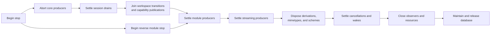

§module-host-capabilities **The coordinator's host interface is core's own.**
The daemon passes one object implementing every published slice
({§module-seam-slices}); these functions are on it too, for core's
Functionality coordinator and core's own witnesses, and are not part of the
published module contract.

| Setup function | Contract |
|---|---|
| `credentials` | The {§credential-authority} on the setup seam: the issuing module publishes its face (`publish({ issuer })`) before any module starts, and every module may `verify` through it. |
| `httpAddress()` | The address of the listener the host bound before any module set up ({§http-host}), as on the application port: the issuing module derives its issuer from it at setup, so the face it publishes answers from publication. |
| `registerRuntimes([{ decl, executor, availability, scheme? }, ...])` | Validates the complete canonical tag set under {§executor-runtime-declaration}, then publishes every process-wide executor and optional claimed scheme facet atomically. |
| §module-workspace-provider `registerWorkspaceCapabilityProvider(namespaceOwner, provider)` | Registers one extension-unique Functionality provider. `activate({ workspaceId, retain })` reconstructs the workspace snapshot; idempotent `deactivate({ workspaceId })` releases process resources. Core coalesces demand and supplies residency leases for work that outlives its caller. |
| §module-workspace-state `readWorkspaceModuleState(workspaceId, namespaceOwner)` | Reads one nullable JSON state value per workspace and provider. Core owns storage and lifecycle; the provider owns its schema. Store symbolic credential references, not copied secrets. A session-scoped family's coordinator reads and replaces the same shape per session in `session_module_state` ({§functionality-scope}). |
| §module-workspace-capabilities `replaceWorkspaceCapabilities({ workspaceId, namespaceOwner, state, runtimes })` | Atomically replaces one provider's durable state and runtime/scheme snapshot at the workspace operation boundary. Namespace claims are validated before mutation. Failure restores the prior state and publication. |

Core keys each {§module-workspace-directory} by a stable random workspace
storage key in its own `workspace_module_state` row.
Module directory allocation is lazy, atomic in SQLite, and independent of the
project root, daemon CWD, and workspace/session environment overrides. New
directories use mode `0700`; existing permissions are not rewritten. Module
names occupy a single encoded path component. Missing workspaces, invalid
stored keys, and filesystem failures are errors, never a fallback to CWD.
Allocated state is not erased on cooling, disable, removal, or shutdown: its
contents may be persistent or referenced by retained results. Deleting a
workspace forgets its storage key through the existing foreign key; old disk
state is not reassigned or automatically purged. A database copy preserves its
storage identities; the directory is operational state, not a backup of it.

§workspace-environment-sharing **The workspace owns its shared environment.**
Sessions own their logs; delegation retains its existing lifecycle.
Creating, attaching, forking, cancelling, or deleting a session does not create,
transfer, or remove ownership of workspace tools or shared resources.

| Fact | Owner |
|---|---|
| Enabled skills, MCP servers, outbound agents, and membership definitions | Workspace |
| Runtime publication, connection residency, and alias configuration | Workspace and the registered provider |
| Submitted operation, receipt, pending interaction, and cancellation signal | Originating operation in its session's history |
| Saved tool output and materialized resource bytes | Workspace; independent of live provider availability |
| Named and commons scratch | Workspace |
| Log | Session |

§module-workspace-quiescence **A Functionality snapshot changes between workspace operations.** Mutation admission, external installation/removal, preparation, and publication hold the same exclusive gate. Every mutation or background refresh acquires that gate before the family's serialization lane; turn-admission refresh uses its already-held gate. A queued background refresh cannot own the family lane while waiting for a turn that needs that lane. Settling the coordinator includes accepted refreshes waiting for that gate, not only work already inside a family lane. These are concurrency constraints, not creator privileges.

| Acquirer | Mode |
| --- | --- |
| An explicit client mutation | `try`: fails 409 before effects while the workspace is held; a refused mutation reserves no queue position, and a client retry is a new admission |
| An accepted operation mutation | `wait`: its turn yields the shared lease at that operation, awaits exclusive publication, and reacquires its lease before dispatching the next operation; concurrent publishers yield independently, and no publisher waits while retaining the shared lease it needs released |
| Activation and turn-admission refresh | `none`, inside their already-held demand boundary |
| Providers | reject replacement while active requests, input exchanges, or Tasks depend on the old snapshot; infrastructure watches may be replaced |

§module-workspace-sharing **Workspace sharing: sessions share Functionality by reference.**
There is one effective definition for each workspace, family, and alias.
Sessions neither inherit module-state copies nor publish private tool registries.
A conflicting alias is rejected explicitly; it never produces a hidden second
definition for the submitting client or session.

§module-workspace-residency **Persistence is not residency.** Model execution,
capability-aware operations, module actions declaring required residency, and retained provider work
lease the workspace's Functionality. Boot, workspace or session creation,
attachment, listing, naming, idle clients, and parked state alone do not.
After the last lease releases, `PLURNK_SERVICE_WORKSPACE_WARM_MS` and
`PLURNK_SERVICE_WORKSPACE_WARM_MAX` bound idle
residency. `0` disables the respective grace or allowance; `-1` disables that
bound. Concurrent demand coalesces; cooling never closes a leased connection.

Cooling withdraws live capability and releases process resources at the
workspace boundary. Durable configuration, history, and saved entries remain.
New demand reconstructs the one shared snapshot. Shutdown cancels warm timers and preparation,
refuses new leases before database access, and joins whole activation and cooling transitions
before releasing resources. An interrupted acquisition rejects with `AbortError`, never a usable
lease. Cooling and activation cleanup remain joined, not cancelled.
Cooling failures are reported; demand awaiting that transition receives its failure, not a lease.

§module-workspace-residency-facet **Residency is the workspace's; processes are
one family's facet.** The workspace is the lease unit, and every family's
publication rides the same replacement: its manager executor, its generated
documents and its state. Only a family that holds processes prepares
`runtimes` (MCP servers today); the field is absent for every other family, so
warming and cooling bound workspaces, never families, and the two-stage rollback
guards the manager registration of every family alongside the one family's
processes. There is no per-family residency policy: residency is
MCP-specific.

The version-1 baseline table `workspace_module_state` stores one JSON value
per `(workspace_id, namespace_owner)`. It is configuration, not an executable
registry. Deleting the workspace cascades its state; session lifecycle does not.

## Workspace Functionality

<!-- map -->
| Tag | Promise |
| --- | --- |
| {§functionality-coordinator} | One coordinator owns the common lifecycle. |
| {§functionality-replacement} | Replacement is a named whole-definition assignment. |
| {§functionality-addressing} | Functionality addressing: a family may name definitions by their content. |
| {§functionality-mutation-status} | Mutation status describes the committed resource outcome, not the management invocation's stream lifetime. |
| {§functionality-discover-advertisement} | A family's `discover` advertises exactly the inputs it serves. |
| {§configuration-definition-resolution} | Named resource definitions replace whole; independent behavior controls remain independent. |
| {§configuration-provenance} | Configuration provenance names the winning definition's input, not its owner or runtime. |
| {§configuration-repair-path} | Invalid optional configuration cannot remove the agent's repair environment. |
| {§functionality-inspection} | Inspection is not demand. |
| {§functionality-preparation-visibility} | Preparation is workspace activity, not model context. |
| {§functionality-hotload} | Functionality hot-load: out-of-band state is admitted before the next turn. |
| {§agent-plugins-hosting} | Installed Agent Plugins are found like skills. |
| {§agent-roots} | A daemon reads the roots `PLURNK_SERVICE_ROOTS` names. |
| {§env-functionality} | Environment is a scoped family. |
| {§env-scheme} | The env scheme is the registry as an address space. |
| {§functionality-scope} | A family declares its supported scopes. |
| {§functionality-state} | Functionality state is one durable value per workspace and family. |
| {§functionality-publication} | Functionality publication is one replacement of a family's state and runtimes. |
| {§functionality-documents} | Generated documents describe the shared snapshot. |
| {§functionality-model-projection} | The model's projection of Functionality families is the workspace `plurnk` tool. |
| {§functionality-document-body} | A family's document body is an authored file in its tool schema. |
| {§functionality-model-mutation} | The model's mutations of a Functionality family settle in authored order. |
<!-- /map -->

§functionality-coordinator **One coordinator owns the common lifecycle.**
Functionality families are adapters beneath
`list | discover | add | replace | enable | disable | remove`. State and mutations
serialize per workspace and family. Scope-bound client actions
`workspace.<family>.<verb>` / `session.<family>.<verb>` and model manager executors invoke the same
coordinator. Families do not invent another management grammar, proposal
policy, or hotload path.

Retryability describes the actual failed condition, not its numeric status.

| Verb | Common contract |
|---|---|
| `list` | Project definitions, ownership (`origin`), winning configuration source (`provenance`), enabledness, and published preparation outcome: disabled, dormant, active, unavailable with its Problem, or authorization-required. No credential values. |
| `discover` | Return inert candidates for the inputs the family serves ({§functionality-discover-advertisement}). Never install, persist, enable, or execute them. |
| `add` | Admit and persist a local definition, prepare it, and enable it atomically. It may override an inherited definition. Reapplying the same local definition enables it idempotently (200); a different local definition for that alias fails 409 without replacing it. |
| `replace` | Assign a complete definition to an explicit alias through {§functionality-replacement}. Preserve existing enabledness; a new alias is enabled. |
| `enable` | Publish an available definition; retry preparation if unavailable. |
| `disable` | Withdraw live capability; retain its definition and saved results. |
| `remove` | Forget the locally owned definition and its enabledness override. Restore any inherited definition with its inherited enabledness. Inherited definitions cannot be removed at this scope. Saved results remain. |

§functionality-replacement **Replacement is a named whole-definition assignment.**
The shared coordinator admits it through the family's existing schema and adapter,
then uses the same serialized preparation and publication path as other mutations.
It neither removes the old definition first nor merges omitted fields.

| Boundary | Outcome |
|---|---|
| Existing local or inherited alias | Persist the complete admitted definition in the selected scope, retaining the alias's effective enabledness. A local override replaces inherited interpretation context and provenance. |
| Absent alias | Create the named local definition, enabled. The alias is required; replacement never derives one. |
| Disabled candidate | Persist without preparing that alias. Editing a definition does not enable it. |
| Admission, preparation, or publication refuses | Keep the preceding definition, enabledness, attachment and documents. Return the exact failure to either client or model caller. External effects of preparation retain the limits of {§functionality-publication}. |
| Authorization required | Publish the existing authorization-required handoff; this is not a failed preparation. |
| Identical definition | Retain enabledness and normal attachment reuse; this is not an explicit enable/restart. |

§functionality-addressing **Functionality addressing: a family may name definitions by their content.** An adapter that
declares `addressing` supplies the input of `add` and the input of `enable`, `disable` and `remove`,
and reads from a select input the alias it names; its alias grammar ({§functionality-adapter}) is
the identity's own, and the generated teaching's `add` example is that input. Every other rule of
the coordinator — ownership, enabledness, `alias-exists`, `alias-unknown`, publication, documents —
reads the alias as that identity. The members family names its definitions by their glob
({§members-functionality}).

| Verb | Addressing family |
|---|---|
| `add` | Admits every definition the body names, or none: one refusal refuses the whole body. Reapplying a definition the scope holds is idempotent; a different definition under the same name is `alias-exists` (409), whose recovery is remove and add. The receipt lists the admitted definitions in body order (`definitions`) and names no one `alias`. Preparation receives them all as its admissions. |
| `replace` | Not served: when the name is the definition there is nothing to reassign, so neither projection offers it ({§functionality-discover-advertisement}). |
| `enable`, `disable`, `remove` | Take the family's select input; the receipt names the one alias it concerned. |

§functionality-mutation-status **Mutation status describes the committed resource
outcome, not the management invocation's stream lifetime.** Apply these rows in
order; refusals retain their own Problems and do not commit a replacement.

| Outcome | Status |
|---|---:|
| The resulting definition requires authorization | 202 |
| `add` or `replace` creates a local definition, including an override of an inherited definition; an `add` naming several ({§functionality-addressing}) creates any of them | 201 |
| `add` reapplies the identical local definition, every one it names; `replace` assigns an existing local definition; `enable`, `disable`, or `remove` settles | 200 |

`add` of a different local definition remains `alias-exists` (409); `replace` is explicit where a family serves it.
Model invocation settlement follows {§functionality-model-mutation} independently.

§functionality-discover-advertisement **A family's `discover` advertises exactly the inputs it
serves.** The coordinator builds the family's discover input schema from its declared discovery
({§functionality-discovery-inputs}): the declared inputs with their shared
`FunctionalityDiscoverQuery` definitions and no other property (a multi-scope family adds
`scope`), and, unless a request naming none lists everything, at least one of them: the one
input required, or any of several. The client actions, the manager's tool documents and their
schema documents carry that schema. Any other input, or a request naming none, is refused by the
shared schema check as 400 `arguments-invalid`, its `errors` naming each field; no family mints
its own refusal for an input it does not serve. A family without discovery has no `discover`
action, and its manager teaches none. A value of a served input the family cannot use remains the
family's own refusal.

| Family | Inputs | A request naming none |
|---|---|---|
| `skills` | `source` ({§skills-functionality}) | Refused |
| `schedule` | `source` ({§schedule-clock}) | Refused |
| `mcp` | `query`, while a registry is configured; otherwise no discovery ({§mcp-registry-discovery}) | Refused |
| `env` | `query`, `source` ({§env-functionality}) | The whole catalog |
| `members` | `query` ({§members-functionality}) | Refused |

§configuration-definition-resolution **Named resource definitions replace whole;
independent behavior controls remain independent.** Source readers and scope
overlays apply the same boundary:

| Value | Resolution |
|---|---|
| Named definition | Select the complete definition from the highest-precedence source or scope declaring that alias. Omitted fields, arrays and nested objects never inherit from a lower definition. |
| Environment resource declaration | Use {§resource-environment}: absence inherits, an empty definition is invalid, and an explicit enabledness switch disables without erasing the definition. |
| Definition validity | Validate the selected definition against its family's schema. Missing required fields are errors, not requests to fill from a lower definition; rejected live changes preserve the previous publication. |
| Independently declared behavior control | Resolve its own value through its cascade. An enabledness override does not copy or patch the definition it controls. |
| Local definition removal | Remove this scope's definition and enabledness override. Restore the current inherited definition and enabledness, or leave no entry if none exists. Do not persist a replacement or disabling mask; subsequent inherited changes remain effective. Restoration follows the same preparation and publication failure policy as other mutations ({§functionality-publication}). |

§configuration-provenance **Configuration provenance names the winning definition's input, not its owner or runtime.** `provenance` uses the same `{kind, source, reference?}`
shape as discovery candidates. Source readers contribute it; the coordinator
preserves it through inheritance, enabledness changes, and every readiness state.

| Definition source | Inspection |
|---|---|
| Assembled environment | `kind: environment`, `source`: exact definition key; never its value or an inferred dotenv filename. |
| Discovered skill root | `kind: file`, `source`: the winning `SKILL.md` path. |
| Standalone MCP file | `kind: file`, `source`: the winning `mcp.json` path; `reference`: its entry's JSON Pointer. |
| Local workspace/session definition or host-provided tree with no configuration input | No fabricated provenance; `origin` identifies ownership and the family definition describes the resource. |
| Local override | Replaces inherited provenance with the local definition; removal restores the current inherited provenance. |

Only the winning definition's source is reported. Shadowed definitions, secrets,
and environment-file loading history are not tracked. Source metadata is derived
on inspection, not persisted in the local overlay or used as runtime identity.

§configuration-repair-path **Invalid optional configuration cannot remove the
agent's repair environment.** Capability owners reject typed operator input
errors. The launcher and shared coordinator contain them at their respective
composition boundaries, not arbitrary exceptions:

| Boundary | Outcome |
|---|---|
| Optional startup integration (hooks, observability) cannot be configured | Withhold that integration and retain its exact configuration diagnostic. Activate the client interface and unrelated capabilities; never invent a replacement setting. |
| Invalid default model or child selector | Retain its diagnostic at startup; keep client inspection and explicit selection available. A request relying on the invalid selector fails with `daemon:configuration/configuration-invalid` (503), naming its key. Never substitute another model or silently inherit a child model. |
| Model construction or endpoint verification fails | Reject selection/use before inference or committing the selection. Keep the client available; a later selection can retry or choose another route. |
| Invalid effect, file-creation, or server approval policy | Retain the startup diagnostic. Reject the affected operation as `daemon:configuration/configuration-invalid` (503); no guessed admission policy, external effect, or orphan approval wait. Independent operations remain usable. |
| Invalid retention configuration | Withhold collection and automatic storage conversion, including shutdown collection. Preserve stored evidence and expose the diagnostic; do not substitute a deletion policy. |
| Invalid executor construction/probe configuration | Keep the installed declaration and its diagnostic, but no executable instance or output scheme. Other executors and ordinary READ/EDIT remain usable. Invoking the unavailable tag returns its exact 503 configuration Problem. |
| Invalid execution scheduling, input, or scratch configuration | Diagnose at startup and validate on the affected execution path before admission, stream creation, or external effects. Scratch configuration applies only to resource-backed execution; inline programs remain independent. Never substitute concurrency, timeout, or directory settings. |
| Invalid model-alias catalog | Fail catalog inspection explicitly; omit its unavailable snapshot rather than report an empty catalog. Exact provider/model selection does not depend on aliases. |
| Offline `config check` | Validate the same inputs without activating integrations; an invalid setting remains a nonzero failure. |
| Family configuration cannot be resolved | Keep its manager available, identify the configuration failure in its generated documentation, and preserve durable definitions. Do not publish the family's operational capabilities or pretend its catalog is empty. Other families and ordinary model work remain usable. |
| Inspection or mutation of an unresolved family | Return the exact configuration Problem, naming the key and required correction, through both client and model paths. No silent source fallback or change to stored settings. |
| Invalid live mutation | Reject atomically and preserve the preceding publication. |
| Previously valid family becomes invalid | Withdraw its operational capabilities at normal publication, then release the old snapshot. Keep the manager and diagnostic. |
| Configuration source is corrected or removed | Inspection resolves the current source immediately, even in the repairing turn; a previous source-resolution error cannot override a successful read. Not-yet-published definitions remain dormant. Normal publication restores capabilities; inspection does not activate them. |
| Preparation configuration is corrected | The published preparation failure remains until ordinary preparation succeeds. Successful source inspection alone does not establish runtime readiness. Environment-file edits follow their ordinary process lifetime, not an implicit reload. |
| Internal invariant, state, or implementation failure | Preserve the exception; never reclassify it as an operator configuration error. |

Client discovery and passive synchronization report startup diagnostics through the
existing Notice channel, even without a usable model. Each is a Notice from `engine:configuration`
of kind `configuration_unavailable` that names the failed setting's `key` and its `owner`: the
setting's reader (such as `retention`, `model` or `executor:<runtime>`), a family, `extensions` for an
extension declaration, or a module as `module:<package>`. The first turn of a drain, and a changed diagnostic
thereafter, reports unresolved configuration to both client and model. An
unchanged diagnostic is not repeated every turn. Operation failures remain Problems.

§functionality-inspection **Inspection is not demand.** `list` and `discover` do not
acquire residency, join preparation, reconcile session documents, or extend warm
retention. An enabled definition no resident publication has prepared is `dormant`: every one while
the family is cold, and one that arrived or changed out of band until the next turn publishes it
({§functionality-hotload}). During replacement the preceding publication remains authoritative;
the candidate is never presented as active. A published outcome belongs to the
complete definition prepared, not merely its alias. Cooling leaves durable definitions
inspectable. Mutations and protocol continuations retain their residency rules.

§functionality-preparation-visibility **Preparation is workspace activity, not
model context.** The coordinator owns a current `FunctionalityPreparationActivity`
per preparing family. `workspacePreparationStatus(workspaceId)` returns that same
state without demand; `workspace/preparation` broadcasts
`{ workspaceId, preparation: [...] }` whenever it changes.

| Boundary | Visible state |
|---|---|
| Preparation begins | Family, `phase: preparing`, `alias: null`, UTC `since` |
| Adapter reports the aliases it is preparing | One activity per alias, each keeping the `since` it began; an alias leaves when a later report omits it, so aliases prepared at once are listed together |
| Prepared candidate enters publication | `phase: publishing`, `alias: null` |
| Commit, rejection, or rollback settles | Family removed; empty array means no preparation |

Preparation reports neither definitions nor credentials, does not alter the
publication contract, and creates no log entries or model Notices. Published
failures retain their exact Problems in `list`. Concurrent consumers share the
workspace activity; a client disconnect does not clear another consumer's work.

§functionality-hotload **Functionality hot-load: out-of-band state is admitted before the next turn.** An adapter whose
`available` reads state that changes outside the daemon, such as skill roots ({§skills-hotload}) or
installed plugins ({§agent-plugins-hosting}), implements `refreshIfChanged`. Turn admission calls it
for every family under the workspace gate before packet assembly. The family handle's `refresh` with
`ifChanged` republishes a resident family only when the enabled definitions it would prepare differ
from the ones its publication prepared. The coordinator makes that comparison because it alone knows
what it published, so a change `list` saw first is still published at the next turn. A family whose
definitions do not capture its published content, such as a skill's files, republishes
unconditionally when that content changed. An unchanged family dispatches nothing.

§agent-plugins-hosting **Installed Agent Plugins are found like skills.** A workspace's plugins are, in precedence order, loaded and validated by `@plurnk/plurnk-agent-plugins` ({§agent-plugins-roots}):

1. the immediate child directories of its project's `.agents/plugins`;
2. `$XDG_CONFIG_HOME/plurnk/plugins` (plurnk alone);
3. `~/.agents/plugins` (every agent);
4. standard plugin bundles in the installed npm graph.

| Fact | Rule |
| --- | --- |
| Shadowing | an earlier source shadows a later plugin of the same manifest name, regardless of distribution or directory name |
| Native discovery | the same cascade with the project root omitted; workspace discovery includes it |
| `PLUGIN_DATA` | `$XDG_DATA_HOME/plurnk/plugins/<name>/<sha256(canonical-root)>`, kept across in-place updates and moved with a state root ({§state-root}); distinct installations never share data by name alone, and workspaces referencing the same canonical installation share its data |
| Modules | receive a workspace's plugins, in precedence order, through the setup seam's `readWorkspacePlugins`, with one signature that changes exactly when a plugin, its manifest, its MCP configuration, or its skills change ({§functionality-hotload}), and the roots the workspace has |
| The loader | read-only: it does not install or delete plugins; MCP's own lifecycle is independent ({§mcp-definitions}) |

Portable components use each family's existing management and publication path. Within a source
scope, standalone definitions precede bundled components; nearer scopes precede farther scopes,
with npm last. Complete environment definitions override those inputs, followed by workspace
definitions and enabledness. Inspection names the winning component file as plugin provenance.
Removing a workspace override restores inheritance; it never deletes the installed bundle.
Current plugin-source diagnostics join the workspace's configuration notices before inference.

§agent-roots **A daemon reads the roots `PLURNK_SERVICE_ROOTS` names.** A comma list drawn from
`project`, `plurnk` and `global`, nearest first, selects which Agent Skills, Agent Plugins and standalone MCP roots a
daemon reads; the default names all three. The real-model gate profile selects
its discovery roots explicitly ({§operator-config-real-model-profile}), so
operator roots do not shape a gate. Root selection does not restrict explicit
source definitions. Skills mutations change workspace bindings, not these roots
({§skills-functionality}); MCP mutations likewise remain workspace-owned. The module setup seam's
`workspacePaths` supplies selected `<project>/.agents`, `$XDG_CONFIG_HOME/plurnk`,
and `~/.agents` directories in precedence order with their scopes, omitting project
when no project is bound ({§module-workspace-paths}). Modules own their file formats;
core owns discovery roots.

An adapter may expose a `scheme` facet beneath its family's runtime namespace ({§execution-output-identity}). An adapter states the `traits` of its runtime — `web` for a family that reaches the network — so {§capability-admission} selects its manager and its resources alike.

| The facet | Rule |
| --- | --- |
| Claims | a path subtree, and is the scheme's whole live half there: READ and FIND preparation, FIND, EDIT, SEND, WAIT and KILL are its own wherever it implements them |
| Does not implement | a claimed KILL it does not implement is the ordinary entry KILL ({§stream-control}); an unclaimed coordinate keeps the stored-execution behaviour, SEND to a process included |
| States | where its resources are not shaped like the executor's output, their representation — resource authority, channels, the default channel, who may write them — and that manifest governs every claimed coordinate: its address, its fragmentless READ, the channel a subscription publishes, the writer gate ({§scheme-surface}) an EDIT or a COPY into it passes |

§env-functionality **Environment is a scoped family.** Ambient names admitted by the
operator's ceiling ({§execution-output-identity}, service origin) precede workspace defaults and
session overrides ({§execution-output-identity}). `add` takes
the name as the alias and `{ "value": "…" }` as the definition, used verbatim with no
interpolation. `disable` withholds a name in the selected scope while retaining it;
`remove` forgets a locally-owned entry and restores any same-name inherited value
and enabledness ({§configuration-definition-resolution}). Use `disable` to keep
an inherited name out of subsequent launches. Definitions from a lower layer
cannot be removed in the current scope.

`list` projects effective values with their origin. Values are shown: the ceiling is the security
boundary, not the projection, and any admitted name is already readable by every command the
Session runs — withholding it here would be theatre and would make `list` lie about the
environment its commands receive. A name the invariant reserves (`PLURNK_*`, provider credential
names) is refused at **admission**, not dropped at the spawn, so the model learns why.

`discover` is this installation's configuration catalog: every name an installed package declares under {§operator-config-env-defaults} that a Session may set, projected as candidates whose summary is the declaration's own comment and whose provenance is the declaring package. Files are read with READ; variables are set with `add`.

| Fact | Rule |
| --- | --- |
| Reserved names | the names the invariant reserves — plurnk's own configuration and provider credentials — are the operator's and never appear, so the catalog stays short enough to read whole |
| `query` | matches a name or the comment that documents it, never a value |
| Not a permissions list | a Session may set any name it lists or none of them; the catalog answers which names have a **consumer**, and it is how a Session learns the name of a value only the operator can supply |
| Declarations, never the host environment | a credential the operator has filled in appears by name with its documentation and an empty value ({§execution-output-identity}: referred to by name, never read) |
| `source` | selects one declaring package; an unknown source is `source-unknown` (400), not an empty catalog; a known source with no matching settable declarations returns an empty candidate list; a request naming neither input is the whole catalog |
| A client's own environment | no input: contributing candidates, it would be a second door past the ceiling |

The family publishes no process runtimes. Its values are read at the spawn that uses them,
not from a live process or a cached session environment.

§env-scheme **The env scheme is the registry as an address space.** Every name in effect for a Session's commands — the ambient names the ceiling admits, workspace defaults and the Session's own entries, exactly what `list` projects — is a resource at `env:///NAME` whose body is the value, verbatim; a reserved or masked name is no resource. The family's manager exposes it as the facet of its own `env://` namespace ({§execution-output-identity}), read for the dispatching Session; the manager's own output streams, eight hexadecimal characters ({§execution-output-identity}), stay the executor's. Admission is the family's ({§env-functionality}) and its refusal is the operation's result.

| Operation | On `env:///NAME` |
| --- | --- |
| READ | projects the value its commands receive now |
| FIND | lists the names in effect; a pattern on it matches values |
| COPY | carries a value out |
| EDIT | sets the whole value through the family's `replace` for the Session: a write is the Session's own layer, never the workspace's or the operator's (the runtime session keeps none, so a person's write is the workspace's, {§actor-boundary-client-operations}) |
| KILL | retires the name from the Session's commands: `remove` for an entry the Session owns, which restores an inherited value, `disable` for an inherited one, which keeps its definition |
| a line scope on EDIT or KILL | `value-whole` (400): a value has no lines; a pattern on EDIT is the dispatcher's refusal for any scheme without text scopes |
| a target that is not `env:///NAME` | `name-invalid` (400), or `target-required` (400) when absent |
| a name not in effect | `entry-not-found` (404) on READ and KILL alike |

§functionality-scope **A family declares its supported scopes.** The adapter declares `scopes` (absent means `["workspace"]`; the first is the model default), and the coordinator keys durable state and the locally-owned `origin` by it. Origin names ownership, never scope, so a projection never claims the workspace set a value one Session set for itself. Nothing else in the contract varies but the discovery inputs a family serves ({§functionality-discover-advertisement}): the verbs, the two projections, enabledness, and the service-baseline rules are one implementation across every family, which is what keeps their idioms from drifting apart.

| Scope | Describes | Own entries' origin |
| --- | --- | --- |
| **workspace** (Skills, MCP and members) | what exists in a workspace: a capability, resident or installable, that every Session there shares | `workspace` |
| **session** (Environment) | how one Session works — context rather than capability — with session overrides above workspace defaults; a context family's definitions are read where they are used, so a change at either scope holds nothing resident and takes no workspace exclusivity: it serializes on the family's lane | `session` |

A family projects `<scope>.<family>.<verb>` for each verb it serves, in each supported scope. The action's
context binds that scope; a session-scoped action also names the Session. Its durable
value is the same shape per (session, family) in `session_module_state`, read
at each verb and at each spawn rather than held in the workspace snapshot. Its `list` and
mutations serialize on the Session's own lane and take no workspace exclusivity: nothing
resident changes, and the next spawn reads the state, so a Session shapes its own environment
while its siblings run. Its preparation yields outcomes only — no runtimes, documents or
snapshot — and the coordinator refuses one that does more.

A Session created with a parent — WORK and FORK alike — starts with a copy of the parent's
session-scoped state, taken at creation. The child owns its copy: neither side's later edits
reach the other, and depth is transitive with no further rule. Each copied entry carries
`inherited`, the Session that set it, preserved across generations until the child changes that
entry, so `list` never claims the child set what it inherited; a parent's masking of an
ambient name travels the same way.

§functionality-state **Functionality state is one durable value per workspace and family.**
`{ version: 1, definitions: { [alias]: { origin, enabled, definition? } } }`
is stored under the provider namespace in `workspace_module_state`; a
session-scoped family ({§functionality-scope}) stores the same value per session
and family in `session_module_state`.
A locally-owned entry persists its exact definition; a lower-layer entry persists
only enabledness, never a copied value. Active, unavailable, and authorization-required are preparation
outcomes, not durable desired state. The configuration cascade contributes
defaults; one workspace snapshot is effective authority.

§functionality-publication **Functionality publication is one replacement of a family's state and runtimes.** The coordinator prepares, then replaces state and runtimes through {§module-workspace-capabilities}, with the manager followed by any runtimes the adapter prepared ({§module-workspace-residency-facet}). Admission, tools, documents, Turn 0, and client status consume that publication. `settleFunctionality` joins queued publications before inspection or shutdown.

| Callback | Rule |
| --- | --- |
| The coordinator's synchronous `publish` | participates in the registry commit; its returned undo restores the previous view before rollback reconciles documents |
| The adapter's `publish` | runs inside that same callback, so the family view, the registry and the adapter's live candidate change in one instant, and its undo composes with the view's |
| The adapter's `commit` | follows a committed publication |
| Neither callback | performs fallible I/O |
| Publication failure | restores the preceding configuration/runtime snapshot; it cannot roll back an external effect of preparation, such as a fetched skill source, and a failed external effect retains its cause and must not be reported as a successful configuration change |

§functionality-documents **Generated documents describe the shared snapshot.**
Documents are projected through the existing session generated subtree
({§session-scheme}); the projection does not confer ownership, and it
follows the family's admission ({§schemes-directory}): a denied family projects none.
Enabled, active definitions are discoverable. Disabled or unavailable
definitions add no hot-path teaching. Their exact state and Problem remain
available through `list`.

§functionality-model-projection **The model's projection of Functionality families is the workspace `plurnk` tool.** Core registers one in-process `plurnk` runtime at boot under `resourcesPath: "/tools"` with `expandTools: true`, publishing one tool per registered Functionality family (`plurnk (<family>)`) alongside `plurnk (question)` ({§question-tool}). Each family tool's `verb` — `discover` only where the family serves discovery
({§functionality-discover-advertisement}), defaulting to `list` when omitted — and arguments use its actual coordinator schemas and the ordinary
tool-document machinery (`workspace:///_plurnk/tools/plurnk.md` and `workspace:///_plurnk/tools/plurnk/<family>.json`). `list`/`discover` are read effects; mutations are host
effects and use normal proposals. Summary, signatures, and deep docs derive
from the same registry ({§tools-resource-materialization},
{§executor-input-schema-preview}). Outcomes stream into the invoking operation's
output entry (`plurnk:///<id>`). A family's `scheme` facet (`env://`, `schedule://`) registers directly in the workspace scheme registry ({§module-workspace-capabilities}).
A session-scoped family's verbs act for the invoking Session: Core
binds that Session and workspace to the manager at the operation, so the executor framework's arguments carry no
identity ({§functionality-scope}).

Expected adapter failures retain their exact status and Problem in both client
actions and the model operation's stream/result ({§problem-error-carrier}). An
unexpected exception remains an executor fault, not a managed refusal.

§functionality-document-body **A family's document body is an authored file in
its tool schema.** The adapter names its package directory (`docsDir`);
that package's `docs/<family>.md` is read once, by the same rule runtimes use
for `docs/<tag>.md` ({§executor-discovery}: the authoring title `# <family>` is
removed), and rides the family tool's `details` into `workspace:///_plurnk/tools/plurnk/<family>.json` (`description`). The runtime header, tool signatures, and
schema documents stay generated; no prose from the file enters the hot path.
A family that ships no file has a schema-only tool document. Registration also
validates the adapter's taught `plurnk (<family>)` `add` example against the `add` input schema it
teaches, so a wrong example fails boot rather than the model.

§functionality-model-mutation **The model's mutations of a Functionality family settle in authored order.** Every manager verb, including inspection, completes before dispatch proceeds; later operations observe earlier successful configuration changes. The invoking operation and its output remain pending until settlement, and never acknowledge merely starting a future commit; settlement reports `active`, `unavailable`, or the exact publication failure. When a model mutation publishes `authorization-required`, it announces that sign-in requirement and holds at the workspace boundary ({§module-workspace-quiescence}) until a subsequent publication resolves the alias out of `authorization-required`, then streams that settled outcome. Shell commands, remote tools, WORK/FORK and streaming READ retain their deliberately asynchronous contracts ({§op-methods-op-dispatch}).

- These core-owned commands use ordinary proposals and durable execution outputs, but not the background-execution slot pool. Preparation and publication share the family's serialized lane; resident publication uses the lease handoff in {§module-workspace-quiescence}, and context-only families retain their existing scope-local serialization.
- A preparation failure may publish enabled-but-unavailable state for other mutations, but `replace` rejects it ({§functionality-replacement}); a publication failure never reports a successful mutation. Result observation uses the ordinary execution lifecycle, without a separate deferred-commit queue.
- An explicit client action publishes now, rejects a failed preparation, and fails 409 while the workspace is held ({§module-workspace-quiescence}). Rejecting a proposal prepares, persists, and publishes nothing. Cancellation removes queued publication and aborts preparation before publication; an already-started atomic publication is joined, never abandoned partway through.

## §methods Application interface

<!-- map -->
| Tag | Promise |
| --- | --- |
| {§methods-event-subscribe} | Events — `subscribeToEvents(handler) -> unsubscribe` |
| {§methods-credentials} | Credentials — `credentials` |
| {§proposal-list} | Proposals — `pendingProposals(workspaceId)` |
| {§methods-proposal-resolve} | Proposals — `resolveProposal(logEntryId, resolution, owner)` |
| {§client-interaction-list} | Client interactions — `pendingClientInteractions(workspaceId)` |
| {§methods-client-interaction-resolve} | Client interactions — `resolveClientInteraction(interactionId, resolution, respondent, message?)` |
| {§methods-loop-run} | Loops — `runLoop({ workspaceId, sessionId, loopId?, prompt, source?, maxTurns?, openPaths?, selector?,… |
| {§message-idempotency} | Message admission — `messageAdmission({ workspaceId, address, body })` |
| {§methods-session-inbox} | Reads — `readInbox({ workspaceId, sessionId })` |
| {§methods-session-streams} | Reads — `readStreams({ workspaceId, sessionId })` |
| {§methods-loop-cancel} | Loops — `cancelDrain(sessionId, reason?)`; `cancelSession({ workspaceId, sessionId, reason? |
| {§methods-op-mirror} | Op mirror: client dispatch — `dispatchClientAction({ workspaceId, actor, contextSessionId?, statements,… |
| {§methods-log-read} | Reads — `readLog({ workspaceId, sessionId, ...coordinate })` |
| {§methods-entry-read} | Reads — `readEntry({ workspaceId, sessionId, target, channel?, offset? |
| {§methods-entry-channel-read} | Reads — `readEntryChannel({ workspaceId, sessionId, target })` |
| {§methods-workspace-create} | Workspace lifecycle — `createWorkspace({ name?, projectRoot?, settings? |
| {§methods-workspace-attach} | Workspace lifecycle — `attachWorkspace({ workspaceId } \ |
| {§methods-workspace-activate} | Workspace lifecycle — `activateWorkspace({ workspaceId })` |
| {§methods-session-create} | Workspace lifecycle — `createSession({ workspaceId, name?, parentSessionId?, owner? |
| {§methods-workspace-rename} | Workspace metadata — `renameWorkspace(workspaceId, name)` |
| {§methods-workspace-hide} | Workspace metadata — `setWorkspaceHidden({ workspaceId, hidden })` |
| {§methods-session-hide} | Session topology — `setSessionHidden({ workspaceId, sessionId, hidden })` |
| {§methods-workspace-rollback} | Workspace files — `rollback({ workspaceId, sessionId, actor, to })` |
| {§methods-workspace-prompts} | Workspace metadata — `listPrompts(workspaceId, limit?, sessionId?)` |
| {§methods-session-read} | Session topology — `readSession({ workspaceId, identity })` |
| {§methods-session-list} | Session topology — `listSessions(workspaceId, query?)` |
| {§methods-session-overview} | Session overview — `readSessionOverview({ workspaceId?, limit, excerptChars })` |
| {§methods-session-loops} | Loop lifecycle — `listSessionLoops({ workspaceId, sessionId })` |
| {§methods-session-accounting} | Session spend — `sessionAccounting({ workspaceId, sessionId })` |
| {§methods-session-gauge} | Session gauge — `sessionGauge({ workspaceId, sessionId })` |
| {§methods-loop-run-fold-consistency} | A folded prompt cannot silently reconfigure its loop. |
| {§methods-loop-run-open-paths} | Workspace paths are core-owned context reads. |
| {§methods-rebind} | Rebinding: binding belongs to the client-interface module. |
| {§methods-session-name-admission} | Session-name admission. |
| {§capability-admission} | One admission path owns external authority. |
| {§workspace-capability-policy} | The workspace is the access boundary. |
| {§workspace-capability-inspection} | Client inspection uses the admission resolver. |
| {§question-tool} | The `question` tool asks the session's owner and waits for the answer the client-interaction lifecycle… |
| {§session-tool-admission} | Tool visibility and execution share admission. |
| {§owner-interaction-ring} | An interaction tool is offered only where an answer can come from. |
| {§model-catalog} | Model discovery is a bounded local projection, not provider activity. |
| {§session-model-selection} | Session-owned model selection. |
| {§session-effort} | Reasoning effort is a durable session policy. |
| {§session-effort-source} | The effort source: a default never masquerades as a choice. |
| {§methods-loop-run-model} | Per-loop model selection. |
| {§methods-loop-run-child-provider} | Child-provider selection is one durable subcall policy. |
| {§methods-log-coordinate} | Log coordinate. |
| {§methods-log-entry-wire} | Log entry wire fidelity. |
| {§methods-readable-reasoning} | Readable provider reasoning remains derived provider evidence. |
| {§methods-invocation} | `invocation`: a row that discharges an obligation names the operation that opened it. |
| {§methods-answering} | `answering`: a reply names the operation that sent the message it answers. |
| {§notifications} | Notifications: core events |
| {§notifications-operation-event} | `operation/event` — `ApplicationOperationEvent`: `{ sessionId, loopId, turnId, sequence, origin, projectRoot,… |
| {§notifications-log-entry-notify} | `log/entry` — `{ entry: LogEntry }` |
| {§notifications-loop-terminated} | `loop/terminated` — `{ sessionId, loopId, loopSeq, result, hitMaxTurns, turnIds, usage: { accounting,… |
| {§notifications-loop-packet} | `loop/packet` — `{ sessionId, loopId, loopSeq, packetCount, gauge: { curationWeight, curationBudget,… |
| {§notifications-loop-proposal} | `loop/proposal` — contracts-owned `ProposalProjection` |
| {§notifications-loop-interaction} | `loop/interaction` — contracts-owned `ClientInteractionProjection` |
| {§notifications-workspace-created} | `workspace/created` — `{ id, name, projectRoot }` |
| {§notifications-workspace-renamed} | `workspace/renamed` — `{ id, name }` |
| {§notifications-workspace-hidden} | `workspace/hidden` — `{ id, hidden_at }`, as `setWorkspaceHidden` returns it |
| {§notifications-session-hidden} | `session/hidden` — `{ id, hidden_at, sessionIds }`, as `setSessionHidden` returns it |
| {§notifications-session-policy} | `session/policy` — `{ sessionId, model, spawnModel }`, the session's generation policy as… |
| {§notifications-stream-event-on-channel-change} | `stream/event` — `{ entryId, sessionId, target, channel, state, contentLength, mimetype?, loop_seq?,… |
| {§notifications-stream-concluded} | `stream/concluded` — `{ entryId, sessionId, target, subscriptionId, scheme, result, summary, wakeAction,… |
| {§notifications-notice-event} | `notice/event` — `{ sessionId, loopId, notice: Notice }` |
| {§notifications-outside-event} | `outside/event` — `{ sessionId, loopId, turnId, coordinate, text, tokens }` |
| {§notifications-reasoning-event} | `reasoning/event` — `{ sessionId, loopId, turnId, loopSeq, turnSeq, modelCallId, requestSequence, phase,… |
| {§notifications-stream-event-failure-isolation} | The extension-facing `NotifyCaps.streamEvent()` remains a synchronous advisory call while core resolves its… |
| {§notifications-envelope-carries-workspaceid} | The notification envelope carries its workspaceId: event scope is explicit. |
| {§session-external-reference} | External session references |
| {§connection-lifecycle} | Client operations and their connection lifetime |
| {§actor-boundary-client-operations} | A client operation acts on workspace resources, attributes messages to its person, and reads a log in the… |
<!-- /map -->

`ApplicationPort` is the contracts-owned interface implemented by `Daemon` and
consumed by every exterior adapter ({§application-port}). Its function names are
transport-neutral library calls, not public wire names; this table specifies
Core's behavior behind them.

| Area                                              | Function | Core contract |
|---------------------------------------------------|----------|---------------|
| §methods-event-subscribe Events                   | `subscribeToEvents(handler) -> unsubscribe` | Subscribes to the raw event source in {§notifications}. A subscriber failure is logged and cannot re-enter engine control flow. |
| §methods-credentials Credentials                  | `credentials` | The {§credential-authority}: `issue`, `verify`, `consume`, `revokeFamily`, `onRevoked` and the sign-ins of a subject by `sessions` ({§credential-authority}), and a module's own client by `registerClient`, `client` and `authenticateClient` ({§credential-authority}); one in-memory authority per daemon, offered to every module on the seam. |
| §proposal-list Proposals                          | `pendingProposals(workspaceId)` | Intersects durable proposed rows with the lifecycle owner's live resolution waiters, then returns their validated {§proposal-projection}; persistence alone cannot advertise an unresolvable client interrupt. |
| §methods-proposal-resolve Proposals               | `resolveProposal(logEntryId, resolution, owner)` | Validates the workspace-scoped owner before delivering one accept, reject, or cancel decision. Unknown, mismatched, and already-resolved identities fail without consuming the gate; the adapter authenticates its owner identity. |
| §client-interaction-list Client interactions      | `pendingClientInteractions(workspaceId)` | Intersects durable interaction rows with their live operation waiters and returns the contracts-owned projection; a row alone is not a resumable interaction. |
| §methods-client-interaction-resolve Client interactions | `resolveClientInteraction(interactionId, resolution, respondent, message?)` | Validates the recorded recipient before delivering one resolved payload or cancellation. Unknown, mismatched, and already-resolved identities fail before affecting an operation. |
| §methods-loop-run Loops                           | `runLoop({ workspaceId, sessionId, loopId?, prompt, source?, maxTurns?, openPaths?, selector?, childSelector? })` | Validates a model session and persists the request with the effective turn ceiling, then returns an immediate status-100 acknowledgement with `loopId` and `action`. An explicit Loop recipient follows {§session-wait-timing}. A trusted adapter may identify the prompt's causal actor with one canonical `source`; ordinary clients cannot author it through their protocol surface. Messages carry no approval authority. The exact terminal result arrives only through `loop/terminated`; parking and resuming do not replace the loop. |
| §message-idempotency Message admission           | `messageAdmission({ workspaceId, address, body })` | A client message's address is its idempotency key ({§message-source-scheme}): `new` when nothing is accepted there, `accepted` when the same body is, so a repeat attaches to what the message started instead of admitting it twice; another body under an accepted address is refused, 422 `message-address-reused`, creating nothing. `runLoop` refuses every repeat it is handed: other words 422 `message-address-reused`, the same words 409 `message-already-accepted`, a duplicate racing the original. |
| §methods-session-inbox Reads                       | `readInbox({ workspaceId, sessionId })` | The accepted messages the session has not yet observed at a turn boundary ({§message-arrival}), in acceptance order, each by its immutable source address (`path`), causal `source`, `body`, `loopId` and the `lifecycle` of that loop ({§loop-lifecycle-vocabulary}); a message leaves it when its arrival row lands, and one whose loop concluded first stays, with that terminal lifecycle, since nothing will observe it ({§message-loop-containment}). |
| §methods-session-streams Reads | `readStreams({ workspaceId, sessionId })` | The streams the session holds open ({§subscriptions}), in opening order, each its subscription's facts as `stream/event` names them: `entryId`, the initiating `sessionId`, the canonical `target`, `lifetime` (`loop`, `turn` or `detached`, as {§exec-lifetime} names what ends it besides its own exit; a duration is loop-bound and reads `loop`, its deadline unreported), the causal `loop_seq`, `turn_seq` and `sequence` read from the `source` it recorded when it began in a turn ({§subscriptions-causal-resource}), and every channel of its entry, written or not, as `{ channel, state, mimetype }` ({§channels}). Content stays the resource's ({§methods-entry-read}); a closed stream is gone, its conclusion already published ({§notifications-stream-concluded}). The session must belong to the workspace. |
| §methods-loop-cancel Loops                        | `cancelDrain(sessionId, reason?)`; `cancelSession({ workspaceId, sessionId, reason? })`; `cancelLoop({ workspaceId, loopId, reason? })` | `cancelDrain` begins durable structured cancellation and reports whether process-local work existed when called; queued or parked durable work is still terminalized when it is `false`. The ownership-bounded `cancelSession` awaits that same tree cancellation and stream reap, so an exterior protocol can project the settled durable result without polling or fabricating state. `cancelLoop` cancels exactly one client operation ({§connection-lifecycle}): its dispatch while that runs, and every attached execution its rows started that still runs, then reports whether any of it was running; nothing else in the runtime session shares its scope. |
| §methods-op-mirror Op mirror: client dispatch               | `dispatchClientAction({ workspaceId, actor, contextSessionId?, statements, onLoop? })` | Dispatches already-parsed grammar statements as one client operation of `actor` ({§connection-lifecycle}), in the workspace's Functionality ({§actor-boundary}), reading `log:///` in `contextSessionId`'s log ({§actor-boundary-client-operations}). `onLoop` hears the operation's loop before any statement runs. Every statement is an ordered client/operation turn, and every committed `log/entry` is emitted before the promise resolves. Core exposes no per-op method family. |
| §methods-log-read Reads                           | `readLog({ workspaceId, sessionId, ...coordinate })` | Ownership-checks the session, then reads by ids, recency, or the complete `loopSeq`/`turnSeq`/`sequence` display coordinate, newest first. `sinceId` keeps rows after an id and `beforeId` rows before one, so a reader pages back through the whole log one page at a time. An omitted `limit` is `PLURNK_SERVICE_LOG_READ_PAGE`, and any `limit` is capped at `PLURNK_SERVICE_LOG_READ_MAX`. |
| §methods-entry-read Reads                         | `readEntry({ workspaceId, sessionId, target, channel?, offset? })` | Acquires the selector from that session's perspective ({§scheme-address}) and returns {§entry-read-result}, either complete or as one channel suffix, without creating action evidence. |
| §methods-entry-channel-read Reads                 | `readEntryChannel({ workspaceId, sessionId, target })` | The channel `target` selects, its fragment's or else its scheme's default there, read as `readEntry` reads it and returned complete as {§entry-read-result}: what the HTTP form of an address answers with. |
| Providers                                         | `listProviders()` | Lists configured aliases with provider/model identity, active state, and the effective provider-derived `inputCapacity` when known. |
| Model catalog                                     | `listModels(query)` | Returns one validated bounded {§model-catalog-wire} page under {§model-catalog}; performs no provider request or selection. |
| Client capabilities                               | `listClientDisplayCapabilities()` | Composes sorted scheme declarations ({§manifest-client-display}) followed by sorted MIME declarations ({§mimetype-client-display}) into the validated shared wire ({§client-display-capabilities}). The internal `exec` operation handler is excluded; its addressable runtime-tag scheme faces remain included. |
| §methods-workspace-create Workspace lifecycle     | `createWorkspace({ name?, projectRoot?, settings? })` | Validates `settings` through {§operator-config-workspace-settings}, creates the workspace and returns its client envelope, minting no session, and emits global `workspace/created`; with a project root and no name it names and selects the workspace under {§execution-output-identity}, showing a hidden one ({§machine-processes}), emitting `workspace/created` only for a workspace it created. Creation and attachment are passive: neither starts derivation nor activates workspace Functionality. `projectRoot` is established here or the workspace remains headless. |
| §methods-workspace-attach Workspace lifecycle     | `attachWorkspace({ workspaceId } \| { name } \| { projectRoot })` | Exactly one selector returns an existing workspace's client envelope, minting and activating nothing. Names are literal lookups, including previously admitted names. An absolute project root selects its folder-derived default name ({§execution-output-identity}), not a workspace by its stored folder. An absent target is `404 workspace-not-found`; ambiguous or absent selectors are `400 identity-invalid`. It retains no caller or transport binding state. |
| §methods-workspace-activate Workspace lifecycle   | `activateWorkspace({ workspaceId })` | Makes the demand a turn makes, without a turn: a cold workspace activates and publishes its complete capabilities; a concurrent demand shares that one activation; it resolves once the workspace is active and leaves it warm under `PLURNK_SERVICE_WORKSPACE_WARM_MS`. Creation and attachment stay passive; an owner's arrival calls it ({§acp-owner-activation}). |
| §methods-session-create Workspace lifecycle  | `createSession({ workspaceId, name?, parentSessionId?, owner? })` | Creates a distinct model-origin session with empty history. A root may name a registered owner; a child names its parent and inherits ownership. Supplying both parent and owner is invalid ({§session-ownership}). |
| Session ownership | `registerSessionOwner(workspaceId, { address, tools, interactive })` | Declares or replaces an owner's supported client-tool names and whether a person attends it, in that workspace; `_plurnk` is reserved. |
| Session ownership | `claimSessionOwner({ workspaceId, sessionId, owner })` | Claims a model session and its model descendants under {§session-ownership}, returning its effective owner. The owner must already be registered. |
| Runtime actor | `ensureRuntimeSession(workspaceId)` | Returns the workspace's `_plurnk` actor, creating it if absent; it always retains runtime ownership. |
| Workspace lifecycle                               | `forkSession({ workspaceId, sessionId, name? })` | Creates a child session that branches the source session's history while sharing workspace state. The source is a model session, else `409 model-session-required` ({§machine-processes}). |
| §methods-workspace-rename Workspace metadata      | `renameWorkspace(workspaceId, name)` | Changes only the workspace's unique mutable name, under the admission of {§execution-output-identity}; sessions, log, and membership remain intact, and a refused name changes nothing. |
| §methods-workspace-hide Workspace metadata | `setWorkspaceHidden({ workspaceId, hidden })` | Hides or shows the workspace under {§machine-processes} and returns `{ id, hidden_at }`, the mark it now holds. An absent workspace is `404 workspace-not-found`, a hide over live work `409 live-work`, and a `hidden` that is not boolean `400 flag-invalid`. |
| §methods-session-hide Session topology | `setSessionHidden({ workspaceId, sessionId, hidden })` | Hides or shows the session's group under {§machine-processes} and returns `{ id, hidden_at, sessionIds }`: the session's mark now and the sessions whose mark the call changed, none when nothing changed. A session outside the workspace is `404 session-not-found` and a hide over live work `409 live-work`. |
| §methods-workspace-rollback Workspace files      | `rollback({ workspaceId, sessionId, actor, to })` | Reverses `sessionId`'s settled file mutations after its coordinate `to` as one client operation of `actor` ({§log-wire-format}, {§connection-lifecycle}); answers a `RollbackReport`. |
| §methods-workspace-prompts Workspace metadata     | `listPrompts(workspaceId, limit?, sessionId?)` | Returns nonempty loop-seed prompts a client addressed to the workspace's model sessions, newest-first; `sessionId` narrows to one session. Authorship is the seed message's address ({§message-arrival}): a session-issued seed (WORK, FORK, SEND to a session) has none and is never history, whichever session it seeded; a client prompt at a forked model session is. An omitted limit is `PLURNK_SERVICE_PROMPTS_PAGE`. |
| Workspace metadata                                | `listWorkspaces({ hidden? })`, `workspaceDerivationStatus(...)` | Reads current workspace identity, with each folder, its label ({§execution-output-identity}) and its `hidden_at` mark, filtered by the mark when `hidden` is present ({§machine-processes}), and derivation progress. |
| §methods-session-read Session topology              | `readSession({ workspaceId, identity })` | Ownership-bounds an exact id-or-name lookup and returns one durable Session projection or `null` under {§application-session-observation}. Supplying both identities or neither is invalid. Any non-empty name is looked up, the runtime session's `_plurnk` included: the lookup is no minting door ({§session-scheme}). |
| §methods-session-list Session topology              | `listSessions(workspaceId, query?)` | Returns the workspace's durable Session projections under {§application-session-observation}. The origin filter is exact; an explicitly present `parentSessionId` filters roots (`null`) or one immediate parent (id), while omission returns every lineage position, and a present `hidden` filters by the mark each projection carries as `hidden_at` ({§machine-processes}). Each projection carries `kind` (`root` for a session with no parent, `fork` for a child with a fork boundary, `work` for any other child) and `lifecycle`, the representative work loop's status through {§loop-lifecycle-vocabulary} (`idle` with no work loop), so a directory row shows the same lifecycle glyph the bound session's own status gauge shows; clients infer neither (#523). |
| §methods-session-overview Session overview | `readSessionOverview({ workspaceId?, limit, excerptChars })` | Returns `{ sessions, workspaces, omitted }`, the places of the daemon or of one workspace with what waits there, under {§application-session-overview}: each place's lifecycle, the gates it waits on and its latest finished reply ({§message-completion}) with its excerpt ({§list-excerpt}) of at most `excerptChars` characters, most recently finished first; every place waiting on a gate and the first `limit` in that order, `omitted` counting the rest. Hidden places are out of scope ({§machine-processes}). An unknown `workspaceId` is 404 `workspace-not-found`. |
| §methods-session-loops Loop lifecycle              | `listSessionLoops({ workspaceId, sessionId })` | Ownership-checks the Session and returns its Loops in sequence order under {§application-loop-observation}, including the validated exact terminal result when one exists, and each Loop's `invocation`: `{ sessionId, address }`, the Session and the log address ({§methods-invocation}) of the operation that sent the Loop's first message ({§loop-completion}), or null when a person, a client, a peer or the daemon sent it. It performs no scheduling or event replay. |
| §methods-session-accounting Session spend       | `sessionAccounting({ workspaceId, sessionId })` | Ownership-checks the Session and returns the {§provider-accounting} projection of every settled request on any loop the Session or a descendant of it (`parent_session_id`, to any depth) ran, since the Session began: its own spend and its delegations', the same tree the turn cap counts ({§turn-cap-counts-the-tree}). Nothing spent is explicit zero. One loop's own accounting stays {§notifications-loop-terminated}'s. Derived from the request ledger on every read ({§tokenomics-provider-usage}); no rollup, no second store. |
| §methods-session-gauge Session gauge | `sessionGauge({ workspaceId, sessionId })` | Ownership-checks the Session and returns the four {§tokenomics-client-gauge} facts its latest packet reported in `loop/packet.gauge`, read from durable evidence: each `null` when unknown, all `null` before the Session's first packet. A client attaching later starts from the gauge a live one holds. |
| Extension actions | `listModuleActions()`, `invokeModuleAction(name, params, context)` | Lists setup-registered `{ name, scope, inputSchema, outputSchema }` descriptors in sorted order. Invocation requires a context matching the registered scope; missing names, forged scope, and missing workspace identity fail before the owner runs. Handler values remain opaque to core. |

§methods-loop-run-fold-consistency **A folded prompt cannot silently reconfigure
its loop.** When `runLoop` targets an active or 202-parked loop, core appends the
prompt to that same loop and returns `action: "injected_next_turn"`. Configuration
already durable on the loop remains authoritative:

| Requested input       | Omitted                                              | Equal to the durable selection | Different from the durable selection |
|-----------------------|------------------------------------------------------|--------------------------------|--------------------------------------|
| Provider/model        | The resolved request selection must still agree.     | Fold.                          | 409 provider conflict.               |
| `maxTurns`            | Keep the durable ceiling.                            | Fold.                          | 409 turn-ceiling conflict.           |

The conflict names both selections and directs the caller to cancel or conclude
the loop before changing configuration. A newly enqueued loop instead persists
the requested configuration normally.

§methods-loop-run-open-paths **Workspace paths are core-owned context reads.**
`openPaths` belongs to the message submitted by the client. The client
sends local paths or scheme URIs, never duplicated resource bytes; core dispatches one ordinary
`plurnk`-origin READ per path from inside the owning workspace, and successes
and failures surface through the normal operation-result contract.
Path spelling follows {§path-syntax}, including channel fragments and literal
delimiters. Malformed URI syntax is rejected before message admission; a valid
address whose resource is absent produces the ordinary READ failure.

| `runLoop` disposition | Message and path behavior                                                                            |
|-----------------------|------------------------------------------------------------------------------------------------------|
| New loop              | Persist with the initial message; publish it and READ its paths on turn 1.                          |
| Active loop           | Persist with the injected message; publish it and READ its paths together on the next turn.        |
| Parked loop           | Persist with the waking message; publish it and READ its paths together on the resumed turn.       |

If an unpublished message is promoted into subsequent work under
{§message-loop-containment}, its selected paths travel with it.

§methods-rebind **Rebinding: binding belongs to the client-interface module.** Core's
workspace lifecycle calls return exactly the workspace (`workspaceId`,
`workspaceName`, `projectRoot`, `projectLabel`); they carry no session, bound-session
or operation-loop binding. Core retains no connection, thread, or current-workspace
mapping. A module may replace its own binding with a later create or attach result
without requiring a new transport; it resolves the bound session separately, while
each client operation allocates its own administrative loop under {§connection-lifecycle}.

§methods-session-name-admission **Session-name admission.** Session
creation and fork apply {§session-scheme} before lookup or creation. A client therefore cannot forge or resume the runtime actor (its
name lies outside `SESSION_NAME`) or create a session under a spelling model session control
could not mint.

§capability-admission **One admission path owns external authority.** Core derives one or more `CapabilityDescriptor` demands from each routed statement, then evaluates the service and workspace policy layers. Every demand of a composed operation must survive before execution or proposal creation. A denial is an exact terse 403 identifying the denied descriptor and owning policy scope; it never guesses the model's intent or recommends an alternate operation.

| Statement | Demands |
| --- | --- |
| COPY | observation of its source and mutation of its destination |
| MOVE | additionally mutation of its source |
| A resource-backed execution | its runtime plus source observation |
| Unknown schemes, runtimes and tools | continue to their ordinary resolver, so capability policy cannot turn absence into a misleading restriction; the same resolver shapes generated scheme references, session tool documents, and Turn0 surveys |
| NOTE, lifecycle declarations, log KILL, and label or targetless SEND | log/program control rather than routed external demands, so outside capability selectors; runtime mutations of owned generated entries ({§session-scheme}) likewise maintain intrinsic state |
| Producer identity | grants no exemption: source observations and other effects in the same operation retain their independent demands, and harness-authored initialization obeys workspace policy |

§workspace-capability-policy **The workspace is the access boundary.**
`workspaces.settings.capabilities` is the one mutable access policy under the
service ceiling. Every actor, including an existing child, uses the current
workspace policy; neither creation nor delegation snapshots authority. Sessions
own their log and scratchpad, not tools or resource grants; their owner decides only
which interaction runtimes they are offered ({§owner-interaction-ring}). Intrinsic source
mutability, workspace separation, and proposal approval remain distinct
contracts. Input is validated before persistence; malformed stored policy fails
at its reader with the workspace coordinate and cause.

§workspace-capability-inspection **Client inspection uses the admission
resolver.** Workspace capability actions return the contracts-owned
`CapabilityProjection` {§capability-policy-projection}: service, workspace, and
their normalized effective intersection. The same resolver governs dispatch
and packet shaping. Replacement preserves unrelated workspace settings. Before their next operation
or observation, existing sessions reconcile generated references against it. It requires no selected
bound session and returns the complete fresh projection.

§question-tool **The `question` tool asks the session's owner and waits for the answer the client-interaction lifecycle delivers.** Core publishes `question` as a tool of the in-process `plurnk` runtime (`plurnk (question)`, schema at `workspace:///_plurnk/tools/plurnk/question.json`) and offers it only to a session whose owner would receive it ({§owner-interaction-ring}).

| Facet | Rule |
| --- | --- |
| Body | the MCP2 2026-07-28 form-elicitation shape verbatim, `{ message, requestedSchema }`; target `(question)` selects the tool on `plurnk` |
| Result | the `results` channel carries the standard `ElicitResult` (`{ action: "accept", content? }`, `{ action: "decline" }`, or `{ action: "cancel" }`): the executor submits the contracts-owned form `ClientInteractionRequest` (`{ toolName: "question", mode: "form", message, requestedSchema }`), the client returns the exact `ClientInteractionResolution`, and the executor writes it verbatim to `results`; answer fields are data, including fields named `action` or `content` |
| Lifecycle | the executor awaits the shared client-interaction lifecycle — durable pause, reconnect discovery, cancellation and the answer-as-resolution all come from {§client-interactions}; there is no loopback MCP and no proposal masquerade; answer and cancellation resume the same waiting loop whether resolved before or after it parks, and the next packet contains the result without replaying the execution |
| Effect | `read`: the tool observes the human's answer and is never proposal-gated |
| Admission | the tool declares the `interaction` trait, which the shared resolver projects as access class `interact`, so any capability-policy layer may admit or deny `plurnk (question)` independently of family tools; the ordinary executor policy also applies, `PLURNK_EXECS_PLURNK=0` disabling registration and teaching ({§executor-policy}) |

§session-tool-admission **Tool visibility and execution share admission.** The
reserved tool tree's FIND/READ faces drop a runtime or tool document whenever
the workspace capability policy denies its descriptor. The ordinary document
reconciler runs before operation turns and observation requests, so FIND counts,
weights, and catalog text agree. Turn0 surveys that same catalog. Dispatch evaluates that
same descriptor and policy cascade at the operation boundary, never at
registration; there is no separate per-tool availability system.

§owner-interaction-ring **An interaction tool is offered only where an answer can come
from.** An asking session adds one ring inside that cascade, derived live from its owner
and never stored. It denies each interaction tool or runtime whose tool the owner would not
receive under {§session-ownership}; an interaction tool asks under its own
tool name (such as `question` on `plurnk`), or its runtime tag for a standalone interaction runtime.

| Surface | With the ring |
| --- | --- |
| Turn 0 survey and the session's FIND of the shared reserved tree | The runtime's documents are absent, from counts and folder summaries too. |
| Dispatch | 403 `capability-denied` naming scope `owner`, with the recovery pinned in {§pinned-wording-core}. |
| Workspace capability projection and reserved-tree materialization | Unaffected: they take no session. |

A FIND or READ by exact path is not filtered.

§model-catalog **Model discovery is a bounded local projection, not provider
activity.** Core composes the release-pinned Models.dev snapshot with
provider-owned `{§model-catalog-readiness}` and {§provider-effort}.
Each entry includes the exact route's admitted `efforts`; session-level
model/spawn intersections and alias tuning are not catalog facts. The default query includes only
providers configured enough to attempt; `availability: "all"` includes every
catalog model with structured missing-configuration causes. Provider and text
filters apply before deterministic selector ordering and offset/limit paging;
the default page is 50 and the schema caps it at 100. Discovery never probes,
authenticates, invokes, or selects a model, and catalog data never enters model
packets or state snapshots.

§session-model-selection **Session-owned model selection.** Every model session owns one durable model, persisted as a nullable `model_routes` foreign key:

- Concurrent first selections of the same resolved tuple share one identity; an insertion conflict returns the existing route without changing its fields.
- A root model session is seeded once — from an explicit selection, else the daemon default — and never re-seeded from a later default change. A deliberately modelless daemon leaves the session unset and rejects model work until an explicit selection. First-time initialization of an unset session model remains legal and never rewrites an existing loop's generation snapshot.
- Starting a loop snapshots the session's resolved model onto the loop; inject, park, wake, retry, reconnect, and restart continue from the loop snapshot and never re-resolve through the alias cascade.
- A WORK/FORK child copies the spawning loop's effective spawn model (spawn override ?? model) onto the new session by value at creation; it retains no live link and begins with no override, so a later parent change affects only that session's future loops and descendants.
- The runtime session and other Plurnk-owned bookkeeping sessions run no model loops and own no model selection; the model, spawn-override, and effort controls refuse them with `409 model-session-required` before any policy row is initialized or written.
- An explicit model, spawn-override, or effort change while the session holds any queued, running, or parked loop is a precise `409 session-loop-active` ({§session-loop-lifecycle}), independent of a process-local drain; the policy write checks liveness atomically, including selections carried by new prompts. Reasserting unchanged settings is not a change. Select after concluding or cancelling the unfinished tasks.
- An explicit change to a model whose calibrated curation budget ({§tokenomics-calibrated-readout}) cannot hold the session's current context is refused with a precise `413 context-exceeds-model-budget` naming the current context tokens, the target model, and its budget; curate below that budget or select a larger model.

A client-created branch copies the source session's durable model, spawn
override, and effort by value alongside its history. It retains no
live policy link to the source session.

§session-effort **Reasoning effort is a durable session policy.** Each selected session model has exactly one member of the shared `{§effort-wire}`; a modelless session has none. Model identity and reasoning policy are persisted atomically, while visibility of returned reasoning and token ceilings remain separate concerns.

| Fact | Rule |
| --- | --- |
| Seeding | a declared alias's scoped environment value — or the global provider value for an exact route — seeds the policy only when the session first receives its model; inspection or mutation materializes the daemon-default model and policy onto an uninitialized model session before answering, and a deliberately modelless daemon remains unset |
| An explicit change | validates the exact policy against both the session model and its optional spawn model and is refused while the session owns a live or parked loop |
| Identity-grade | every client-visible model route carries the session's durable policy as `effort`, omitted only when the cataloged model has no reasoning dimension |
| Inspection | returns the supported-policy intersection of those two routes |

§session-effort-source **The effort source: a default never masquerades as a choice.** The session row records
`effort_source` beside `effort`: `default` when the value was seeded from the alias
or provider configuration, `explicit` only after `setSessionEffort`. `readSessionEffort`
returns `source`, and a projected `ModelRoute` carries `effortSource` exactly when it carries
`effort`, so a client can render `deepdumb[low]` differently from a seeded `low` without
inferring anything. Selecting a new model keeps an explicit policy (validated against the new
model) and re-derives a default one from the new alias, so a seeded value never outlives the alias
that supplied it; the source itself is not part of the mid-loop generation-change check, because
choosing the value already in force changes no inference. A spawned child inherits its
parent's effective policy by value as `default`: nothing was chosen on that session (#528).

Starting a loop snapshots the session's policy beside its model. Restart, retry,
park, wake, and injection retain that immutable snapshot. WORK, FORK, and BARE
inherit the spawning loop's policy by value; no descendant consults a later
environment or parent-session change. Unsupported policies fail with a precise
provider-boundary problem rather than being silently weakened or translated.

§methods-loop-run-model **Per-loop model selection.** `runLoop` accepts one
optional `selector`: either a declared alias or an exact `<provider>/<model>`
route. An exact route stores no fabricated alias and receives no alias-scoped
configuration. An explicit selection persists onto the
addressed session before the loop snapshots it; an omitted selector is not a
selection and continues the session's durable model
({§session-model-selection}). The fully resolved provider identity and reasoning
policy are persisted on the loop and remain immutable through turns, parks,
wakes, and restart ({§session-effort}).
Injecting into an existing loop with a conflicting explicit selection fails
before work is accepted. Provider instances are cached; no resume path
substitutes a boot default for missing or malformed durable selection.

§methods-loop-run-child-provider **Child-provider selection is one durable
subcall policy.** Optional `childSelector` uses the same alias-or-exact-route
vocabulary for every WORK/FORK descendant and BARE inference; omitted uses
`PLURNK_MODEL_CHILD`, while explicit `childSelector: null` means inherit. An
explicit override persists onto the addressed session before the loop
snapshots it; an omitted selector continues the session's durable override
({§session-model-selection}). Core persists the resolved policy on each loop. A
child runs on the spawning loop's effective spawn model and carries the same
policy deeper; inherit uses the spawning loop's provider and remains inherit.
BARE consumes the selection without spawning a child. Packet admission is
unchanged: a smaller WORK is valid when its packet fits, and an oversized
inherited FORK terminates through the ordinary child-loop result without
preflight assembly or provider fallback.

§methods-log-coordinate **Log coordinate.** Every `LogEntry` returned by
`readLog` or emitted through `log/entry` carries `loop_seq` and `turn_seq`
beside database ids, so a client can render and resolve the logical `L/T/S`
coordinate without fetching all rows and matching locally.

§methods-log-entry-wire **Log entry wire fidelity.** `readLog` and `log/entry`
name the row's session by its id and its immutable name (`session_id`, `session_name`,
{§machine-processes}), preserve causal `source` and the row's lifecycle `state` (`proposed` while a
proposal awaits its decision, then `resolved`, `failed` or `cancelled`), and parse the row's JSON `attrs` into
structured data. Client interfaces do not reconstruct these fields from operation or origin.

§methods-readable-reasoning **Readable provider reasoning remains derived
provider evidence.** On a turn's first model operation row, `readLog` and `log/entry`
project the turn's nonempty admitted `packet.assistant.reasoning` as the optional
`reasoning` field, from the row's first announcement; no other row repeats it. Beside it,
`reasoning_model_call_id` and `reasoning_request_sequence` name the request that streamed it (the
turn's accepted model call and that call's response request), so a client can match the reasoning it
watched stream; history a FORK inherited was streamed by no request of this session and names none. The durable packet remains the sole stored representation;
core does not copy readable reasoning into log attributes or bodies. A turn
without readable reasoning omits the field.

§methods-invocation **`invocation`: a row that discharges an obligation names the operation that opened it.** `readLog`
and `log/entry` project `invocation`, the log address of that operation ({§loop-completion}), on every
row that discharges one, so a client pairs the answer with its call without matching addresses:

| Discharging row | Its invocation |
|---|---|
| A stream observation ({§exec-stream}) | The execution, as its subscription recorded it ({§subscriptions-causal-resource}) |
| A child's conclusion ({§env-delta-child-termination}) | The operation that sent the first message of the concluded loop |
| A completion reply delivered to the sender ({§message-reply-delivery}), including {§loop-completion} | The operation that sent the message it completed |

Each is derived from what the row records: the publication it advanced, or the occurrence it materialized.
A message names an invocation only to the session whose operation sent it; history a FORK inherited names the
same invocation as its original, at the same coordinate. The row's own `source` keeps its attribution meaning
({§env-delta-attribution}). An obligation whose opener was not recorded, and every other row, omits the field.

§methods-answering **`answering`: a reply names the operation that sent the message it answers.** `readLog` and `log/entry`
project `answering` on a reply delivered to the session whose operation sent the message ({§message-reply-delivery}):
that operation's log address, whether the reply completes the message or reports progress. A completion reply
names the same address as its `invocation`. A reply to a message this session did not send, such as another actor
answering a message in this session's inbox, omits the field, as does every other row.

### §notifications Notifications: core events

| Event                                                        | Payload | When fired |
|--------------------------------------------------------------|---------|------------|
| §notifications-operation-event `operation/event` | `ApplicationOperationEvent`: `{ sessionId, loopId, turnId, sequence, origin, projectRoot, statement, phase, result? }` | One admitted dispatch starts before capability/proposal admission and settles after its durable receipt(s). Only the settled phase has `result`, the exact returned operation result. Resource fan-out is one dispatch ({§op-methods-op-dispatch}); BARE starts before prompt preparation and settles after ordered receipt persistence. Automatic stream observations and log writes are not dispatches. An asynchronous executor's successful dispatch does not assert process exit. An internal exception that prevents settlement has no invented result event. |
| §notifications-log-entry-notify `log/entry`                  | `{ entry: LogEntry }` | A non-proposed `log_entries` row is committed, or a proposed row reaches terminal settlement under {§proposal-proposed-hidden}. Delivery completes before a later event may terminate the owning Loop. |
| §notifications-loop-terminated `loop/terminated`             | `{ sessionId, loopId, loopSeq, result, hitMaxTurns, turnIds, usage: { accounting, curationWeight, curationBudget, contextTokens, contextCapacity, meta }, attributions, terminatedAt }` | One loop reaches a terminal state, announced once, after what the loop held has settled however it ended: a gate its running turn holds (a proposal, or an interaction the turn awaits) settles as the turn unwinds, and every stream the loop's end reaps ({§exec-lifetime}), an open interaction among them, concludes, so their `log/entry` and `stream/concluded` arrive first. A cancellation announces each loop it retired once the session's drain has settled and every stream it reaped has concluded. `terminatedAt` is the loop's own stamp in Unix milliseconds, the one a projection reads ({§application-loop-observation}). `result` is the exact universal operation result, including its RFC 9457 Problem Details on failure. `accounting` is the loop's contracts-owned {§provider-accounting}; the two curation facts and two physical-context facts follow {§tokenomics-client-gauge}; `meta` is that turn's opaque provider bag. `attributions` is the sorted union of exact provider-request evidence ({§emission-admission}), separate from accounting. Session and loop are an inseparable owning coordinate; `loopSeq` is the loop's number among its session's loops, the L of its log coordinates ({§methods-log-coordinate}). |
| §notifications-loop-packet `loop/packet`                     | `{ sessionId, loopId, loopSeq, packetCount, gauge: { curationWeight, curationBudget, contextTokens, contextCapacity } }` | One provider packet becomes durable with its turn's inference. `loopSeq` is the loop's number, as `loop/terminated` carries it. `packetCount` is the exact count of packet-bearing turns in that Loop; packetless producer turns and physical provider retries never contribute. `gauge` is the Loop's client gauge at that moment ({§tokenomics-client-gauge}), so the gauge moves with every model turn. |
| §notifications-loop-proposal `loop/proposal`                 | contracts-owned `ProposalProjection` | Dispatch pauses on a durable 202 proposal. `disposition` is the sole authority for whether a client presents review UI; live and reconnect share {§proposal-projection}. |
| §notifications-loop-interaction `loop/interaction`           | contracts-owned `ClientInteractionProjection` | An operation is paused on client input. Live delivery and reconnect discovery share {§client-interactions}; workspace scope remains the event envelope. |
| §notifications-workspace-created `workspace/created`         | `{ id, name, projectRoot }` | A workspace is created. This is the only current global event. |
| §notifications-workspace-renamed `workspace/renamed`         | `{ id, name }` | A workspace's name changes ({§methods-workspace-rename}), delivered in that workspace's scope; the id is unchanged. |
| §notifications-workspace-hidden `workspace/hidden` | `{ id, hidden_at }`, as `setWorkspaceHidden` returns it | A workspace is hidden or shown ({§methods-workspace-hide}), delivered in that workspace's scope. A call that changes nothing fires nothing. |
| §notifications-session-hidden `session/hidden` | `{ id, hidden_at, sessionIds }`, as `setSessionHidden` returns it | A session's group is hidden or shown ({§methods-session-hide}), delivered in its workspace's scope. A call that changes nothing fires nothing. |
| `workspace/preparation` | `{ workspaceId, preparation: FunctionalityPreparationActivity[] }` | Workspace capability preparation changes; snapshot and clearing semantics follow {§functionality-preparation-visibility}. |
| §notifications-session-policy `session/policy` | `{ sessionId, model, spawnModel }`, the session's generation policy as `ApplicationPort.readSessionModel` reads it | A session's stored model, effort, effort source or spawn model changes, by whichever path: a client's set, a message's selector, or the seeding of a session's first model. A write that changes nothing, and a change refused while the session has unfinished tasks, fire nothing. |
| §notifications-stream-event-on-channel-change `stream/event` | `{ entryId, sessionId, target, channel, state, contentLength, mimetype?, loop_seq?, turn_seq?, sequence? }` | Channel content grows or channel state transitions. `sessionId` is the initiating actor used for routing to the bound session, never entry ownership or access control. `target` is the canonical resource URI. Optional numeric coordinates identify the causal log item, independently of that URI. Core-managed channel writes include the current stored `mimetype`, which may change per call ({§channels}); the generic extension notification capability does not require it. It carries metadata, not content: `contentLength` counts the channel's whole stored content in Unicode code points, the unit of {§entry-read-result}'s `contentOffset` and `contentLength`, and consumers read the content by canonical workspace address. |
| §notifications-stream-concluded `stream/concluded`           | `{ entryId, sessionId, target, subscriptionId, scheme, result, summary, wakeAction, loop_seq?, turn_seq?, sequence? }` | A subscription closes. `sessionId` identifies the initiating actor; `target` is the canonical resource URI. Optional numeric fields identify the causal log item, never parsed from `target`. Exact result truth is preserved. `summary` is a display line the owning scheme writes; an execution's is {§exec-stream}. `wakeAction` reports `wake-pending` before settlement, `no-op-active-loop` when work is already executing, `no-loop`, or `skipped-aborted`/`skipped-cancelled` for an aborted session scope. A pending wake predicts neither execution nor recipient count; subsequent ordinary loop events report actual progress and completion. |
| §notifications-notice-event `notice/event`                   | `{ sessionId, loopId, notice: Notice }` | A transient observation or progress notice occurs. `sessionId` owns loop activity; only workspace derivation progress uses `null` with `loopId=0`. It cannot alter durable history, scheduling, recovery, or model-visible failure truth. |
| §notifications-outside-event `outside/event`                 | `{ sessionId, loopId, turnId, coordinate, text, tokens }` | An admitted emission carried text outside every operation ({§outside-text}): once per admitted emission, the exact stored text, its packet weight, and the turn's `<session>-<loop>-<turn>` coordinate. It is transient presentation evidence; the turn's `outside` source remains the durable authority. |
| §notifications-reasoning-event `reasoning/event`             | `{ sessionId, loopId, turnId, loopSeq, turnSeq, modelCallId, requestSequence, phase, delta? }` | A main emission call exposes readable reasoning. `loopSeq` and `turnSeq` are its turn's ordinals in the session's log, the `L/T` of `reasoning://<session>/L/T` ({§turn-source-resources}). Each physical request that emits reasoning owns a distinct positive `requestSequence` and balanced start/content/end stream; opening a retry closes the preceding stream before any retry delta. Only content carries a nonempty exact delta. It is transient presentation evidence, never a log row, Notice, packet field, or BARE/child channel. The settled provider response remains the durable authority. |

§notifications-stream-event-failure-isolation The extension-facing
`NotifyCaps.streamEvent()` remains a synchronous advisory call while core
resolves its entry identity asynchronously.

| Condition                         | Outcome                                                                                         |
| --------------------------------- | ----------------------------------------------------------------------------------------------- |
| No notifier is configured         | Synchronous no-op; no lookup is scheduled.                                                      |
| The entry vanishes before lookup  | No event.                                                                                       |
| Entry and notifier remain present | One `stream/event` is emitted.                                                                  |
| Lookup or notifier throws          | Daemon diagnostics receive the complete cause; no rejection or engine-state transition escapes. |

§notifications-envelope-carries-workspaceid **The notification envelope carries its workspaceId: event scope is explicit.**
`subscribeToEvents` supplies `(workspaceId, event, payload)`: `workspaceId` is
the authoritative scope and is `null` only for a global event. Core does not
mutate each payload to repeat it. A transport module stamps that scope onto any
outward envelope that requires it and owns workspace fan-out.

### §session-external-reference External session references

An adapter's `(namespace, reference)` identifies one durable model session. Both strings are opaque
to core; protocol syntax belongs to the adapter. `readSessionReference` returns its workspace and
session IDs or null, without creating anything. `ensureSessionReference` returns the same identity,
atomically creating an ordinary folderless workspace and root model session if absent. Names follow
{§execution-output-identity} and {§execution-output-identity}; no owner is claimed and no work starts.

The association is immutable while its session exists. Concurrent allocation creates exactly one
workspace, session and association; failure leaves none. Renaming a workspace, changing approval
ownership, reconnecting or restarting does not change the association. Session deletion removes it
through its foreign key. Namespaces isolate adapter identities, not authorization: the daemon
remains one trust domain. `listSessionReferences` inspects one namespace's references to a session,
bounded by its workspace. New workspace creation emits the ordinary `workspace/created` event.

### §connection-lifecycle Client operations and their connection lifetime

A session is a model's identity. A person's client operations (an execution, typed
statements, a rollback's compensations) are the workspace's, so each journals in the
workspace's runtime session `_plurnk`, created when absent, and executes in the workspace's
Functionality ({§actor-boundary}). Binding a workspace mints nothing.

| | A model session | A client operation in `_plurnk` |
|---|---|---|
| Who acted | the session | the person its loop names ({§actor-boundary-client-operations}) |
| Who answers its proposals | the session's owner reviews them | nobody: it is that person's decision already ({§proposal-disposition}) |
| Who answers its clarifications | its owner, while it can ({§session-ownership}) | nobody: the runtime's owner receives no client tool, so an interaction the operation needs fails at once as unsupported |
| What is cancelled and observed together | the session's loops | the operation's own administrative loop |
| What its `env:///` means | its own layer, above the workspace's | the workspace's layer; `_plurnk` keeps none ({§env-scheme}) |
| Whose voice its messages carry | its own | the person's, as a thread message's is |
| Whose log its log addresses and FORK mean | its own | the session the person acts for: read and branched, never curated |
| What its WORK starts | its own child | a root session the person owns |

One client operation owns one administrative loop, and its statements become ordered
`client` operation turns inside it. The loop carries its own cancellation scope, and
nothing else in `_plurnk` (another person's operation, the daemon's narration) shares it. `cancelLoop` cancels that operation alone: a dispatch still running
ends `operation-cancelled`, as does its loop, and every attached execution its rows started
that still runs is reaped ({§session-causal-admission}), its stream concluding aborted even
after the loop settled. A detached execution is nobody's obligation, and `cancelLoop` leaves it
running. Shutdown cancels every operation the same way.

`runLoop` targets a model session with `origin="model"`. A packet renders only that
session's private log, so a client operation's rows are structurally absent from every
model's packet ({§actor-boundary}); a person reaches a model through a message.

§actor-boundary-client-operations **A client operation acts on workspace resources, attributes messages
to its person, and reads a log in the context of one session.** Its loop's `promptSource`
({§methods-session-loops}) is the acting person's canonical address, the form arrivals use
({§message-causal-source}); the daemon's own loops in `_plurnk` have none. Its rows are acts, not arrivals:
they keep writer `origin: "client"`, so a person never writes as the runtime
({§scheme-surface}), and `source` null, so a person's SEND replies and completes as any
author's does. Acting for no session, an operation names no log: `log:///` is 404 `log-unaddressed` and
FORK is 404 `fork-unaddressed`.

| Frame | Covers | So |
|---|---|---|
| Workspace resources | files, executions, Functionality, `env:///` | `_plurnk` keeps no layer of its own, so a person's `env:///` reads and writes the workspace's ({§env-scheme}) |
| The person's voice | messages and delegated prompts | a message the operation delivers (SEND, or WORK to a session that exists) arrives from the person, as a thread message does; WORK to a new session starts a root model session the person owns, its first prompt from them |
| The session it acts for | `log:///`, and the log FORK branches | READ and FIND answer from that session's log as it reads it; FORK branches it as `forkSession` does, its task from the person; curating the log is a client write it refuses ({§scheme-surface}) |

---

## §packet-assembly Packet assembly

<!-- map -->
| Tag | Promise |
| --- | --- |
| {§packet-wire-envelope} | The wire envelope |
| {§emission-history} | Emission history: a turn's operations, then its results |
| {§paired-receipt} | A paired receipt names its operand and reports execution information, not a second copy of its request. |
| {§packet-cache-monotone} | Default order and cache locality |
| {§packet-extension-transform} | Trusted whole-list extension seam |
| {§tokenomics} | Tokenomics: one room, one gauge, one rule |
| {§tokenomics-context-envelope-admission} | Context envelope admission: provider input capacity — Provider model limits, the configured output… |
| {§context-admission} | Context admission fits one request through the room: estimated, then measured. |
| {§context-budget} | The context budget is one room for the whole packet. |
| {§context-gauge} | One gauge. |
| {§context-fit} | One rule: whole if it fits, otherwise as much as fits, then its size and address. |
| {§context-verbs} | The verbs are the curation. |
| {§context-over-budget-row} | Over budget is a row and a request, not an ending. |
| {§context-wall} | The context wall is the provider's window, and only it ends a loop. |
| {§context-wall-measure} | The wall measures the request that will be sent. |
| {§tokenomics-weight-stored-at-write} | Curation weight, stored at write. |
| {§tokenomics-render-weight-budget} | Packet curation budget. |
| {§tokenomics-calibrated-readout} | The calibrated readout translates capacity by measured evidence, never extrapolating unmeasured content. |
| {§tokenomics-window-partition} | The window partition: one capacity derivation, no service-side token budget. |
| {§tokenomics-window-unpollable-deliberate} | An unpollable window is deliberate: unknown provider capacity stays unknown. |
| {§tokenomics-client-gauge} | Clients receive curation and physical occupancy as separate pairs. |
| {§membership-binary-sniff} | Binary truth beats a text label. |
| {§tokenomics-agnostic-ruler} | One model-agnostic curation ruler. |
| {§tokenomics-content-hash-identity} | Content identity, not per-tokenizer counts. |
| {§tokenomics-provider-usage} | Provider accounting is physical-request evidence, not curation state. |
| {§loop-terminals} | A loop's terminal status is an HTTP status, exact to its outcome. |
| {§env-delta} | The environment delta: what changed since the model last looked |
| {§env-delta-log-pull} | Pull the event record, never a workspace snapshot. |
| {§env-delta-session-entry-visibility} | Session-entry visibility: the commons is global; every other resource follows lineage. |
| {§env-delta-child-activity} | Direct-child activity — Child-authored final EDIT, COPY, MOVE, SEND, executor invocation, WORK, FORK, and… |
| {§env-delta-child-termination} | Direct-child termination — The child's exact terminal loop result, except loops containing only `_plurnk`… |
| {§env-delta-commons-mutation} | Commons mutation — One successful resolved operation whose landed effects touch `workspace:///...`. |
| {§env-delta-filesystem-narration} | Filesystem narration: project-file divergence — Runtime-owned reconciliation evidence remains in the runtime… |
| {§env-delta-entry-materialization} | Executor `entry()` sink — The runtime records typed materialization evidence under its owning actor. |
| {§env-delta-attribution} | Attribution: ownership, authorship, and cause are independent. |
| {§env-delta-no-coalescing} | No coalescing: activity is never coalesced. |
| {§env-delta-passive} | Passive observation never forces a turn. |
<!-- /map -->

`PacketBuilder.buildRequestPacket` owns the engine's default ordered section
list. Trusted scheme extensions may transform that first-class list before it is
rendered or measured; {§context-fit} remains an engine-owned post-build rail.


### §packet-wire-envelope The wire envelope

Sections retain their message roles and order. System sections form the leading system message;
adjacent nonempty sections of the same remaining role form one message. With an eligible
{§emission-history}, the default envelope is:

| Message | Role | Content |
|:--|:--|:--|
| 1 | `system` | the system slot, as rendered |
| 2 | `user` | initial retained log records, up to the first replayed turn's first surviving receipt |
| 3… | alternating `assistant`, `user` | a replayed turn's operations, then that turn's receipts and the records that follow, up to the next replayed turn; native parts remain beside their READ records ({§log-wire-format}) |
| last | `user` | remaining log records and the current-status footer, from Session through Open Messages and optional Recap |

Without selected programs, the log and footer coalesce into one user message: system + user.
Each turn's operations precede its first surviving receipt.
Log records retain their order; interpolation never groups or relocates their bodies.
Stored sections retain their original roles and order: reading evidence
never converts an earlier request into a different envelope.

The digest's packet artifacts record the sections, and `.wire.json` reconstructs their text-message
envelope ({§share-packet-names}); it is not a serialized HTTP capture.

### §emission-history Emission history: a turn's operations, then its results

| Concern | Contract |
|---|---|
| Choice | `PLURNK_SERVICE_EMISSION_HISTORY`: `none`, `latest`, or `all` (default). Reasoning return is independent ({§turn-source-resources}). |
| Selection | `latest` considers only the immediately preceding completed model inference turn in this loop, never falling back to an older eligible program. `all` considers every completed model inference turn in this loop, in ascending turn order. |
| Eligibility | An admitted content program with no syntax errors and an active emission row. Rejected attempts, syntactically partial emissions, empty or reasoning-only turns, initialization and other loops supply none. Runtime failures do not disqualify an admitted program. |
| Vocabulary | Executor identities come from that turn's admitted operation evidence ({§packet-stored-shape}), not the current registry. Disabling or removing a runtime never changes its admitted history. |
| Association | Each dispatched content operation records its ordinal in the turn's frozen canonical program. Resource fan-out retains that ordinal on every concrete receipt. Reasoning operations, arrivals and runtime observations have no content ordinal. Never infer association from matching bodies, paths, or row proximity; older rows without this provenance remain self-describing. |
| Content | Replay each associated canonical operation, including its complete body, in its own closed fence; a turn's fences are separated by one blank line. No placeholders, body redaction, preview, or inspection of body text for nested operations. A log-curation KILL's distilled body belongs to its independent NOTE, not to its replay. Reasoning operations remain in their own source and receipts. |
| Placement | Put one assistant message holding the turn's surviving operations, in program order, immediately before the turn's first surviving receipt; that turn's receipts, fan-out included, and the records between them follow together in the user role, so the model sees each past response as the batch it wrote. Preserve receipt chronology and concrete fan-out targets. No history is collected at the end. `none` adds no assistant section; filtering never makes `latest` fall back. |
| Curation | A retired operation row loses its replay; retiring one fan-out receipt leaves the operation with its surviving receipts. A body-trimmed authored row is not replayed: its ordinary receipt shows the remaining body. Retiring the emission row removes that turn's replay, not its operation results or immutable source. No legend or separate NOTE-curation path exists. |
| Authority | Core assembles these chronological sections before the trusted whole-list transform ({§packet-extension-transform}); this is presentation of admitted work, not additional execution or inference. |
| Accounting | The first paired receipt's displayed curation weight includes its assistant operation once. Packet accounting measures each actual message once. The emission row charges only its own record. |

§paired-receipt A paired receipt names its operand and reports execution information, not a second copy of its request.

| Information | Paired receipt | Unpaired receipt / explicit log READ |
|---|---|---|
| Authored body | Lives in the complete assistant operation only | Ordinary body projection |
| Authored aside, scope, metadata and pattern | Supplied by the operation | Self-describing request facts |
| Operand: the concrete addressed path, each COPY/MOVE operand and each fan-out target | On its H3 (`→ path`) | On its H3, with the pattern |
| Retrieval and tool output, landed edit windows, errors, result extents, stream/resource identities and statuses | Retained | Retained |

Suppression is packet-local. Durable requests, results, exact source and recorded historical packets remain complete.

The initial user segment is `log`; later segments are `log/<first-record-coordinate>`.
Operations are `emission-history/<first-surviving-receipt-coordinate>`. These are durable, unique section
names, not model-facing headings. Only the initial segment has the `Log` header. Section-family
inspection joins segments in recorded order; wire projection uses their individual roles and
positions. Stored packets retain the sections actually sent, including older packet layouts.

### §packet-cache-monotone Default order and cache locality

Conditional absence never reorders the surviving default sections.

| Order | Slot   | Section               | Wire contract |
|------:|:-------|:----------------------|:--------------|
|     1 | system | `definition`          | Framework definition; leads the most stable prefix. |
|     2 | system | `system-policy`       | Operator policy; empty content is omitted on the wire. |
|     3 | system | `inject`              | Present only when operator notes are configured. |
|   4–5 | user / assistant | `log` and `emission-history` segments | Append-mostly chronological history: each replayed turn's operations immediately precede that turn's results ({§emission-history}). |
|     6 | user   | `git`                 | Per-turn workspace status; empty content is omitted. |
|     7 | user   | `budget`              | `Context Curation`; omitted when capacity is unknown. |
|     8 | user   | `session`              | `Session`: `{"path": "session://alice", "parent": <address or null>, "loop": L, "turn": T}`, the actor and the coordinate this packet's response becomes ({§child-orientation}). |
|     9 | user   | `work`                | `Open Work`: per-turn `{sessions, streams, messages}` pointers; always present, each list `[]` when empty ({§child-orientation}). |
|    10 | user   | `messages`            | `Open Messages`: immutable message addresses and causal sources ({§message-arrival}). |
|    11 | user   | `notices`             | Per-turn observations; empty content is omitted. |
|    12 | user   | `errors`              | Per-turn failure pointers; empty content is omitted. |
|    13 | user   | `recap`               | Optional authored operational recap. |

The order favors prefix-cache locality where semantics permit: the definition and privileged policy lead operator notes, while the append-mostly log and interpolated programs lead the volatile user-status clump. Trust is a separate admission rule: the system slot contains trusted control-plane material, observations stay in the user role, and only the model's admitted content program is replayed under assistant authorship.

| Fact | Rule |
| --- | --- |
| The status clump | never cached across turns, since the next turn's log grows into its place, so its order serves attention alone: it runs from ambient state (Git Status, Context, Session, Open Work) to what the turn owes (Open Messages) to feedback on the last turn (Notices, then Errors), and closes with the Recap; the nearer the end, the more a section asks of this turn |
| With `all` | appending new observations and programs preserves the existing history's roles and text prefix; no old program moves past newly appended observations; changing selection or curating a row may invalidate the prefix at the affected position |
| Not claimed | that every system byte is immutable or that the complete packet is globally monotone in volatility: operator notes and policies can change |

### §packet-extension-transform Trusted whole-list extension seam

`SchemeRegistry.transformSections` pipes the complete default list through
every registered scheme implementing `transformSections(sections) -> sections`,
in registration order, before rendering and measurement. The schemes-owned
`PacketSectionDraft` contains only `name`, `slot`, `header`, and `content`.
Each initial or returned list passes the schemes-owned validator, including
unique-name enforcement, before the next transformer or renderer. Each
transformer may inspect the section content and add, remove, or reorder
sections. It receives no separate engine, database, actor, or request context.
The complete default list already includes the interpolated programs ({§emission-history}) and
native READ boundaries. Transforms own section drafts, not the session's immutable source evidence.
Removing a section removes its native deliveries too; a retained native delivery requires its
named section to remain user-authored. Core measures the transformed composition.

This is strictly a trusted in-process seam, admitted through the common extension
trust gate; an external client action cannot invoke it. Whole-list transformation is
the fork-avoidance valve for alternate packet shapes, while
overflow recovery and packet projection remain closed engine concerns.

### §tokenomics Tokenomics: one room, one gauge, one rule

Token accounting distinguishes the artifact being measured, the unit, and the
time of measurement.

| Fact | Owner and unit | Time | Contract |
|:-----|:---------------|:-----|:---------|
| Core curation weight | `contentWeight = ceil(chars/2)` over channel content, canonical log bodies, and each rendered message (including the optional emission history) | Write/build | Stable, model-independent measure; never a tokenizer claim. The model meets it as `tokens`. |
| §tokenomics-context-envelope-admission Context envelope admission: provider input capacity | Provider model limits, the configured output reservation and the output floor, in provider tokens | Before every logical request | The reservation `min(maxInputTokens, contextWindow − outputBudget)` sizes the room; the wall `min(maxInputTokens, contextWindow − outputFloor)` decides admission ({§provider-capacity-admission}). The provider alone measures the complete request and admits it — with the grant flexed when the prompt is over the reservation — defers it, or rejects it at the wall. |
| Provider generation envelope | Provider response grant and optional reasoning subset, in provider tokens | Before every logical request | The reservation includes hidden reasoning; its strict reasoning subset is never additive. The response grant follows {§provider-flexed-allowance}. |
| Provider usage and cost | Provider-reported input/output/cache/reasoning tokens and monetary evidence | After every physical request | Durable physical-request forensics under {§provider-usage}; never curation state or a preflight estimate. |

§context-admission **Context admission fits one request through the room: estimated, then measured.** Core checks the packet against the wall on its calibrated estimate, marks an over-budget packet with one error row, then has the provider assess the exact request before it is sent. The daemon never hides, folds, or strips stored rows or emission history to make a packet smaller; a packet over the wall by either measure ends its loop.

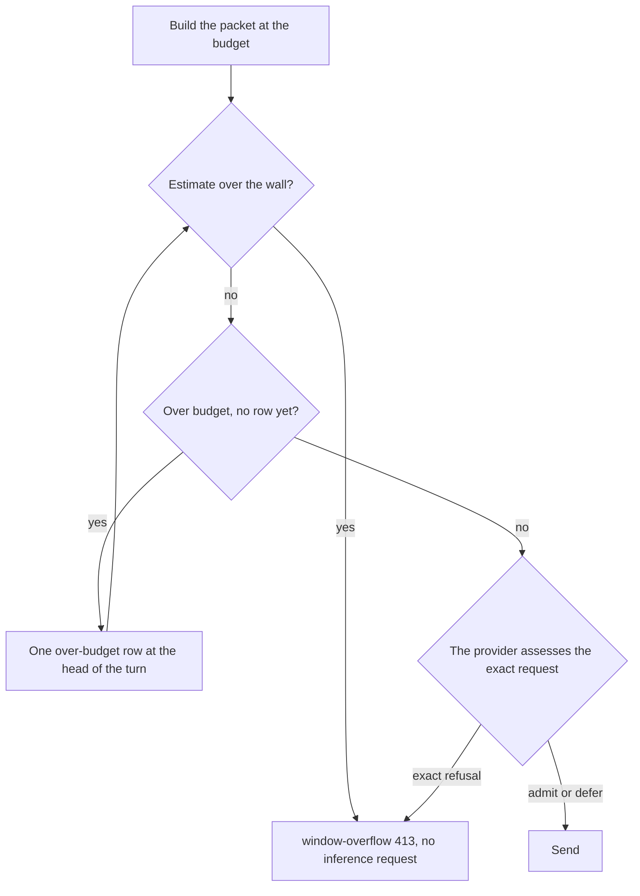

- §context-budget **The context budget is one room for the whole packet.** The budget is the provider's input capacity translated by the loop's calibration offset, `max(0, inputCapacity + offset)` ({§tokenomics-calibrated-readout}), and it bounds the whole packet — teaching, catalog, log and gauge together. Nothing on the service panel sizes a part of it: no projection share or preview page. When a settled emission updates the offset, the budget follows it either way; a room that shrinks under the model is announced by the over-budget row ({§context-over-budget-row}), never hidden by keeping a larger figure.
- §context-gauge **One gauge.** Every packet carries one `## Context` section holding one JSON object: `tokens`, the packet's weight as rendered, `budget`, the known room, and `percent`, `floor(100 × tokens / budget)` over the gauge's own final figures, so the share never disagrees with the counts beside it; a zero budget states no share. Only when the packet without an inventory strictly exceeds `PLURNK_SERVICE_BUDGET_PRESSURE` of its budget does `largest` name the `PLURNK_SERVICE_BUDGET_LARGEST_ITEMS` heaviest retained log rows as `{path, tokens}`, ranked by weight then path. Unknown budget omits `budget`, `percent` and `largest`. The final `tokens` includes the inventory; over budget, its full configured count remains available for curation ({§context-over-budget-row}). Each log row heading carries its own `tokens`. The gauge is state: it never presents `budget − tokens` as response allowance and carries no mandate.
- §context-fit **One rule: whole if it fits, otherwise as much as fits, then its size and address.** A result the model asked for — a READ without a scope, a FIND, an exec result delivered on close — arrives complete when its weight fits within `budget − tokens` as of that turn, less the room the turn still owes — one receipt's measured weight for each result still to land in it and the emission record that answers it, so that the receipts of a batch and the answer always fit. Otherwise the complete result stays where it was read from and the row is a `413` receipt naming the result's size, its weight, the remaining budget, and the two verbs: `READ` a range, or `KILL` first. Result cuts are named where they happen: the first page of what came back unasked in size ({§markerless-first-page}) and the cut at the room in the receipt.

  | Result | When it does not fit |
  | --- | --- |
  | A READ of lines | carries, above its receipt, the longest prefix of those lines whose row fits that room — the lines with their anchors, the returned range closed on the last line delivered, and the receipt naming the lines delivered |
  | A result whose first line does not fit, a FIND, a stream page, a byte view | a bodiless receipt |
  | An arrival the model did not ask for — an inbound `SEND`, a child's conclusion | the same bodiless receipt as a fact, not an error: its size and its address |
  | Explicit scopes (`<a,b>`, a pattern, `<1,-1>`) | exact, and take the same test |
  | The optional emission history | whole or absent ({§emission-history}), never a cut |

- §context-verbs **The verbs are the curation.** `READ` with a range takes a piece of what did not fit ({§read}); `NOTE` keeps what the model learned; `KILL` retires rows, ranges and bodies ({§log-kill-scope}) and may carry what it keeps of them as its own NOTE ({§log-kill-scope}). The daemon adds no other mechanism.
- §context-over-budget-row **Over budget is a row and a request, not an ending.** A packet whose weight exceeds `budget` is still submitted when it fits the window ({§context-wall}), and it carries one `_plurnk` error row at the head of its turn, `engine/context/packet-exceeds-budget` 413: "Context exceeds budget. YOU MUST ONLY KILL, MOVE or NOTE this turn." The limit protects a loop; it never ends one.

  | The row | Rule |
  | --- | --- |
  | Carries no figure | the row is the mandate: the gauge is the one home for `tokens` and `budget` ({§context-gauge}), and it shows the packet over with the row in it |
  | Shown once | in the packet it describes, then retired from the projection as a no-match KILL receipt is ({§log-history-projection}): it stays durable and readable at its coordinate, and a later packet that is over carries its own row |
  | Hides nothing | nothing is hidden to make the packet smaller; the response grant is the window's remainder above the provider's output floor ({§provider-output-floor}) |

- §context-wall **The context wall is the provider's window, and only it ends a loop.** The wall is the provider's physical input limit: `maxInputTokens`, and the context window less the output floor ({§provider-output-floor}). A packet that exceeds the wall by either measure ({§context-wall-measure}) ends its loop with the exact `engine/context/window-overflow` 413 Problem, and no inference request is made. An unknown window has no wall ({§tokenomics-window-unpollable-deliberate}).
- §context-wall-measure **The wall measures the request that will be sent.** The estimate is the packet's weight translated by its calibration offset, `max(0, weight − offset)` ({§tokenomics-calibrated-readout}), and is never assumed to overestimate. A packet that fits by the estimate is assessed by the provider as the exact wire request ({§provider-capacity-admission}): an admission sends it; an exact refusal is the wall's verdict and ends the loop. A provider that can only estimate defers, and the upstream provider is then the capacity oracle: its refusal ends the loop with the provider's own 413.
- §tokenomics-weight-stored-at-write **Curation weight, stored at write.** `entry_channels.weight` weighs the complete channel content. `log_entries.weight` weighs the complete canonical `LogBody` content before coordinate and packet presentation; persistence `tx`/`rx` envelopes contribute nothing merely by existing, and proposal settlement recomputes the value when the canonical result changes. Bodyless rows therefore weigh zero. The stored number is a stable content-depth measurement, not a provider-token prediction. `entry_channels.lines` is the channel's line count beside it, a stored generated column SQLite keeps on every write as the persisted mirror of {§logical-line-count} (a trailing newline terminates the last line; empty content has none), so a catalog lists extent without reading bodies.
- §tokenomics-render-weight-budget **Packet curation budget.** `tokens` measures the *complete assembled packet* after section transforms and readout substitution, each rendered message (including {§emission-history}) and native attachments; it is not a sum of stored row weights ({§tokenomics-weight-stored-at-write}). Core measures minimum-width probes, monotonically expands fields that do not fit, then right-aligns final values into those widths; final substitution is length-invariant and the displayed total equals the stored request weight. Receipt, FIND-item, pressure-inventory, total, and ceiling figures all use the same curation ruler. A `SUM` of stored content weights measures a different artifact and cannot substitute for packet render weight.
- §tokenomics-calibrated-readout **The calibrated readout translates capacity by measured evidence, never extrapolating unmeasured content.** A sample is a settled emission response pairing its request's measured packet weight with the provider-reported prompt count, both positive. Calibration never changes stored weights, rendered receipt costs, or the immutable request history ({§tokenomics-agnostic-ruler}).

  | Fact | Rule |
  | --- | --- |
  | The offset | a loop's latest settled sample from the answering model fixes the additive offset `weight − reported` for its next packet; until the loop settles one of its own, its packets use that model's most recent sample from any loop or session, and a model that has none uses `0` |
  | The conversion | `max(0, inputCapacity + offset)` converts provider capacity into curation units, the budget ({§context-budget}), crediting only the tokens saved on the measured packet while budgeting unmeasured growth 1:1; `max(0, weight − offset)` converts the packet's weight into the wall's estimate ({§context-wall-measure}); zero means no room fits, and unknown input capacity remains `null` |
  | The packet | captures this allowance and its offset once for its readout, pressure inventory, wall estimate, and persisted client gauge; later responses cannot change that packet's allowance |

- §tokenomics-window-partition **The window partition: one capacity derivation, no service-side token budget.** The provider owns model limits, the configured output reservation, and each call's response grant. Its resolved `inputCapacity` supplies the physical denominator exposed to clients and the boundary conversion into curation units ({§tokenomics-calibrated-readout}). Core shapes context in curation units; provider request-shaped evidence alone admits or rejects physical I/O. Local and custom deployments tune context window, total output budget and optional reasoning subset at their owning layers.
- §tokenomics-window-unpollable-deliberate **An unpollable window is deliberate: unknown provider capacity stays unknown.** When the provider cannot derive `inputCapacity`, there is no budget: the gauge carries `tokens` alone, every result arrives whole, and the provider remains the capacity oracle ({§provider-capacity-admission}). Core never invents a stand-in.

§tokenomics-client-gauge **Clients receive curation and physical occupancy as separate pairs.** `loop/packet.gauge`, after each packet-bearing model turn, and `loop/terminated.usage`, at the Loop's end, carry latest packet-bearing model-turn `curationWeight`/`curationBudget` and latest-emission-call `contextTokens`/`contextCapacity`; each unknown fact is `null`. The curation pair is the packet's measured weight and captured allowance, exactly as displayed to the model, not a recalculation using newer usage evidence. Packetless chronology cannot erase an assembled-request gauge. Both physical facts bind to that same call: a preflight rejection may report capacity while its absent physical request leaves `contextTokens=null`, never borrowed from an earlier call. Clients never divide provider-reported physical tokens by Core curation weight. `providers.list` exposes each instantiated alias's `inputCapacity`. A model switch replaces the latest-turn facts together; aggregate provider accounting remains cardinal monetary evidence, not a gauge input.

- **Derivation is exhaustive and demand-led.** Explicit searchable-resource changes may start one coalesced warm. Passive creation and attachment do not. The first model turn starts or joins that warm; later turns derive intervening changes before dispatch. No model operation observes partial graph or full-text coverage. Progress notices make the wait visible. {§persistent-search-index}
- §membership-binary-sniff **Binary truth beats a text label.** Filesystem source acquisition, including tracked members and installed skill resources, inspects up to the first 8192 bytes when extension detection does not identify a binary type. NUL marks `application/octet-stream`; existing binary types retain their declared type. Member projections follow {§derivation-dedup-parallel}; installed skill projections follow {§skills-resources}.
- §tokenomics-agnostic-ruler **One model-agnostic curation ruler.** The daemon runs sessions on different models in one workspace concurrently, while catalog and log accounting are workspace-wide. `contentWeight = ceil(chars/2)` therefore gives one content one stable number without per-model workspace state or recount passes. It controls curation only; every provider call independently measures the complete request as well as it can.
- §tokenomics-content-hash-identity **Content identity, not per-tokenizer counts.** A settled channel's `content_hash` (SHA-256) is its body's identity in the content store ({§content-store}); a writer may bind it, a bound hash must match the content, and an active stream has none until it settles. `weight` is stored beside that content and is never keyed or recomputed by model.
- §tokenomics-provider-usage **Provider accounting is physical-request evidence, not curation state.** Every issued physical request has one durable pre-I/O `provider_requests` identity beneath the normalized {§provider-surface} and settles once as response or error. This is operational request accounting, not invoice reconciliation. Output and reasoning are quantities the model cannot KILL, so they never alter the model-facing Budget ledger.

  | Fact | Rule |
  | --- | --- |
  | Each record | preserves conventional {§provider-usage} quantities and required {§provider-cost} evidence; an unreported quantity remains absent, including on response-less failures, and is never replaced by zero |
  | Ownership | `model_calls` own response/failure evidence, `turn_attempts` specialize emission admission, and `provider_requests` are the sole durable accounting representation, so emissions, BARE calls, rejected responses, retries, failovers, and errors remain cardinal and ordered |
  | Derivation | turn, loop, session, workspace, digest, and protocol accounting are derived from those records through the shared {§provider-accounting} projection; only emission calls contribute the latest-packet context gauge; the baseline stores no floating-point money, denormalized totals, or rollup triggers |
  | Cost | a documented direct charge becomes `charged`; otherwise the provider may compute an exact-decimal USD `estimated` amount from complete usage and the exact model's Models.dev rates; insufficient evidence becomes `unknown`; complete totals and known subtotals remain distinct under {§provider-accounting}, unknown requests cannot impersonate free requests, and missing usage never becomes zero |

Each physical request also retains {§provider-request-evidence}, atomically
with its accounting settlement. Failure does not discard received fragments.
The digest emits one linked `requests/<id>.json` artifact per physical request,
including unavailable evidence as `null`, reading heavy records one at a time.
Failed partial operations and reasoning remain forensic data only; they never
execute, enter model history, or become a later request's successful output.

- §loop-terminals **A loop's terminal status is an HTTP status, exact to its outcome.**

  | Status | Outcome |
  |---|---|
  | 100 / 102 | Queued / running |
  | 202 | WAIT or an eligible final response joining a live obligation ({§loop-completion}, {§session-wait-timing}) |
  | 200 | Messages answered, results observed, held work settled |
  | 499 | Session-scope or client cancellation |
  | 429 | Turn allowance exhausted |
  | 413 | A result that does not fit ({§context-fit}), a packet over the budget ({§context-over-budget-row}: a row; the request still goes), a packet that exceeds the window ({§context-wall}), or an upstream provider's own refusal ({§context-wall-measure}) |
  | 500 / 508 | Strike threshold or invalid-emission exhaustion / crossing strike caused by a cycle |
  | 504 | Loop timeout or exec-timeout restamp |

  An empty WAIT continues at 102. The exact terminal result retains its Problem;
  status classes are not catch-all replacements for that evidence. No failing status
  here is ever softened because the model wrote something the harness could not read;
  every one of them cites it instead ({§outside-text}).

### §env-delta The environment delta: what changed since the model last looked

Catalog FIND results ({§packet-catalog}) state what existed when observed. The
environment delta supplies structurally addressed activity without copying the
workspace into every session's private state.

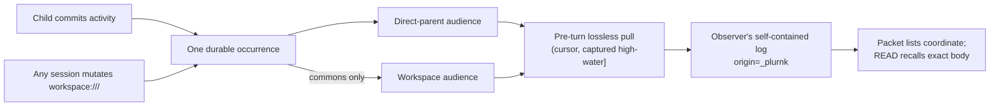

§env-delta-log-pull **Pull the event record, never a workspace snapshot.** At
pre-turn, a session materializes only occurrences whose structural audience
includes that session. The set is exhaustive, unranked, and exactly once; the
engine makes no relevance decision. Each copied event retains the operation,
result, and typed attributes.
Every producer appends to one workspace-scoped occurrence journal with a
monotonic identity. A pull captures one closed `(session cursor, high-water]`
interval, materializes each addressed identity idempotently, then advances the
cursor only after the whole interval is durable. An event racing the capture is
therefore in this interval or a later one, never neither or both. Source-log
curation cannot erase the occurrence record.

The cursor is observation progress, not a private copy of resource contents. A
fresh session captures the current high-water when its session row is created, so
pre-existing broadcast history stays out while later occurrences remain
deliverable even before its first packet. A fork instead copies the parent's
cursor and captures its own fork high-water atomically with session creation
({§machine-processes}). Observer rows retain the source
identity and never publish another occurrence. Newly materialized ambient and
terminal-stream rows emit the ordinary client notification
({§notifications-log-entry-notify}) before the next inference; an idempotent
pull does not emit an existing row again.

§env-delta-session-entry-visibility **Session-entry visibility: the commons is global; every other
resource follows lineage.** A successful state-changing `EDIT`, `COPY`, `MOVE`,
entry-path `KILL` whose landed effects touch `workspace:///...` acquires the workspace
audience and retains the commons address in its observer row. Mutations to
`session://<session>/...`, named session spaces, project files, and remote resources do
not broadcast. When authored by a child, their
ordinary operation evidence still reaches that child's direct parent.

| Producer / event                                      | Durable occurrence                                                                                     | Observer projection                                                                                                                |
| ----------------------------------------------------- | ------------------------------------------------------------------------------------------------------ | ---------------------------------------------------------------------------------------------------------------------------------- |
| §env-delta-child-activity Direct-child activity       | Child-authored final EDIT, COPY, MOVE, SEND, executor invocation, WORK, FORK, and targeted non-log KILL receipts, including failures. `_plurnk` initialization, maintenance, and operation turns stay with the session. A reply already delivered to the parent uses its reply occurrence instead ({§message-reply-delivery}). | Direct parent only; one exact attributed row born body-suppressed. Incoming message projections ({§message-arrival}), NOTE, READ (including executor-output READs), FIND, BARE, WAIT, and log KILL never create activity occurrences. Provider reasoning, calls, rejected emissions, and turn sources do not cross automatically. |
| §env-delta-child-termination Direct-child termination | The child's exact terminal loop result, except loops containing only `_plurnk` operation or maintenance turns. A conclusion before the first turn still reports, including failed spawns. `source` names the actor; the READ selects the exact loop ({§message-completion}). | Direct parent only; bounded, initially visible READ under {§session-scheme}, never the child's potentially newer loop. Excluded administrative loops create no pending child-result edge. |
| §env-delta-commons-mutation Commons mutation          | One successful resolved operation whose landed effects touch `workspace:///...`.                         | Every existing session; one body-suppressed row per observer, deduplicated with any lineage audience.                               |
| §env-delta-filesystem-narration Filesystem narration: project-file divergence | Runtime-owned reconciliation evidence remains in the runtime actor's own log.                        | No ambient observer row. Current content remains addressable and stale hash edits reject at their owned boundary.                 |
| §env-delta-entry-materialization Executor `entry()` sink | The runtime records typed materialization evidence under its owning actor.                           | No ambient observer row unless the resulting operation itself is direct-child activity or a commons mutation ({§execution-output-identity}). |

§env-delta-attribution **Attribution: ownership, authorship, and cause are independent.**

| Field       | Meaning                                                                                                                                                                                 |
| ----------- | --------------------------------------------------------------------------------------------------------------------------------------------------------------------------------------- |
| `session_id` | The session whose self-contained log owns the materialized row.                                                                                                                          |
| `origin`    | The actor tier that wrote the row; a materialized delta is `_plurnk`.                                                                                                                   |
| `source`    | The attributed actor or subsystem: a lineage or commons observation uses canonical `session://<producer>`; a subsystem observation may use its stable token (for example `file`). Self-authored rows omit it. Stream invocation correlation belongs to the subscription/publication relationship, not this field. |

§env-delta-no-coalescing **No coalescing: activity is never coalesced.** Each eligible child
action and each commons mutation has one occurrence identity. Combining
them would destroy causal order and conflate event replay with a state
comparison.

§env-delta-passive **Passive observation never forces a turn.** Deltas materialize only
while a packet is already assembling. Intermediate child activity and commons
broadcasts therefore cannot wake an idle session. Urgent directed communication
uses the voice door ({§actor-boundary}); child conclusions and addressed
replies use {§session-causal-admission} and {§message-reply-delivery}.
Stream progress remains owned by {§exec-stream}.

---

## §packet Packet shape

<!-- map -->
| Tag | Promise |
| --- | --- |
| {§packet-markdown} | The packet's Markdown projection (#626). |
| {§packet-stored-shape} | A model packet preserves the rendered request and, only when an emission is admitted, its response. |
| {§packet-items} | Sections are rows over content-addressed items; the bag never holds them. |
| {§definition-table-projection} | The definition's tables are projected, not authored. |
| {§body-projection} | One full body, one readable view, one packet projection. |
| {§markerless-first-page} | What the model did not ask for in size arrives as its first page. |
| {§message-arrival} | A message source, its log observations and its reply state are distinct. |
| {§message-reply-delivery} | A reply is delivered once, not re-enqueued as a request. |
| {§message-short-identity} | The model addresses a message by its short name. |
| {§message-causal-source} | Message authorship and delivery are distinct facts. |
| {§message-projection} | Message storage is unbounded by model context; its arrival in the packet is not. |
| {§message-loop-containment} | A loop contains every message that arrives before it concludes; the next turn boundary publishes every inbox… |
| {§completion-defers-to-messages} | Completion defers to messages: a conclusion does not cross an unobserved arrival. |
| {§packet-catalog} | Catalogs are query results, not packet state. |
| {§operation-results} | Operation results: model-facing failures and notices |
| {§operation-result-uniform-error-channel} | One uniform error channel within an accepted turn. |
| {§log-row-self-explains} | A log row self-explains: every ≥400 pointer names a record that states its why. |
| {§notice-drain-on-read} | Notices |
| {§rail-accounting-private} | Rail accounting is private. |
| {§continued-without-note} | A continuing turn that carried no NOTE is told so, in the card's own words. |
| {§notice-callout} | A notice speaks in the card's callout form. |
| {§notice-level} | Severity on the wire (`level`, required). |
| {§operation-result-no-error-scheme} | There is no error scheme. |
| {§notice-event-notify} | Notices notify the client surface. |
| {§loop-status-notice} | The loop status notice carries lifecycle and its observation deadline together. |
| {§share} | A share is the database's record, ready to send. |
| {§share-scope} | A share is unredacted. |
| {§share-folder} | Shares land in one place. |
| {§candidate-pinned-runtime} | Candidate runtime stays pinned. |
| {§output-allowance-notice} | The output allowance is not disclosed; a ceiling cut names its cause. |
| {§turn-lifecycle} | Turn-lifecycle liveness. |
| {§turn-accounting-notice} | The turn accounting notice: the completion beat carries the spend. |
| {§notice-content-offset-pointer} | Content-offset position. |
| {§tools-resource-discovery} | Executable capability discovery uses ordinary Plurnk resources. |
| {§tools-resource-materialization} | Tool resources materialize from one workspace snapshot. |
| {§tool-document-header-only} | A header-only tool document: |
| {§tools-summary-invocation} | A summary featuring one exact enabled tool invocation includes its compact input signature after literal `\n`… |
| {§members-functionality} | File membership is one workspace Functionality family. |
| {§members-configuration} | *Available definitions.* `PLURNK_MEMBERS_<alias>=<glob>` declares one service-origin rule (`!glob` excludes),… |
| {§members-model-scope} | *The model's authority.* A model's `add` is admitted against `PLURNK_SERVICE_MEMBERS_MODEL_SCOPE` in the… |
| {§members-projection} | The members projection is one overlay of the workspace's enabled definitions. |
| {§plurnk-skill} | Plurnk's own reference is an ordinary service-provided skill. |
| {§schemes-directory} | Scheme references are ordinary workspace entries at `workspace:///_plurnk/plurnk/<scheme>.md`. |
| {§inject} | system.inject — the operator injection |
| {§packet-inject} | When `PLURNK_SERVICE_PACKET_INJECT` names a readable markdown file, its content renders as an `## Operator… |
| {§card-read-per-wake} | The card is read from disk at every loop start and wake, never held. |
| {§policy} | system.policy — the client's policy injection |
| {§policy-sections} | One section rides the system slot **after the definition**: the contents of `PLURNK_SERVICE_POLICY` (unset… |
| {§schemes-self-doc-materialization} | Self-documentation materializes one generated reference tree per workspace. |
| {§packet-git-status} | The Git status section — compact repository state |
| {§recap} | Optional Recap footer |
| {§recap-lines} | The operator's recap lines lead the footer: every non-empty `PLURNK_SERVICE_RECAP_LINE_<alias>`, in alias… |
<!-- /map -->

§packet-markdown **The packet's Markdown projection (#626).** Core renders the transformed section list into the ordered messages of {§packet-wire-envelope}; within each message, section order is preserved. Core owns the order at {§packet-cache-monotone}; a trusted extension may transform the section list before rendering ({§packet-extension-transform}).

| Section | Renders as |
| --- | --- |
| Nonempty, with a header | an H2 immediately followed by its JSON object/array content; non-JSON content has one blank line after the header |
| A null header | only its content |
| Empty content | omitted: any node whose content is empty is absent from the wire, except the child-orientation sections, which state emptiness as `[]` ({§child-orientation}) |
| Between sections | trailing newlines are removed from each section, and rendered sections are separated by one blank line |

The projection preserves the evidence section owners supply: paths, URI fragments, log coordinates, scopes and coordinate-prefixed body lines remain usable without translation; curation and log-row measurements stay attached to what they measure ({§tokenomics-agnostic-ruler}); statuses, Problems, body visibility and bodyless rows render as produced, never upgraded or suppressed; operation examples remain typed fences and log records keep their boundaries ({§log-wire-format}).

| Default section | Slot   | Wire form                                                                                     | Semantic owner                  |
| --------------- | ------ | --------------------------------------------------------------------------------------------- | ------------------------------- |
| `definition`    | system | Bare `plurnk.md`; no wrapper heading                                                          | {§definition-table-projection}  |
| `system-policy` | system | Authored Markdown                                                                             | {§policy-sections}              |
| `inject`        | system | Authored Markdown                                                                             | {§packet-inject}                |
| `log`, `log/<coordinate>` | user | Chronological Markdown H3 records with JSON metadata | {§log-wire-format} |
| `session`        | user   | JSON `path` with the literal Session address, `parent` (address or `null`), `loop`, `turn`     | {§child-orientation}          |
| `delegation`    | user   | JSON `{sessions, streams}`                                                                    | {§child-orientation}            |
| `errors`        | user   | JSON status/log-path pointers                                                                 | {§operation-results}            |
| `notices`       | user   | One alert callout per notice, directive first                                                 | {§notice-callout}               |
| `git`           | user   | Working-tree state in a NOTE blockquote                                                       | {§packet-cache-monotone}        |
| `budget`        | user   | JSON curation usage and ceiling                                                               | {§context-gauge} |
| `messages`      | user   | JSON pointers to the loop's unanswered immutable messages, path and source                    | {§message-arrival}              |
| `recap`         | user   | Optional authored operational recap                                                           | {§recap}                        |
| `emission-history/<coordinate>` | assistant | Complete retained operations at their emission records; replay omitted whole at capacity | {§emission-history} |

§packet-stored-shape **A model packet preserves the rendered request and, only
when an emission is admitted, its response.** Core assembles and measures the
request under {§packet-assembly}. An admitted response extends that same record
before the turn closes; a failed provider call or exhausted invalid emission
leaves the request-only record, while rejected exchanges remain in their
`inference_calls`/`model_calls` evidence with classification in
`turn_attempts`.

| Turn state                    | `turns.packet` (the bag) + `turn_sections` rows  |
| ----------------------------- | ----------------------------------------------- |
| No admitted model request (including initialization and local capacity rejection) | SQL `NULL`, no rows |
| Request assembled             | `{ weight, attributions }` + the ordered sections as items; each selected program is stored at its emission boundary, with no empty placeholder ({§emission-history}) |
| Response admitted             | `{ weight, attributions, assistant, assistantRaw }` + the sections as items |

§packet-items **Sections are rows over content-addressed items; the bag never holds them.** Every rendered block — one log row's record, one non-log section's content — is stored once in `packet_items` under the SHA-256 of its text (`sha256`, a registered function), and a turn stores its composition in `turn_sections` and `turn_section_items`: the ordered sections and, per section, the ordered item hashes.

- A section's content is its items joined by one blank line, so a log row whose rendering did not change between turns hashes to the same item and a turn's durable cost is its new and changed items — the copied prefix of the previous packet is transient data and is never written. A packet transformed by an extension, or any non-log section, is one item.
- The write is one statement: an INSERT into the `turn_inference_evidence` view, whose INSTEAD OF trigger refuses a turn that is not an open model inference turn and lands the items, the composition, the bag, and the provider metadata together.
- Readers of a whole packet select from `turn_packets`, which assembles `sections` back into the bag byte for byte (the digest, and every test that inspects a stored packet); statements that need one field read the bag directly with `json_extract`.
- Items no composition references are transient data: `retention_collect_packet_items` collects them under the retention policy ({§retention-policy}), which is how a deleted session's or workspace's packets release their space while shared items survive. A fork copies the composition and shares the items ({§machine-processes}).

| Field                   | Presence                         | Contract                                                                                                                                                                      |
| ----------------------- | -------------------------------- | ----------------------------------------------------------------------------------------------------------------------------------------------------------------------------- |
| `weight`                | Every assembled model request    | Curation weight of both rendered request slots. Admission does not change its meaning; it is never response weight or provider usage.                                          |
| `sections`              | Every assembled model request, as rows ({§packet-items}); assembled back into the bag by `turn_packets` | Ordered post-transform request sections. `PacketWire.renderSlot` groups them into system and user messages, and the digest re-renders those stored sections byte-for-byte.     |
| `sections[].weight`     | Every stored section             | Independently measured curation weight of that section. Their sum is not the rendered request weight because slot separators and independent rounding remain outside each row. |
| `assistant.content`     | Admitted response only           | Accepted model content from which operations were parsed.                                                                                                                     |
| `assistant.ops`         | Admitted response only           | Parsed operations admitted from that content.                                                                                                                                |
| `assistant.reasoning`   | Admitted response only           | Normalized readable reasoning text, or `null`.                                                                                                                               |
| `assistantRaw`          | Admitted response only           | Opaque provider-owned transport record retained for forensics; `null` when the provider supplies no raw record.                                                               |

`StoredPacket` is the one core type and validation path for this algebra. The
flat schema enforces its root states; typed reads additionally validate every
section and parsed operation. A hard budget stop remains request-only. Client,
setup, filesystem-narration, and executor-materialization turns are ordinary
operation turns and therefore store `NULL`. Digest projects exact operation
source independently from this optional model-exchange record; a request-only
turn receives a note instead of a fabricated response.

he external tokenless draft and transformation boundary is owned by
{§scheme-packet-transform}. Core alone extends each validated draft with its
measured `weight` field for storage. #74 tracks coverage that mistakes the sum
of section weights for the rendered request weight.

§definition-table-projection **The definition's tables are projected, not authored.** The authored `plurnk.md` remains human-aligned. Its `definition` section deterministically removes Markdown table-cell padding and shortens separator cells to three dashes before extension transforms, measurement, storage, and wire rendering; alignment colons survive, while fenced blocks and all non-table whitespace remain exact.

§body-projection **One full body, one readable view, one packet projection.** Every durable log row has one canonical full body resolved from its stored tx/rx envelope by `LogBody`. READ and FIND over `log:///`, persistent search derivation, and packet rendering apply the same deliberate trimming under {§log-kill-scope}. Packet rendering additionally applies initial suppression and these presentation bounds:

| row producer | ordinary visible projection |
|---|---|
| any `READ` or `FIND` | the result as its own page ({§markerless-first-page}), complete when it fit; otherwise the `413` receipt, above the longest prefix of a READ's lines that fit ({§context-fit}) |
| `NOTE`, `WAIT` | complete literal authored text |
| inbound `SEND` from outside the workspace | the operator's: complete when it fit, otherwise its size and address ({§context-fit}, {§message-projection}); a peer session's: its first page ({§markerless-first-page}) |
| structured `EDIT` receipt or textual `COPY`/`MOVE` effects | complete receipt-owned join context |
| every other nonempty body | the model's own: complete; what it did not author: its first page ({§markerless-first-page}); then {§context-fit} |
| the `reasoning` row | the optional reasoning preview under {§turn-source-resources} |
| bodyless row | heading and any facts; no coordinate lines; `tokens` includes any selected native part |

§markerless-first-page **What the model did not ask for in size arrives as its first page.** A READ or FIND without a scope, a stream delivered when a command closes, a peer session's message, an environment delta, an extension's body and a rejected emission shown back all arrive as their first page: `PLURNK_SERVICE_PREVIEW_LINES` lines and at most `PLURNK_SERVICE_PREVIEW_CHARS` characters, in the projection's own units — lines of text, bytes of a byte view ({§binary-parity}), results of a FIND — with one fact in one notation stating the page and the whole, `<1,100> of 4812 lines` (`range` on a retrieval, `preview` on a stored body, {§log-wire-format}). No operation carries a page size of its own.

| Rule | What |
| --- | --- |
| stands whole | what the model authored — a NOTE, a WAIT, the body of its SEND, the prompt of its WORK or FORK, and the command it handed an executor — and what it asked for exactly: an explicit scope (`<a,b>`, `<1,-1>`, a pattern) and an EDIT receipt, bounded by its own rule ({§edit-result-receipt-projection}) |
| takes its page | what it did not ask for in size, as above; its own reasoning, when it lands as a row, stands whole only when it fits the row's page and otherwise takes its last page ({§turn-source-resources}) |
| the only exceptions | the operator's message keeps its own rule ({§message-projection}) and emission rows remain folded ({§turn-source-resources}), so the model can reason about every page the same way |

A page lands under {§context-fit} like any result: whole when it fits the remaining budget, otherwise the prefix and receipt. Retrievals take their page at the source, before storage, and the packet applies no second cut to a stored result; a stored body takes its page in the packet, and the rest stays readable at the row's address.

READ and FIND own their range or pagination before packet rendering; the packet never applies a second hidden substring bound to their selected result. Reasoning arrives through ordinary scoped READs ({§turn-source-resources}). When a visible projection differs from its canonical body, metadata carries `preview` under {§log-wire-format}; complete and fully suppressed bodies omit it. ```` ```READ (log:///<coordinate>/<OP>) ```` selects untrimmed lines in original coordinates under {§log-kill-scope}; the unsuffixed exact shorthand and authoritative suffix behavior are defined by {§log-history-projection}. ```` ```FIND (log:///...) ```` and search match that same readable view. System/policy sections are not log bodies. Notices are transient non-log observations; they share the ordinary line/character bounds but have no durable body or recovery URI.

§message-arrival **A message source, its log observations and its reply state are distinct.**

| Fact | Owner | Curation effect |
|---|---|---|
| Accepted body, attachments, address and causal source | Durable inbox message | None; ordinary READ/FIND/COPY can recover the source. |
| Arrival seen at a turn boundary | One inbound SEND log row, `origin="_plurnk"`, `attrs.kind="message"` | Ordinary KILL can trim or remove this observation. |
| Answered messages | Successful executed reply, {§message-completion} | None; curation cannot retract delivery. |

Every accepted message enters its recipient loop's inbox in arrival order, with its selected
paths, and publishes exactly once at the next turn boundary. **Open Messages** lists the
unanswered messages by their immutable source address (`path`) and their sender — a causal
`source`, or `"origin": "user"` for the operator's own ({§message-causal-source}) — not a log coordinate. Each arrival receipt's `resource` names that same retained source.
Trusted protocol modules supply message addresses in their own scheme;
native arrivals use `message://<recipient>/<opaque-id>`, separate from the session's
actor and scratch addresses. Ordinary session scratch remains writable. Source bodies
are not edited or deleted through resource operations; independently curatable READs and
arrival rows obey {§log-kill-scope}. No curation operation answers a message.
Within a workspace an address identifies exactly one accepted message. Reusing it for
another admission is a 409 conflict, not a second message or an implicit content update.

§message-reply-delivery **A reply is delivered once, not re-enqueued as a request.**

| Audience | Delivery | Effect |
|---|---|---|
| Assigned session | Its own log, even when another actor answered | Visible reply; wakes eligible parked work without a new Open Message or loop. |
| Original native sender | That session, if distinct from the assigned session; original delegated-task answers use {§session-scheme} instead | Other replies use the same wake and observation path. |
| Exterior sender | The assigned session's protocol adapter | The adapter delivers the answer through its standard message channel. |
| Replying actor | Its own executed SEND | No duplicate ambient occurrence. |

The successful SEND and its addressed occurrences commit together. Reply occurrences use
the ordinary durable ambient cursor and wake revision; curation cannot revoke delivery or
replay it. An addressed reply replaces the same parent's generic activity observation.
The child's reply to its original parent-delegated message reaches that parent once,
through the conclusion READ under {§session-scheme}; it is not a separate reply
occurrence. Other replies remain ordinary messages. The exact loop remains addressable
under {§message-completion}.
Unobserved replies prevent conclusion just as unobserved child results do. All operation
producers notify the same settlement path after durable execution; reply wake-up shares
{§session-causal-admission}, without delaying the replying program.

§message-short-identity **The model addresses a message by its short name.** Every message carries
`message://<session>/<key>` (`key_path`), the form the session docs teach, and that is what the packet
shows in Open Messages and in an arrival row's `resource`. A client's own identity for the same
message — an ACP message UUID — stays the durable `path` that correlation,
delivery and reply accounting use, and remains addressable in its own scheme; the short form is an
additional alias. Answering either reaches the same message.

§message-causal-source **Message authorship and delivery are distinct facts.** The harness publishes every arrival row; the row's `source` carries the canonical address of the causal actor. Attribution persists with the message through the inbox, parking, orphan recovery, restart, and later log projection; model syntax cannot author it. The Open Messages pointer carries the same attribution ({§message-arrival}).

| Arrival | `source` |
| --- | --- |
| Native WORK, FORK, and directed session SEND | `session://<sender>`, derived from the authenticated sender session ID |
| A trusted exterior adapter | its own canonical actor address through {§methods-loop-run}: the ACP module names the client's message under `acp://` ({§acp-run-source}) |
| Absent | the operator |

The wire renders the row's `source` in place of its `origin`, which is constant for every arrival, except where the source is the transport that minted this very message, which says nothing the address does not ({§message-short-identity}). The operator's message is then the one arrival with no sender to show, so it renders `"origin": "user"`; a bare arrival would read as the model's own SEND and hide the request it answers.

§message-projection **Message storage is unbounded by model context; its arrival in the packet is not.** Core persists every accepted message completely before packet assembly. An arrival renders complete when it fits the remaining budget ({§context-fit}) and otherwise as its size and address, where a READ of the message's log body, scoped or whole, retrieves it. A peer session's message is received text and arrives as its first page ({§markerless-first-page}). No share of the capacity is set aside for arrivals, and no knob sizes one.

§message-loop-containment A loop contains every message that arrives before it
concludes; the next turn boundary publishes every inbox row the loop has not yet
published, oldest first, and stamps each with the row it became. Ordinal 1 is the loop's
own assignment and shares the loop's fate: a loop that fails before its first turn does
not replay it. Every other still-unpublished message at conclusion moves into one
source-keyed recovery loop, renumbered from its first, whose headline it becomes; that loop's first turn publishes the complete
ordered set exactly once. The recovery loop retains the source loop's model routes,
effort, and call ceiling; message bodies and attribution are preserved directly from
their durable rows. Recovery retries complete the same queued loop and never
mint duplicate work. Output withholding preserves readable arrival rows; explicit
KILL follows the ordinary log contract.

§completion-defers-to-messages **Completion defers to messages: a conclusion does not cross an unobserved arrival.** The end-of-program check includes messages that arrived during inference. The final database transition atomically requires every inbox message to be published and the loop's observed wake revision to equal its session's current revision. Answer delivery is not this barrier. An arrival that wins the race continues the current loop; one admitted after conclusion belongs to a new loop. Orphan recovery preserves messages accepted before an independently forced termination.

§packet-catalog **Catalogs are query results, not packet state.** The packet
stores no materialized manifest. Complete and one-level entry directories,
their row shape, and their ordering are ordinary FIND projections owned by
{§find-result-projection}; persistent search derivation is a separate index.

### §operation-results Operation results: model-facing failures and notices

The model's runtime alert surface has two distinct kinds of information:

- **Turn failures are log items.** A failed action and an engine-rail failure are durable `log_entries` rows whose `rx` is an RFC 9457 operation result. They can be scoped-KILLed, retired, and budgeted like every other row. The `errors` section is a derived pointer index over recent `status_rx ≥ 400` rows; it owns no bodies or failure state. Rejected emissions never become accepted turn content; their private response and admission evidence remains in `model_calls` and `turn_attempts`, apart from the bounded recovery `emissionAttempt` under {§emission-admission}.
- **Notices are transient observations.** Progress and non-fatal diagnostics such as `turn_awaiting_model`, `search_progress`, and `output_unaccounted` may appear once in the packet and broadcast live. They neither substitute for a failure result nor influence scheduling or recovery.

The `log` is durable product truth. The `errors` section points at its failures
while the separate `notices` section displays transient observations. The two
retain distinct contracts and lifetimes.

- §operation-result-uniform-error-channel **One uniform error channel within an
  accepted turn.** Every operation or engine-rail failure — including
  max-commands and premature completion — is a `log_entries` row with
  `status_rx ≥ 400` and an RFC 9457 Problem Details operation result in `rx`.
  There is no per-category handling or bespoke ephemeral relationship. The
  `errors` section is a derived index over those rows from the current and
  immediately prior turn: one `{status, path}` JSON object per row,
  nothing else. The Problem lives on the curatable row and is READ via the path.
  Withheld output preserves its original result ({§context-fit});
  a packet past the window fails before inference ({§context-wall}).
- §log-row-self-explains **A log row self-explains: every ≥400 pointer names a record that states its why.** A model-operation failure is the model's own operation result; its
  Problem Details `instance` retains the originating occurrence URI; when absent,
  persistence assigns that row's `log:///` URI. Packet wire renders
  the contracts-owned compact `{§problem-projection}` on its meta line whether
  its body is visible or suppressed. The enclosing row owns status, model-facing path, source, and target;
  an identical extension is not repeated inside the projection. No
  separate item is minted for operation failures. Actionless engine rails mint
  `op='error'` items because no authored operation row exists. Invalid provider
  emissions are outside this channel because they are not turns. A bare
  failure status or mismatched result/problem
  statuses violate the producer contract and fail hard. Genuine
  engine-internal faults crash and never mint model-facing rows.
- **Asynchronous work does not weaken the contract.** A stream-producing operation returns its initial `102` after acquisition. At conclusion the subscription stores the exact universal terminal result; `stream/concluded` carries it unchanged; the next ambient terminal READ merges it with the stream payload and preserves its Problem instance, assigning the committed `log:///.../READ` URI only when absent. Timeouts and service cancellations replace the complete terminal result with a new valid 504/499 Problem—they never mutate a status while retaining a contradictory Problem.
- **Self-explaining rows.** A problem `title` names the stable class and `detail` states the occurrence-specific cause. Producer-known operands belong in factual extensions. `stage` appears only when neighboring stages imply different recovery; `recovery` states one generally valid next action; `retryable` is true only when the producer recommends automatically retrying the identical request. Unknown recovery or retryability is omitted rather than guessed. General workflow teaching stays in the packet rather than being duplicated into every failure. The runtime-neutral writing contract is owned by `@plurnk/plurnk-contracts`.
- **Exact Problems cross durable and external boundaries.** Scheme capabilities, proposal application, subscription conclusion, loop settlement, ACP, clients, digests, and benchmark records preserve the originating Problem object. The model packet alone derives `{§problem-projection}` without mutating that object. An adapter may add a missing durable `instance`, never replace an existing one; it must not rebuild failure truth from `status`, `detail`, a transport error envelope, or a scheduler projection. A failed boundary without a valid Problem is a contract violation and fails hard.
- **Caught diagnostics are bounded.** Core-owned Problems may include a bounded preview of a caught runtime diagnostic when it states the occurrence-specific cause. `PLURNK_SERVICE_ERROR_DETAIL_LIMIT` owns that model-facing character bound; complete errors remain in daemon diagnostics. Input validation and stable contract failures do not spend this allowance on implementation text.
- §notice-drain-on-read **Notices** - the few observations that are not log rows render one callout each under their distinct `## Notices` section ({§notice-callout}), never a JSON dump. Packet rendering normalizes whitespace, bounds the producer message with the shared preview limits, and appends any typed position. The notice buffer drains on read; event Notices appear on at most one packet. Parking preserves pending notices for that loop's next packet; another loop cannot consume them. Terminal cleanup, including cancellation while parked, discards undelivered notices. This buffer is process-local, not restart-persistent. Stateful derivation progress and provider availability coalesce in the buffer, so clients observe every checkpoint live while a later model packet receives only the current state under ordinary level filtering.
- §rail-accounting-private **Rail accounting is private.** Visibility is owned by {§engine-rails}: the model sees concrete failures from admitted turns, never rejected emissions, attempt counts, the strike streak, or cycle detection. Surfacing internal state creates a gamification surface where the model optimizes for engine metrics instead of the task.

**The error rows (one channel) + the only non-log notices:**

| failure | row | status |
|---|---|---|
| action failure | the failed op's own row; the owning scheme supplies Problem Details | 4xx/5xx |
| provider input capacity | `op='error'`, origin `_plurnk`, source `provider`; exact provider-owned `capacity-exceeded` Problem Details | 413 |
| max commands exceeded | `op='error'`, origin `_plurnk`, source `rail`; `engine/rail/max-commands-exceeded` Problem Details | 429 |

| notice `kind` | Source | Directive ({§notice-directive}) | Position |
|---|---|---|---|
| `output_unaccounted` | a provider whose billed output tokens exceed those its content and reasoning hold | none | content-offset at the end of the content |
| `parse_advisory` | grammar parser — recoverable near-miss which did not invalidate the parsed statements | YOU SHOULD write the canonical form. | content-offset into the model's emission |
| `search_progress` | repository materialization/indexing lifecycle ({§persistent-search-index}); structured phase, count, and percent; `level: info`, `warn` when a completed pass carries failed members ({§derivation-dedup-parallel}), `error` on terminal failure | none | none |
| `git_inspection_refused` | engine membership — automatic Git inspection refused a supplied repository whose config declares a `filter.*` program ({§membership}); names the key; `level: warn`, once per workspace until the key changes or clears | none | none |
| `continued_without_note` | engine turn — a continuing or parked model turn that admitted no NOTE ({§continued-without-note}); `level: warn` | YOU MUST persist all new facts, ideas, and plans in NOTEs on every turn. | none |
| `outside_text` | engine turn — text the emission carried outside its operations, discarded ({§outside-text}); `level: warn` | YOU MUST NOT emit anything except whitespace between fenced operations. | none |
| `invalid_emission` | engine grammar — a response rejected before dispatch; `level: error` | YOU MUST ONLY emit fenced operation batches; with the parameters, pattern, and terse aside on the fenced operation line. | content-offset of the parser diagnostic, when it has one |
| `output_truncated` | engine capacity or turn — an emission cut at the output allowance ({§output-allowance-notice}); `level: error` when the cut response was rejected, otherwise `warn` | YOU SHOULD emit fewer or shorter operations per turn. | none |
| `provider_warning` | a provider warning: an SDK compatibility note, or native tool calls in a response that declared none; `level: warn` | YOU MUST NOT emit native tool calls. on the native tool calls; none on a compatibility note | none |
| `provider_retry` | a provider stream that failed after output began and was answered by a complete retry; `level: warn` | none | none |
| `provider_unavailable` | engine provider — a provider failure retried within its recovery budget | none | none |
| `path_normalized` | file scheme — a path resolved to its canonical spelling; `level: warn` | YOU SHOULD address the resolved path. | none |
| `member_added` | file scheme — an untracked file the model's READ or FIND reached was admitted as its own member definition ({§membership-auto-add}); `level: warn` | none | none |
| `read_fanout_bounded` | engine dispatcher — a READ whose glob matched more paths than its resource page selected; `level: warn` | YOU SHOULD narrow the glob, or FIND first. | none |
| `parse_issues_unavailable` | engine mimetype — parser recovery evidence unavailable for a mimetype; `level: warn` | none | none |
| `metadata_ignored` | engine dispatcher — `[metadata]` on an operation whose scheme takes none, run without it; `level: warn` | YOU SHOULD NOT write [metadata] on an operation that takes none. | none |
| `scope_normalized` | engine slicer — a scope normalized to its canonical form; `level: warn` | YOU SHOULD write the normalized scope. | none |
| `edit_merged` | engine slicer — an EDIT resolution rule applied to a batch ({§op-methods-op-dispatch}); `level: warn` | YOU SHOULD verify the merged EDIT before building on it. | none |

§continued-without-note **A continuing turn that carried no NOTE is told so, in the card's own words.** The card states its rule as one important callout, `YOU MUST persist all new facts, ideas, and plans in NOTEs on every turn.`, and that command is the notice's directive. When a model turn settles at 102 or 202, so the loop continues past it or parks on it, and it admitted no NOTE in its program or from its reasoning ({§reasoning-operations}), the next packet carries one `engine:turn` notice, `continued_without_note`, `level: warn`, with that directive and the message `The turn continued without a NOTE.` It is a notice, never a failure: it mints no row, never counts toward the strike rail, and never ends or alters a loop. A turn that concludes its loop, an empty turn, which carries its own no-operation row, and every non-model turn take none.

§notice-callout **A notice speaks in the card's callout form.** Each renders as one alert callout, its level choosing the callout: `> [!CAUTION]` for `error`, `> [!WARNING]` for `warn`, and `> [!NOTE]` for `info`, which no model packet carries. Inside it stand the directive ({§notice-directive}), then the message, any typed position as `@ line:column`, and the kind in brackets; a blank line separates consecutive callouts:

```text
> [!WARNING]
> YOU SHOULD write the normalized scope. Scope <0,120> was normalized to <1,120>. [scope_normalized]
```

§notice-level **Severity on the wire (`level`, required).** Every `Notice` carries `level: "error" | "warn" | "info"`, set by the **producer** at the emit site. The level is client presentation, not operation status: even an `error` notice cannot terminalize work or substitute for a durable Problem. A forwarded `output_unaccounted` is `warn`; ordinary lifecycle and progress notices are `info`. Clients color straight off `level` without interpreting the open `kind` vocabulary.

§operation-result-no-error-scheme **There is no error scheme.** Private strike and cycle accounting stays engine-internal ({§rail-accounting-private}). Every failure within an accepted turn - a bounded parse error, failed action, or engine rail - is a LOG ITEM (`log:///<coord>`, `status_rx ≥ 400`) with Problem Details, independently curatable and exactly READable while active. The `errors` section surfaces a derived pointer to each. Rejected emissions stay in the forensic model-call and admission relations. There is **no bespoke `error://` scheme** and no ephemeral per-category failure buffer.

§notice-event-notify **Notices notify the client surface.** Engine Notices broadcast live via the `notice/event` notification — `{ sessionId, loopId, notice: { source, kind, level, message?, position?, …kind-specific } }` per the grammar's `Notice` schema — the moment they land. A loop Notice names its owning Session; workspace derivation progress alone carries `sessionId=null, loopId=0`. ACP projects the same observation as the custom `plurnk.notice` event. Failures do not broadcast on this surface: they are log rows, and the client reads them through `log.read` / the `log/entry` notification, the durable log.

§loop-status-notice **The loop status notice carries lifecycle and its observation deadline together.**
`notice/event` carries `{ sessionId, loopId, notice: { source: "engine:lifecycle", kind: "loop_status", level: "info", status, loopSeq, waitUntil, packetCount, claimedAt } }`:
with its status, every beat carries its loop's number (`loopSeq`, as `loop/terminated` carries it), packet
count and claim stamp (Unix milliseconds, `null` before the first claim), the ones a projection reads
({§application-loop-observation}), so a client updates the loop's identity, number, count and stamp together.

| Edge | `status` | `waitUntil` |
|---|---|---|
| Claimed to run | 102 | `null` |
| Parked | 202 | Persisted Unix-millisecond observation deadline, or `null` for an untimed park |
| Woken, awaiting dispatch | 100 | `null` |

Park observations and wakes use the session's existing drain serialization, so
an earlier park cannot overwrite a later wake's cleared countdown.
The beat is transient: broadcast to the workspace ({§notice-event-notify}), never
a log row or packet. Terminals remain `loop/terminated`'s. Reattachment obtains
the same deadline through {§application-loop-observation}, not a restarted clock.

§share **A share is the database's record, ready to send.** `plurnk-service share [<file.db>] [<folder>]`, and `npm run share` from a checkout, take a consistent copy of the database (`VACUUM INTO`; a live database is never read in place), and write its digest into `<folder>`, an ordinary folder the user archives or attaches however they like. Without a database the service's own is shared. Nothing is overwritten: a folder that exists and is not empty is refused, and a caller reusing a place removes it first. The share is the user's bug report and our dogfood, benchmark and forensics artifact alike.

§share-scope **A share is unredacted.** `--workspace=<id>` limits a share to one workspace; without it the whole database is shared. Nothing is filtered, redacted or scanned: a share holds what the models saw and wrote in scope, including prompts, file contents read, command output and reasoning, and the command says so. `--requiem` adds the forensic interview ({§digest-requiem}), which calls a model; `plurnk-service requiem <file.db> <folder>` adds it later to a digest already written.

§share-folder **Shares land in one place.** With no folder named, a share is a stamped child, `share-<UTC stamp>`, of `PLURNK_SERVICE_SHARE_FOLDER` (a leading `~/` expands, as for every explicit Plurnk path) or of `$XDG_STATE_HOME/plurnk/shares`.

§candidate-pinned-runtime **Candidate runtime stays pinned.** At launch, after its optional build, the candidate copies every workspace's package projection (`files`) into `<state>/runtime`, links third-party dependencies, and resolves `@plurnk/*` to those copies. Its daemon and its digest export both run from that copy, never the shared checkout, so neither source edits nor a concurrent candidate's or developer's rebuild after launch changes the code a run finishes on. The copy is removed once the digest is written.

§output-allowance-notice **The output allowance is not disclosed; a ceiling cut names its cause.** The packet's budget section carries the curation state and no response allowance: a model does not plan in tokens and no harness tells it its output ceiling, so the number is a fact without a use (#826). Overflow tolerance (#482) is likewise never advertised; a cut's notice names the true per-call grant from the response's own capacity record.

| On a provider finish of `length` | Rule |
| --- | --- |
| The notice | the engine emits an `output_truncated` notice (source `engine:capacity`) naming the allowance — the fact alone, never advice on what to do about it — on every path, railed or not |
| The rails | the verdict never blames the model for a cut the engine's own ceiling made: a cut turn is no repetition evidence ({§engine-rails}), and a strike threshold crossed on one names the allowance ({§engine-rails}) |
| A cut so deep no operation parses | the rejection notice names the truncation as the cause, not the parser's symptom, overriding {§emission-admission}'s parser diagnostic for `length` finishes |

§turn-lifecycle **Turn-lifecycle liveness.** Provider generation is the long, opaque window in a turn — one or more same-packet emission attempts may occur before the first committed op. A static client screen there is indistinguishable from a hang. The engine brackets the complete attempt window with two `notice/event` notices (`source: "engine:turn"`, `level: "info"`): `turn_awaiting_model` before the first call and `turn_generated` when an emission is accepted or the attempt budget is exhausted. The completion beat carries the spend ({§turn-accounting-notice}). Rejected content never rides the notice channel. Both are suppressed on an aborted loop and broadcast to the workspace like any notice ({§notice-event-notify}).

§turn-accounting-notice **The turn accounting notice: the completion beat carries the spend.** `turn_generated`
carries the turn's exact settled wire accounting — request count, exact nullable
USD and token totals with separately named known subtotals across every physical exchange the turn paid for, failed
calls included. It is the shared exact derivation from the ledger, never a second
stored fact, so a live watcher accrues running loop cost per turn (#465).

§notice-content-offset-pointer **Content-offset position.** A non-fatal diagnosis on an accepted emission (for example `output_unaccounted` or `parse_advisory`) carries `position: { type: "content-offset", line, column }` into the model's exact `ops://<session>/<loop>/<turn>` source; the optional emission-history section shows a canonical program ({§emission-history}), so the position names a line of the source, which READ of its address shows. A bounded hard parse error becomes a durable failed operation whose Problem Details preserve its line, column, source, and parser-owned diagnostic. Hard errors that make the frame untrustworthy remain only with their rejected forensic attempt.
Reasoning normalization notices use source `grammar:reasoning` and omit the
content-offset position: reasoning coordinates do not address the content source.

### Executable tool resources

§tools-resource-discovery **Executable capability discovery uses ordinary Plurnk resources.** No generated tool table rides the system packet. Every runtime enabled for the current session with an admitted invocation materializes one runtime document at `workspace:///_plurnk/plurnk/<runtime>.md`; nested paths beneath it do not contribute extra Turn0 rows. Tool-result/output schemas remain ordinary evidence, not teaching. Unknown-target recovery names the published runtime document through the same path owner as materialization, including a runtime's declared `resourcesPath`.

| Document | Contents |
| --- | --- |
| A general runtime's | its {§executor-tool-document} |
| A runtime's with an exact {§executor-tool-registry} | a compact catalog at the same address |
| Every runtime document | summarizes the server or runtime and lists every enabled target as a directly copyable executable fence named for the runtime, with its input preview ({§operation-aside} carries the target one-liner; no invocation dispatch would reject is ever advertised) |
| `<runtime>/<percent-encoded-target>.md` beneath the same root | linked from that aside by a schema-backed target: the full tool description and raw input schema under {§executor-input-schema-preview}; a schema-backed general runtime uses `<runtime>/input.md`; non-schema targets retain supplemental details after the framework-owned sections |

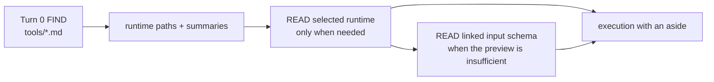

§tools-resource-materialization **Tool resources materialize from one workspace snapshot.** The runtime registry, workspace capability policy, tool resources, and dispatch use one effective workspace snapshot; attached tools are capabilities like every other runtime, and the model never learns an origin.

- A disabled, unavailable, detached, replaced, or removed runtime has no tool resource; an exact registry's empty set publishes no runtime and admits no invocation. Reconciliation deletes stale documents before upserting the current set. `PLURNK_SERVICE_DOCS_EXCLUDE` does not hide an enabled executable; executor enablement is the sole user-configured filter shared by discovery and dispatch.
- A runtime declaration may carry `resourcesPath`, its generated-doc root relative to the workspace's generated subtree ({§session-scheme}). Absent, its docs live in the internal `_plurnk/plurnk` namespace; present (`plurnk` and attached MCP servers: `/tools`), the runtime document materializes at `_plurnk` + that root in the shared scratch.
- Turn 0 surveys the runtimes (`FIND (workspace:///_plurnk/tools/*.md)`, one row per runtime carrying its summary) and, for each runtime with `expandTools` (`plurnk` by default, plus each MCP server named in `PLURNK_MCP_EXPANDED`), adds one FIND over its runtime document matching the complete executable blocks (`FIND (workspace:///_plurnk/tools/<runtime>.md)` with a multiline regex over matching fences), so turn 0 names every tool with its aside and signature — one row per tool, paged like every survey. Capability attenuation restricts that matcher to the admitted exact tools. No document is delivered unasked.
- When the registry supplies {§executor-tool-catalog} definitions, the runtime document links to its sibling `<runtime>.json`. The catalog contains exactly the effective tools and is an ordinary `application/json` resource for READ, FIND, and JSONPath selection. It follows the same reconciliation as the runtime document and per-tool schemas; neither the catalog nor its definitions are automatically included in turn 0 or expanded-tool surveys.

§tool-document-header-only **A header-only tool document:** a registry-less runtime whose declaration carries no
supplemental details (no `docs/<tag>.md`, no inline `details`) is a
header-only document: its summary aside ends with `(invocation only)`, so
the catalog row that advertises it says so and the model is not invited to
READ an empty room. Every runtime and family plurnk ships carries a body.

§tools-summary-invocation A summary featuring one exact enabled tool invocation
includes its compact input signature after literal `\n` when no example body is
already present. Required schema fields use {§executor-input-schema-preview};
authored examples take precedence. Family alternatives and descriptive summaries
remain one compact orientation line, not an expansion of every tool's signature.

§members-functionality **File membership is one workspace Functionality family.** Core registers the `members` family with the coordinator ({§functionality-coordinator}): the model, the client, and the operator learn one surface — `list | discover | add | enable | disable | remove`, `workspace.members.<verb>` for the client, ```` ```plurnk (members) ```` for the model — for what the model may see, exactly as they do for skills and MCP servers. A definition is one shell-path glob ({§find}) relative to the project root, or absolute: it is matched against member keys, so its spelling is canonicalized as a path's is ({§fs-namespace}) and an absolute glob admits exactly what its root-relative spelling does; a leading `!` excludes matching members, and an exclusion wins over every inclusion. The glob is the definition's identity ({§functionality-addressing}). Admission provenance (`service-configuration`, `client-action`, `model-proposal`) rides the persisted definition, `{ glob, provenance }`, to enforce {§members-model-scope}; configuration-source provenance belongs to the shared inspection projection ({§configuration-provenance}).

| Verb | Input | Effect |
| --- | --- | --- |
| `add` | `{"files": ["<glob>", …]}` | admits each glob, trimmed, as one definition, a glob named twice being one; a bare `!` is 400 `definition-invalid` |
| `enable`, `disable`, `remove` | `{"file": "<glob>"}`, the glob as `list` shows it | the definition's state |
| `list` | — | each definition with what it resolved to — `include` or `exclude`, the pattern, the members it admits or removes (count and a bounded sample), and for a model's inclusion the matches the repository's ignore rules refused — so the model sees what its glob did and adapts |
| `discover` | `query`, a path or a glob | introspection, never a catalog: a path answers why it is or is not visible (tracked, included by which pattern, a creation record, excluded by which `!glob`, ignored, untracked, absent); a glob previews what `add` would include or exclude; a query that names neither, blank or a bare `!`, is 400 `query-invalid`; names only, never content, and nothing is added |

§members-configuration *Available definitions.* `PLURNK_MEMBERS_<alias>=<glob>`
declares one service-origin rule (`!glob` excludes), named by its glob like every definition; the
key is its configuration provenance, which `list` shows, and two keys declaring one glob fail by
name. The shared naming and
enabledness dialect is {§resource-environment}; `PLURNK_MEMBERS_ENABLED` supplies
the panel default and `PLURNK_MEMBERS_<alias>_ENABLED` overrides one rule.
An empty glob or a bare `!` fails validation. Controls may precede their rule;
they are validated without creating a definition ({§resource-environment}).

§members-model-scope *The model's authority.* A model's `add` is admitted against
`PLURNK_SERVICE_MEMBERS_MODEL_SCOPE` in the file-creation lattice `none < root <
namespace`, narrowed by `settings.membersModelScope` (most restrictive wins). `none`
refuses every model definition — inclusion or exclusion — as `403
members/functionality/model-scope`, whose recovery is the one path that remains, a client or
operator definition, the user's to give; `root` admits patterns inside the root, however spelled; `namespace` admits `../` too.
`auto` loops self-approve proposals, so the ceiling — not the proposal — is the guard
({§membership}). The coordinator hands `admit` the caller (`action` | `operation`)
so the family bounds the model without a second grammar; an admission a read earns
({§membership-auto-add}) is that same `operation` add and meets the same ceiling.

§members-projection **The members projection is one overlay of the workspace's enabled definitions.** Definitions are desired state per workspace ({§functionality-state}); the workspace overlay (`workspace_constraints`) combines its enabled definitions: inclusions union and an exclusion wins. There is no other membership path: the client's `/members` verbs are these verbs.

| Fact | Rule |
| --- | --- |
| Sessions | session creation copies no membership state; accepted changes reach every session |
| Source | human-authored definitions project with source `members`, model-proposed ones with source `model`; the same pattern from both keeps `members`; a `model` inclusion is a pattern scan like a human one but never admits a path the repository ignores ({§membership}) |
| Creation records | the engine's (`source: "create"`, {§fs-write-surface}) are not definitions: the projection never overwrites or retires them |
| When | at the family's publication commit, re-resolving membership; workspace cooling changes nothing, because desired state is durable |
| Documents | each enabled definition is one generated document at `workspace:///_plurnk/members/<glob>.md` ({§functionality-documents}), the glob percent-encoded as one path segment (RFC 3986 unreserved characters and parentheses stay literal) — its glob, origin, provenance, and what it resolved to — surveyed at turn 0 like every family's enabled definitions ({§session-initialization-entry}), so the model sees why a file is or is not a member before it asks |

The skills module owns the Agent Skills family ({§skills-functionality}) and its resource trees
({§skills-resources}); core supplies the Plurnk reference through {§provided-skills-module-slice}.

§plurnk-skill **Plurnk's own reference is an ordinary service-provided skill.** `skill://plurnk/SKILL.md` is the standard frontmatter entry point, catalogued with other enabled skills. No chapter, contract or defaults body is injected merely because the skill is enabled. Disable/enable, shared workspace visibility, and project/global shadowing use the ordinary Skills lifecycle; service-provided skills are host-provided trees, never fetched, and removal follows {§skills-remove}.

| It links | Where from |
| --- | --- |
| Package-owned configuration, model, COPY/MOVE and extensibility chapters | native chapter files, which retain their owners and locations |
| The complete `.env.defaults` aggregate at `skill://plurnk/.env.defaults` | the same {§operator-config-env-defaults} renderer as the operator command, never the effective environment; runtime-generated bytes have no invented disk location |
| The installed contracts at `skill://plurnk/packages/<package name>/SPEC.md` | the service's own `SPEC.md` and each installed ecosystem package's that ships one, the same membership as the defaults aggregate, with that package's published type declarations beside it at `packages/<package name>/dist/**/*.d.ts`; the service's declarations are its internals and are not served; contracts are listed when the tree is listed and read where each package installed them, never through a symbolic link |
| The Session's existing tool/resource references | their own owners |

The catalog and Turn0 describe Functionality under the current workspace
capability policy and service ceiling. A direct denied attempt receives the
same exact 403 from dispatch rather than a second documentation policy.
Optional non-execution operations remain a separate `## Enabled Optional Operations`
section because they are language extensions rather than executable tools.

### Scheme-reference discovery

§schemes-directory Scheme references are ordinary workspace entries at `workspace:///_plurnk/plurnk/<scheme>.md`. Turn0's FIND survey projects their summaries ({§session-initialization-entry}); the model READs details on demand. No Resources section or separate example catalog is injected into the system packet.

| Reference decision | Owning rule |
|---|---|
| Registered and model-visible scheme | Its reference is eligible when at least one supported resource capability is admitted by the effective policy ({§capability-admission}). Illustrative operations never determine admission. |
| Runtime output scheme | Its runtime's reference owns discovery; no duplicate scheme reference. |
| Family manager and its generated documents | Eligible while the family's manager runtime is admitted by the effective policy ({§capability-admission}), by name or by trait: a denied family has no page, no generated document and no runnable verb, so a masked family never stands in the survey empty (#842). |
| Excluded scheme | `PLURNK_SERVICE_DOCS_EXCLUDE` omits its reference, not its functionality. |
| Reference content | Required meta-owned content follows {§teaching-corpus}; other schemes may supply optional `manifest.documentation`. Absent optional content contributes nothing; a failed required source read surfaces its cause. |
| Policy layers | Materialization, Turn0, and direct operations use the same current workspace policy and service ceiling. |

### §inject system.inject — the operator injection

§packet-inject When `PLURNK_SERVICE_PACKET_INJECT` names a readable markdown file, its content renders as an `## Operator Notes` section in the system slot (definition → policy → inject). Read per-turn so the operator's edits take effect live; a set-but-unreadable path fails the turn hard as {§policy-sections} rules. `~/` expands to home. It's the operator-side complement to the extension packet transform — a pressure valve so reshaping the packet edits operator content, never the core. Unset → no section.

§card-read-per-wake **The card is read from disk at every loop start and wake, never held.** `plurnk-contracts/plurnk.md` is read when a loop runs, is injected, is woken by a completion or a reply, or is recovered at daemon start; the daemon keeps no copy between those reads, so an edit to the card reaches the next loop or wake without a restart.

### §policy system.policy — the client's policy injection

§policy-sections One section rides the system slot **after the definition**: the contents of `PLURNK_SERVICE_POLICY` (unset resolves to the policy member in {§host-path-layout}), with no engine-generated heading. The policy document owns its Markdown structure. Policy is the client's authoritative rules promoted into the privileged zone — NOT a log entry; the model cannot READ or KILL it. A default-absent path is silent (the section is omitted); an explicit override (env set) that fails to read fails the turn hard — a deliberate setting with a broken path is a misconfig, surfaced not hidden. Read per-turn so edits take effect live. The PROJECT `AGENTS.md` is local guidance, not policy: it rides turn 0 as the foisted `workspace:///_plurnk/AGENTS.md` entry ({§session-initialization-entry}); references and skills use native discovery ({§skills-functionality}).

On first run, and only when `$XDG_CONFIG_HOME/plurnk` itself is absent, the service seeds
`AGENTS.md` from `@plurnk/plurnk-meta/POLICY.md` ({§teaching-corpus}).
It reads that required source before creating the service home; a failed read
surfaces with its cause and leaves no apparently initialized home.
After that bootstrap the file is user-owned: edits and deletion persist, and a
later boot never refreshes or recreates it.

§schemes-self-doc-materialization **Self-documentation materializes one generated reference tree per workspace.** `@plurnk/plurnk-schemes` owns `SchemeManifest.documentation` ({§manifest-self-doc}). Each reference carries an H2 `Summary` for ordinary catalog projection. `SchemeRegistry.docs(workspaceId)` resolves corpus-or-manifest documentation, and `referenceEntries` applies workspace capabilities to that source. One workspace materializer deletes vanished contributions and upserts current documents. Concurrent readers share the same reconciliation and outcome; independent workspaces do not serialize together. Ordinary runtime turns maintain {§session-scheme}, including under read-only workspace policy.

### §packet-git-status The Git status section — compact repository state

When Git is admitted for the workspace, `## Git Status` contains a Markdown `> [!NOTE]` block. The section never contradicts the catalog: an untracked file a definition admits is named as the member it is. The section never carries an unbounded path list.

| Fact | Rule |
| --- | --- |
| The quoted lines | the current branch, upstream ahead/behind counts, and staged/unstaged/untracked totals, then one bounded line per non-empty class (at most `PLURNK_SERVICE_GIT_STATUS_PATHS` paths, `+K more`): staged, unstaged, `untracked members` — each path with the inclusion pattern that admits it or `created` for a creation record — and `untracked (not members)`, named because such a file is not a member ({§membership}) and a human must `git add` it or add a members definition before the model can read it |
| Per-path state | belongs to the runtime actor's durable causal evidence: its `source=file` row carries the exact two-character porcelain `XY` value as `git` metadata when the status snapshot names that path |
| The snapshot | the engine takes one after membership reconciliation and uses it for both projections; no per-file Git process exists |
| Porcelain v2 NUL-delimited records | supply these facts: an unborn branch retains its actual name with `no commits`; detached HEAD is identified as detached, never as a branch named `HEAD`; pathnames and rename sources retain their exact bytes; the internal two-character status uses spaces for unchanged coordinates |

### §recap Optional Recap footer

The user slot may end with `## Recap`, a compact recency-biased reminder of
selected operational law already owned by `plurnk.md`. A non-empty `runLoop` /
`runTurn` `recap` value overrides the default; otherwise core reads
`PLURNK_SERVICE_RECAP` or the required meta-owned `recap.md` source for every
packet. Empty content intentionally omits the rendered section while retaining
one dormant authored source. A failed read fails packet assembly with its cause.
The footer is one projection path and one authored source, not a second language
contract.

§recap-lines The operator's recap lines lead the footer: every non-empty
`PLURNK_SERVICE_RECAP_LINE_<alias>`, in alias order, renders as one callout ahead of the recap
source, `> [!IMPORTANT]` for a `YOU MUST` line and `> [!TIP]` for `YOU SHOULD` and `YOU MAY`. A line
that does not open with `YOU MUST`, `YOU MUST NOT`, `YOU MUST ONLY`, `YOU SHOULD`, `YOU SHOULD NOT` or
`YOU MAY` is a configuration error naming its key, and an empty value turns a shipped line off. The
shipped `recap.md` stays empty: it is the extension contract's source, not a home for core's lines.

## Matcher selection and text regions

<!-- map -->
| Tag | Promise |
| --- | --- |
| {§matcher-dispatch} | Matcher dispatch |
| {§relation-indexed-dialects} | `~full-text` and `&graph` are indexed relation dialects and never route through the content matcher. |
| {§graph-relations} | Graph matching is one-hop, kind-agnostic name matching. |
| {§matcher-invalid-expression} | A malformed matcher Problem identifies the dialect and includes the bounded native parser cause as… |
| {§matcher-dispatch-203-soft-fallback} | On parse failure, 203 returns raw content as the text primitive with `reason` so the model can use ordinary… |
| {§derivation-in-flight} | In-flight derivation and query are live uses. |
| {§matcher-selection-signal} | The matcher selection signal: matching carries navigation evidence |
| {§matcher-index-readiness} | Indexed patterns require complete evidence. |
| {§matcher-result-resource-selection} | A matcher selects resources; it never extracts a value or chooses a retrieval window. |
| {§text-scope-runtime} | Text-scope runtime projection |
| {§zero-width-column-one-insert} | An authored zero-width column-1 scope inserts whole lines. |
| {§slice-semantics-compose-pattern} | A composed pattern is one selection, independent of operation. |
| {§ext-mimetype} | Path-extension declares mimetype |
| {§ext-mimetype-extension-mimetype} | A channel's mimetype by extension: |
| {§render-rule-line-navigable-prefix} | Every textual content body with a source `startLine` renders with a coordinate prefix on each physical line,… |
| {§render-rule-find-renders-result} | A log row's canonical full body is resolved once by `LogBody`: READ/FIND, actionless source artifacts,… |
| {§markdown-primitive} | Mimetype primitive: text/markdown |
| {§markdown-primitive-text-markdown-normalize} | Any scoped text projection -> `text/markdown` |
| {§op-invariants} | Op-level invariants and resolved ambiguities |
| {§copy-l-source-range} | COPY/MOVE source scope |
| {§kill-scope-entry} | Scoped KILL on an entry |
| {§kill-pattern} | A pattern on a textual entry KILL removes exactly its matches. |
<!-- /map -->

Matchers select resources and report evidence; text scopes independently
address the exact readable text, regardless of mimetype. Syntax belongs to
{§naked-pattern}, {§matcher-prefix-claims}, and {§scope-slot}.

### §matcher-dispatch Matcher dispatch

One parsed content matcher crosses three ownership layers:

| Layer                            | Responsibility                                                                                                          |
|----------------------------------|-------------------------------------------------------------------------------------------------------------------------|
| `@plurnk/plurnk-mimetypes`       | Resolve the handler and execute glob, regex, JSONPath, or XPath with honest evidence.                                   |
| `@plurnk/plurnk-schemes/Matcher` | Map framework results and typed failures to the universal scheme-result contract.                                       |
| Core `Matcher.matchCandidates`   | Apply that operation adapter across caller-supplied `{key, content, mimetype}` candidates and preserve source identity. |

§relation-indexed-dialects `~full-text` and `&graph` are indexed relation dialects and never route through
the content matcher. Language admission accepts exactly one graph symbol (`&sym`, `&<sym`, `&>sym`);
runtime validation is only a defensive boundary for typed callers. When the candidates' persistent index is still
deriving, the engine settles the workspace's derivations once and re-runs the selection; a still-incomplete
index is a 503 that is retryable — never a refusal to wait paired with an instruction to wait. Candidate composition has no dependency on the table that
stored a resource.

§graph-relations **Graph matching is one-hop, kind-agnostic name matching.**
Source definitions resolve over the complete relationship universe (the
workspace for entry FIND; the session's complete log for log FIND), while the
authored target still constrains every resource returned. Outgoing
references belong to a definition through the handler-reported fully qualified
container identity.

| Matcher      | Selected resources                                                               | Match evidence                                                            |
| ------------ | -------------------------------------------------------------------------------- | ------------------------------------------------------------------------- |
| `&<symbol`   | In-scope resources that reference `symbol`                                       | Each matching reference's source span                                     |
| `&>symbol`   | In-scope resources defining names referenced by each definition of `symbol`      | Each referenced symbol's definition span                                  |
| `&symbol`    | In-scope resources defining `symbol` | Each definition's source span |

Graph storage preserves the handler's complete text coordinates, including
reference columns and end positions. Match evidence and source text come from
the same immutable derivation. A definition without handler-supplied columns
selects its declared whole-line extent; a reference always retains its exact
region. Matches are deduplicated by resource and complete region, not line.
READ presents whole lines with that evidence ({§read}); EDIT
replaces the selected region literally, not a semantic rename of the symbol.
Upgrades invalidate obsolete derived indexes, never their source content or
retained history ({§db-migrations}).

| Result | HTTP status |
|---|---|
| Match array | 200 |
| Empty match array | 204 |
| Malformed matcher expression | 400 |
| Source unparseable for its mimetype | 203 (soft fallback: raw content as text with `reason`) |
| Dialect unsupported by the resource | 415 |

§matcher-invalid-expression A malformed matcher Problem identifies the dialect
and includes the bounded native parser cause as `diagnostic` when available. Core applies
`PLURNK_SERVICE_ERROR_DETAIL_LIMIT` before the cause crosses into the schemes
adapter; the Problem offers only the deterministic recovery to revise the
expression, never a guess about the intended pattern.

§matcher-dispatch-203-soft-fallback On parse failure, 203 returns raw content as the text primitive with `reason`
so the model can use ordinary text retrieval or repair the source.

`Matcher.matchCandidates` searches heterogeneous resource sets. A candidate
whose handler returns 415 is omitted when another candidate supports the
dialect; if every candidate is unsupported, the first exact 415 Problem is the
operation result. This preserves exact-resource diagnostics without allowing
one binary marker to fail a repository-wide text search.

Glob anchoring (`TODO*` starts-with, `*TODO*` contains, `*.log` ends-with,
`[Tt]odo*` character class) lives in the mimetypes framework.

§derivation-in-flight **In-flight derivation and query are live uses.** An exact
indexed operation holds its content-addressed artifact from derivation through
the completed query. Producers hold artifacts while building and attaching
them. Derivation and content collection share one per-database exclusion boundary:
parallel uses remain parallel, a collection pass skips these two collectors
while a use is active, and a new use waits for an already-running collection.
Successful, failed, and cancelled uses release in `finally`; no durable pin or
additional retention setting is introduced. The ordinary later pass or drained
shutdown collects unattached artifacts under {§retention-policy}.

### Matcher selection and evidence

- §matcher-selection-signal **The matcher selection signal: matching carries navigation evidence** - each selected resource carries `matches: MatchEvidence[]`, where `MatchEvidence` is `{channel?,locator?,region?,enclosingRegion?}`. `channel` identifies the entry channel and is absent for channel-less resources such as log rows ({§channel-selection}); `locator` preserves the structural address. `region` is the exact selection; `enclosingRegion` is presentation context only. Both use complete four-coordinate `TextRegion`s in the readable source. Exact duplicate evidence deduplicates. FIND projects this evidence as resource rows or flat locations ({§find-result-projection}); consumers never invent missing precision. An operation requiring exact source fragments refuses a selection containing unlocated or enclosing-only findings with 422 `pattern-source-unlocated`, before any mutation.

§matcher-index-readiness **Indexed patterns require complete evidence.** A held
resource snapshot whose search derivation is excluded or failed answers 422
`search-unavailable`, preserving the reason. Graph selection requiring an
unsettled relationship universe answers retryable 503 `search-index-incomplete`.
Neither condition is a successful empty match.

§matcher-result-resource-selection **A matcher selects resources; it never extracts a value or chooses a retrieval
window.** Every dialect answers whether a resource matches and may return
`MatchEvidence { locator?, region?, enclosingRegion? }` ({§matcher-selection-signal}).
`locator` is a canonical structural locator. `region` is an exact selected
`TextRegion`; `enclosingRegion` identifies presentation context, not a selection.
Both address the physical text the model can READ. A matcher miss is 204. FIND's target shape projects the selected
resources according to {§find-result-projection}.

| Dialect | Selects | Natural use |
|---|---|---|
| regex `/pat/` | resources whose readable text matches | exact text region, or the smallest enclosing region when a match bisects an indivisible text unit |
| glob `pat` | resources with matching readable lines | exact text region |
| jsonpath `$.path` | resources whose deep JSON resolves the path | canonical locator plus exact/enclosing text region when honest |
| xpath `//sel` | resources whose deep XML resolves the selector | canonical locator plus exact/enclosing text region when honest |
| `~` full-text `~q` | resources ranked by FTS5 BM25 | matched text regions |
| `&`graph `&<sym` | resources with matching symbol relations | symbol text region when available |

Match evidence is navigation evidence, never an implicit body projection. The
model uses broad FIND to select and page resources, exact FIND to page that
resource's locations, then explicit exact READs—parallel in one turn when
useful—to retrieve chosen bodies or regions. A locator-only or coordinate-less
valid result still selects the resource; the service never fabricates
coordinates. {§read-exact-target} {§read}

### §text-scope-runtime Text-scope runtime projection

Core realizes the authored scope contract ({§text-scope-semantics}) as the
contracts-owned `TextRegion` wire shape ({§text-region}). All textual
READ/EDIT/COPY/MOVE scopes use the same physical text:

| Scope           | Retrieval                  | Mutation                                     |
|-----------------|----------------------------|----------------------------------------------|
| `<N>`           | whole line `N`             | replace/delete whole line `N`                |
| `<N,M>`         | inclusive whole lines      | replace/delete inclusive whole lines         |
| `<SL,SC,EL,EC>` | exact exclusive-end region | delete that region, then insert at its start |
| `<0>` / `<-1>`  | empty selection            | prepend / append anchor                      |

One/two-coordinate line shorthand is newline-aware so deleting a line does not
leave an empty line. A terminal position after a final newline is an exact
insertion anchor, not an additional whole line. `<1,-1>` selects all content.

§zero-width-column-one-insert **An authored zero-width column-1 scope inserts whole lines.** Core prepares that fenced EDIT body once, using `wholeLineBody`, before handing literal replacements to the scheme; mutation, receipt, and anchor-continuity calculation all consume that same prepared body.

| Scope | Effect |
| --- | --- |
| `<L,1,L,1>`, an anchored `<@hash,1,@hash,1>`, or `L` = final line + 1 when the content ends with a newline | a non-empty body that does not end in a newline is inserted with the content's line separator appended, so `X` at `<2,1,2,1>` into `a\nb` yields `a\nX\nb`; an empty body inserts nothing |
| A zero-width region at any other column | a byte-exact insert with nothing appended |
| A pattern's generated coordinates | exact matches, not authored line-insertion syntax: `/^/` inserts a literal prefix without adding a newline |
| COPY and MOVE | transfer source bytes and are likewise untouched |
| An authored three-coordinate `<startLine,startColumn,endLine>` scope | tolerated: immediately lowered to the complete four-coordinate region ending after the final code point of `endLine`, that exact normalization reported only in a use-triggered Notice; not canonical producer syntax |
| Other negative values, decimal text coordinates, inverted regions, out-of-range coordinates, and other arities | 416 |

Every successful scoped READ carries its complete resolved `region` in the
operation result and packet metadata. The body remains coordinate-prefixed from
`startLine`; the region preserves columns that line numbering cannot express.

Every same-resource mutation resolves its replacement offsets against one
unmodified snapshot. Disjoint replacements apply from the highest source offset
down; overlaps and duplicate insertion boundaries are 409. This is the adopted
SARIF region/replacement algebra for exact spans and same-snapshot ordering, not
adoption of the SARIF interchange envelope.

§slice-semantics-compose-pattern **A composed pattern is one selection, independent of operation.**
A pattern runs over the canonical source channel, never a READ receipt's
line-ending normalization, preview, coordinate prefixes, or other presentation.
A match region uses the four-coordinate source scope. FIND reports it, READ
shows its lines with that evidence, EDIT replaces it, COPY transfers it, MOVE
transfers then removes it, and a textual KILL removes it. Enclosing display
context never enlarges the selected span. Multiple fragments retain source
order and literal text; COPY/MOVE insert no separators between them. Scope
composition admits complete matches, never clipped fragments or other matches
on the same line. Mutation batches retain {§op-methods-op-dispatch} and collision
handling; a pattern does not create another overlap-recovery algorithm.

FIND retains locators even without source coordinates. READ may display
`enclosingRegion` as context, but a selected value with neither kind of location
returns `422 pattern-source-unlocated`. EDIT, COPY, MOVE,
and textual KILL require exact `region` evidence for every selected match;
enclosing or unlocated values return that same Problem without changing any
source or destination. Absence of matches remains an ordinary empty selection.

A follow-up ```` ```READ (resource) <SL,SC,EL,EC> ```` retrieves the exact
region. JSONPath/XPath remain locators and matchers, not a structural update
language: `//item` selects the element, `//item/text()` its direct text nodes,
and `$.host` the JSON value including its lexical quotes/escapes, never the
property name or colon. Literal replacement does not serialize a value or
repair neighboring punctuation. Readable projections have their own coordinates.

### §ext-mimetype Path-extension declares mimetype

`PathMimetype.resolve` (exported from `@plurnk/plurnk-schemes`): pathname extension → `Mimetypes.detect({ ext })` (with `text/plain` normalized to `text/markdown` per {§markdown-primitive}); an unrecognized or absent extension uses the caller's supplied type. Text EDIT creation supplies the scheme's declared channel type or the Markdown primitive for a dynamically typed channel. Transfers follow {§copy}.

- `workspace:///users.json` → `application/json` (extension wins)
- `workspace:///notes.md` → `text/markdown` (extension; matches default)
- `workspace:///config.yaml` → `application/yaml`
- Text EDIT of `workspace:///users` (no suffix) → `text/markdown` (text primitive)

§ext-mimetype-extension-mimetype **A channel's mimetype by extension:** the same rule applies to every entry-bearing scheme when
creating a channel without a per-call type declaration. EDIT and COPY/MOVE into
an existing channel retain its stored type. Effective mimetype is stored in
`entry_channels.mimetype` and drives matcher, projection, and binary handling.
Text scope meaning does not vary by mimetype.

### Render rule

§render-rule-line-navigable-prefix Every textual content body with a source
`startLine` renders with a coordinate prefix on each physical line, independent
of mimetype. A successful exact READ whose active scheme declares
`lineAnchors: true`, or `textEditScopes: true` with addressed-resource model write authority
under {§line-anchors}, supplies `@hash N:` with one
or more ASCII spaces before `N` under
{§line-anchors}; generated FIND rows render a result ordinal left-padded to the
complete result total's width; every other body renders `N:` left-padded to its own largest line number's width, so every body keeps one stable content column. JSON, XML, and HTML are therefore just as
line-addressable as markdown and source code. The prefix is a packet
presentation aid, never part of canonical content; matchers and mutations
consume canonical bytes before rendering. A producer may set `startLine: null`
only when its content is already source-numbered, such as an effect receipt.

§render-rule-find-renders-result A log row's canonical full body is resolved once by `LogBody`: READ/FIND, actionless source artifacts, prompt, and extension result content comes from `rx.content`; EDIT and scoped entry KILL use their structured receipt, while environment-delta EDIT uses its resulting span; COPY/MOVE concatenate the textual receipt contexts in their ordered `effects`; NOTE and lifecycle operations retain their literal `text/plain` bodies; executions and SEND/WORK/FORK use their statement body. Whole-channel COPY/MOVE effects are bodyless rather than fabricating a text projection. Packet rendering applies {§body-projection} and the coordinate projection in {§render-rule-line-navigable-prefix}. READ/FIND over `log:///` and search use the same body with deliberate trims applied under {§log-kill-scope}, without packet-only suppression or preview limits. Status and content are orthogonal: a failed terminal stream READ retains its Problem Details and failure status while rendering captured diagnostic output; failure never erases evidence.

An EDIT or scoped entry KILL log row renders its bounded effect receipt (`rx.receipt`) as row
metadata and join context, not its input statement. Proposal-gated file EDITs
compute the accepted receipt from what actually lands. Environment-delta EDITs
render their resulting `rx.span`. COPY/MOVE rows write both operand
selections ({§log-wire-format}), render compact ordered `effects` metadata, and
any scoped textual receipt contexts under their `log:///` address, never under
one operand's resource address. All generated bodies remain under
{§body-projection}. {§edit-result-receipt-projection}

Numeric and anchored coordinate prefixes are presentation/reference per
plurnk.md ("not part of the source"); matchers operate on canonical content.

### §markdown-primitive Mimetype primitive: text/markdown

Auto-derived text mimetypes anywhere in plurnk-service normalize to `text/markdown`:

- §markdown-primitive-text-markdown-normalize Any scoped text projection -> `text/markdown`
- File scheme extension fallback → `text/markdown`
- `Mimetypes.detect()` returning `text/plain` → normalized via `normalizeAutoTextMimetype`

`text/plain` survives only where a scheme explicitly declares it (exec stdout/stderr — subprocess byte-streams aren't markdown). The model never auto-encounters `text/plain` from defaults.

### §op-invariants Op-level invariants and resolved ambiguities

Carried from the contract walk; durable.

- **Dialect/mimetype mismatch** → 415 (xpath on text/plain → 415; jsonpath on JSON-shapeless mimetypes → 204 because outline is empty, not 415).
- **Binary coordinates** are numeric byte positions for READ and transfer; text EDIT does not author native bytes ({§binary-parity}). Readable projections retain their own textual coordinates ({§derivation-dedup-parallel}).
- **EDIT `<L>` on non-existent entry** → body becomes content; `<L>` is positional-only on existing content.
- §copy-l-source-range **COPY/MOVE source scope** selects only the addressed source channel and
  first resolves and, when required, prepares the same canonical
  owner-addressed representation as exact READ/FIND. It transfers canonical
  text without the packet's coordinate prefix; log sources omit deliberate
  trimming under {§log-kill-scope}. A MOVE removes
  that same selected region; an unscoped MOVE removes only the selected
  channel, deleting the entry only when no channels remain. Binary sources
  transfer bytes under {§binary-parity}. A selected producer failure aborts before destination mutation;
  successful non-`200` content remains transferable.

- **COPY/MOVE destination scope** is independent of the source scope and lowers
  through the destination scheme's `editBatch`.
- **COPY/MOVE result effects** are engine-owned and describe only mutations that
  landed. COPY orders destination only; MOVE orders destination then source.
  Any scoped textual transfer materializes create/update receipts; whole-channel
  changes do not. Operand selections remain independently visible per
  {§copy-move-observation}.
- **READ rx** prefixes every textual line under {§render-rule-line-navigable-prefix}; eligible
  editable resources carry `@hash N:`, and all others carry `N:`.
- **Pattern selection** applies to the addressed source channel under {§slice-semantics-compose-pattern}. The path and channel select resources; FIND reports matches and READ displays their lines. EDIT, textual KILL, COPY, and MOVE act on exact selected spans, not their enclosing lines ({§read}, {§edit-pattern}, {§kill-pattern}, {§copy}).
- **Scoped KILL** on the **log** (`log:///`) removes a body span from its readable projection ({§log-kill-scope}); on an entry it deletes that span through the EDIT path ({§kill-scope-entry}). A whole-entry KILL deletes the entry, or one `#fragment` channel.
- **File scheme** detects with `Mimetypes.detect({ path })` and classifies with the same configured service ({§mimetype}). Handler-declared binary sources materialize through {§derivation-dedup-parallel}; projected bodies are READ-able, while source-aware EDIT remains 415.

### §kill-scope-entry Scoped KILL on an entry

A KILL with a text-coordinate scope aimed at an entry-bearing scheme deletes exactly that span: core prepares and dispatches it as an EDIT with an empty body over the same marker, so anchors resolve, proposals gate it, and the merge facts and receipt are the EDIT path's — while the log row records the model's KILL. Its packet metadata and canonical log body use {§edit-result-receipt-projection}. ```` ```EDIT (path) <scope> ```` with an empty body remains the same act spelled the other way; the teaching names KILL.

§kill-pattern **A pattern on a textual entry KILL removes exactly its matches.**
It is the same empty-body EDIT under {§edit-pattern}, including exact column
and multiline regions, scope, preconditions, proposals, and receipt. It has no
separate line-deletion mode. Zero matches leave the resource unchanged (204,
`matched: 0`); a pattern never becomes whole-resource deletion. The receipt
counts selected spans and retains the first and last applied effects.
Log KILL still selects retirement rows ({§log-history-projection}); stream
KILL controls a process and refuses a content pattern (`kill-pattern-unsupported`).

---

## Testing and evidence

<!-- map -->
| Tag | Promise |
| --- | --- |
| {§live-harness-deadline} | The live harness uses `PLURNK_SERVICE_LIVE_TIMEOUT` as one whole-specimen deadline, including multi-prompt… |
| {§tier-specimen-selection} | One invocation runs the live tier or one of its specimens. |
| {§provider-conformance-matrix} | The provider conformance matrix: every configured model alias is exercised through a real PLURNK loop: the… |
| {§test-artifact-retention} | Test artifact retention: every harness writes its run into one home. |
| {§tier-census} | A real-model tier run is one directory with its census. |
| {§fs-resource-state} | The resource-state harness — coverage that closes the class. |
<!-- /map -->

| Tier | Location | LLM | Substrate |
|---|---|---|---|
| **unit** | `src/**/*.test.ts` | No | Isolated logic, mocked boundaries |
| **intg** | `test/intg/` | No (mock provider) | Real file-backed SqlRite (per-test DB under `test/intg/.tmp/`), real engine |
| **live** | `test/live/` | Real | Thin real-model smoke and digest witness; the full `live` and `demo` specimen corpus lives in `plurnk-bench/tiers/` (#1236) |

§live-harness-deadline The live harness uses `PLURNK_SERVICE_LIVE_TIMEOUT`
as one whole-specimen deadline, including multi-prompt stories. The test's abort
signal reaches the loop wait and invokes ordinary scope cancellation before
teardown. The runner joins the test body's cleanup before starting the next
specimen. The shared workspace and story helpers (`test/harness.ts`) cover setup,
inference and oracle failures, preserve the primary failure when their cleanup
also fails, and attempt every registered disposal.
The provider whole-call deadline and recovery policy remain independent; a harness cancellation is
not evidence that the provider's own deadline expired.

§tier-specimen-selection **One invocation runs the live tier or one of its specimens.** The live catalog is every specimen under `test/live/`, registered in one place; `npm run test:live` runs the tier, and `-- --specimen "<name>"` the one specimen, through the same invocation, which places the name pattern before the file list. A selector must match at least one registered specimen before any provider call: a zero-match selector exits non-zero and runs nothing.

§provider-conformance-matrix **The provider conformance matrix: every configured model alias is exercised through a
real PLURNK loop: the production packet, a model-selected operation, its
materialized result, and completion.** Transport-only completions are not
conformance evidence. Provider-exposed reasoning must survive in the durable
assistant packet and digest; a provider with no private reasoning is valid when
the observable operation cycle succeeds. One package-owned runner executes the
live smoke (`npm run test:live -- --specimen
"<exact test name>"` in plurnk-core), rejecting absent and duplicate names before
execution, while `plurnk-bench` runs the full `live` and `demo` corpora. The ledger and classification taxonomy live in
`plurnk-providers/README.md` and report authorization/credential failures
distinct from model failures and repeated stochastic failures separately from
stable ones, never with weakened assertions.

§test-artifact-retention **Test artifact retention: every harness writes its run into one home.** A file-backed test database is a benchmark artifact like any other: the lane's run directory lives under `PLURNK_BENCHMARKS` (`~/benchmarks` by default) beside live, demo and benchlet runs, and the checkout holds source only — never run output.

| Fact | Rule |
| --- | --- |
| The stamp | `test:intg` stamps `PLURNK_TEST_RUN` once and every test process inherits it, so one suite's databases land in one directory without a pretest step, a marker file or a sweep; an unstamped invocation is not a special case with its own rules, it is simply an unstamped run with its own directory |
| The lane | a lane whose suite boots Core through Core's test harness also exports `PLURNK_TEST_LANE`, its own lane name, so the daemon it boots writes into that lane's run directory and the lane's reclaim takes all of it; an unnamed run is Core's |
| Reclaim | a stamped run that passes is reclaimed when it exits; a failed suite's evidence is never touched and stays exactly where the run reported it |
| Fixture reuse | a cross-package test may reuse Core's migration fixture only by passing a path inside the caller's own run directory |

§tier-census **A real-model tier run is one directory with its census.** The live driver stamps `PLURNK_TIER_RUN` as `<kind>-<UTC stamp>`; every session the run claims lands inside `PLURNK_BENCHMARKS/tier-<kind>-<stamp>/`, each in its own `<label>-XXXXXX/` with its database, its own host, its digest and a `census.json` naming the specimen that drove it, its loops, turns, requests, tokens and cost. The run's `census.md` and `census.json`, written by the tier's node:test reporter when the run ends, carry one row per specimen: verdict, skip reason or first failure line, the sessions it claimed, turns, requests and cost; a run never deletes or moves any of it. `npm run digest:missing` re-digests only a run's interrupted specimens, replacing a partial digest with a complete one and touching no other.

A specimen declares what it requires of the route and the host; an unmet requirement is a skip, before anything boots or is spent, whose reason names the requirement and what was observed, and the census answers each unmet route-bound requirement with the declared aliases whose catalog entry satisfies it. A route the harness cannot resolve is a failure, never a skip. No test surface is an opt-in flag or a script of its own: the third-party MCP composition, the llama-server rails and the client's real-model TUI tier are live specimens that run wherever their requirements hold.

| Requirement | Form |
| --- | --- |
| an input modality | `input:<image\|pdf\|audio\|video>` |
| reasoning | `reasoning` |
| an output budget | `output-budget` |
| an environment variable | `env:<NAME>` |
| a URL | `url:<http(s) URL>` |
| a binary on PATH | `bin:<name>` |
| a checkout | `checkout:<client>`, at `PLURNK_CLIENT_CHECKOUT`, else beside the repository |

§fs-resource-state **The resource-state harness — coverage that closes the class.** Op-outcome tests check what an op returned; the harness checks the resulting resource state. `ResourceState.check(db)` asserts, pure-db and read-only: identity uniqueness in practice (no tuple holds two rows), the canonical fixpoint on every file-class key, channel orphan-freedom, the closed admission set (every file row's origin is Git or constraint), and sig-coherence. Generated-pick incorporation and lifecycle require filesystem/Git evidence and are covered by the composed creation matrix rather than a false pure-database proxy. The harness runs as a lifecycle-test epilogue and at every soak turn boundary, where the delta half applies: an idle turn grows the entries table by ZERO. A violation names its law and its row.

## Problem codes and pinned wording

<!-- map -->
| Tag | Promise |
| --- | --- |
| {§problems-dispatch} | Dispatch Problems. |
| {§problems-loop} | Loop and context Problems. |
| {§unregistered-scheme-recovery} | An unregistered scheme's refusal names what does exist. |
| {§problems-content} | Content and transfer Problems. |
| {§problems-file} | File scheme Problems. |
| {§problems-exec} | Execution Problems. |
| {§problems-entries} | Entry scheme Problems (log, session, workspace, entries). |
| {§problems-client} | Client interactions and message admission Problems. |
| {§problems-functionality} | Server and Functionality Problems. |
| {§pinned-wording-core} | Pinned wording. |
<!-- /map -->

Every Problem code core mints is named here under its family ({§problem-error-carrier} carries it); the root lint (`scripts/problem-codes.mjs`) refuses a code no owning SPEC names.

§problems-dispatch **Dispatch Problems.** Every code minted here, its status, and the sentence that is its contract (placeholders in *italics* are filled at emission; a fixed recovery follows its detail).

| code | status | contract |
|---|---:|---|
| `target-required` | 400 | *OP* requires a target path. Recovery: Write the target in parentheses on the opening fence line: `OP (path)`. |
| `target-cardinality` | 400 | *OP* *operand* matched *n* resources; expected one. Recovery: Name one source and one destination per pair. |
| `scheme-not-found` | 501 | Scheme '*name*' is not registered. Recovery: ({§unregistered-scheme-recovery}) `Registered schemes: *names*.` |
| `scheme-metadata-unsupported` | 400 | *OP* on '*scheme*' does not accept the [metadata] modifier. |
| `operation-not-implemented` | 501 | Scheme '*name*' does not implement *OP* (or exec). |
| `entry-read-not-implemented` | 501 | The '*scheme*' scheme does not provide entry reads. |
| `entry-write-not-implemented` | 501 | The '*scheme*' scheme does not provide entry writes. |
| `entry-delete-not-implemented` | 501 | The '*scheme*' scheme does not provide entry deletion. |
| `channel-delete-not-implemented` | 501 | The '*scheme*' scheme does not provide channel deletion. |
| `scheme-handler-threw` | 500 | The '*scheme*' scheme did not produce a result for *OP*. |
| `exec-source-not-data` | 501 | Scheme '*name*' is not a data source for an execution. |
| `writer-forbidden` | 403 | Writer '*origin*' cannot modify scheme '*name*'. |
| `capability-denied` | 403 | Capability '*route*' is denied by *scope* policy. |
| `spawn-prompt-empty` | 422 | *OP* has no prompt text. Recovery: Write the prompt on the lines beneath the *OP* fence line. A prompt resource that is empty with no body says so: *OP* has no prompt text: the resource is empty and there is no body. Recovery: Write the prompt on the lines beneath the *OP* fence line, or name a resource that holds it. |
| `message-not-found` | 404 | No accepted message exists at *address*. |
| `send-target-required` | 400 | SEND has no recipient and its loop has no published message. Recovery: Name a recipient address. |
| `edit-collision` | 409 | EDIT collided with the current resource state ({§edit}). Recovery: *n* of *m* edits applied. READ the target for current coordinates. |
| `edit-target-required` | 400 | A line-anchored EDIT requires a target resource. Recovery: Provide the target that rendered the line anchor. |
| `kill-target-required` | 400 | KILL requires a target path. |
| `kill-target-scheme-required` | 400 | KILL target requires a scheme. |
| `session-not-found` | 404 | Session '*name*' does not exist in this workspace. |
| `entry-operation-unsupported` | 400 | KILL requires an entry-bearing target; '*scheme*' does not provide one. |
| `coordinate-invalid` | 400 | '*to*' is not a log coordinate ({§log-wire-format}). Recovery: Name the coordinate as `<loop>/<turn>/<item>`, as the log shows it. |
| `coordinate-not-found` | 404 | No log entry exists at log:///*coordinate* ({§log-wire-format}). |
| `project-root-required` | 400 | Rollback restores files, and this workspace has no project root ({§log-wire-format}). |
| `resource-scheme-required` | 400 | Resource selection requires an address. |
| `channel-required` | 400 | The '*scheme*' scheme has no default channel. Recovery: Address a named channel with a URI fragment. |
| `binary-source-unsupported` | 415 | Channel #*name* is binary and its scheme keeps no bytes to transfer. |
| `fork-unaddressed` | 404 | This client operation acts for no session, so FORK has no log to branch ({§actor-boundary-client-operations}). |
| `session-name-conflict` | 409 | Session '*name*' already exists in this workspace. Recovery: WORK or SEND (session://*name*) delivers a message to the live session; FORK with a name no session holds. ({§session-scheme}) |
| `no-operation` | 422 | The turn performed no operation ({§outside-text}). |
| `send-target-not-a-recipient` | 400 | The addressed scheme is not a SEND recipient. Recovery: Name a message address or a recipient that implements SEND. |
| `invalid-operation-syntax` | 400 | The parser's diagnostic for an invalid operation in an admitted turn. |
| `unreadable-pattern` | 400 | The pattern reader's diagnostic for an unreadable matcher. |
| `completion-invalid` | 400 | A reply accepts one completion code: 200 or 499. |
| `attachment-address-invalid` | 400 | An attachment selects one exact resource address. |

§problems-loop **Loop and context Problems.** These codes identify the failed boundary; lifecycle and recovery remain governed by their owning contracts.

| code | status | condition |
|---|---:|---|
| `result-exceeds-budget` | 413 | A result exceeds the remaining log budget; detail names its size, delivered portion, and a smaller selection or curation ({§context-fit}). |
| `window-overflow` | 413 | The packet exceeds the model's window ({§context-wall}). |
| `packet-exceeds-budget` | 413 | Context exceeds budget; the curation mandate is the pinned sentence below ({§context-over-budget-row}). |
| `loop-timeout` | 504 | The loop exhausted its active execution allowance. |
| `strike-threshold` | 508 / 500 | Repetition crossed the strike threshold (508), or another strike source crossed it (500), under {§engine-rails}. |
| `loop-running` | 425 | The addressed execution has not concluded. |
| `loop-cancelled` | 499 | The loop was cancelled; detail preserves the cancellation reason. |
| `loop-threw` | 500 | The loop failed outside its operation result contract. |
| `narration-failed` | 500 | Filesystem divergence narration failed before its operation turn settled. |
| `provider-contract-violation` | 502 | The provider failed without returning its required Problem Details. |
| `active-session-limit-reached` | 508 | The workspace's active sessions reach its configured limit. |

§unregistered-scheme-recovery **An unregistered scheme's refusal names what does exist.** Its recovery
lists the schemes the workspace registers, and rebuilds the address into nothing else
({§diagnostic-observation}). READ, FIND, KILL and resource selection share the sentence.

§problems-content **Content and transfer Problems.** Every code minted here, its status, and the sentence that is its contract (placeholders in *italics* are filled at emission; a fixed recovery follows its detail).

| code | status | contract |
|---|---:|---|
| `handler-crashed` | 415 | The *mimetype* content handler failed on *key*: *cause*. |
| `line-anchor-unsupported` | 400 | The byte view of *target* publishes no anchors. Recovery: Use byte coordinates: `<first,last>`. |
| `line-anchor-invalid` | 400 | A line anchor in the marker is malformed or names no current line ({§line-anchors}). |
| `channel-not-found` | 404 | The addressed channel does not exist at *target*. Recovery: Use one of the available channels: #*a*, #*b*. |
| `binary-read-unsupported` | 415 | The representation at *target* is binary and cannot be rendered. |
| `pattern-unapplicable` | 422 | The pattern could not be applied to *target*. |
| `move-region-overlap` | 409 | MOVE cannot insert a whole channel into itself and then remove that channel. |
| `mimetype-mismatch` | 415 | COPY or MOVE cannot write '*source-mimetype*' into a '*destination-mimetype*' channel. |
| `binary-region-unsupported` | 415 | Channel #*name* is binary and cannot receive a textual region. |
| `copy-destination-exists` | 409 | COPY or MOVE destination *address* already contains different content. |
| `proposal-apply-missing` | 500 | The source scheme accepted its MOVE proposal without applying the source mutation. |
| `line-anchor-collision` | 409 | READ coordinates collided with current content at *target*. |

§problems-file **File scheme Problems.** Every code minted here, its status, and the sentence that is its contract (placeholders in *italics* are filled at emission; a fixed recovery follows its detail).

| code | status | contract |
|---|---:|---|
| `invalid-file-url` | 400 | The native file-URL diagnostic, or `File URL path must not include NUL characters.` ({§fs-namespace}). |
| `edit-empty` | 400 | EDIT requires at least one statement. Recovery: Provide an EDIT statement. |
| `edit-batch-mismatch` | 400 | The EDIT batch spans multiple resources. Recovery: Submit a separate EDIT batch for each resource. |
| `line-marker-required` | 400 | EDIT of an existing file requires a line marker ({§edit}). Recovery: Name the lines to replace with `<@hash>` or `<@start,@end>` from a READ of the file; `<L,1,L,1>` inserts before line L, and `<1,-1>` replaces the whole file. |
| `creation-batch-conflict` | 409 | Multiple EDIT operations attempted to create the same file. Recovery: Create the file with one EDIT before applying additional edits. |
| `member-read-only` | 403 | The mounted member '*path*' is read-only. |
| `project-root-required` | 400 | The workspace has no project root, so it cannot write files. |
| `path-names-no-file` | 403 | The spelling '*path*' does not name a file: it is empty, or it names a directory. |
| `path-occupied-by-nonmember` | 403 | A non-member file already occupies '*path*'. Recovery: Choose an unoccupied member path. |
| `path-outside-workspace` | 403 | A symlink on '*path*' resolves outside the namespace. |
| `binary-write-unsupported` | 415 | A text EDIT cannot author binary '*mimetype*'. |
| `file-create-excluded` | 403 | A members exclusion (`!_glob_`) covers '*path*'. Recovery: Remove or disable the excluding members definition, or choose another path. |
| `file-create-gitignored` | 403 | Active Git policy ignores '*path*', and no members definition includes it. Recovery: Choose a Git-admitted path or add a members definition that includes it. |
| `file-materialization-limit` | 413 | The file exceeds the materialization byte limit and is not read into the workspace. |
| `entry-not-found` | 404 | No member of this workspace is at '*path*'. Recovery: FIND lists paths. EDIT creates files; `plurnk (members)` admits existing files with a `{"verb": "add", "files": ["<path>"]}` body. A path beyond the root recovers instead to: '*path*' is outside the project root: only a members definition under the operator's namespace scope admits it. |
| `body-channel-required` | 400 | A file write requires a body channel. |
| `write-failed` | 500 | Publication or its settlement failed; the result distinguishes an unpublished write from an already-published one. |
| `creation-rollback-failed` | 500 | Incorporating a newly created file failed, and rollback was incomplete. |
| `creation-incorporation-failed` | 500 | Incorporating a newly created file failed; its exclusive creation was rolled back. |
| `materialization-failed` | 500 | The file was written to disk but could not be registered. |
| `delete-failed` | 500 | Deletion or projection settlement failed; the result distinguishes an undeleted file from an already-deleted one. |

§problems-exec **Execution Problems.** Every code minted here, its status, and the sentence that is its contract (placeholders in *italics* are filled at emission; a fixed recovery follows its detail).

| code | status | contract |
|---|---:|---|
| `stream-not-found` | 404 | No execution exists at the requested address. Recovery, when the id holds an execution under another runtime ({§exec-target-routing}): The execution at /*id* is `*runtime*:///*id*`. |
| `executor-not-registered` | 400 | No executor or MCP service named '*runtime*' is registered for this session. |
| `runtime-unavailable` | 501 | Executable tool '*runtime*' is unavailable; detail includes the availability diagnostic. |
| `lifetime-invalid` | 400 | The execution lifetime directive is invalid; detail identifies the invalid form. |
| `metadata-unsupported` | 400 | Executable tool '*runtime*' does not accept metadata, or stored execution output does not accept READ or FIND metadata. |
| `target-classification-failed` | 500 | The execution target could not be inspected; detail includes a bounded cause. |
| `source-content-unavailable` | 422 | The source scheme did not supply execution content. |
| `stream-entry-write-failed` | 500 | The execution's stream entry could not be created. |
| `program-is-a-tool` | 404 | The command exited 127 and names a registered tool of another runtime ({§exec-target-routing}). |
| `executor-did-not-conclude` | 500 | The executor did not produce a terminal result. |
| `execution-cancelled` | 499 | Execution was cancelled by the service. |
| `executor-invalid-result` | 500 | The executor returned an invalid operation result. |
| `executor-threw` | 500 | The executor failed outside its operation result contract. |
| `entry-narration-failed` | 500 | An executor entry could not be materialized or narrated. |

§problems-entries **Entry scheme Problems (log, session, workspace, entries).** Every code minted here, its status, and the sentence that is its contract (placeholders in *italics* are filled at emission; a fixed recovery follows its detail).

| code | status | contract |
|---|---:|---|
| `read-target-required` | 400 | READ requires a log coordinate. Recovery: Provide one exact log coordinate. |
| `coordinate-malformed` | 400 | The log coordinate '*path*' is malformed. Recovery: Use one exact loop/turn/sequence coordinate. |
| `log-unaddressed` | 404 | This client operation acts for no session, so `log:///` names no log ({§actor-boundary-client-operations}). |
| `kill-failed` | 400 | The log target '*path*' is malformed. (A glob the matcher cannot read: The log glob '*glob*' is malformed.) Recovery: the {§log-kill-scope} sentence. |
| `curation-failed` | 400 | A scoped KILL's selection could not be read: the same sentences and recovery as `kill-failed`. |
| `session-target-required` | 400 | EDIT requires a session:// target. Recovery: Provide the session target. |
| `workspace-target-required` | 400 | EDIT requires a workspace:/// target. Recovery: Provide the workspace target. |
| `workspace-authority-unsupported` | 400 | A workspace:/// address takes no authority. Recovery: Use `workspace:///path` for shared workspace entries or `session://<name>/path` for session scratch. |
| `binary-edit-unsupported` | 415 | The #*channel* channel is binary and cannot be edited. |
| `message-not-implemented` | 501 | SEND does not deliver messages to *scheme* entries. Recovery: To reply, SEND to an Open Message address or omit the target. `SEND (session://<name>)` sends a new message. |
| `session-entity-not-editable` | 400 | A session entity is not an editable entry. Recovery: EDIT requires an entry path, such as workspace:///example.md. |
| `workspace-entity-not-editable` | 400 | A workspace entity is not an editable entry. Recovery: EDIT requires an entry path, such as workspace:///example.md. |
| `message-empty` | 400 | SEND has no message text or attachments. |
| `scope-unsupported` | 400 | A session SEND takes no scope. |
| `control-address-invalid` | 400 | The operation requires an authority-only session control address. |
| `named-session-required` | 400 | A session deliverable READ requires a named session. |
| `emission-curated-whole` | 422 | An emission source announcement must be curated whole, without a line scope. |
| `entry-exists` | 409 | An entry already exists at the addressed resource. |
| `invalid-expression` | 400 | The full-text or graph matcher expression is invalid. |
| `delete-target-required` | 400 | KILL requires a target path. |

§problems-client **Client interactions and message admission Problems.** Refused admission creates no replacement message or interaction.

| code | status | condition |
|---|---:|---|
| `interaction-not-pending` | 409 | The requested client interaction is not pending. |
| `interaction-unsupported` | 501 | No recipient implements the requested tool for this session. |
| `recipient-mismatch` | 403 | Only the interaction's recipient may answer it. |
| `interaction-response-invalid` | 400 | The response does not satisfy the pending interaction's schema. |
| `invalid-body` | 400 | A question body is not JSON, or lacks its nonempty message or requested schema. |
| `offset-invalid` | 400 | An entry offset is not a nonnegative safe integer. |
| `userinfo-not-allowed` | 400 | An entry target URL contains userinfo. |
| `action-threw` | 500 | The client action failed outside its operation result contract. |
| `operation-cancelled` | 499 | The client operation was cancelled: *reason*. Its loop settles with this result ({§connection-lifecycle}). |
| `message-already-accepted` | 409 | The message address was already accepted in this workspace. |
| `message-address-reused` | 422 | The message address was already accepted in this workspace with other words. |
| `source-not-running` | 409 | The originating task is not running; no message was admitted. |
| `loop-not-open` | 409 | The named loop is not an unfinished recipient of the session; no message was admitted. |

§problems-functionality **Server and Functionality Problems.** Every code minted here, its status, and the sentence that is its contract (placeholders in *italics* are filled at emission; a fixed recovery follows its detail).

| code | status | contract |
|---|---:|---|
| `service-starting` | 503 | The PLURNK service owns this listener but has not admitted its client interface yet. |
| `route-not-found` | 404 | The requested HTTP route does not exist. |
| `request-target-invalid` | 400 | The request target is not a URL the listener can route. |
| `route-failed` | 500 | The mounted route failed while answering the request. |
| `configuration-invalid` | 503 | The owning configuration reader's diagnostic, naming the invalid key. Recovery: Correct the named configuration input. Other capabilities remain available. |
| `name-reserved` | 400 | '*alias*' is reserved in env entries. Recovery: READ workspace:///_plurnk/tools/plurnk/env.json for supported configuration paths. |
| `value-invalid` | 400 | '*alias*' needs a string value. |
| `source-unknown` | 400 | '*source*' is not a package in the configuration catalog. Recovery: Omit source to list the catalog. READ files; set variables with add. |
| `query-invalid` | 400 | '*query*' names no path or pattern. Recovery: Supply a path such as `docs/guide.md` or a pattern such as `docs/**`. |
| `headless` | 409 | The workspace has no project root, so there are no file members. Recovery: Open the workspace on a project root. |
| `definition-invalid` | 400 | A members definition is { glob }: a shell-path pattern, `!glob` to exclude. |
| `model-scope` | 403 | The model may not change membership here: the members scope is none. Recovery: A client or operator definition can admit it; that is the user's to give: ask them. |
| `workspace-not-found` | 404 | Workspace *id* does not exist. |
| `state-not-json` | 400 | Session module state is not JSON-serializable. |
| `workspace-busy` | 409 | Workspace *id* is running an operation or another capability change. Recovery: Settle the current operation and retry the capability change. |
| `not-configured` | 501 | No provider is configured for this session. Recovery: Select a model for this session, or set `PLURNK_MODEL=<provider/model>` as the service default; that provider's API key must be in the service's environment. |
| `provider-unavailable` | 503 | *route* is unavailable, followed by the provider's instantiation failure when present. |
| `effort-unsupported` | 409 | *route* does not support effort '*effort*'. Recovery: Select one of the provider's supported efforts: *supported*. ({§session-effort}) |
| `effort-invalid` | 400 | The effort is invalid. Recovery: Select a valid effort: off, adaptive, low, medium, high, xhigh, max. ({§session-effort}) |
| `context-exceeds-model-budget` | 413 | Current context (*tokens* tokens) does not fit in *route* (budget: *budget* tokens). Recovery: Curate context below *budget* tokens or select a larger model. ({§session-model-selection}) |
| `model-session-required` | 404 | No model session exists for prompt injection (or to fork). |
| `name-conflict` | 409 | The session name is taken. Recovery: Choose another session name. |
| `offset-channel-required` | 400 | Recovery: Select the channel to read from the offset. |
| `target-invalid` | 400 | Recovery: Use a scheme://path target. |
| `proposal-not-pending` | 409 | Recovery: Refresh pending proposals before resolving one. |
| `proposal-decision-unrecorded` | 500 | The approval decision could not be saved; the operation was not applied. |
| `scope-cancelled` | 499 | The session scope was cancelled: *reason*. |
| `range-not-satisfiable` | 416 | `Range <0,-1>` starts at 0, which is not a line; lines are numbered from 1. Recovery: Trim one line with `<L>` or lines L through M with `<L,M>`; `KILL (log:///…/READ)` with no scope retires the whole row. |
| `runtime-owner-reserved` | 409 | The runtime owner cannot be registered by a client. |
| `owner-not-found` | 404 | The owner address is not registered in the workspace. |
| `proposal-policy-failed` | 500 | Core could not establish the proposal's settlement policy. |
| `handler-unavailable` | 410 | The proposed scheme handler is no longer available. |
| `proposal-apply-threw` | 500 | The scheme failed outside its proposal application contract. |
| `verb-unknown` | 400 | The requested verb is not a lifecycle verb of the addressed family. |
| `arguments-not-json` | 400 | The lifecycle verb's body must be a JSON object. |
| `dispatch-threw` | 500 | The Plurnk actor failed outside its operation result contract. |

§pinned-wording-core **Pinned wording.** Verbatim sentences tests pin: each is contract, and a change here is a change of contract.

| sentence | arises when |
|---|---|
| Nothing is in flight. Continuing. | a WAIT (or a premature terminal) with no live work ({§loop-completion}) |
| All Open Messages resolved. Review new results; emit no OPs if finished. | resolved messages with unobserved results ({§loop-completion}) |
| Context exceeds budget. YOU MUST ONLY KILL, MOVE or NOTE this turn. | the over-budget row ({§context-over-budget-row}) |
| YOU MUST persist all new facts, ideas, and plans in NOTEs on every turn. The turn continued without a NOTE. | a continuing or parked model turn without a NOTE ({§continued-without-note}) |
| Each directive in the notice table | a notice of the model's own output ({§notice-directive}) |
| Context window overflow: the packet exceeds the model's window. | the wall ({§context-wall}) |
| No recipient implements the requested interaction. | The session's owner is not interactive or does not declare the required client tool ({§session-ownership}). |
| Nobody is present to answer. Decide from what you already have, or conclude stating what you could not resolve. | dispatch of an interaction tool the session's owner would not receive ({§owner-interaction-ring}) |
| Session name '*name*' must match `[A-Za-z0-9][A-Za-z0-9_-]{0,62}`. Recovery: Use 1–63 ASCII letters, digits, '_' or '-', starting with a letter or digit. | an invalid session name |
| Provide the client identifier. / Provide an absolute project path. / Use a positive integer limit. / prompt is not a non-empty string. | client input validation on the daemon's methods |
| name '*name*' has the path segment '*segment*'. Recovery: Provide a name with no '.' or '..' between its slashes; a dot within a segment is ordinary. / name is not well-formed Unicode: it holds an unpaired surrogate. | a workspace name refused at creation or rename ({§execution-output-identity}) |
| The stream was cancelled by KILL. | a stream terminal after KILL |
| '*runtime*' exited with code 127; `*program*` is a registered tool of `*owner*`. | a tool run as a shell command ({§exec-target-routing}) |
| '*path*' is a directory, not a file; READ reads one file. Recovery: `FIND (_path_/)` lists its files. | READ of a directory |
| The execution at ops://*session*/*loop* has not concluded. | a bare READ of a running session's result (425) |
| The child provider failed. | a child's provider failure read back by its parent |
| '*path*' exists on disk but is not a member of this workspace. Recovery: Admit it with `plurnk (members)` and a `{"verb": "add", "files": ["<path>"]}` body. | a non-member on disk at the addressed path |
| '*path*' exists on disk but is not a member of this workspace. Recovery: Git ignores it (`<file>` line `<n>`): a client or operator members definition can include it, a model definition cannot. | a non-member git ignores ({§fs-namespace}, {§membership}) |
