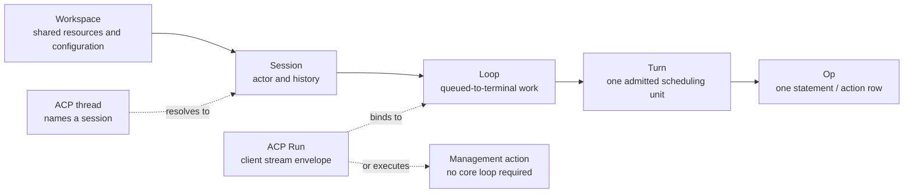
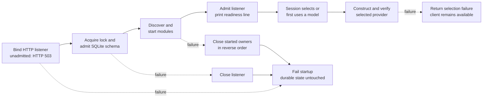
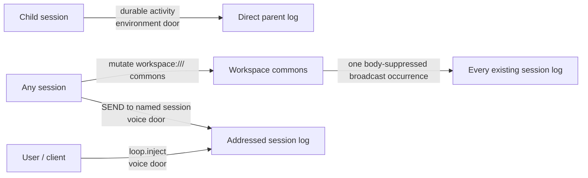
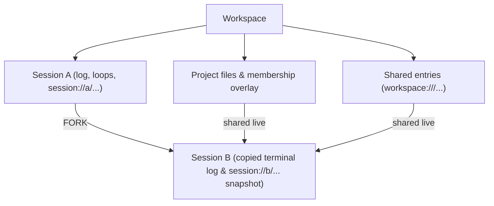
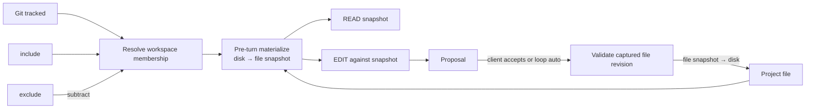
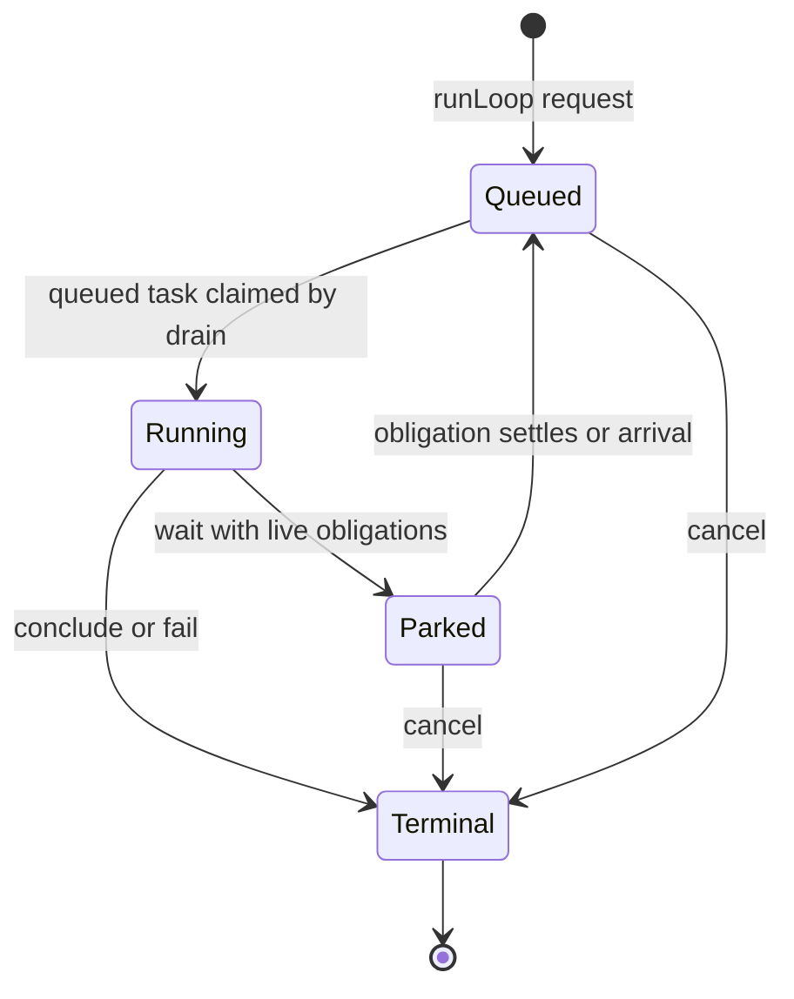
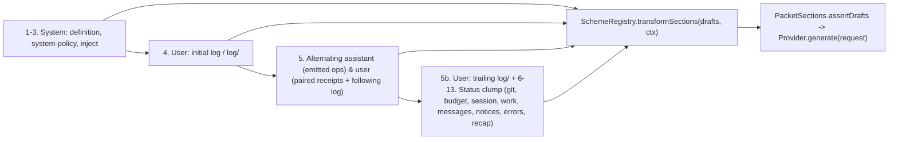
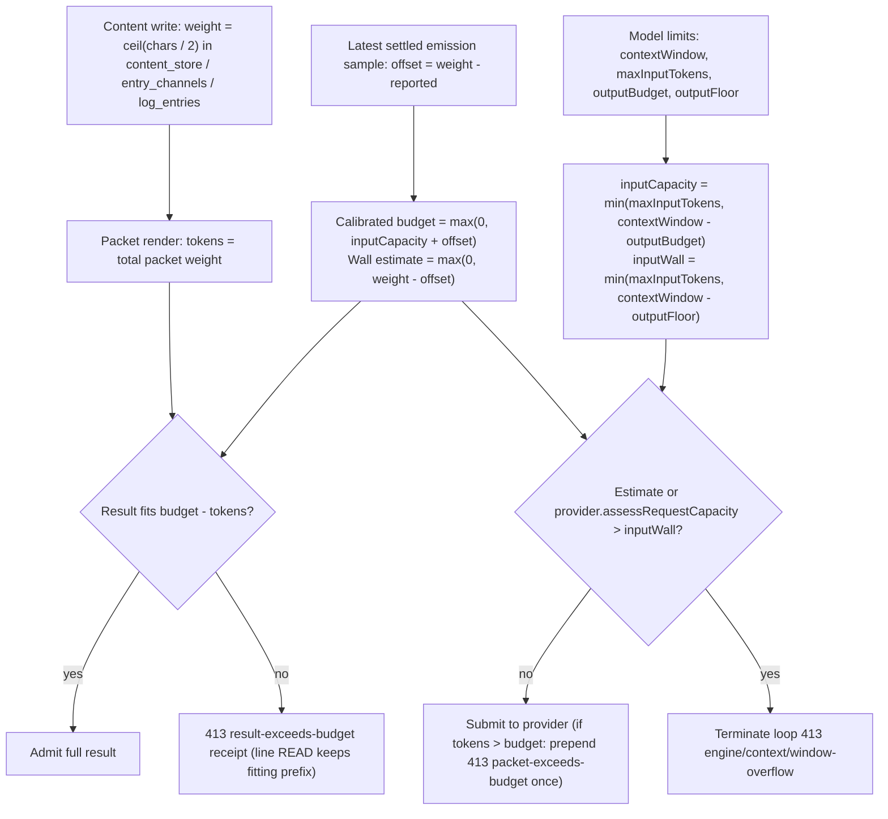
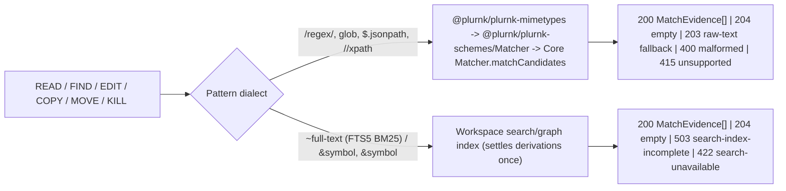

# plurnk-service — Specification

Canonical contracts plurnk-service exposes, architecture it implements, promises it makes to the constellation (`plurnk-contracts`, `plurnk-providers`, `plurnk-schemes`, `plurnk-mimetypes`, `plurnk-execs`, the user-facing `plurnk` CLI). `AGENTS.md` covers process; this file covers contract.

## Contents

- [Glossary](#glossary)
- [Architecture](#architecture)
- [Sessions and workspace boundaries](#actor-boundary-sessions-and-workspace-boundaries)
- [File membership and project roots](#membership-file-membership-and-project-roots)
- [Loop scheduling and lifecycle](#session-loop-lifecycle-loop-scheduling-and-lifecycle)
- [Provider Contract](#provider-surface-provider-contract)
- [Scheme Contract](#scheme-scheme-contract)
- [Mimetype Contract](#mimetype-mimetype-contract)
- [Search indexing](#persistent-search-index-search-indexing)
- [Channel Topology](#channels-channel-topology)
- [Op Surface](#op-surface)
- [Text line anchors](#line-anchors-text-line-anchors)
- [EDIT](#edit-edit)
- [READ](#read-read)
- [The Log](#log-history-projection-the-log)
- [COPY](#copy-copy-engine-orchestrated)
- [MOVE](#move-move-engine-orchestrated)
- [FIND](#find-find)
- [Messaging and turn disposition](#send-messaging-and-turn-disposition)
- [Executions](#exec-executions)
- [Proposals and client interactions](#proposal-proposals-and-client-interactions)
- [Stream Model](#stream-stream-model)
- [Storage Model](#storage-model)
- [Extension composition](#core-extension-composition-extension-composition)
- [Bundled Set](#bundled-set-bundled-set)
- [Grammar Dependency](#grammar-dependency)
- [Operator Configuration](#operator-config-operator-configuration)
- [Module seam](#rpc-module-seam)
- [Workspace Functionality](#functionality-coordinator-workspace-functionality)
- [Application interface](#methods-application-interface)
- [Packet assembly](#packet-assembly-packet-assembly)
- [Packet shape](#packet-packet-shape)
- [Matcher selection and text regions](#matcher-dispatch-matcher-selection-and-text-regions)
- [Testing and evidence](#test-artifact-retention-testing-and-evidence)

---

## Glossary

### §lifecycle-terms Lifecycle, storage, execution, and packet vocabulary



| Term | Layer | Meaning |
|---|---|---|
| **agent** | PLURNK | The plurnk runtime acting in-workspace as the `_plurnk` session ({§actor-boundary}), never a privileged singleton owning entries ({§execution-output-identity}, {§machine-processes}). |
| **workspace** | Core | Durable shared resources, configuration, and optional `project_root`. Identity: `workspaces.id`; mutable label: unique `workspaces.name`. |
| **session** | Core | Durable actor and history over one workspace (`parent_session_id` optional, one process-local cancellation scope while active). |
| **loop** | Core | Queued-to-terminal unit of work within a session (`100` pending · `102` running · `200` done · `202` waiting, {§send} · `413` input-capacity · `429` turn ceiling · `499` cancelled · `500` failed · `504` timeout, {§operator-config-workspace-settings} · `508` runaway). |
| **turn** | Core | One durable, producer-neutral batch of ordered operations (`(loop_id, sequence)`) authored by `model`, `client`, or `_plurnk`; only a model turn assembles a packet and owns an emission call. |
| **model call** | Core/provider | One logical `provider.generate` invocation (`(turn_id, sequence)`); emission attempts and BARE inferences share this owner while retries are physical requests beneath it. |
| **op / statement / action / dispatch** | Core | An op is one submitted DSL operation ({§turn-record}), parsed into a `PlurnkStatement` AST, dispatched to its scheme handler, and recorded as a `log_entries` action row at `log:///<L>/<T>/<S>/<op>` (or `op='error'`, {§operation-results}). |
| **ACP Run / ACP thread** | ACP | A client stream envelope (`runId`) bound to a core loop or management action; within a workspace, `threadId` resolves to one model session. |
| **entry / channel** | Storage | Canonical state unit `(workspace_id, scheme, authority, pathname)` ({§db-migrations}) holding named `channels` (`body`, `stdout`, `stderr`, `headers`, `symbols` with `content`, `mimetype`, `weight`, and `state`: `static \| active \| closed \| errored`) plus scheme `attributes`. |
| **scheme / mimetype / provider** | Extensions | Addressable namespace handler ({§scheme-surface}), content-type structural projector ({§mimetype}), and LLM transport adapter ({§provider-surface}). |
| **status / proposal state / outcome** | Execution | Operation HTTP status on `log_entries.status_rx` ({§operation-results}); proposal lifecycle `proposed \| resolved \| failed \| cancelled` ({§proposal}); short terminal reason string (`outcome`). |
| **writer / origin / writable_by** | Authority | Identity authoring a write (`model \| client \| _plurnk`, logged as `log_entries.origin`); engine enforces scheme `manifest.writableBy` with `403` ({§subscriptions}). |
| **verdict / strike / emission attempt / cycle** | Engine | End-of-turn ruling ({§tokenomics}); turn matching a rail ({§engine-rails}); provider exchange under {§emission-admission}; repeated operational inputs/results ({§engine-rails}). |
| **BARE inference** | Engine | Isolated child-provider model call whose response becomes an ordinary BARE log result without session, packet, tools, or output grammar ({§op-methods-op-dispatch}). |
| **capability policy / approval owner / proposal / resolution** | Governance | Subtractive `only`/`deny` selector layers; workspace-scoped approval recipient ({§session-ownership}); deferred side-effecting action ({§proposal-disposition}); client decision settling a proposal ({§methods}) or interaction ({§methods}, {§acp-proposal-resolve}). |
| **packet / log / render** | Packet | Turn's optional model-exchange record (`sections`, plus `assistant`/`assistantRaw` on admitted emission); chronological `log` section of in-scope `log_entries`; packet computation under {§packet-assembly} and {§packet}. |

---

## Architecture

### §observability-boundary Observability and package boundaries

OpenTelemetry may observe PLURNK; it never becomes product state, failure transport, scheduler input, model teaching, or client protocol. Domain and client activity remain on ACP. Reusable packages and the daemon depend on the OTel API only; `@plurnk/plurnk-otel` constructs configured trace and metric providers from standard `OTEL_*` variables ({§otel-module}, {§otel-contained}), while unconfigured or disabled processes keep no-op behavior and OTel Logs have no provider path. Telemetry shutdown runs at module `stop` ({§module-shutdown-order}); exporter failure never alters product results.

| Surface | Contract |
|---|---|
| HTTP & general spans | HTTP spans carry only an ACP-owned bounded route class (never pathname/query); other spans carry high-cardinality IDs while metric labels stay low-cardinality; prompts, reasoning, file bodies, arbitrary URLs, secrets, and extension payloads are never recorded by default. |
| GenAI convention projection | Provider request spans follow the GenAI registry (`c88d504` on core v1.44.0): a `CLIENT` `chat {model}` span with `gen_ai.operation.name="chat"`, `gen_ai.provider.name` (constructed route provider ID, or `other`), `gen_ai.request.model`, settled `gen_ai.usage.input_tokens`/`output_tokens` ({§tokenomics}), `gen_ai.response.finish_reasons`, and failure `error.type` alongside Plurnk attempt/kind/status/loop/turn attributes. |
| Service session composition | Both the service launcher and live/demo workspace helper discover ACP, MCP, Schedule, and command hooks ({§module-lifecycle}); management families and reference docs exist even with no enabled definitions, governed by workspace capability policy and {§operator-config-precedence}. The launcher binds the one listener ({§http-host}); the helper binds none ({§module-http-mounts}). |
| Package export surface | `@plurnk/plurnk-service` exports only `./launch` ({§startup-admission}), `./evidence` ({§digest-evidence-reader}), and `./package.json`. |

### §startup-admission Startup, listener admission, and service commands



- **Runtime floor**: Before any other module of `plurnk-service` evaluates, it checks `process.versions.node` against `engines.node`; below the floor it writes one stderr line naming both versions and exits `1` before binding a listener or touching durable state.
- **Listener and admission order**: The production service binds its listener ({§http-host}) before creating, opening, migrating, or mutating anything in the durable data directory; losing the bind race leaves storage byte-identical. Core answers `503 service-starting` until database admission and all module starts complete ({§module-http-mounts}). Startup validates model selectors without provider I/O; provider construction and endpoint verification happen on session selection or first use. Any startup failure closes started resources in reverse order (`daemon`, `observability`, `database`, `listener`).
- **Readiness line**: Once admitted, the service prints one stdout line `plurnk-service acp=<url> db=<json string> route=<json string>` (with IPv6 hosts bracketed and `db`/`route` JSON-encoded). After readiness, `discover` distinguishes this daemon from any other listener.
- **Daemon launcher (`@plurnk/plurnk-service/launch`)**: Spawns a daemon argv with caller-supplied `readyTimeoutMs` and `stopGraceMs` ({§host-path-layout}), resolving on the readiness line with `{ acpUrl, dbPath, route, logFile, stop }`. Failed starts stop and await the child before throwing with both output streams. `"private"` lifetime pipes streams to the parent and terminates with it; `"shared"` runs in its own process group, appends streams to `logFile` (default `<state dir>/service.log`), reads readiness from that file, and unrefs the child.
- **`plurnk-service stop`**: Reads the owning PID from the database lock, sends `SIGTERM`, and returns `0` once the process exits ({§module-shutdown-order}); an unlocked database reports not running and exits `0`.
- **Explicit update (`PLURNK_SERVICE_UPDATEABLE`)**: Nothing phones a third party or installs packages automatically. Startup loads `$XDG_CACHE_HOME/plurnk/models.json` if present ({§model-catalog-cache}). When `PLURNK_SERVICE_UPDATEABLE=1` (default), `plurnk-service update`, `updateService()`, `service.update`, or `/update` atomically refreshes `models.json`, hot-swaps the active catalog, and updates installed `@plurnk/plurnk-service` (and co-installed `@plurnk/plurnk`) via `npm` (or reports `status: "source"` in a checkout). When `0`, update requests fail with `403 update-disabled`.

### §http-host Shared HTTP host and request origin

Core binds one HTTP listener on `PLURNK_HOST:PLURNK_PORT` and exposes `registerHttpRoute(prefix, handler)`, `registerHttpUpgrade(prefix, handler)`, and `httpAddress()` on the application port ({§application-session-observation}, {§module-lifecycle}).

| Aspect | Rule |
|---|---|
| Prefix matching | Absolute pathnames claiming themselves and their subtree (`/` is root); longest mounted prefix with the matching handler kind (`route` vs `upgrade`) wins without falling through to a shorter prefix. |
| Admission & errors | Before activation every request gets `503 service-starting`; unparsable targets get `400 request-target-invalid`; unmatched paths get `404 route-not-found`; throwing handlers return `500 route-failed` (or abort in-flight streams) without crashing the listener ({§module-http-mounts}). |
| Request origin | `requestOrigin` is the configured public origin, else the request's `Host` over HTTP, else the listener's own address. Every advertised URL (including OAuth issuer, {§auth-oauth-endpoints}) uses `requestOrigin`, and no request is refused for the hostname it used. |

### §credential-authority Credential authority

Every credential presented to the listener is an opaque in-memory token (`access`, `refresh`, or browser `session`) issued by the daemon's `credentials` authority ({§application-session-observation}) with subject, client, scopes, family, and expiry. Restart revokes all credentials; revoking a family revokes its access, refresh, and browser session tokens together, and replaying a consumed refresh token revokes its family. The issuing module publishes `{ issuer }` at setup ({§module-phases}, {§acp-http-authorization}, {§auth-oauth}).

| Surface | Rule |
|---|---|
| `PLURNK_AUTH` posture | When `1`, holds `PLURNK_SECRET` or mints a `0600` `secret` file beside the database before admitting mounts and requires a published auth face; when `0`, no secret file or face exists and mounts admit anonymously ({§operator-config-precedence}). |
| Confidential module clients | At setup a module calls `registerClient({ id, redirectPaths, scopes, stylesheetPath })` (`id` matching `[A-Za-z0-9._-]+` except `operator`; pathnames under its own mounts without query/fragment, {§auth-oauth-documents}, {§auth-oauth-endpoints}). The authority mints an in-memory secret for the registrant and verifies it in constant time (`authenticateClient`, {§auth-oauth-clients}); duplicate or malformed registrations throw. |
| Credential sessions | `sessions(subject)` lists families holding a live `session` credential ({§auth-oauth-session}), oldest first (family handle, subject, created timestamp, expiry, client IDs); `client_credentials` and code grants without a browser session are omitted. |

---

## §actor-boundary Sessions and workspace boundaries



- **Session isolation & attribution**: A packet renders only the assembling session's log alongside shared workspace state ({§packet}, {§membership}). `origin` (`model \| client \| _plurnk`, {§scheme-surface}) records provenance ({§env-delta}) and never filters rows. Client management commands mutate workspace Functionality ({§module-lifecycle}) while client ops journal in `_plurnk` ({§connection-lifecycle}).
- **Two cross-session doors**:
  1. *Environment door*: Direct child durable activity ({§env-delta}) enters only the direct parent's log (never republished to grandparents), and successful mutations of `workspace:///` emit one broadcast occurrence to every existing session (unioned with parent lineage so a parent never gets duplicate rows). Intermediate child activity and commons broadcasts never wake; only a child's terminal disposition wakes a parked parent ({§session-loop-lifecycle}, {§env-delta}).
  2. *Voice door*: Directed `loop.inject`, `SEND (session://name)`, or exact-message replies ({§message-arrival}) enter the addressed session's log and wake idle or waiting work.
- **No mutex & self-hosting**: Sessions share workspace state without session locks; stale writes reject at anchor or revision boundaries ({§line-anchors}, {§file-snapshot-revision}, {§file-snapshot-revision}). Work with an operation runs as the unmintable `_plurnk` session (`DispatchAsPlurnk` for reference materialization), while git membership ingestion, disk-divergence `source=file` narration, search derivation, and packet/budget rails stay in the kernel.

### §session-ownership Session ownership and client interaction routing

Every session has one durable workspace-scoped approval owner (`session_owners`), enforced by database invariant. Root sessions take an explicit owner or default to `_plurnk`; `WORK`/`FORK` children inherit their parent's owner; `SEND` and scheduled messages preserve the recipient's owner; explicit client control attachment claims a model session and its model descendants (including pending interaction recipients) without ever claiming `_plurnk`.

- **Owner capabilities & proposals**: An owner declares its implemented client tools and whether it is `interactive` (attended by a person); `_plurnk` implements no tools and is non-interactive. Proposals record their session's owner and disposition (`review`, `accept`, or `reject`); `review` waits only for that owner, and capability policy precedes approval.
- **Client interactions**: Clarifications and questions route to the session's owner only when it is `interactive` and declares the tool; otherwise the request fails immediately with `501` without parking. Only the recorded recipient may resolve the pending interaction.

### §session-initialization-entry Turn-0 orientation and reference materialization

Workspace reference documents and projected instructions are materialized into `workspace:///_plurnk/` through `_plurnk` maintenance turns whose loops are excluded from `work_loops` ({§application-session-observation}, {§application-session-observation}) and emit no ambient broadcasts.

- **Project instructions**: When `<projectRoot>/AGENTS.md` exists, LoopDocs materializes `workspace:///_plurnk/AGENTS.md` and turn 0 foists a `READ` of it (global XDG `AGENTS.md` stays in the system prompt, {§packet-inject}). When root `<projectRoot>/AGENTS.local.md` exists (regardless of git ignore status, unless excluded), LoopDocs materializes `workspace:///_plurnk/AGENTS.local.md` and turn 0 foists its `READ` immediately after. Absent files produce no entry and no `404`.
- **Catalog preview (`PLURNK_SERVICE_FILES_ITEMS`)**: When non-zero (`-1` for markerless page, positive `N` to cap `*`), turn 0 foists bodyless `FIND` surveys in order: `skill://*/SKILL.md` (`<1,-1>`, {§skills-resources}), `workspace:///_plurnk/plurnk/*.md` (`<1,-1>`), `workspace:///_plurnk/tools/*.md` (`<1,-1>`, {§tools-resource-materialization}), `workspace:///_plurnk/members/*.md` (`<1,-1>`, {§tools-resource-materialization}), `*` (`project root member files`), `workspace:///*` (`workspace knowledgebase entries`), and `session://<session>/*` (`session knowledgebase entries`). Unregistered schemes and surveys selecting zero items are omitted before recording.
- **Turn-0 execution**: A model session's first loop starts with one packetless `{ producer="_plurnk", kind="initialization" }` turn (`init` rows) submitted through {§turn-record} and {§op-methods-op-dispatch}, framed by opening and closing `<!-- plan -->` `NOTE`s when any survey runs, with no fabricated emission row ({§turn-source-resources}). Initial messages arrive in the first model turn (sequence `2`, {§message-arrival}).

### §machine-processes Session topology, fork, and hiding



| State | Owner & Fork Behavior |
|---|---|
| Project filesystem, membership overlay, `workspace:///`, `sh://`, `http://` | Workspace-owned and shared live; never copied on fork. Workspaces themselves cannot be forked. |
| Named scratch (`session://<name>/...`) | Workspace-owned under literal namespace `<name>`. When the `sessions` row with `parent_session_id` and `forked_from_turn_id` is inserted, `sessions_fork_copies_history` ({§db-migrations}) snapshots quiescent `session://<parent>/...` entries into `session://<child>/...` without rewriting body text. |
| Log, loops, turns, curation, and accounting | Session-owned. Fork copies the parent's loops, turns, and `log_entries` up to `forked_from_turn_id` as settled terminal history (`100`/`102`/`202` clamped to `200`, open turns to `499`, pending proposals to `cancelled`, stream subscriptions omitted), preserving `weight`, `forget_The_Past`, and observation cursor while copying zero provider cost ({§tokenomics-turn-summary}). |
| Session identity & origin | Each session carries `origin` (`model` or `_plurnk`; `WORK`/`FORK` create `model` sessions regardless of operation producer, {§connection-lifecycle}) and an immutable unique 128-bit hex `provider_identity` (`sessions.provider_identity`, {§provider-interface}). |
| Place hiding (`hidden_at`) | Hiding a workspace marks the workspace alone; hiding a session marks it and its subtree (`hidden_by` naming the root of the hide group; `409 live-work` if any covered session holds a live loop, {§session-loop-lifecycle}, open stream, pending proposal, or pending question). Starting a live loop or selecting a workspace by its default folder name ({§execution-output-identity}) shows it; `listWorkspaces`, `listSessions`, and `overview` ({§methods-workspace-create}) filter by `hidden_at` and emit `workspace/hidden` / `session/hidden`. |

### §session-scheme Session scheme addressing, delegation, and collection

- **Authority & scratch scope**: `session://<name>/<path>` keys workspace entries by literal `authority = <name>` (`workspace:///<path>` has `authority = ""`; `session:///<path>` is refused with `400 named-session-required` pointing to `workspace:///`). Any session in the workspace can `READ`, `FIND`, `EDIT`, `COPY`, `MOVE`, or `KILL` any `session://<name>/<path>` entry without ancestry checks ({§execution-output-identity}, {§scheme-address}), and entries outlive their namesake session. `workspace:///_plurnk/` is ordinary shared workspace scratch reconciled by `_plurnk` ({§tools-resource-materialization}, {§skills-resources}).
- **Minting & control addressing**: Minted session names must match `SESSION_NAME` ({§path-syntax}, `^[A-Za-z0-9][A-Za-z0-9_-]{0,62}$`, case-sensitive; `_plurnk` is unmintable, though readable by `readLog` / {§methods-workspace-create}). Session control addresses (`WORK`, `FORK`, `SEND`, `READ`, `KILL`) must be authority-only `session://<name>` with no userinfo, port, pathname, query, or fragment (`400 control-address-invalid`), `~` is never an alias, and `EDIT (session://<name>)` fails with `400 session-entity-not-editable`.
- **Delegation (`WORK`, `FORK`) and messaging (`SEND`, `KILL`)**:
  - `WORK (session://<name>)` spawns a fresh child if `<name>` is unused ({§connection-lifecycle}), or delivers its non-empty body as a message to the existing session `<name>` (`attrs.delivered = "message"`). Omitting `(session://<name>)` auto-allocates an 8-hex-character name ({§execution-output-identity}). Passing a non-`session://` resource path on `WORK (<path>)` reads that resource whole (`<1,-1>`) as the prompt (composed with any inline body, {§bare-prompt-composition}) and auto-names the child.
  - `FORK (session://<name>)` (or addressless `FORK`) branches the calling session into a fresh name; if `<name>` already exists, `FORK` fails with `409 session-name-conflict` naming `WORK or SEND (session://<name>)`. Inherited loops are terminal so {§loop-completion} sees only the branch's new loop. Both `WORK` and `FORK` enforce `PLURNK_SERVICE_WORKSPACE_SESSIONS_MAX_ACTIVE` (`508`) and require a non-empty prompt (`422 spawn-prompt-empty`).
  - `SEND (session://<name>)` delivers a non-empty message or attachment ({§op-methods-op-dispatch}; `422 message-empty` when blank, `404` when absent) to `<name>`, folded into a running loop or queued as a new loop (`202` parked loops re-queue to `100` without firing terminal hooks). `KILL (session://<name>)` cancels the session's active tree (`404` when absent).
- **Collection (`READ (session://<name>)` and `ops://<name>/<L>`)**: Each concluded child loop reaches its direct parent as an `_plurnk` `READ` of `ops://<name>/<L>` ({§message-completion}, {§message-arrival}, {§env-delta}), and `READ (session://<name>)` (or `ops://<name>/<L>`) collects that same terminal result on demand without `lineAnchors` ({§session-loop-lifecycle}): `404` if absent, `425 loop-running` (`resource: "ops://<name>/<L>"`) while unresolved, `200` with answer content on completion, or the child's exact failure status and Problem on error.

### §child-orientation Open-work orientation and Session footer

Every model packet includes two orienting blocks in the status clump below `## Log` ({§packet-assembly}), carrying no date, time, or timezone anywhere:

- **`## Session`**: Renders `{"path": "session://<name>", "parent": <"session://..." | null>, "loop": L, "turn": T, "owner": {"address": "<owner>", "interactive": <boolean>}}`, naming the actor, its parent, the `(L, T)` coordinate this packet's response will occupy (`reasoning://<session>/L/T`, `ops://<session>/L/T`, `log:///L/T/*`), and its owner's attendance ({§session-ownership}).
- **`## Open Work`**: Always renders (even when all lists are `[]`, as the deliberate exception to empty-section omission) as `{"sessions": [...], "streams": [...], "messages": [...]}`, listing unconcluded child sessions, active stream subscriptions, and sent messages awaiting completion ({§loop-completion}, {§schedule-delivery}). Each active stream pointer carries `detail: "elapsed <E>s; output unchanged <U>s; <channel> <lines> lines (+<growth> bytes)"` (or `output timing unknown` when `output_changed_at` is null); `opened_at` is fixed at subscription open, while `output_changed_at` resets atomically only when a published channel's content actually changes ({§exec-stream}).

## §membership File membership and project roots

A file is a member of a workspace when Git tracks it or a `members` definition includes it and none excludes it: `(tracked ∪ include ∪ created) − exclude`. Only members can be READ, found by FIND, or changed by EDIT, and every member path resolves under `workspaces.project_root` (null is headless). Internal entries do not participate in the project-file disk loop.



| Concern | Rule |
| --- | --- |
| Baseline and exceptions | To a workspace a project file is **invisible**, **added**, or **tracked by git**; ambient admission of untracked files is prohibited ({§fs-write-surface}). Exceptions enter only by exact creation records (`source: "create"`, origin `constraint` from accepted EDIT or COPY/MOVE destinations), standard instruction projection (`AGENTS.md` / `AGENTS.local.md` into `workspace:///_plurnk/…` unless ignored or excluded, {§session-initialization-entry}), or model `members` proposals under `PLURNK_SERVICE_MEMBERS_MODEL_SCOPE` ({§tools-resource-materialization}) and `PLURNK_MEMBERS_AUTO_ADD` ({§membership-auto-add}). |
| Native Git and hermetic execution | Core Git reads (`git ls-files`, `git status`, `git check-ignore -v`) execute the installed Git binary with ambient `GIT_*` and global/system config scrubbed, `core.fsmonitor=false`, `core.hooksPath=/dev/null`, and only the daemon user's `core.excludesFile` preserved. Repositories declaring `filter.<name>.clean` or `filter.<name>.process` are skipped with a `git_inspection_refused` notice. `PLURNK_SERVICE_GIT_ALLOWED` gates `PLURNK_SERVICE_GIT_AUTO` ({§operator-config-workspace-settings}). |
| Ignore attribution and edit gate | An ignore refusal or `discover` verdict names its rule (`<file>:<line>`) from `git check-ignore -v`; negated patterns re-include paths. EDIT is bounded by membership: existing non-members refuse 403 before reading or writing bytes; accepted creations recursively create missing parent directories. |
| Web discovery and retrieval | Web search is an ordinary MCP concern ({§mcp-model-projection}); executors prefetch discovered pages through the generic `content: null` `entry()` request ({§execution-output-identity}) into `WebFetcher`, which materializes sanitized readable projections under canonical HTTP URLs ({§scheme-address}) and omits failed candidates. |

### §membership-auto-add Overlay, auto-add, and SQL reconciliation

`workspace_constraints` holds projected `members` definitions (`source: "members"` for human definitions, `source: "model"` for model definitions, `source: "create"` for accepted creations) and `!glob` exclusions ({§tools-resource-materialization}). Only `source: "members"` inclusions override active Git ignore; exclusions mask creation records without deleting their provenance ({§fs-write-surface}).

- **Auto-add (`PLURNK_MEMBERS_AUTO_ADD=1`)**: Model READ and FIND see untracked, non-ignored files under `project_root` minus exclusions. Listing FIND rows mark candidates `untracked` without admitting them; content READ or text-matching FIND proposes a `202` host-effect admission (`{"files": [...]}`) under `PLURNK_SERVICE_MEMBERS_MODEL_SCOPE` ({§proposal}, {§proposal}, {§proposal}), emitting one `member_added` notice per admitted path ({§diagnostic-observation}) and re-running the operation. Client operations and `PLURNK_MEMBERS_AUTO_ADD=0` read members only.
- **Set reconciliation and SQL globs**: Membership reconciles in two SQL set statements (`INSERT … SELECT FROM json_each` and `DELETE … WHERE pathname NOT IN (json_each) RETURNING`), recording EMI divergence only when a removed path also left disk truth. `glob_match(pathname, glob)` (`src/core/glob_match.ts`) evaluates {§find} directly in SQLite queries over `workspace_constraints`.

### §derivation-dedup-parallel Materialization, source projection, and search derivation

| Disk source | Durable body and materialization rule |
| --- | --- |
| Text within `PLURNK_SERVICE_FILE_MATERIALIZE_MAX_BYTES` (`1..104857600`) | Verbatim Unicode under the detected textual mimetype; READ and EDIT use the snapshot. |
| Binary with or without readable projection | Bounded by {§mimetype-binary-input}: readable projections store derived `text/markdown` (EDIT returns 415); unprojectable binaries store an empty marker under the binary mimetype (READ uses {§binary-parity}, EDIT returns 415). |
| Oversized or failed acquisition | Remains a member with an empty body channel carrying a durable 413/failure producer result; stat-gated until policy or file metadata changes, while whole-file KILL streams a digest without materializing the body. |

Search maintenance deduplicates by hashing the representation's `content_hash` ({§tokenomics}), mimetype, reader identity, and `PLURNK_SERVICE_SEARCH_EXCLUDE` pattern without loading unchanged channel bodies into the process:

- **Bounded parallel derivation**: Distinct pending artifacts sort smallest-first and run under `PLURNK_SERVICE_DERIVE_CONCURRENCY`, writing symbol graphs in `PLURNK_SERVICE_DERIVE_STORE_BATCH` batches and joining all launched siblings before settling. Changed passes emit `preparing`, `indexing` heartbeats (`PLURNK_SERVICE_DERIVE_PROGRESS_HEARTBEAT_MS`), and `complete`/`failed` notices; FTS reads text from `{§content-store}` and retains `{§mimetype-channel-selection}` and `{§mimetype-channel-selection}` metadata.
- **Member-local derivation failures**: Each completed artifact records `indexed`, `excluded`, `unsearchable`, or `failed`. A handler defect on one member (`MimetypeDerivationError` under {§mimetype-error-policy}, or `MimetypeInputError` under {§mimetype-error-policy}) attaches a terminal `failed` disposition for that representation and completes the pass with a `level: warn` `search_progress` notice naming the failed member; contract, persistence, missing-grammar, or abort failures remain fatal to the pass and leave the artifact `building` for retry.

### §file-snapshot-revision Snapshot revisions and serialized file commits

Materialization checks physical identity and raw-byte digest (never timestamps alone), publishing the revision and channels in one database statement and recording observed external changes as `source="file"` `EDIT` rows ({§env-delta}). Final validation, atomic temp-file-and-rename publication or deletion, and projection settlement serialize per physical path within the daemon:

| Commit boundary | Filesystem and settlement outcome |
| --- | --- |
| Captured revision matches disk | Publish staged bytes atomically (preserving mode/ownership on replacement) or unlink source (`KILL`/`MOVE`), stamping the new revision from written bytes so native writes are not narrated as external divergence. |
| Unknown baseline or observed drift | Return `409 edit-collision` without mutating disk ({§line-anchors} separately guards anchored neighborhoods before proposal). |
| Partial publication or rollback | If incorporation fails after existing-file replacement, report the partial update; if incorporation fails after new-file creation, unlink only the unchanged creation; if `MOVE` source drifts after destination publication, keep both and report conflict ({§move}). |

## §session-loop-lifecycle Loop scheduling and lifecycle

A session is a log plus a cancellation scope (`AbortController`) advanced by at most one registered per-session drain that claims queued loops (`100 → 102`). A Session is live while any of its loops is unresolved (`100`, `102`, or `202`).



| Invariant | Contract |
| --- | --- |
| State machine and terminal result | Only `100 → 102`, `102 → 202`, `202 → 100`, and unresolved-to-terminal transitions are admitted; terminal rows are immutable and must carry `loops.terminal_result` (exact status and RFC 9457 Problem Details), while active rows have `terminal_result = NULL`. Completion and cancellation never borrow the last reply's body. |
| Independent collection (`425`) | Reading an unfinished child (`READ (session://<running-child>)`) returns `425 Too Early` without a strike or scheduler side effect; `WAIT` joins live obligations (`{§loop-completion}`). |
| Stream and child wake matrices | Streams are durable session subscriptions (`[0].stream: { state, ... }`, {§subscriptions}). At `WAIT`, open streams or live children park the loop (`202`); closed streams or terminated children with undelivered results continue immediately (`102`) to observe the terminal delta; `[0]` or `[{"lifetime":"turn"}]` streams reap at the next pre-turn boundary. |

### §session-wait-timing Durable waits, wake identity, and execution allowance

When a loop parks on live work, `PLURNK_SERVICE_WAIT_SEC` (or `WAIT [seconds]`, `{§op-shapes}`) commits `wait_until` atomically with the wait revision; `WAIT [0]` or an idle `WAIT` continues at `102` without parking.

- **Wake identity and completion revision**: Timers and wakes bind to the exact loop and wait generation. Each loop captures the session's completion revision and acknowledges it before inference only after every addressed reply/child terminal has crossed the observation cursor and every closed stream has published its terminal channels.
- **First-claim latency and execution allowance**: `loops.claimed_at` is stamped once by trigger on first entry to `102`. The first execution snapshots `PLURNK_SERVICE_LOOP_TIMEOUT` ({§operator-config-workspace-settings}) on the loop; active execution segments (inference, retries, turn-lock waits, proposal waits, optimistic holds) consume that allowance via a monotonic clock, while parked/queued/offline intervals do not. Exhaustion aborts execution with `504`.
- **Recipient selection and loop-addressed admission**: Unaddressed session arrivals select the running loop, else the oldest parked loop, else a new queued loop under the session's admission lock. When `runLoop` specifies an explicit `loopId`, admission requires that exact loop to belong to the session and remain unresolved, failing `409 daemon/admission/loop-not-open` rather than falling back to a new loop.

### §session-causal-admission Drains, cancellation, settlement, and restart recovery

`DrainSupervisor` serializes message admission, orphan-message recovery, and recursive subtree cancellation within the workspace, holding at most one active drain per session and re-checking the queue before relinquishing the drain slot.

| Mechanism | Rule |
| --- | --- |
| Recursive cancellation and epoch bound | `lifecycle_cancel_sessions` and the `sessions_cancel_live_loops` trigger atomically record `cancelled_through_sequence` and terminalize unresolved loops (`499`, `terminated_by = 'cancel'`) across the session subtree, while process-local teardown invokes every durable open subscription's live cancellation handle (`PLURNK_SERVICE_EXEC_KILL_GRACE_MS`) and aborts pending proposal waiters (`daemon_stopping`, {§proposal}). Streams bind to the cancellation scope captured at spawn; cancelled work never resurrects its scope. |
| Child wake and optimistic settlement | Every child task completion notifies its direct parent without injecting a prompt. Before model dispatch, `PLURNK_SERVICE_OPTIMISTIC_WAIT_MS` (default 5s; `0` disables) bounds both initiating-turn stream settlement and wake holds that coalesce sibling stream/child arrivals while another obligation remains live. |
| Durable disposition and idle rule | A loop concludes only under {§loop-completion}; a concluded session retains history and starts a new loop on a later addressed arrival. At turn boundaries, a committed `202` park survives a racing daemon-shutdown abort. |
| Daemon lock and restart recovery | Before opening transports, the daemon acquires an exclusive database-adjacent lock (`DaemonLock`), replacing dead-PID claims atomically. Boot recovery commits atomically: `100` loops restore drains; `102` loops, pending provider calls, proposed operations (`owner_vanished`, {§methods}), and open subscriptions settle `500`; pending client interactions are removed ({§proposal-projection}); and `202` loops requeue if obligations settled or restore guarded wait timers. |

### §turn-record Producer-neutral turn record

Every turn (`producer`: `model | client | _plurnk`; `kind`: `inference | initialization | operation | maintenance`) opens at status `102` (`completed_at = NULL`), orders operations by `(turn_id, sequence)`, preserves source-backed programs in `turn_sources` ({§log-history-projection}), and records `packet`/provider evidence only on `model`/`inference` turns.

- **Shared admission and selection snapshot**: Every admitted program parses once and dispatches through the same executor, which captures the session's log high-water mark before statement dispatch so log-targeted `KILL` operations cannot select rows emitted by their own turn (including `{§turn-source-resources}`).
- **Exceptional inference exits**: An exceptional exit completes any still-open turn it acquired without overwriting completed turns or fabricating provider evidence—settling `499` when caused by the owning abort signal, `504` on `LOOP_TIMEOUT_REASON`, and `500` on unrelated or `AggregateError` failures—and rethrows the original cause.

### Engine notifications: one bundle of daemon callbacks

The daemon's observation callbacks (stream, reasoning, outside-text and packet events, session wake, inject and cancel, operation settlement, and notices) are passed to `Engine` as one flat `EngineNotifications` bundle consumed directly by internal collaborators.

### §engine-rails Engine rails, cycle evidence, and provider recovery

After each admitted turn, the engine evaluates one inline rail verdict. Rail state (strike streak and cycle window) belongs to the durable loop across wakes and restarts, closing the cycle window on an actual `202` park or an output-allowance-cut turn ({§operation-results}).

| Mechanism | Rule |
| --- | --- |
| Strike sources and progress immunity | A turn earns at most one strike from: (1) a hard non-execution operation or parse failure (`status >= 400`, excluding soft `404`, `409`, `416`, `425`, `501` and `{§matcher-prefix-claims}`), (2) an exact operation+result cycle across `MIN_CYCLES × MAX_CYCLE_PERIOD`, or (3) an empty turn ({§outside-text}). A turn where any task-acting operation succeeded (`status < 400`, excluding `NOTE`, `WAIT`, and targetless `SEND`) is immune to hard-result strikes and resets the streak. Crossing `PLURNK_SERVICE_MAX_STRIKES` terminates at `508` (cycle) or `500` (`output_allowance`, `repetition`, `no_operation`, or `operation`, citing `{§outside-text}`). |
| Cycle identity | Hashes ordered executed operations and results (operands, scopes, bodies, metadata, and `NOTE`/response bodies; or raw text for empty turns), ignoring source positions, asides, Problem `instance` URIs, and `NOTE` storage coordinates. |
| Provider recovery | Retryable provider failures ({§provider-failure-normalization}) record a `_plurnk` Problem row, emit `provider_unavailable`, back off (`PLURNK_SERVICE_PROVIDER_RECOVERY_BACKOFF` up to `PLURNK_SERVICE_PROVIDER_RECOVERY_BACKOFF_MAX`), and reissue against the frozen messages up to `PLURNK_SERVICE_PROVIDER_RECOVERY` without consuming emission attempts or scoring strikes (applicable to loop inference and `{§op-methods-op-dispatch}`). When recovery is exhausted, interactive sessions park at `202` ({§session-ownership}) while non-interactive sessions terminate with the provider's exact failure. |

## §provider-surface Provider Contract

Core consumes [`@plurnk/plurnk-providers`](../plurnk-providers/SPEC.md) through three entry points and one normalized inference ledger:

| Surface / Guarantee | Contract |
| --- | --- |
| `provider.generate(args)` | Invoked once per logical model call. Emission calls pass packet messages, session/turn coordinates, generation envelope, optional local grammar, attribution tags, and `callKind: "emission"`; `BARE` calls pass one user message plus call identity and `callKind: "bare"` ({§provider-interface}). Both wire `signal` to the session `AbortController` and supply `observeRequest({ provider, model })` to record each physical provider I/O before wire dispatch. |
| `provider.assessRequestCapacity` & `countPromptTokens` | Capacity verdicts ({§provider-capacity-admission}) govern context-envelope admission ({§tokenomics}); `countPromptTokens` measures complete requests ({§provider-capacity-admission}) without replacing the curation ruler. Provider capacity and identity are immutable per instance ({§provider-interface}). |
| Logical inference ledger | Every model call opens a `model_calls` row (`state = "pending"`), specialized by `turn_attempts` (turn-packet emissions) or `bare_inferences` (stateless `BARE` calls). Physical requests settle in `provider_requests`, and core verifies that returned `ProviderRequestAccounting` matches observed requests before accepting a response or classifying a `ProviderError`. |
| Metadata & `assistantRaw` | `generate` may return `meta: Record<string, unknown>` (defaulting to `{}`), persisted on `turns.meta` and forwarded opaque in `loopUsage(loopId).meta`. `assistantRaw` is opaque forensic evidence persisted on the attempt row. |

### §emission-admission Emission Admission, Retry, and Attribution

An emission attempt parses `assistant.content` as the operational turn program and `assistant.reasoning` for explicit `NOTE` blocks ({§op-shapes}):

| Outcome | Rule |
| --- | --- |
| Admitted response | Admitted when (a) `assistant.content` contains no fabricated log heading (`### log:///` outside a fenced block) and (b) either `parseStatements(assistant.content)` has no unparsed tail boundary ({§parse-recovery}), at least one closed statement precedes the lost boundary, or `finishReason === "length"` ({§outside-text}). Admitted statements execute in source order; bounded parse errors record `400` log rows without resampling. |
| Private retry (`PLURNK_SERVICE_EMISSION_ATTEMPTS`) | When the entire emission is rejected before any statement closes (or fabricates a `### log:///` heading), core records `accepted = 0` on `turn_attempts` and re-invokes `generate` with the exact same `messages` up to `PLURNK_SERVICE_EMISSION_ATTEMPTS` (default `3`), keeping prompt caches warm. |
| Exhaustion & recovery turn | Exhausting private attempts completes the turn at `102` without fabricating an `error` log row, records a durable body-suppressed `_plurnk` `emissionAttempt` row, and scores one contract strike ({§session-loop-lifecycle}). If the strike rail does not terminate the loop, the next turn projects the latest rejected text and parser diagnostic once in `notices`. |
| Attribution & client metadata | Each attempt queries `attributions(context)` across schemes, executors, mimetypes, and the provider ({§extension-attribution}), passing the deduplicated sorted tags on `generate` and persisting them on `turn_attempts`. Workspace `settings.client` (`1..128` printable ASCII chars) is stored on `workspaces.settings` and never sent to providers. |

### §provider-instantiation Provider Instantiation and Operator Grammar

`ProviderInstantiate` resolves model selectors through `@plurnk/plurnk-aliases` ({§alias-env-contract}) and constructs providers via `ProviderRegistry` (`discoverExternal`, `register`, `has`, `list`), caching instances by canonical `(provider, model, baseUrl, alias)` spec. `Mock` from `@plurnk/plurnk-providers` serves deterministic integration suites ({§mock-provider}).

| Mechanism | Rule |
| --- | --- |
| Operator grammar (`PLURNK_PROVIDERS_GBNF[_<alias>]`) | Resolves per alias (empty string disables) as a filesystem path (absolute or relative to daemon `cwd`) read via `readFileSync` on each `generate` call and passed as `grammar`. Unreadable paths fail before inference; `ProviderInstantiate.validateGrammarConfiguration` refuses providers that do not set `constrainsOutput === true`. Turn `meta.railsAttached` records `"client"` or `"withheld"` from `ProviderResponse.grammarEvidence`. |

---

## §scheme Scheme Contract

Core mediates between the model and scheme handlers ([`@plurnk/plurnk-schemes`](../plurnk-schemes/SPEC.md)). Data and streaming schemes store resources in `entries` and `entry_channels`; control schemes (`session`, `plurnk`) act on runtime state without entry rows.

### §scheme-address Scheme Addressing and Entry Matrix

Core decomposes targets via RFC 3986 / WHATWG URL parsing ({§path-grammar}): namespace schemes fold authority into `pathname` (`authority = ""`), network schemes preserve `hostname[:port]` in `authority` and serialize `?query` into `pathname` ({§url-decomposition}), and `#fragment` selects the channel ({§channel-selection}). Client `entry.read` acquires addresses through the same exact-READ pipeline.

| Scheme | Category | Address & Ownership | Mutability & Scope |
| --- | --- | --- | --- |
| `file` | `data` | Project-relative or `../` canonical key (`authority = ""`); workspace-owned | Model/client `EDIT` (with `textEditScopes` & `lineAnchors`), `COPY`, `MOVE`, `KILL` (reviewed via `202` proposals) |
| `workspace` | `data` | `workspace:///<path>`; workspace-owned scratchpad | Model/client `EDIT` (`textEditScopes` & `lineAnchors`), `COPY`, `MOVE`, `KILL` |
| `session` | `data` / `control` | `session://[<handle>]/<path>` (entry) or `session://<handle>` (actor); session-owned | Entry: model/client `EDIT`, `COPY`, `MOVE`, `KILL`; Actor: `SEND`, `WORK`, `FORK`, `KILL` |
| `http`, `https` | `data` | `http(s)://<host>[:<port>]/<path>[?<query>]`; workspace-owned | Acquired on `READ`/exact `FIND`; outbound `SEND` proposes (`202`); `lineAnchors: true` |
| `<runtime>` (`sh`, etc.) | `streaming` | `<runtime>:///<id>`; workspace-owned execution output | Created by runtime invocation; `READ`/`FIND` streams (`lineAnchors: true`), `SEND` stdin, `KILL` process |
| `log` | `data` | `log:///<loop>/<turn>/<seq>/<op>`; session-owned log receipts | `READ`, `FIND`, and context-curation `KILL` |
| `message`, `ops`, `reasoning`, `note` | `data` | `<scheme>://[<session>]/<coordinate>`; session-owned turn sources | Immutable turn-source evidence; `READ` and `FIND` (`lineAnchors: true`) |
| `plurnk` | `control` | `plurnk (<noun>)`; control target | Administers `git`, `members`, `mcp`, or `update` |

### §fs-namespace Filesystem Namespace, Canonical Naming, and Refusals

All `file` operations resolve targets through `Namespace` and `plurnk-uri` before touching SQLite or disk:

| Rule | Contract |
| --- | --- |
| Name resolution & home expansion | Local paths and `file://` URLs (decoded once from percent-encoding; rejecting `%00`, `%2F`, invalid UTF-8, or non-empty hostnames with `400 invalid-file-url`) resolve against `project_root` (or `os.homedir()` for `~` / `~/...`). A literal in-root `~` segment is written `./~`. |
| Canonical key & wire canon | Inside `project_root`, the stored `entries.pathname` and wire address are the normalized relative path (`src/a.ts`); outside `project_root`, the stored key is the relative climb (`../sibling/a.ts`) while model-facing wire/problem rendering spells the absolute path. Model-authored non-canonical spellings (`/abs/in/root` or `~/...`) resolve to the canonical key and emit a `path_normalized` notice. |
| Visibility & directory targets | Only paths granted by `git` or `constraint` (`members` / `create`) exist in `file`. Addressing a directory on `READ` or `KILL` returns `404 path-is-directory` with recovery `FIND (<dir>/)`; on `EDIT` it returns `403 path-is-directory`; on `FIND (<dir>)` (with or without trailing `/` for in-root directories) it surveys member descendants. |
| Read/miss refusals | Inside `project_root`, a missing path returns `404 entry-not-found` naming `FIND`, `EDIT`, and `plurnk (members)`; an on-disk non-member returns `404 entry-not-member` naming either the active exclusion rule, the ignoring Git file and line (`.gitignore`, `.git/info/exclude`, user excludes), or `plurnk (members)`. Outside `project_root`, any miss or non-member returns the identical `404 entry-not-found` naming the absolute address without revealing disk presence. |

### §fs-write-surface Filesystem Write Surface and Creation Incorporation

Existing member writes follow their grantor (in-root members and constraint-granted outside members are read-write; Git-only outside members are read-only). Creating a new file is one producer-neutral transaction across `model`, `client`, and `_plurnk`:

| Stage / Case | Contract |
| --- | --- |
| Creation scope (`PLURNK_SERVICE_FILE_CREATE_SCOPE`) | Effective scope is `min(serviceScope, workspaceSettings.fileCreateScope)` over `none < root < namespace` (default `root`). `none` refuses all new files (`403`); `root` admits absent paths whose lexical and realpath parents stay inside `project_root`; `namespace` also admits absent `../` paths. |
| Exclusions & occupancy | Active member exclusions (`!glob`) always refuse creation (`403`). Git-ignored paths refuse creation (`403`) unless explicitly included by a `members` constraint. An existing non-member file on disk refuses creation with `403 path-occupied-by-nonmember`. |
| Atomic incorporation (`source = "create"`) | On proposal acceptance (re-verifying parent realpath against symlink swaps), core writes the file exclusively (`wx`), materializes the `file` entry, and inserts an exact literal `workspace_constraints` pick (`source = "create"` unless already covered by `members`) without running `git add`. If incorporation fails, disk and DB roll back together (`500 creation-incorporation-failed`). `KILL` or ambient disk deletion removes the `source = "create"` pick while preserving explicit `members` rules. |

### §scheme-manifest Scheme Manifest and Entry CRUD

Every scheme class declares a static `SchemeManifest` (`name`, `channels`, `defaultChannel`, `category`, `writableBy`, `volatile`, `modelVisible`, optional `textEditScopes`, `lineAnchors`, `unmanaged`), validated at registration by `SchemeRegistry`.

| Primitive | Contract |
| --- | --- |
| `EntryCrud` (`entries` & `entry_channels`) | `writeEntry` upserts the `entries` row (stamping `workspace_id` and `session_id` for session-owned schemes) and replaces/upserts `entry_channels` inside one transaction, preserving `deep_hash` when a channel's `(content_hash, mimetype)` is unchanged and clearing `deep_hash` (touching `updated_at`) only when representation changes. `deleteChannel` removes one channel and prunes the `entries` row only when no channels remain. |

### §op-methods-op-dispatch Operation Dispatch, Execution Order, and Bulk Targeting

Core executes admitted statements sequentially in authored order within a turn:

| Mechanism | Contract |
| --- | --- |
| Sequential execution & cancellation | Each statement observes the resource and log state committed by earlier statements in the same turn (except `log` `KILL`, which snapshots pre-program log rows so a turn cannot curate its own in-flight receipts). Runtime `plurnk (mcp)` mutations update parser executor tags for subsequent statements in the same turn. Aborting the loop signal stops dispatch after the current settled effect and marks the turn `499`. |
| `EDIT` batches & anchor continuity | Multiple `EDIT`s to the same resource or a single `EDIT` with multiple regions execute against successive states, carrying forward untouched `@hash` line anchors across numeric splices ({§line-anchors}), tolerating `@hash+N`/`@hash-N` offsets, and merging adjacent rendered prefix echoes when uniquely evidenced. |
| Bulk resource targeting (globs) | A glob target on `READ`, `EDIT`, or `KILL` expands against the full unpaged `FIND` match set in deterministic path order, subject to `maxCommands` (`PLURNK_SERVICE_MAX_COMMANDS`). Empty `EDIT`/`KILL` globs produce one `204` receipt. `COPY` and `MOVE` require each glob operand to match exactly one resource (`400 target-cardinality` otherwise). |
| `BARE` inference & `SEND` attachments | `BARE` resolves its prompt (inline body or single-resource target), selects the loop's child provider policy (`spawn_model_route_id`, `PLURNK_MODEL_CHILD`, or parent route), and runs one toolless, historyless inference call. `SEND` on entry schemes without a `send` handler returns `501`; `SEND` with `[path]` metadata attaches resolved resource snapshots into durable `message_envelopes`. |

### §scheme-surface Universal READ/FIND Composition and Scheme Guards

Core enforces `manifest.writableBy` before invoking mutation handlers (returning `403` on unauthorized producers) and catches unhandled scheme exceptions as `500` Problem rows.

| Composition | Contract |
| --- | --- |
| Universal `READ` | Resolves the target entry and channel (calling optional `prepareRepresentation` first for on-demand schemes like `http`/`https`), slices line/byte ranges or regex/structural matchers against the stored representation, and projects line anchors and sibling channel token weights. `http`/`https` responses honor shared-cache `Cache-Control`, `ETag`/`Last-Modified` `304` revalidation, and `no-store` / mutation-method provenance. |
| Universal `FIND` | Data schemes inherit standard catalog, regex, structural, FTS (`~query`), and symbol-graph (`&query`) `FIND` after optional `prepareFind` / `prepareRepresentation`. Non-data schemes without `find` return `501`. |

---

## §mimetype Mimetype Contract

`Daemon` owns and disposes the `@plurnk/plurnk-mimetypes` instance ([SPEC](../plurnk-mimetypes/SPEC.md)), exposing detection, binary classification, readable projection, and AST/symbol extraction:

| Boundary | Contract |
| --- | --- |
| Write-time detection vs. projection | Scheme writes resolve mimetypes via `PathMimetype` / `mimetypes.detect` and invoke handlers only to derive a sibling `#readable` Markdown channel when eligible ({§channel-selection}) — never invoking structural queries at write time. |
| Binary classification & source projection | `MimetypeBinary` uses `mimetypes.classify` to govern UTF-8 decoding, binary `EDIT` refusals (`415`), raw byte `READ` slicing ({§binary-parity}), and search exclusion. Binary files with a readable handler (e.g., PDF facts) persist derived Unicode and refresh when `projectionIdentity(mimetype)` changes; over-limit or unprojectable binary sources record `sourceProjection.disposition` (`"input-limit"` or `"unavailable"`) and remain byte-readable. |

---

## §persistent-search-index Search indexing

`SearchIndex` maintains workspace-shared, content-addressed derivations (`derivation_artifacts`, `derivation_fts`, `derivation_symbols`, `derivation_references`) keyed by `deep_hash = SHA-256(content_hash, mimetype, binary_classification, projection_identity)`:

| Invariant | Contract |
| --- | --- |
| Exact channel indexing & deduplication | Derivations index the exact stored channel content in its own coordinate space. Identical `deep_hash` inputs across entries or workspaces build once and attach the shared artifact without touching `entries.updated_at`. Concurrent channel mutations reject stale in-flight derivation attachments. |
| Eligibility & size bounds | `_search-exclusion` excludes binary channels (except HTML/readable text), lockfiles, minified/bundled assets, and channels exceeding `PLURNK_SERVICE_SEARCH_MAX_BYTES`, recording `disposition = "unsearchable"` so maintenance stays exhaustive without re-probing excluded content. |
| Exhaustive warming (`warmWorkspaceDerivations`) | Runs at workspace creation and before model turns (joining any in-flight warm before calling the provider), materializing repository members and streaming `search_progress` notices (`preparing` → `indexing` → `complete`, with `loopId: 0` when workspace-scoped). |

---

## §channels Channel Topology

Every entry in `entries` owns one or more named channels in `entry_channels` keyed by `(entry_id, name)`, each with its own `content`, `mimetype`, token `weight`, `content_hash`, `deep_hash`, and `state ∈ {static, active, closed, errored}`:

| Property | Contract |
| --- | --- |
| Per-channel mimetype & state | Mimetype is a `(scheme, channel)` property; cross-mimetype `COPY`/`MOVE` follows {§network-address}. `state` is lifecycle metadata owned by the scheme (e.g., `exec` transitions `active → closed`/`errored`) and never gates `READ` or `FIND`, which always serve accumulated content. Entries carry no visibility column. |

### §channel-selection Channel Selection and Readable Projections

URL fragments (`#channel`) select channels across `READ`, `FIND`, `EDIT`, `COPY`, `MOVE`, and `KILL`:

| Rule | Contract |
| --- | --- |
| Default vs. named fragment | Fragment-less targets select `manifest.defaultChannel` (`body` for data schemes, `stdout` for `exec`). A `#channel` fragment selects that named channel; `EDIT` with a fragment on a non-existent entry returns `404`, and `KILL (path#channel)` deletes only that channel. Unknown channels return `404 channel-not-found` listing `availableChannels` (and naming the execution stream URI when a `log` execution receipt is addressed with `#stdout`/`#stderr`). |
| `#readable` sibling channel | When an HTML or rich-text source is written or fetched into `body`, core derives its Markdown projection into the sibling `#readable` channel (`text/markdown`), refreshing or removing `#readable` whenever `body` changes. `#readable` is read-only (`400 channel-derived` on `EDIT`, `COPY`/`MOVE` destination, or `MOVE` source; `COPY` from `#readable` is allowed). |
| Decision-time visibility | Catalog `FIND` emits a resource's channel group with the default channel first and non-empty siblings (`#readable`, `#stderr`) beside it; channel-scoped `FIND` matches and ranks in the addressed channel's coordinates (omitting `channel` on match locations only when it is the default channel); and `READ` on a multi-channel entry returns sibling channel token weights in `channels` (e.g., `{"#readable": 420}`). |

---

## Op Surface

Per-op semantics. AST shapes come from `@plurnk/plurnk-contracts`'s `PlurnkStatement`. Engine dispatches by `op`; scheme implements per author contract ({§scheme}).

## §line-anchors Text line anchors

A scheme declaring `lineAnchors: true`, or `textEditScopes: true` with model write authority for the addressed resource, publishes the contracts-owned 5-character base62 anchor token `@xxxxx` on every rendered line (`<line><@xxxxx><content>`) and accepts `<@a>`, `<@a,@b>`, `<@a+N>`, and `<@a-N>` in scope slots ({§language-scopes}). Schemes without write authority render `<line>:<content>` without anchor tokens.

```text
hash_input = canonical_target_NFD + "\0" + prev_trim + "\0" + curr_trim + "\0" + next_trim
token      = base62( sha256(utf8(hash_input))[0..4] )   // 5 base62 chars from first 4 bytes
```

- Boundary lines use `""` for missing neighbors; `\r\n` is normalized to `\n` before splitting and trimming.
- If a token matches one line, it resolves to that 1-indexed line ordinal regardless of vertical shift; if 0 lines match, resolution fails `409` `edit-collision`; if 2+ lines match, resolution fails `409` `anchor-ambiguous` with candidate line numbers unless paired with a unique boundary or narrowed by a prior anchor in a range.
- Anchor offsets (`@a+N`, `@a-N`) resolve line `L ± N` after resolving `@a`; out-of-range offsets fail `416`.

## §edit EDIT

```text
EDIT (<target>) [<scope>] [<pattern>] [<!-- aside -->]
<body>
```

| Form | Behavior |
|---|---|
| Absent resource (no scope or `<0>`/`<1>`/`<-1>`/`<1,-1>`/`<1,M>`/`<1,1,1,1>`) | Creates resource (`201`) with `body`. Scopes beyond line 1 on empty content fail `416`. |
| Existing resource, no scope and no pattern | Refused `400` (`marker-required-on-existing`); full replacement requires `<1,-1>`. |
| `<L>` / `<L,M>` / `<@a>` / `<@a,@b>` | Replaces inclusive line span `L..M` with `body` (`200`, or `304` when unchanged). Empty body removes the selected lines. |
| `<0>` / `<-1>` | Prepends before line 1 (`<0>`) or appends after the last line (`<-1>`). |
| `<L1,C1,L2,C2>` | Splices exact half-open character span `[C1, C2)` across `L1..L2` ({§character-range-splicing}). `<L,1,L,1>` inserts before line `L` using the resource's line separator. |
| Consecutive same-target `EDIT`s in one turn | Validated and applied as one atomic batch against the pre-batch snapshot; overlapping regions fail `409`, and any failure rejects the whole batch. |

### §edit-pattern Pattern EDIT

An `EDIT (<target>) [<scope>] <pattern>` selects matching spans within the canonical source (bounded by `<scope>` when present) and replaces each matched span literally with `body` (no capture-group interpolation):

- **Regex / literal / FTS5 / structural (JSONPath, XPath, `&graph`)**: replaces each matched character region; a glob with metacharacters replaces each matched whole line.
- **Zero matches**: returns `204` with `matched: 0` and leaves the resource unchanged.
- **Unlocated structural match**: fails `422` `pattern-source-unlocated` without partial writes.
- **Binary target**: fails `415` `binary-edit-unsupported`.

## §read READ

```text
READ (<target>) [<scope>] [<pattern>] [<!-- aside -->]
```

| Form | Behavior |
|---|---|
| Exact target, no scope, no pattern | Returns first page (`PLURNK_SERVICE_PREVIEW_LINES` / `PLURNK_SERVICE_PREVIEW_CHARS`, {§tokenomics}). |
| Exact target, `<L>` / `<L,M>` / `<1,-1>` / `<L1,C1,L2,C2>` | Returns the requested slice (`200`), clamped to the resource end when `L <= total < M`. Starts past `total` fail `416` (naming the execution stream when reading a bodyless invocation row). Empty resources return `204`. |
| Exact target, `<pattern>` (with optional `<scope>`) | Returns every line touched by a match within `<scope>` at its physical ordinal with line anchors, plus `matched` count and `matches` evidence (`204` when `matched: 0`). |
| Glob / folder target, `<pattern>` (with optional `<scope>`) | Fans out into one exact pattern `READ` receipt per matching resource in `FIND` order (with `attrs.fanout`), or one `204` receipt on the glob when none match. |
| Glob / folder target, no pattern | Fans out into one ordinary preview `READ` receipt per matched resource. |

### §binary-parity Binary parity and byte views

Binary resources participate in `READ`, `FIND`, `COPY`, `MOVE`, and `KILL` without base64 text corruption:

- **Storage & transfer**: DB entries store binary channels as base64 in `content` with their binary `mimetype`; `COPY` and `MOVE` transfer exact bytes (whole, by 1-indexed byte range `<B1,B2>`, by byte- insertion `<B>`, or by regex/glob/FTS byte pattern) across files and entries. Textual anchors (`@xxxxx`) and 4-position character spans on binary targets fail `416`.
- **Byte view (`#bytes` or default binary `READ`)**: projects one lowercase hex octet per line (`1:89\n2:50...`) with `unit: "byte"` while preserving the source `mimetype`.
- **Binary `FIND`**: searches raw decoded bytes for regex/glob byte runs and never indexes or matches base64 text.

## §log-history-projection The Log

The session log (`log:///<L>/<T>/<A>[/<leaf>]`) is an append-only SQLite ledger (`log_entries`) paired 1:1 with mutable active-context state (`log_entry_projection`):

- **Coordinates**: `L` (1-indexed loop sequence), `T` (1-indexed turn sequence within loop), `A` (1-indexed action sequence within turn). The optional `/<leaf>` suffix names the op or kind (`READ`, `EDIT`, `emission`, `reasoning`) and aliases the same row. Foreign session authorities (`log://other/...`) are refused `400`.
- **Immutability & redaction**: Core `log_entries` columns and `log_curation_effects` rows are protected by SQLite triggers and cascade only when containing history is deleted. Before any durable persistence, Packet assembly, fork hydration, or Digest export, URL `username`/`password` and `metadata` slots are replaced with `"__redacted__"` while query strings remain visible.
- **Direct curation**: `KILL (log:///...)` is an active-context meta-operation; a successful `log:///` `KILL` never renders its own receipt in the packet, whereas non-log `KILL` receipts (e.g., workspace/file deletions) render and remain visible.

### §log-kill-scope Scoped curation, distillation & readable projection

- **Row retirement vs. line trimming**: An unscoped `KILL (log:///<target>)` (including globs, folder scopes `log:///1/`, and brace sets `{READ,NOTE}`) retires matched rows (`active = 0`). A scoped `KILL (log:///<L>/<T>/<A>) <range|pattern>` folds the selected 1-indexed body lines into canonical merged intervals in `log_entry_projection.folded`. Scope `<0,-1>` fails `416` with recovery guidance.
- **Distillation**: A `KILL (log:///...)` with a non-whitespace body writes a model `NOTE` row at the next sequence with `attrs.distilled` naming the target as written (even if the `KILL` missed with `404`), retaining the note as a `note://` turn source.
- **Readable projection**: `READ`, `FIND`, `COPY`, and `MOVE` against `log:///` operate on the curated projection in original physical line coordinates—omitting folded lines, pricing only visible lines, invalidating stale search derivations on trim, and decomposing `MOVE` from `log:///` into `COPY` + `KILL`.

### §log-wire-format Wire format, patch, extent & native attachments

- **Packet headings & extents**: Each rendered log row opens with `### log:///<L>/<T>/<A>/<leaf> [(<target>)] · <tokens>`, followed by compact metadata lines (`status`, `range` formatted as `<a,b> of N lines|bytes|resources|match locations`, `trimmed`, `effect`, `change`, `extent`).
- **Mutation patch & rollback**: Every settled text mutation on a workspace file records a unified diff in `log_entries.patch` (readable via `#patch`, `404` on binary/patchless rows, preserved across `FORK`). Rollback reverses patches in reverse sequence order.
- **Native media attachments**: When a `READ` targets a media resource (`image/*`, `audio/*`, `application/pdf`) whose modality the route supports, `NativeContent` snapshots the complete original bytes by SHA-256 and attaches the file part beside the `READ` row on every subsequent turn until that `READ` row is `KILL`ed. Routes without the modality receive the text/hex projection only.

### §turn-source-resources Turn sources, emissions & reasoning

Every turn records immutable source evidence in `turn_sources`, addressable across the workspace by session name:

- `ops://<session>/<L>/<T>`: the turn's admitted operation program (including `_plurnk` initialization surveys). For model turns with admitted content operations, the engine records one born-folded `_plurnk` announcement row (`### log:///<L>/<T>/<A>/emission (ops://<session>/<L>/<T>)`) before the turn's operations; retained content operations replay as `assistant` messages. Rejected emission attempts record an actionless `emissionAttempt` row.
- `reasoning://<session>/<L>/<T>`: the turn's final exposed provider reasoning (`204` when the turn had none, `404` when the turn does not exist). Operations fenced inside reasoning execute once after the stream completes; content operations replay in `assistant` history while reasoning operations leave their receipts in the log. When `PLURNK_SERVICE_REASONING_ROWS=1` and context budget permits after required results, the engine inserts a `_plurnk` `reasoning` preview row (bounded by `PLURNK_SERVICE_REASONING_TRAILING_LINES` or the shared page) immediately before the emission row.
- `note://<session>/<L>/<T>/<A>`: each admitted `NOTE` body, distillation, or interstitial outside-text note. All three schemes (`ops`, `reasoning`, `note`) are read-only (`403` on write/kill), hash-free (`400` on line anchors), indexed for `FIND`, and preserved under local coordinates on `FORK`.

### §edit-result-receipt-projection Mutation receipts & reviewer replacement

Every settled text mutation (`EDIT`, `COPY`, `MOVE`) produces a structured `EditReceipt` showing:

- `effect`: `<requested> -> <landed>` line coordinates (with `last` beside the first on multi-span pattern edits), `change: lines -R +I`, `extent: lines before->after`, and `parseIssues` delta when grammar recovery changes.
- `context`: the landed lines plus bounded surrounding context framed with fresh `<line><@xxxxx>` anchors (or a removal window when lines were deleted).
- **Reviewer replacement**: When a proposal is accepted with a reviewer-modified body that differs from the proposed content, the receipt records `disposition: "superseded"` and projects the reviewer's landed replacement as a single effect.

## §copy COPY (engine-orchestrated)

```text
COPY (<source>) [<source-scope>] [<source-pattern>] (<destination>) [<dest-scope>] [<!-- aside -->]
```

- Reads `source` (sliced by `<source-scope>` and/or filtered by `<source-pattern>`) and writes the selected content or bytes into `destination` at `<dest-scope>` (`201` created, `200` updated, `204` zero pattern matches, `304` no-op, `404` missing source, `403` read-only destination, `409` self-overwrite without scope). Patterns on `destination` fail `400` `pattern-destination-unsupported`.
- **Mimetype & proposal gate**: Cross-scheme and file writes go through the destination scheme's proposal and membership contracts. Copying binary bytes into a known textual destination mimetype fails `415` `mimetype-mismatch`; untyped destinations preserve raw bytes.

## §move MOVE (engine-orchestrated)

```text
MOVE (<source>) [<source-scope>] [<source-pattern>] (<destination>) [<dest-scope>] [<!-- aside -->]
```

- Decomposes into destination write followed by source removal: whole-resource `MOVE` (unscoped or `<1,-1>` onto a new/whole destination) deletes/unlinks the source resource and transfers generated membership picks; scoped or pattern `MOVE` removes only the transferred spans/bytes from `source` (using pre-mutation coordinates when `source` and `destination` are the same channel).
- **Proposal ordering**: When `destination` proposes (e.g., a file write), source deletion is deferred until the destination proposal is accepted; rejecting the destination proposal leaves `source` untouched. When `source` proposes (e.g., moving from a file to `workspace:///`), rejecting the source-delete proposal after destination write returns `409` with `destinationWritten: true`.

## §find FIND

```text
FIND (<target>) [<scope>] [<pattern>] [<!-- aside -->]
```

- **Target scope**: An exact path inspects that single resource; a trailing slash (`folder/`) or single-segment `*` lists immediate children (summarizing subdirectories as `dir/**` with item counts and token weights); `**` traverses recursively. Path globs support `*`, `**`, `?`, `[...]`, `{a,b}`, and extglobs, resolved strictly within workspace membership.
- **Content matchers**: Glob, regex (with `^`/`$` anchoring each line), JSONPath, XPath (over native or universal deep-JSON/deep-XML projections), and `&graph` symbol queries run against channel content, never against the pathname. Catalog rows include a 256-character `aside` summary (or full fenced invocation menu for tool docs).

### §find-result-projection Result projection & full-text search

- **Resource mode vs. match-location mode**: A broad target (glob or folder) pages matched resources (`unit: "resource"`), reporting `matchLocationCount` per resource and promoting `region`/`locator` only when `matchLocationCount === 1`. An exact target with a content matcher pages flat match locations (`unit: "matchLocation"`) with exact `region`, `locator`, and `matched` evidence. Markerless `FIND` returns the first page (`PLURNK_SERVICE_PREVIEW_LINES`); `<1,-1>` returns all; 3- or 4-position scopes fail `416`.
- **Full-text search (`~query`)**: Queries the persistent SQLite FTS5 index ranked by BM25 with deterministic path tie-breaking, isolated by workspace and literal scheme/authority namespace. Words with inner punctuation (e.g., `inherited-members`, `c++`, `a/b`) rewrite as phrase queries while preserving native FTS5 operators (`AND`, `OR`, `NOT`, `NEAR`, `"phrases"`, `prefix*`); malformed FTS5 syntax returns `400` with the parser diagnostic.

## §send Messaging and turn disposition

SEND AST: `{ op: "SEND", target: ParsedPath | null, body: SendBody | null, metadata, lineMarker }`.

- **Message:** SEND delivers to an actor (`session://<name>`), a scheme that implements SEND (`https://` POST), or an exact message address. Targetless SEND selects the oldest published Open Message. A SEND to a non-recipient scheme (e.g., `log://`) is refused `400 send-target-not-a-recipient`; a scheme without SEND returns `501`.
- **Workflow:** WAIT yields. The loop concludes from resolved messages, settled work, and observed results ({§loop-completion}). NOTE retains memory without parking or creating an observation obligation; KILL names something to cancel or curate.

### §message-completion Reply delivery and message completion

| Reply metadata | Delivery | Message obligation |
| --- | --- | --- |
| No completion code | Deliver authored text and attachments | Remains open |
| `[200]` | Deliver final answer | Completed |
| `[499]` | Deliver cancellation explanation | Cancelled (no implicit session/execution cancellation) |

| Aspect | Rule |
| --- | --- |
| Targetless SEND | Selects the oldest published Open Message at dispatch time; progress leaves it open, `[200]`/`[499]` resolves it. With none open, delivers speech to the loop's latest published message without changing outcomes (refused only when the loop has no published message). Never broadcasts or answers unpublished arrivals. |
| Empty & sequential replies | Empty completion replies resolve selected messages without inventing speech or erasing an earlier answer. Replies execute and deliver in authored order; the latest explicit completion reply determines each message's outcome. |
| Receipt & history | A successful reply records `answers` (immutable message addresses answered) and remains recoverable in `message_history`. Actor-addressed SEND, WAIT, NOTE, asides, and ambient observations are not replies. |
| Latest finished reply | The session's newest model-authored delivered SEND (not copied history, {§machine-processes}) recording `completion` `200` or `499`; daemon abandonment `499` replies never count. |
| Loop answer (`ops://<session>/<loop>`) | READ resolves to the latest nonempty reply body to the loop's starting message. A failed terminal takes precedence and retains its exact Problem. Running without a reply returns `425`; concluded without speech returns `200` empty body. |

### §loop-completion Loop completion, obligations, and WAIT disposition

A model loop concludes only when all messages have explicit completion replies, every held child and non-detached stream (`session_obligations` / `loop_obligations`) has settled, and every required result has crossed a packet boundary. Every fired operation except SEND, NOTE, WAIT, and successful KILL requires a subsequent packet before completion. When all messages are resolved but new results require another packet, the engine emits `All Open Messages resolved. Review new results; emit no OPs if finished.` When a loop ends, any message another session sent it without completion is answered `499` by `_plurnk` (`Loop N ended with status S; this message was not answered.`, {§message-arrival}) after re-homing unpublished arrivals ({§message-arrival}).

| Condition, in evaluation order | Outcome |
| --- | --- |
| Session/loop already terminal or administrative program | Preserve terminal result, or finish administrative transaction without adjudicating model obligations. |
| New unpublished message | Continue; publish in the next packet. |
| Fresh operation/parser failure or incomplete emission (no WAIT, or after empty WAIT) | Continue before any automatic parking. |
| Authored WAIT and live work | Park the loop; message arrival, child/stream settlement, or wait expiry wakes it ({§session-wait-timing}). |
| Authored WAIT with delivered reply SEND, results observed, no live work | Complete remaining published Open Messages with the turn's latest reply SEND and conclude ({§message-completion}). |
| Any unresolved message, or unobserved results/failures/conclusions | Continue to the next packet (empty turns receive {§outside-text} recovery). |
| All messages resolved and results observed, live work remains | Join live work via the bounded park; replies remain delivered. |
| All messages resolved, results observed, no live work | Conclude with the aggregate message outcome ({§message-completion}). |

External cancellation records `terminated_by = 'cancel'` ({§methods}) and prepends a cancellation marker in COLLECT and termination deltas; engine failure terminals (**500**, **508**, {§engine-rails}) and model terminals keep `terminated_by = NULL`.

### §outside-text Outside text, empty turns, and terminal evidence

| Construct | Rule |
| --- | --- |
| Outside text beside fenced OPs | Each span from {§whitespace-contract} becomes one `NOTE` at its position, frozen in the emission ({§turn-source-resources}) and replayed in history ({§emission-history}) with no notice. |
| Outside text with no fenced OP | Stored verbatim as one `outside` turn source ({§turn-source-resources}) and surfaced once via `outside/event` ({§notifications}, {§acp-outside-text}); never enters a packet or delivers a reply. |
| Empty turn (no content or reasoning OP) | When no boundary was lost ({§parse-recovery}) and messages remain unresolved or emission is incomplete, counts one progress strike ({§engine-rails}) and records `422 The turn performed no operation.` ({§operation-results}). |
| Terminal evidence (`unconcluded`) | If a failed terminal's last inference turn performed no authored operation and kept text, Problem Details carries `unconcluded: "ops://<session>/<loop>/<turn>"` citing that emission without re-sending or softening the terminal. |
| Ignored scheme metadata | READ, FIND, EDIT, KILL, WORK, or FORK carrying `[metadata]` for a scheme taking none runs without it and emits one `metadata_ignored` warning notice; SEND and executions validate their own metadata ({§op-methods-op-dispatch}). |

## §exec Executions

AST: `{ runtime, target, body: string | null, lineMarker }`. Execution refuses a non-null scope (`400 scope-unsupported`, {§exec-lifetime}).

### §exec-target-routing Target routing, scratch realization, and registry resolution

The engine routes unconditionally to `exec`, resolves `runtime` from the workspace snapshot at dispatch (installed base plus {§module-lifecycle} overlays; unknown tag `400`, unavailable probe `501`, configuration failure `503` {§configuration-repair-path}), validates {§executor-discovery} or {§executor-discovery} before effect admission, and prepares metadata under {§executor-contract} using `project_root` (or daemon cwd when headless) as default `cwd`.

| Target / Condition | Outcome |
| --- | --- |
| `script` target: file / directory + body / directory alone | Runs the file / uses directory as `cwd` for inline body / refused `400 target-not-a-program`. |
| Absent path on `script` target | Refused `400 target-not-found` ({§diagnostic-observation}), naming another executor's tool (`toolRuntimes`), another executor (`` `python3` is its own executor. ``), or requiring an existing program resource. |
| Bare shell command naming another runtime's tool | Exits 127 and records `404 program-is-a-tool` (`exitCode: 127`, `toolRuntimes`, `tool`); unknown programs keep `200` with `exitCode: 127`. |
| `workspace:///_plurnk/*` target | Refused `400 target-is-documentation` before realization. |
| Non-stream path in executor's own scheme (`sh:///daemon-env`) | With body, runs targetless; without body, refuses on source read. Wrong-runtime stream id on KILL/input names actual `<runtime>:///<id>` in recovery. |
| `resource` target realization | Native file from {§scheme-operation-dispatch} runs in place; any other resource/channel materializes an exclusive `0600` file under `PLURNK_SERVICE_EXEC_SCRATCH` (`0700`, default `$XDG_RUNTIME_DIR/plurnk` or `tmpdir()`; relative value fails boot; uncreatable dir refuses `400 scratch-unavailable`) for the run's lifetime. |

### §exec-lifetime Execution lifetime, effect admission, and concurrency

| Mechanism | Rule |
| --- | --- |
| `lifetime` metadata ({§manifest}) | Duration (`30s`, `30m`, `2h`): aborts at deadline (polite signal then SIGKILL after `PLURNK_SERVICE_EXEC_KILL_GRACE_MS`) with `504 execution-timeout`. `loop` (default): reaped on loop terminal except `202` ({§notifications}), or on client operation cancel/shutdown ({§connection-lifecycle}). `turn`: reaped at next pre-turn. `detached`: outlives loop `200`, imposes no obligation, reaped on KILL, session reap, or daemon stop. |
| Effect admission (`EffectPolicy`) | `PLURNK_SERVICE_EFFECT_HOST`, `_READ`, and `_PURE` map each declared effect to `propose` ({§proposal}, {§http-manifest}) or `auto`; invalid values fail boot. Initiating turns apply {§session-causal-admission} to their started streams. |
| Workspace concurrency | Bounded by `PLURNK_SERVICE_EXEC_CONCURRENCY` (`-1` unbounded; FIFO per workspace). Admitted runs create entry, channels, and subscription immediately, returning `200 { outcome: "started" }` or `202 { outcome: "queued", executionsAhead, concurrency }`. Queue wait excludes timeout; queued KILL cancels via {§stream-control}. |
| Turn-hold (`PLURNK_SERVICE_EXEC_HOLD`) | Holds cycle until stream conclusion up to `PLURNK_SERVICE_EXEC_HOLD_MS` (fail-open) for listed `<runtime>` or `<runtime>:<effect>` selectors. |

### §exec-stream Stream surfacing and page bounds

| State / Aspect | Rule |
| --- | --- |
| `active` stream | No Log row; `## Open Work` reports timing and channel growth ({§child-orientation}). Explicit READs carry `terminal: false`. |
| `terminal` stream | One `origin=_plurnk` markerless READ per non-empty channel (or one bodyless row on the default channel if all channels are empty), carrying `terminal: true`, any `exitCode`, and empty sibling counts (`channels: {"#stderr": 0}`). |
| Page bound & failures | Unrequested delivery is bounded by the first retrieval page ({§packet}, {§executor-results}) with an atomic per-subscription cursor. A failed execution attaches its Problem to the default (or first landed) channel row so Errors gets one pointer ({§operation-results}). Deleted channels owe no observation; KILL on a terminal stream returns `200` with `terminalStatus` ({§stream-control}). |
| Conclusion summary | `stream/concluded` ({§notifications}) formats `<addr> completed (exit N); <ch>=<B> bytes` or the lowercase Problem title for clients. |

### §execution-output-identity Workspace entries, auto-names, and command environment

| Surface | Rule |
| --- | --- |
| Workspace entries & output | Every entry belongs to one workspace `(workspace_id, scheme, authority, pathname)` ({§scheme-operation-dispatch}). Each execution claims an 8-hex path (`sh:///ab3d5678`) in the workspace commons; deleting a producer session keeps its output. Stored output stays readable when an attachment is disabled or removed, while live control/input binds the workspace resource and wakes the initiating session. |
| `entry()` sink ({§executor-output-address}) | Publishes textual, binary ({§binary-parity}), or HTTP-materialized ({§scheme-operation-dispatch}, {§http-lifecycle}, {§http-lifecycle}) resources under `<invocation>/resources/` ({§scheme-operation-dispatch}) with one runtime `EDIT` row ({§env-delta}). |
| Session & workspace names | Unnamed sessions allocate 8 random lowercase hex chars (`session://ab3d5678`). Workspace names are unique non-empty strings refusing digit-only (`[0-9]+`), ill-formed Unicode, or `.`/`..` segments (`400 name-invalid`). Default workspace name abbreviates daemon home to `~` (matching `projectLabel` / `project_label`), reusing an existing workspace of that name ({§methods-workspace-create}, {§methods-workspace-create}); headless unnamed workspaces draw 5 alphanumeric chars with at least one letter from {§line-anchors}. |
| Command environment | Layers: filtered ambient host (`PLURNK_SERVICE_EXEC_ENV_INHERIT` / `_EXCLUDE` over HostPaths-projected `HOME`/XDG {§host-path-layout}, {§host-path-layout}, always excluding `PLURNK_*` and provider API key vars) → workspace `env` → session `env` ({§env-functionality}, {§configuration-repair-path}) → invocation `env`. Each spawn records provenance for the digest; MCP launches use {§module-seam-slices} and {§mcp-module}. |

## §proposal Proposals and client interactions

When a side-effecting op returns `202` (e.g., `host` execution {§exec} or member file EDIT {§membership}), the engine writes `log_entries.state = 'proposed'` (withheld from packets and `log/entry` until resolved), registers a waiter keyed by `logEntryId`, and pauses `dispatch` until resolved ({§methods}, {§acp-proposal-resolve}, {§proposal-disposition}). {§engine-rails} observes the resolved status, never the provisional `202`.

- **Timeout & loop abort:** Empty `PLURNK_SERVICE_PROPOSAL_TIMEOUT_MS` waits indefinitely for its reviewer; a positive millisecond value synthesizes `cancel` (`outcome: "timeout"`); any other explicit value fails at the lifecycle owner. Loop abort (timeout, `cancelLoop`, session `KILL`) settles held proposals as `cancel` with the abort reason.
- **Decision evidence:** Each proposal commits at most one immutable decision record (`accept`/`reject`/`cancel`, resolver identity, timestamp, body override, outcome) before application; a second resolution returns `409 proposal-not-pending`. Restart marks interrupted application uncertain without replaying ({§session-causal-admission}).

| Decision | `state` | `status_rx` | Default `outcome` | Effect |
| --- | --- | --- | --- | --- |
| `accept` | `resolved` (or `failed` if apply ≥ 400) | applied status (or `200`) | — (`apply_failed` on unnamed failure) | Runs scheme `applyResolution` (`410 handler-unavailable` if missing). |
| `reject` | `failed` | `400` | `rejected` | None; Problem carries forensic `outcome` and harness settlement recovery when applicable. |
| `cancel` | `cancelled` | `499` | `loop_aborted` | None; loop or deadline abandoned the wait. |

### §proposal-projection Proposal projection and client interactions

| Surface | Contract |
| --- | --- |
| `ProposalProjection` | Derived once from the durable proposed row and loop for both `loop/proposal` and `pendingProposals()` ({§methods}): identity (`id`, `session_id`, `loop_id`, `turn_id`, `op`), `session` ({§path-syntax}), `coordinate` `L/T/S` ({§methods-invocation}), optional `expiresAt`, `target` (`attrs.proposalTarget` or row target), `body`, `attrs`, `owner` ({§session-ownership}), `disposition`, `selector` ({§capability-policy-cascade}), and ACP v2 `subject`. Malformed durable fields terminalize the row `500 policy_failed`. |
| `ClientInteractionRequest` ({§provider-request-accounting}) | Inserts a pending-only `client_interactions` row paired with a live process-local waiter, published via `loop/interaction` and reconnect discovery. Resolution (`accept` with schema-validated `content`, `decline`, or `cancel`) validates against `requestedSchema` (`400 interaction-response-invalid` keeps the request pending) before deleting the row and releasing the waiter once. Owner/execution abort or restart removes unowned rows without replay. |

### §proposal-disposition Proposal disposition, authority, and precedence

| First applicable condition | Disposition |
| --- | --- |
| Runtime bookkeeping (reference publication, audit narration) | `reject`, `runtime_bookkeeping` (never acquires approval authority) |
| Server `PLURNK_SERVICE_PROPOSALS=accept` | `accept` |
| Server `PLURNK_SERVICE_PROPOSALS=reject` | `reject`, `policy_veto` |
| Server `review`, client operation ({§connection-lifecycle}) | `accept`, `client_operation` |
| Server `review`, capability `allow` ({§capability-policy-cascade}) | `accept`, `capability_allow` |
| Server `review`, owner declares `request_approval` | `review` (presented only to matching owner; client YOLO resolves via normal accept) |
| Server `review`, owner has no reviewer | `reject`, `no_review_channel` |

Automatic settlement precedes observational notification; invalid configuration fails at the proposal boundary ({§configuration-repair-path}).

---

## §stream Stream Model

Streams are static content at turn boundaries: chunks accumulate as they arrive into named channels (`content`, `mimetype`, `weight`, `state`, {§channels}) under a **100 MiB char-length cap** (`CHECK (length(content) <= 104857600)` on `contents.content` and `entry_channel_rows.buffer`). The Log records only lifecycle transitions (`102`, `200`, `499`, `5xx`), never per-chunk rows. Channel writes emit `stream/event` notifications ({§notifications}) for client waterfalls.

### §subscriptions Subscriptions and finalization

- **Registration & causal resource:** Streaming `READ` returns `102 Processing` and opens a `StreamSubscription` via `subscriptions.open()`, binding one active subscription per entry in the entry's workspace. SQLite stores durable subscription identity and causal `source`; `LiveSubscriptions` holds the process-local `SubscriptionHandle` for coalesced cancellation, turn-scoped reap, and shutdown. Scoped log curation ({§log-kill-scope}) never cancels a subscription.
- **Finalization:** `close(result, summary?, channelResults?)` atomically closes the subscription row, installs each channel's terminal `producerResult` and derived state, releases the live handle, emits pending stream announcements before `loop/terminated` ({§notifications}), and wakes the session. Concurrent closes coalesce; committed closes are idempotent. Process restart settles orphaned open rows as `500` interruption ({§session-causal-admission}).

### §stream-control Stream control and writes

- **Cancel / Kill:** `KILL (<stream-uri>)` aborts the active subscription or queued execution ({§exec-lifetime}). A stream already terminated returns `200` with `terminalStatus`; an unknown address returns `404` ({§execution-output-identity}). When the holding session itself asks to stop the stream via model `KILL`, the subscription settles `200` (preserving any `exitCode`) rather than `499`, adding nothing to Errors ({§operation-results}). External/peer `KILL`, loop/session teardown, and daemon stop keep `499`; lifetime expiry keeps `504`.
- **Stream writes:** `EDIT` or `SEND` on `wss://` sends a text frame through the active owner; other stream writes (`SEND`, exec stdin) follow the scheme contract ({§op-methods-op-dispatch}).

---

## Storage Model

### §db-durability Connection durability and SqlRite persistence

Every daemon database access goes through package-owned SqlRite statements (`node:sqlite` in WAL mode with `STRICT` tables; direct `node:sqlite` imports are restricted by {§lint-gate} to closed-DB catalog witnesses). `PLURNK_SERVICE_SQLITE_SYNCHRONOUS` (`FULL`, `EXTRA`, `NORMAL`, `OFF`) applies to writer and read pool before migrations or `INIT`; invalid values fail `config check` and database admission. `report:sql <database.db> [specimens.json]` plans `PREP` statements and measures read specimens against a private snapshot ({§share-snapshot}) without migrating or mutating the source DB. SQL owns render queries, path-collision guards, model-call/provider-request lifecycle constraints, 1-based sequence issuance, and entry-vs-log integrity; TypeScript owns status bubbling, tokenization ({§tokenomics}), provider dispatch/accounting, scheme/stream execution, and extension loading ({§extension-discovery}).

### §db-migrations Schema baseline, migrations, and validation topology

| Concern | Rule |
| --- | --- |
| Baseline & migrations | `migrations/001_workspaces`..`008_interactions` form the 4.0.0 baseline. Released migrations are frozen; shape changes add a new versioned file with upgrade coverage from the support floor. Pre-floor or mismatched databases refuse open with remediation guidance. |
| Process triggers (`INIT`) | Row-writing triggers live in `-- INIT: <name>` blocks alongside their statements (`DROP TRIGGER IF EXISTS` + `CREATE TRIGGER`), running on the writer after `MIGRATE`. Baseline migrations hold only schema and `RAISE` guard triggers. |
| Validation topology & identity | SQL CHECK constraints and guard triggers enforce storage invariants once, matching JSON Schema gates at `Results` and `Validator`. Every entry has non-null unique identity `(workspace_id, scheme, authority, pathname)` cascading on workspace delete; namespace schemes use `authority = ""`, file members use `scheme = "file"`. |
| Indexes | Every FK column checked by delete/cascade/update is indexed, no `PREP` query scans a growing table unless whole-table by design, and every explicit index has a query-plan, FK, or uniqueness owner. |

### §content-store Content store, retention, and space reclamation

| Mechanism | Rule |
| --- | --- |
| Content interning | `contents` stores each settled body once by SHA-256; `entry_channel_rows` buffers active streams until settlement and exposes channels through the `entry_channels` view and its `INSTEAD OF` triggers. `derivation_fts` indexes `derivation_texts` via `_entry-fts.sql`. |
| Retention policy | `Retention` applies count/age bounds (`PLURNK_SERVICE_RETAIN_PACKET_*`, `_RESPONSE_*`; `-1` disables a bound) to completed turns' `turn_sections` and settled logical calls' response/request payloads while preserving call metadata, accounting, and canonical history. Unreferenced packet items, derivations, text, and native snapshots (held across active operations via {§matcher-dispatch}) are collected per `PLURNK_SERVICE_COLLECT_*`. Invalid policy withholds retention and conversion with a configuration notice ({§configuration-repair-path}). |
| Space reclamation & shutdown | `PLURNK_SERVICE_AUTO_VACUUM` (`incremental` or `none`) converts mismatched files at startup and steps `PRAGMA incremental_vacuum` after retention when free pages reach `PLURNK_SERVICE_RECLAIM_MIN_FREE_BYTES`. Shutdown runs retention, WAL truncation, and `PRAGMA optimize` on the writer. |

---

## §core-extension-composition Extension composition

Discovery and pre-import trust follow {§extension-discovery}. Core arbitrates every addressable scheme and runtime name before mutating host registries: reserved core names reject all extension claims, distinct owners reject collisions in either order, rescanning the same kind/package is a no-op, and a module runtime composes its output scheme and optional resource facet under one claim after applying {§executor-policy}.

---

## §bundled-set Bundled Set

`@plurnk/plurnk-service` is the sole manifest owner of the default extension set (`@plurnk/plurnk-schemes-http`, default `@plurnk/plurnk-mimetypes-*` format/image/pdf handlers and non-optional tree-sitter grammars {§mimetype-binary-input}, {§mimetype-grammar-packages}, {§mimetype-grammar-packages}, and `@plurnk/plurnk-execs-common` {§executor-policy}, {§executor-policy}), while frameworks remain extension-free and opt-in packages (`@plurnk/plurnk-tavily-plugin`, `tokenizers`) stay outside the default dependency graph. The composed service install owns third-party advisory audits at the moderate floor.

---

## Grammar Dependency

Core consumes the language, schemas, and generated types under {§contract-representations}, admitting provider emissions via {§emission-admission} and executing programs via {§turn-record}.

---

## §operator-config Operator Configuration

### §host-path-layout Host filesystem layout

On XDG-compatible hosts, artifact semantics select the default location. An unset or empty base variable uses the XDG default; a relative value is ignored rather than resolved against the working directory. When the daemon projects an ambient environment for subprocess or module launches ({§execution-output-identity}, {§mcp-module}), its resolved `HOME` and XDG base directories replace any ambient values they supersede, and an absent `XDG_RUNTIME_DIR` is omitted.

| Class | Base | Plurnk member |
|---|---|---|
| Configuration | `$XDG_CONFIG_HOME` (default `~/.config`) | `plurnk/.env`, `plurnk/AGENTS.md`, `plurnk/mcp.json`, `plurnk/skills/<name>/SKILL.md`, `plurnk/plugins/<plugin>/` |
| Durable user data | `$XDG_DATA_HOME` (default `~/.local/share`) | `plurnk/plurnk.db` and SQLite sidecars; `plurnk/plugins/<plugin>/` (`PLUGIN_DATA`) |
| Persistent operational state | `$XDG_STATE_HOME` (default `~/.local/state`) | On-demand workspace/module directories ({§module-workspace-directory}) |
| Reproducible cache | `$XDG_CACHE_HOME` (default `~/.cache`) | `plurnk/models.json` cached model catalog ({§model-catalog-cache}, {§startup-admission}); created on explicit update |
| Shared global roots | User home | `.agents/skills/<name>/SKILL.md`, `.agents/mcp.json`, `.agents/plugins/<plugin>/` ({§functionality-inspection}) |

`PLURNK_SERVICE_STATE_ROOT` (absolute; `~/` expands; relative fails hard by name) replaces data, state, cache, and runtime homes with `<root>/{data,state,cache,runtime}`, moving the default database with them (`PLURNK_SERVICE_DB_PATH` still overrides explicitly). Newly created config/data directories use `0700` and newly seeded `.env` files use `0600`.

### §operator-config-precedence Environment cascade, defaults floor, and CLI

Higher-priority sources preserve or replace values supplied by lower sources:

| Priority | Source | Ordering |
|---:|---|---|
| 1 | Assembled package `.env.defaults` | Set-if-unset floor; one owner per key (`@plurnk/*`, `package.json#plurnk`, or winning daemon-wide Agent Plugin `ai.plurnk/.env.defaults` under {§extension-trust-boundary}). |
| 2 | `$XDG_CONFIG_HOME/plurnk/.env` | User-level ambient configuration. |
| 3 | `--config=<path>` | Singular service-owned explicit file. |
| 4 | `--env-file*` | Repeatable explicit files; later selected files win; `--env-file-if-exists` skips absent files. |
| 5 | Initial shell environment | Preserved over every file layer. |
| 6 | Derived service CLI flags | Assigned last (`--<kebab-cased-name>` from active `PLURNK_SERVICE_*` and shared keys). |

A working directory's `.env` never configures plurnk (#926). At boot, any `PLURNK_*` key in `$XDG_CONFIG_HOME/plurnk/.env` or `--config` not declared by an assembled panel (or client/bench namespaces) emits one `info` Notice from `engine:configuration` (`configuration_undeclared`) without blocking boot. `scripts/env-surface-policy.mjs` enforces that the cascading environment is the only home for a choice (`undeclared`, `fallback`, `reader-fallback`, `default-constant`, `tunable`, `timer-literal`, `dead-knob`, `duplicate-owner`, `test-floor`), and the flag-parity check binds `PLURNK_SERVICE_*` reads and `.env.defaults` declarations both ways.

`plurnk-service config` inspects the cascade (`config`, `config edit`, `config defaults`, `config check`). Offline `config check` validates core, MCP, schedule, hooks, and discovered module configuration with the same owning readers as runtime, failing nonzero on invalid configuration without creating a database, starting a listener, or contacting endpoints. First-run seeding publishes the private config directory atomically without reseeding existing directories. The package ships example `plurnk.service` and `plurnk.nginx.conf` templates plus generated `dist/man/plurnk-service.1` and `dist/completions/{bash,zsh,fish}`.

Shared keys (`PLURNK_HOST`, `PLURNK_PORT`, `PLURNK_AUTH`, `PLURNK_SECRET`, `PLURNK_PASS`, and optional `PLURNK_ACP_URL`) are owned by `@plurnk/plurnk-contracts`. Shipped `.env.defaults` is tested directly (modelless, no local GBNF, single policy section). `plurnk-core/.env.test` is the committed real-model gate profile (complete catalog orientation, git admitted when allowed, ambient operator notes/skills/plugins/MCP/schedules isolated, server approval set to accept, `PLURNK_SERVICE_POLICY` cleared). Zero-pin (`PLURNK_ZERO_PIN=1`) strips `PLURNK_PROVIDERS_CONTEXT_WINDOW` and alias output/reasoning budgets after env files and before the defaults floor so capacity derives naturally.

### §operator-config-workspace-settings Service ceilings, loop limits, and workspace settings

Each service knob in `plurnk-core/.env.defaults` is enforced at its owning read site:

- **Ceilings** (most-restrictive-wins — operator caps it, no client or call widens it): `PLURNK_SERVICE_GIT_ALLOWED` (`1` admits Git membership/status, else denied), `PLURNK_SERVICE_FILE_CREATE_SCOPE` (`none < root < namespace`), `PLURNK_SERVICE_MEMBERS_MODEL_SCOPE` (`none < root < namespace`), `PLURNK_SERVICE_MAX_COMMANDS` (per-emission action ceiling; `-1` uncapped; WAIT is exempt so `0` admits lifecycle-only turns), `PLURNK_SERVICE_MAX_STRIKES`, and `PLURNK_SERVICE_MAX_TURNS` (`-1` uncapped; positive clamps `runLoop({ maxTurns })`).
- **Loop and workspace bounds**: `PLURNK_SERVICE_LOOP_TIMEOUT` (cumulative active execution ms per loop; `504 loop_timeout` on exhaustion), `PLURNK_SERVICE_WORKSPACE_WARM_MS` and `PLURNK_SERVICE_WORKSPACE_WARM_MAX` ({§module-workspace-residency}), `PLURNK_SERVICE_FILE_MATERIALIZE_MAX_BYTES`, `PLURNK_SERVICE_PROVIDER_RECOVERY*`, `PLURNK_SERVICE_EMISSION_ATTEMPTS`, `PLURNK_SERVICE_BUDGET_*`, `PLURNK_SERVICE_LINE_ANCHOR_CONTEXT_LINES`, `PLURNK_SERVICE_EDIT_RECEIPT_CONTEXT_LINES`, `PLURNK_SERVICE_MIN_CYCLES`, `PLURNK_SERVICE_MAX_CYCLE_PERIOD`, `PLURNK_SERVICE_FILES_ITEMS`, `PLURNK_SERVICE_EXEC_CONCURRENCY`, `PLURNK_SERVICE_EXEC_SCRATCH`, `PLURNK_SERVICE_PROPOSAL_TIMEOUT_MS`.
- **Session-tree turn budget**: owned by the current loop of the topmost non-`_plurnk` ancestor-or-self session; every emission turn and BARE call on the owner's loop and its descendants spends one unit; `LoopDriver` rules `429 max-turns` ({§tokenomics}) and refuses over-budget BARE calls before any provider request.

`workspace.create({ settings })` validates, normalizes, and persists per-workspace client settings on `workspaces.settings`:

| Field | Admitted value | Composition |
|---|---|---|
| `settings.filesItems` | Integer `>= -1` | Replaces `PLURNK_SERVICE_FILES_ITEMS` (`0` none, `-1` markerless, `N` file-map cap) |
| `settings.maxCommands` | Non-negative integer | `min()`-tightens `PLURNK_SERVICE_MAX_COMMANDS` (bounds actions only; WAIT exempt) |
| `settings.git` | Boolean | `false` denies git for the workspace; never overrides operator lockout |
| `settings.fileCreateScope` | `none \| root \| namespace` | Narrows `PLURNK_SERVICE_FILE_CREATE_SCOPE` in `none < root < namespace` |
| `settings.membersModelScope` | `none \| root \| namespace` | Narrows `PLURNK_SERVICE_MEMBERS_MODEL_SCOPE` ({§tools-resource-materialization}) |
| `settings.client` | Nonempty string | Stable client self-identification ({§emission-admission}) |
| `settings.capabilities` | `CapabilityPolicy` | Subtractive workspace capability layer ({§capability-admission}) |

---

## §rpc Module seam

Core implements {§application-session-observation} and hosts `@plurnk/plurnk-modules` ({§module-contract}) on its single listener ({§http-host}). Client-interface modules (`plurnk-acp`) own their public wire protocol and event projection.

### §module-lifecycle Module lifecycle, discovery, and setup seam


Every registered module's `setup` runs in registration order before any module's `start` ({§module-phases}). Persisted workspaces with no durable work stay passive until first demand. Modules and `start` return values may implement idempotent `stop()` (reject new ingress, settle producers while keeping observer subscriptions alive) and `close()` (unsubscribe observers and release resources).

Daemon modules are discovered from trusted extension packages (`package.json#plurnk` with `kind: "module"`) and daemon-wide Agent Plugins (`plugin.json#extensions.ai.plurnk` with `kind: "module"`). Standard bundles follow {§functionality-inspection} source order, then package-name order; explicitly registered module owners are not rediscovered; modules declaring HTTP mounts are omitted when no listener is bound ({§module-http-mounts}). Invalid declarations or module config errors are diagnosed under `extensions` or `module:<package>` without breaking healthy siblings.

Core's setup seam also exposes host capabilities for the Functionality coordinator and witnesses: `credentials` ({§credential-authority}), `httpAddress()`, `registerRuntimes(...)`, `registerWorkspaceCapabilityProvider(namespaceOwner, provider)`, `readWorkspaceModuleState(workspaceId, namespaceOwner)` (and `session_module_state`), and atomic `replaceWorkspaceCapabilities({ workspaceId, namespaceOwner, state, runtimes })`. Each {§module-workspace-directory} is lazily allocated with a stable random key in `workspace_module_state` (`0700`) and preserved across cooling and shutdown.

### §module-shutdown-order Module shutdown and deadline

`Daemon.stop()` runs four phases under one shared deadline (`PLURNK_SERVICE_STOP_TIMEOUT_MS`):

1. Reject new capability demand, cancel preparation ({§functionality-preparation-cancellation}), and abort proposals, branches, derivations, and session scopes.
2. Begin module `stop()` calls in reverse registration order concurrently.
3. Settle drains, workspace activation/cooling transitions, capability publications, module producers, streaming producers, derivations, mimetypes, schemes, and session cancellation/wake tasks while observers remain subscribed.
4. Join module `close()` calls in reverse order, then maintain and close the database and listener.

Phase failures join one shutdown aggregate without skipping later phases. Past `PLURNK_SERVICE_STOP_TIMEOUT_MS`, unfinished waits abandon with a named error rather than hanging teardown, and the CLI exits (`0` clean, `1` reported error).

### §module-workspace-residency Workspace sharing, quiescence, and residency

The workspace owns its shared environment (enabled skills, MCP servers, outbound agents, membership definitions, runtime publication, tool outputs, and scratch); sessions own only their logs and session-scoped context. Sessions share workspace Functionality by reference with one effective definition per `(workspace, family, alias)`.

A Functionality snapshot changes only between workspace operations under one exclusive workspace gate:

- Explicit client mutations acquire with `try` (failing `409` while the workspace is held).
- Accepted model operation mutations acquire with `wait` (yielding the turn's shared lease during publication and reacquiring before the next operation).
- Activation and turn-admission refresh run inside their already-held demand boundary.
- Providers reject replacement while active requests, input exchanges, or Tasks depend on the old snapshot.

Model execution, capability-aware operations, residency-requiring module actions, and retained provider work lease workspace Functionality; inspection, listing, attachment, and parked state do not. After the last lease releases, `PLURNK_SERVICE_WORKSPACE_WARM_MS` and `PLURNK_SERVICE_WORKSPACE_WARM_MAX` bound idle residency (`0` immediate cooling, `-1` unbounded). Cooling withdraws live capabilities and process runtimes (MCP servers) at the workspace boundary while preserving durable state in `workspace_module_state`.

## §functionality-coordinator Workspace Functionality

One coordinator owns the common lifecycle across all Functionality families (`list | discover | add | replace | enable | disable | remove`), serialized per scope and family for both client actions (`<scope>.<family>.<verb>`) and the workspace `plurnk` tool.

| Verb | Contract |
|---|---|
| `list` | Project definitions, `origin`, winning `provenance` (`{ kind, source, reference? }`), `enabled`, and published outcome (`disabled`, `dormant`, `active`, `unavailable` with Problem, or `authorization-required`). Never expose secret values. |
| `discover` | Return inert candidates for the family's declared discovery inputs; never install, persist, or execute. |
| `add` | Admit, persist, prepare, and enable a local definition atomically (`201` created/override, `200` identical reapply, `409 alias-exists` on conflicting local definition). |
| `replace` | Whole-definition assignment to an explicit alias (`201` created/override, `200` existing local update; preserves existing enabledness; absent on content-addressed families). |
| `enable` / `disable` | Publish an available definition (retrying preparation if unavailable) or withdraw live capability while retaining the definition (`200`). |
| `remove` | Forget the local definition and enabledness override, restoring any inherited definition and its inherited enabledness (`200`). |

An adapter declares `scopes` (default `["workspace"]`, e.g. Skills, MCP, members; or `["session", "workspace"]` for Environment). Durable state `{ version: 1, definitions: { [alias]: { origin, enabled, definition? } } }` lives in `workspace_module_state` or `session_module_state`. Session-scoped state is copied on WORK/FORK with `inherited` provenance and serializes on the session lane without workspace exclusivity. Publication atomically replaces state and runtimes via {§module-lifecycle}, running the coordinator's and adapter's synchronous `publish` callbacks (with composable undo on rollback) followed by `commit`.

### §functionality-replacement Mutation verbs, addressing, and replacement

- **Replacement**: validates the complete definition without merging omitted fields; disabled candidates persist without preparation; failed admission, preparation, or publication keeps the prior publication and returns the exact Problem; `authorization-required` publishes its handoff (`202`).
- **Content-addressed families (`addressing`)**: `add` admits all definitions in the body or none, returning `definitions` in body order; `replace` is not served; `enable`, `disable`, and `remove` take the family's select input and report the resolved `alias`.
- **Discovery advertisement**: the coordinator builds `discover` schemas strictly from the adapter's declared `FunctionalityDiscoverQuery` inputs (`source` for `skills`/`schedule`, `query` for `mcp`/`members`, `query`+`source` for `env` where empty lists the whole catalog). Unserved or empty inputs fail `400 arguments-invalid`.

### §configuration-repair-path Definition resolution, provenance, and repair path

Named definitions replace whole from the highest-precedence source or scope without field-level inheritance; `ENABLED` controls resolve independently ({§resource-environment}). Provenance reports only the winning definition's source (`environment` key, `SKILL.md` path, or `mcp.json` path + JSON Pointer) and is derived on inspection.

Invalid optional configuration never removes the agent's repair environment:

- Optional startup integrations (hooks, observability), invalid model/child selectors, invalid effect/file-creation/approval policies, invalid retention settings, invalid executor probes, and unresolved family configurations record `engine:configuration` Notices (`configuration_unavailable` naming `key` and `owner`) while keeping the client interface, unaffected families, and repair tools operational.
- Affected operations return `503 daemon:configuration/configuration-invalid` (or the family's exact configuration Problem) without guessing fallbacks.
- Corrected sources resolve immediately on inspection and restore capabilities on the next publication.

### §functionality-inspection Inspection, preparation visibility, and hot-load

- **Inspection is not demand**: `list` and `discover` never acquire residency, join preparation, reconcile docs, or extend warm timers; enabled definitions not yet prepared by a resident publication report `dormant`.
- **Preparation visibility**: `workspacePreparationStatus(workspaceId)` and `workspace/preparation` broadcast `{ workspaceId, preparation: [{ family, phase: "preparing" | "publishing", alias, since }] }` until settlement.
- **Hot-load (`refreshIfChanged`)**: turn admission checks out-of-band sources under the workspace gate before packet assembly and republishes only when enabled definitions or tracked content changed.
- **Agent Plugins and discovery roots**: `PLURNK_SERVICE_ROOTS` (comma list of `project`, `plurnk`, `global`; default all three) selects which `.agents` and `$XDG_CONFIG_HOME/plurnk` roots are read. Plugins resolve in order: `<project>/.agents/plugins/*`, `$XDG_CONFIG_HOME/plurnk/plugins/*`, `~/.agents/plugins/*`, then installed npm plugin bundles (with `PLUGIN_DATA` under `$XDG_DATA_HOME/plurnk/plugins/<name>/<sha256(canonical-root)>`). Adapters may also expose a `scheme` facet (`env://`, `schedule://`) claiming a path subtree.

### §env-functionality Environment family and env scheme

Environment is a session- and workspace-scoped family (`env`). Ambient names admitted by the operator ceiling precede workspace defaults and session overrides. `add` and `replace` bind `{ "value": "…" }` verbatim; `PLURNK_*` and provider credential names are refused at admission. `list` shows effective values and origins. `discover` exposes settable declarations from installed `.env.defaults` panels (`query` matches name/comment; `source` filters by package or fails `400 source-unknown`).

The `env` scheme projects every effective name for the dispatching Session at `env:///NAME`:

- `READ` returns the verbatim value (`404 entry-not-found` if unset/masked); `FIND` lists effective names and matches values; `COPY` copies values out.
- `EDIT` sets the whole value in the Session's layer (or workspace layer for `_plurnk`); `KILL` removes a session-owned entry or disables an inherited one (`400 value-whole` on line scopes; `400 name-invalid` / `target-required` on invalid coordinates).

### §functionality-model-projection Model projection, documents, and mutation settlement

Core registers the in-process `plurnk` runtime at boot (`resourcesPath: "/tools"`, `expandTools: true`), publishing `plurnk (<family>)` tools alongside `plurnk (question)` ({§question-tool}), backed by generated docs at `workspace:///_plurnk/tools/plurnk.md` and `workspace:///_plurnk/tools/plurnk/<family>.json` (incorporating `docs/<family>.md` description body and boot-validated `add` examples). Enabled, active definitions project generated session documents ({§session-scheme}); disabled, unavailable, or capability-denied families project none.

Model invocations of `plurnk (<family>)` settle in authored order before dispatch proceeds (`list`/`discover` are read effects; mutations are host effects using normal proposals and the lease handoff in {§module-workspace-residency}). When a model mutation publishes `authorization-required`, it holds at the workspace boundary until sign-in resolves the alias, then streams the settled outcome.

## §methods Application interface

`ApplicationPort` ({§application-session-observation}) is the in-process interface implemented by `Daemon` and consumed by exterior adapters:

| Area | Methods | Contract |
|---|---|---|
| Events & credentials | `subscribeToEvents(handler) -> unsubscribe`, `credentials` | Subscribe to {§notifications} (subscriber failures are logged and isolated); `credentials` exposes the daemon's {§credential-authority} (`issue`, `verify`, `consume`, `revokeFamily`, `onRevoked`, `sessions`, `registerClient`, `client`, `authenticateClient`). |
| Proposals & interactions | `pendingProposals(workspaceId)`, `resolveProposal(logEntryId, resolution, owner)`, `pendingClientInteractions(workspaceId)`, `resolveClientInteraction(interactionId, resolution, respondent, message?)` | Intersect durable pending rows with live waiters and return validated {§proposal-projection} / `ClientInteractionProjection`; validate workspace-scoped `owner` / `respondent` before delivering one `accept`, `reject`, `cancel`, or interaction payload. |
| Loop admission & cancellation | `runLoop({ workspaceId, sessionId, loopId?, prompt, source?, maxTurns?, openPaths?, selector?, childSelector? })`, `messageAdmission({ workspaceId, address, body })`, `cancelDrain(sessionId, reason?)`, `cancelSession({ workspaceId, sessionId, reason? })`, `cancelLoop({ workspaceId, loopId, reason? })` | `runLoop` validates a model session (`origin="model"`), persists the prompt with the effective turn ceiling, and returns status `100` (`{ loopId, action }`; terminal result arrives via `loop/terminated`). `messageAdmission` checks the message address idempotency key ({§message-source-scheme}: `new`, `accepted` on identical body, or `422 message-address-reused` on different body; `runLoop` refuses repeats with `409 message-already-accepted` or `422`). `cancelDrain` begins durable structured cancellation; `cancelSession` awaits tree cancellation and stream reap ({§cancellation}); `cancelLoop` cancels one client operation loop and its attached executions ({§connection-lifecycle}). |
| Reads, client actions & extension actions | `readInbox`, `readStreams`, `dispatchClientAction`, `readLog`, `readEntry`, `readEntryChannel`, `listProviders`, `listModels`, `listClientDisplayCapabilities`, `listModuleActions`, `invokeModuleAction` | `readInbox` returns unconsumed accepted messages ({§message-arrival}, {§application-session-observation}, {§message-arrival}). `readStreams` returns open subscriptions (`entryId`, `sessionId`, `target`, `lifetime`, causal coordinates, and channels `{ channel, state, mimetype }`; {§subscriptions}, {§exec-lifetime}, {§channels}). `dispatchClientAction` runs parsed client statements as one client operation of `actor` ({§connection-lifecycle}). `readLog` reads newest-first by ids, recency (`sinceId`/`beforeId`, `PLURNK_SERVICE_LOG_READ_PAGE`/`MAX`), or exact `loopSeq`/`turnSeq`/`sequence`. `readEntry` and `readEntryChannel` return {§text-region} ({§scheme-address}). `listClientDisplayCapabilities` composes sorted scheme ({§manifest}) and MIME ({§mimetype-discovery}) declarations ({§mcp-server-definition}). `listModuleActions` and `invokeModuleAction` expose setup-registered module actions checked against their registered scope. |

### §methods-workspace-create Workspace and session lifecycle

| Method | Contract |
|---|---|
| `createWorkspace({ name?, projectRoot?, settings? })` | Validate `settings` ({§operator-config-workspace-settings}), create or unhide (`projectRoot` with no `name` under {§execution-output-identity}, {§machine-processes}) the workspace without minting a session or activating Functionality, and emit `workspace/created` when newly created. |
| `attachWorkspace({ workspaceId } \| { name } \| { projectRoot })` | Resolve an existing workspace by exactly one selector (`404 workspace-not-found`, `400 identity-invalid`), minting, activating, and retaining no transport binding state. |
| `activateWorkspace({ workspaceId })` | Ensure a cold workspace activates and publishes its complete capabilities once across concurrent demands ({§acp-owner-activation}), leaving it warm under `PLURNK_SERVICE_WORKSPACE_WARM_MS`. |
| `createSession`, `forkSession`, `registerSessionOwner`, `claimSessionOwner`, `ensureRuntimeSession` | `createSession` creates a model session (`parentSessionId` or `owner`, never both; {§session-ownership}, {§session-scheme}). `forkSession` branches a model session (`409 model-session-required`; {§machine-processes}). `registerSessionOwner` declares an owner's `tools` and `interactive` flag (`_plurnk` reserved); `claimSessionOwner` claims a model session tree; `ensureRuntimeSession` returns `_plurnk`. |
| `renameWorkspace`, `setWorkspaceHidden`, `setSessionHidden`, `rollback`, `listPrompts`, `listWorkspaces`, `workspaceDerivationStatus` | `renameWorkspace` updates the workspace name ({§execution-output-identity}). `setWorkspaceHidden` / `setSessionHidden` hide or show (`409 live-work` over active work, `400 flag-invalid`; {§machine-processes}). `rollback` reverses a session's file mutations after `to` as a client operation ({§log-wire-format}). `listPrompts` returns client loop-seed prompts (`PLURNK_SERVICE_PROMPTS_PAGE`; {§message-arrival}). `listWorkspaces` and `workspaceDerivationStatus` inspect workspace metadata and derivation progress. |
| `readSession`, `listSessions`, `readSessionOverview`, `listSessionLoops`, `sessionAccounting`, `sessionGauge` | Inspect Session projections ({§application-session-observation} with `kind: "root" \| "fork" \| "work"` and `lifecycle`), workspace/daemon overview (`readSessionOverview` with `sessions`, `workspaces`, `omitted` under {§application-session-observation}, {§message-completion}, {§application-session-observation}), loop history (`listSessionLoops` under {§application-session-observation} with `invocation` under {§methods-invocation} and {§loop-completion}), tree request spend (`sessionAccounting` under {§provider-request-accounting}, {§tokenomics}), and latest packet gauge (`sessionGauge` under {§tokenomics}). |

- **Fold consistency**: when `runLoop` folds a prompt into an active or `202`-parked loop (`action: "injected_next_turn"`), existing durable provider/model and `maxTurns` remain authoritative; a differing explicit selection fails `409`.
- **Open paths (`openPaths`)**: local paths or scheme URIs ({§path-syntax}) submitted with `runLoop` are persisted with the message (and travel with it on promotion under {§message-arrival}) and dispatched as `plurnk`-origin `READ`s on the turn that publishes the message (malformed URIs fail before admission).
- **Stateless binding & session-name admission**: workspace calls return only workspace identity (`workspaceId`, `workspaceName`, `projectRoot`, `projectLabel`); client modules own their own transport binding. Session creation and fork enforce {§session-scheme} so `_plurnk` cannot be forged or resumed as a model session.

### §capability-admission Capability admission and workspace policy

Core derives `CapabilityDescriptor` demands from each statement and evaluates service and workspace policy (`workspaces.settings.capabilities`) before execution or proposal creation:

- **Demands**: `COPY` demands source observation + destination mutation; `MOVE` adds source mutation; resource-backed executions demand runtime + source observation; unknown schemes/runtimes/tools continue to their ordinary resolver; `NOTE`, lifecycle declarations, log `KILL`, targetless/label `SEND`, and runtime mutations of generated entries ({§session-scheme}) are outside external capability selectors. Denials return `403` naming the denied descriptor and policy scope.
- **Live workspace boundary**: every actor (including existing children) evaluates current `workspaces.settings.capabilities` under the service ceiling without snapshotting authority at creation/delegation. Inspection actions return `CapabilityProjection` ({§capability-policy-cascade}: service, workspace, and effective intersection), and sessions reconcile generated references against policy changes before their next operation or observation.

### §question-tool Structured owner questions and interaction ring

Core publishes `plurnk (question)` (`workspace:///_plurnk/tools/plurnk/question.json`, `read` effect, `interaction` trait -> access class `interact`, governed by `PLURNK_EXECS_PLURNK` under {§executor-policy}):

- **Form elicitation & lifecycle**: takes MCP2 `2026-07-28` `{ message, requestedSchema }`, submits `ClientInteractionRequest` (`{ toolName: "question", mode: "form", message, requestedSchema }`), pauses on {§proposal-projection}, and writes the settled `ElicitResult` (`{ action: "accept", content? }`, `{ action: "decline" }`, or `{ action: "cancel" }`) verbatim to `results`.
- **Shared tool admission & owner interaction ring**: `FIND`/`READ` of the reserved tool tree, Turn 0 surveys, and operation dispatch share the capability resolver. An asking session adds a live owner ring ({§session-ownership}) that withholds from Turn 0/directory `FIND` and denies at dispatch (`403 capability-denied` with scope `owner`, {§operation-results}) any interaction tool whose owner does not support it (exact-path `FIND`/`READ` and sessionless workspace projections are unaffected).

### §session-model-selection Model catalog, session model selection, and effort

- **Model catalog (`listModels`)**: bounded local projection of the release-pinned Models.dev snapshot with {§provider-configuration} and {§provider-effort} (`efforts` per route; default configured-only, `availability: "all"` includes unconfigured causes; default page `50`, max `100`; zero provider activity).
- **Session model (`sessions.model_route_id`)**: seeded once for root model sessions from explicit selection or daemon default (modelless daemons stay unset); snapshotted onto each loop at start (immutable across inject, park, wake, retry, reconnect, restart); copied by value on `WORK`/`FORK` and `forkSession`. Bookkeeping sessions (`_plurnk`) have no model and fail `409 model-session-required`. Changing model, spawn override, or effort while a session has any queued, running, or parked loop fails `409 session-loop-active` ({§session-loop-lifecycle}); changing to a model whose calibrated curation budget ({§tokenomics}) cannot fit current context fails `413 context-exceeds-model-budget`.
- **Reasoning effort & effort source**: durable `{§capability-policy-cascade}` member persisted atomically with model identity (`effort_source: "default"` when seeded from alias/provider config or inherited by a spawned child, `"explicit"` after `setSessionEffort`; projected as `effort` and `effortSource` on `ModelRoute`). Switching models keeps `"explicit"` effort (validated against both session and spawn models) and re-derives `"default"` effort from the new alias.
- **Per-loop `selector` and `childSelector`**: `runLoop({ selector, childSelector })` accepts a declared alias or exact `<provider>/<model>` route (`childSelector: null` means inherit; omitted defaults to `PLURNK_MODEL_CHILD`), persisting explicit selections onto the session before snapshotting onto the loop (`WORK`/`FORK`/`BARE` consume the spawning loop's effective spawn model).

### §methods-invocation Log entry wire, reasoning evidence, and invocation attribution

`readLog` and `log/entry` deliver `LogEntry` rows carrying `loop_seq`, `turn_seq`, `session_id`, `session_name` ({§machine-processes}), causal `source`, lifecycle `state` (`proposed | resolved | failed | cancelled`), and parsed JSON `attrs`:

- **Readable reasoning**: on a turn's first model operation row, nonempty admitted `packet.assistant.reasoning` projects as `reasoning` alongside `reasoning_model_call_id` and `reasoning_request_sequence` (omitted on forked history or turns without readable reasoning).
- **`invocation` and `answering`**: every row that discharges an obligation projects `invocation` (the opener's log address: the execution for a stream observation under {§exec-stream}/{§subscriptions}, the first-message sender for a child conclusion under {§env-delta}, or the message-sending operation for a completion reply under {§message-arrival}/{§loop-completion}; {§env-delta}). Every reply delivered to the session whose operation sent the message projects `answering` naming that operation's log address.

### §notifications Notifications: core events

`subscribeToEvents` delivers `(workspaceId, event, payload)` (`workspaceId` is `null` only for global `workspace/created`):

| Event | Payload & trigger |
|---|---|
| `operation/event` | `ApplicationOperationEvent` (`{ sessionId, loopId, turnId, sequence, origin, projectRoot, statement, phase, result? }`) bracketing each admitted dispatch (`started` before capability/proposal admission, `settled` with `result` after durable receipts; {§op-methods-op-dispatch}). |
| `log/entry` | `{ entry: LogEntry }` when a non-proposed row commits or a proposed row reaches terminal settlement ({§proposal}), before `loop/terminated`. |
| `loop/terminated` | `{ sessionId, loopId, loopSeq, result, hitMaxTurns, turnIds, usage: { accounting, curationWeight, curationBudget, contextTokens, contextCapacity, meta }, attributions, terminatedAt }` once all turn gates and reaped streams ({§exec-lifetime}) have settled ({§application-session-observation}, {§provider-request-accounting}, {§tokenomics}, {§emission-admission}). |
| `loop/packet` | `{ sessionId, loopId, loopSeq, packetCount, gauge }` when a provider packet becomes durable with its turn's inference. |
| `loop/proposal`, `loop/interaction` | `ProposalProjection` / `ClientInteractionProjection` when dispatch pauses on a durable `202` proposal or client interaction ({§proposal-projection}). |
| `workspace/created`, `workspace/renamed`, `workspace/hidden`, `session/hidden`, `workspace/preparation`, `session/policy` | Workspace/session lifecycle, `{ workspaceId, preparation }` ({§functionality-inspection}), and `{ sessionId, model, spawnModel }` generation policy changes. |
| `stream/event`, `stream/concluded` | Channel write/state change (`{ entryId, sessionId, target, channel, state, contentLength, mimetype?, loop_seq?, turn_seq?, sequence? }`; {§channels}, {§text-region}; `NotifyCaps.streamEvent()` isolates missing entries and listener errors) and subscription close (`{ entryId, sessionId, target, subscriptionId, scheme, result, summary, wakeAction, ... }`; {§exec-stream}). |
| `notice/event`, `outside/event`, `reasoning/event` | Transient `Notice` (`{ sessionId, loopId, notice }`), outside text (`{ sessionId, loopId, turnId, coordinate, text, tokens }`; {§outside-text}), and balanced `start/content/end` reasoning deltas (`{ sessionId, loopId, turnId, loopSeq, turnSeq, modelCallId, requestSequence, phase, delta? }`; {§turn-source-resources}). |

### §session-external-reference External session references

An adapter's `(namespace, reference)` identifies one durable model session (`readSessionReference` inspects without creating; `ensureSessionReference` atomically allocates a folderless workspace and root model session under {§execution-output-identity} if absent; `listSessionReferences` lists references in a workspace). The association is immutable while the session exists and removed on session deletion.

### §connection-lifecycle Client operations and their connection lifetime

Client operations (`dispatchClientAction`, executions, typed statements, `rollback`) journal in the workspace's `_plurnk` session (`origin: "client"`, `source: null`) in the workspace's Functionality ({§actor-boundary}), each in its own administrative loop (`promptSource` set to the acting person's canonical address under {§message-arrival}) and isolated cancellation scope (`cancelLoop` cancels only that operation and its attached executions; {§session-causal-admission}):

| Frame | Model session | Client operation in `_plurnk` |
|---|---|---|
| Proposals & clarifications | Reviewed/answered by the session's owner ({§session-ownership}) | Proposals need no self-review ({§proposal-disposition}); client interactions fail at once as unsupported |
| Workspace resources & `env:///` | Session's `env:///` layer above workspace | Workspace's `env:///` layer directly (`_plurnk` keeps none; {§env-functionality}) |
| Voice (`SEND`, `WORK`) | Session's own voice; `WORK` spawns a child session | Acting person's voice; `WORK` to a new session starts a root model session owned by that person |
| Context session (`log:///`, `FORK`) | Session's own log | Reads (`READ`/`FIND`) and branches (`FORK`) `contextSessionId`'s log; client writes (`KILL`/`MOVE`) fail `403` ({§scheme-surface}); without `contextSessionId`, `log:///` is `404 log-unaddressed` and `FORK` is `404 fork-unaddressed` |

---

## §packet-assembly Packet assembly



`PacketBuilder.buildRequestPacket` projects session state into ordered `PacketSectionDraft` items (`{ name, slot, header, content }`), pipes the draft array through `SchemeRegistry.transformSections(drafts, ctx)` in registration order, validates the result with `PacketSections.assertDrafts`, and emits the `ProviderMessage[]` wire envelope:

| Order | Section `name` | Wire `slot` | Header / shape |
| --- | --- | --- | --- |
| 1 | `definition` | `system` | Stripped table projection of `plurnk-contracts/plurnk.md` (read fresh per loop start and wake) |
| 2 | `system-policy` | `system` | Concatenated contents of `PLURNK_SERVICE_POLICY` files (seeded on first boot from `@plurnk/plurnk-meta/POLICY.md` into `$XDG_CONFIG_HOME/plurnk/AGENTS.md`) |
| 3 | `inject` | `system` | `## Operator Notes` when `PLURNK_SERVICE_PACKET_INJECT` is non-empty |
| 4–5 | `log`, `log/<coord>`, `emission-history/<coord>` | `user` / `assistant` | Initial retained log records (`## Log`) up to the first replayed turn's first surviving receipt, then alternating `assistant` (replayed turn's emitted operations) and `user` (`emission-history/<first-surviving-receipt-coordinate>` paired receipts plus following non-receipt log records), ending with remaining `log/<first-record-coordinate>` records |
| 6 | `git` | `user` | `## Git Status` `> [!NOTE]` summary when workspace is a Git repository |
| 7 | `budget` | `user` | `## Context` JSON gauge (`tokens`, `budget`, `percent`, and pressure `largest`) |
| 8 | `session` | `user` | `## Session` JSON (`{"path": "session://<name>", "parent": <address\|null>, "loop": L, "turn": T}`) |
| 9 | `work` | `user` | `## Open Work` JSON (`{"sessions": [...], "streams": [...], "messages": [...]}`; always present with `[]` when empty) |
| 10 | `messages` | `user` | `## Open Messages` JSON index of unclosed inbound/outbound messages |
| 11 | `notices` | `user` | `## Notices` callout blocks drained from `notices` |
| 12 | `errors` | `user` | `## Errors` JSON array (`{status, path}`) indexing `status_rx >= 400` rows from the current and prior turn |
| 13 | `recap` | `user` | `## Recap` callout directives (`PLURNK_SERVICE_RECAP_LINE_<alias>`) and `PLURNK_SERVICE_RECAP` / `recap.md` |

Wire message grouping: Message 1 is `system` (`1–3`); Message 2 is `user` (initial retained `log` records before the first replayed turn's first surviving receipt); Messages `3…2k` alternate `assistant` and `user` for each replayed turn; the final `user` message carries any trailing `log/<coord>` segment and the status clump (`6–13`).

### §emission-history Emission history and paired receipts

`PLURNK_SERVICE_EMISSION_HISTORY` selects how prior turns in the active loop replay as `assistant`/`user` pairs:

| Value | Contract |
| --- | --- |
| `all` (default) | Replays every eligible prior turn in the active loop that still has at least one surviving non-killed log receipt |
| `latest` | Replays only the immediately preceding completed model inference turn in this loop (never falling back to an earlier turn if that turn has no surviving receipts) |
| `none` | Renders all retained log records in a single `user` `log` section without `assistant` turn replay |

Eligibility and paired-receipt rules:

- **Admitted content turn**: A turn is eligible for emission-history replay only when its model response parsed with zero syntax errors, produced an admitted content program, and has an active emission row (`ops://<session>/<loop>/<turn>`). Each dispatched content operation records its `op_seq` ordinal in the turn's frozen canonical program; fan-out receipts retain that same ordinal.
- **Paired receipt (`→ path`)**: In a replayed turn, the `assistant` message carries the authored operation (including its request body for `EDIT`, `NOTE`, `SEND`, `WORK`, `FORK`, or exec). Its paired receipt in the following `user` section (`emission-history/<first-surviving-receipt-coordinate>`) renders an `### <VERB> ... → <path>` H3 heading and retains retrieval/tool output, landed edit context windows, problem details, extents, and status codes while omitting the authored request body so it is never duplicated on the wire.
- **No synthetic turns**: Unexecuted operations after a stop boundary ({§op-execution-order}) or rejected syntax turns produce no emission-history pair.

### §tokenomics Tokenomics: one room, one gauge, one rule



| Mechanism | Contract |
| --- | --- |
| Curation ruler (`contentWeight`) | `ceil(chars / 2)` computed at write time and stored in `entry_channels.weight` (alongside generated `entry_channels.lines`) and `log_entries.weight` (over canonical `LogBody`; bodyless rows weigh `0`), keyed by SHA-256 `content_hash` in `content_store`. |
| Binary sniff | Filesystem acquisition inspects the first `8192` bytes for `NUL` (`\0`) when the path extension is not already binary, classifying `NUL`-containing files as `application/octet-stream` so raw binary bytes never enter text curation weight. |
| Window partition | `inputCapacity = min(maxInputTokens, contextWindow - outputBudget)` reserves `outputBudget` (`PLURNK_SERVICE_OUTPUT_BUDGET`); `inputWall = min(maxInputTokens, contextWindow - outputFloor)` reserves `outputFloor`. When model limits are unknown, `inputCapacity` stays `null` (never fabricated). |
| Calibrated offset | The latest settled emission sample fixes additive `offset = weight - reported` (falling back to the same model's most recent sample across loops/sessions, else `0`). The curation `budget` is `max(0, inputCapacity + offset)` and the provider wall estimate is `max(0, weight - offset)`. |
| Packet gauge (`## Context`) | Reports `tokens` (complete rendered packet weight), `budget`, `percent = floor(100 * tokens / budget)`, and—when `tokens > PLURNK_SERVICE_BUDGET_PRESSURE * budget`—`largest`: the top `PLURNK_SERVICE_BUDGET_LARGEST_ITEMS` heaviest active log rows (`{path, tokens}`). |
| Result context fit (`413 result-exceeds-budget`) | A retrieval or execution result is admitted whole only if its weight fits within `budget - tokens` (after reserving receipt weights for remaining batch operations and the turn's emission record). Otherwise it records `413 https://problems.plurnk.xyz/engine/context/result-exceeds-budget`; for a line-scoped `READ`, the receipt includes the longest prefix of anchored lines that fit. |
| Over-budget turn row (`413 packet-exceeds-budget`) | When assembled `tokens > budget` at turn start, the engine inserts a `413 https://problems.plurnk.xyz/engine/context/packet-exceeds-budget` log row at the head of the turn (`"Context exceeds budget. YOU MUST ONLY KILL, MOVE or NOTE this turn."`), shown once then retired, and still submits the turn if it remains under `inputWall`. |
| Context wall (`413 window-overflow`) | When the calibrated wall estimate or `provider.assessRequestCapacity` exceeds `inputWall`, the loop terminates immediately without calling the provider (`413 https://problems.plurnk.xyz/engine/context/window-overflow`). |
| Client gauge pairs | `loop/packet.gauge` and `loop/terminated.usage` carry two distinct pairs: `curationWeight` / `curationBudget` (from the latest packet-bearing model turn) and `contextTokens` / `contextCapacity` (from the latest settled emission call; `null` when unknown, never divided or conflated). |
| Pre-I/O provider ledger | Every provider call persists a `provider_requests` row beneath `model_calls` and `turn_attempts` before network I/O begins; `plurnk-digest` exports each payload to `requests/<id>.json`. |
| Loop terminal statuses | `100` queued, `102` running, `202` parked on a live obligation (`WAIT`, child session, open stream, or pending reply), `200` completed, `413` budget/window overflow, `429` turn allowance (`PLURNK_SERVICE_MAX_TURNS`) exhausted, `499` cancelled, `500` strike threshold (`PLURNK_SERVICE_MAX_STRIKES`), `504` loop/exec timeout (`PLURNK_SERVICE_LOOP_TIMEOUT`), `508` cycle strike (`PLURNK_SERVICE_CYCLE_WINDOW`, `PLURNK_SERVICE_CYCLE_THRESHOLD`). |

### §env-delta Environment delta and lineage observation

Before building each turn's packet, the engine performs a lossless pull over the workspace occurrence journal in `(session.cursor, highWater]` and appends observed occurrences into the observer's `log_entries` (`origin: "_plurnk"`, `source: "session://<producer>"` or a subsystem token such as `"file"`), advancing the session's cursor.

| Producer / surface | Visibility rule |
| --- | --- |
| Workspace commons (`workspace:///...`) | `EDIT`, `COPY`, `MOVE`, and entry `KILL` on shared workspace entries broadcast to every existing session in the workspace (with landed bodies suppressed on passive delta rows so observers see coordinate/extent metadata without unasked payload bulk). |
| Direct child activity | A child session's `EDIT`, `COPY`, `MOVE`, `SEND`, exec, `WORK`, `FORK`, and non-log `KILL` occurrences are visible only to its direct parent session (`parent_session_id`), never to siblings or grandparents. |
| Direct child termination | When a direct child loop terminates, its parent receives a bounded initially visible `READ` of `ops://<child>/<loop>` summarizing the child's conclusion. |
| Passive observation posture | Environment-delta rows enter the observer's log passively for the next turn and never wake or force a new loop on an idle session. |

---

## §packet Packet shape

| Mechanism | Contract |
| --- | --- |
| Content-addressed packet storage | Each distinct rendered block is stored once in `packet_items` by SHA-256 hash; turn composition lives in `turn_sections` and `turn_section_items`, written atomically through the `turn_inference_evidence` view (`INSTEAD OF` trigger) and read through the `turn_packets` view as `StoredPacket` (`{ weight, attributions, assistant?, assistantRaw? }`). Unreferenced items are reclaimed by `retention_collect_packet_items`. |
| `definition` table normalization | When projecting `plurnk-contracts/plurnk.md` into the `definition` system section, Markdown table cells strip padding whitespace and normalize separator cells to `---`. |
| First-page preview rule (`PLURNK_SERVICE_PREVIEW_LINES`, `PLURNK_SERVICE_PREVIEW_CHARS`) | Unasked sizes—unscoped `READ` or `FIND`, closed stream outputs, arrived peer messages, and passive environment deltas—render their first page (`<1,N> of <total> lines` or character preview) without line-edit hash prefixes; model-authored bodies (`NOTE`, `WAIT`, `SEND`, `WORK`, `FORK`, exec stdin/body) and explicitly scoped reads (`<a,b>`, `<1,-1>`, or `<pattern>`) render their full requested span. |

### §message-arrival Message arrival, reply delivery, and containment

```mermaid
sequenceDiagram
  participant Caller as Sender (person / session://<peer> / acp://...)
  participant Inbox as Target session inbox & log
  participant Loop as Target session loop
  Caller->>Inbox: SEND / WORK (exterior path UUID + short key_path message://<session>/<key>)
  Inbox->>Loop: Publish inbound SEND row (origin="_plurnk" or "user", attrs.kind="message")
  Loop->>Caller: SEND (message://<session>/<key>) reply delivered once to sender / adapter
  Note over Inbox,Loop: Completion barrier: loop cannot finish 200 while unpublished arrivals or wake-revision drift remain
```

| Invariant | Contract |
| --- | --- |
| Dual identity (`path` vs `key_path`) | Every message keeps its exterior protocol UUID as durable `path` (`409` on address conflict) and receives a short session-local `key_path` (`message://<session>/<key>`) for packet display and model replies. |
| Arrival log row | Publishing an inbox message appends an inbound `SEND` row to the recipient's log (`origin: "_plurnk"` with `attrs.kind: "message"` and `source: "session://<sender>"` or `acp://...`, or `origin: "user"` when operator-authored). |
| Single reply delivery | `SEND (message://<session>/<key>)` delivers the reply once to the assigned session, original native sender, or external protocol adapter (`acp://...`); when a child session replies to a parent-delegated `WORK` prompt, conclusion delivery occurs through the parent's `ops://<child>/<loop>` termination `READ`. |
| Loop containment and completion barrier | Final loop completion (`200`) atomically requires all arrived inbox messages to be published into the session log and the loop's observed wake revision to equal the session revision; any arrival that lands after the last turn's snapshot withholds `200` and continues or opens a source-keyed recovery loop. |

### §operation-results Operation results, notices, and problem codes

| Channel | Contract |
| --- | --- |
| Uniform error channel | Every operation or turn-rail failure in an accepted turn is recorded as a `log_entries` row with `status_rx >= 400` and RFC 9457 Problem Details in `rx` (actionless turn rails use `op = 'error'`). The `errors` packet section renders a `{status, path}` JSON index over the current and prior turn; there is no `error://` scheme. |
| Self-explaining log row | Each log row carries its canonical `log://<session>/<loop>-<turn>-<op>` coordinate, target URI, status (omitting routine `200` on wire headers), extents, and Problem Details (`type`, `title`, `status`, `detail`) in place. |
| Notices (`## Notices`) | Stored in `notices`, drained on packet read, and broadcast live via `notice/event` (`level: "error" \| "warn" \| "info"`). Packet rendering groups notices into `> [!CAUTION]` (`error`), `> [!WARNING]` (`warn`), and `> [!NOTE]` (`info`) callouts (`> <directive> <message> @ line:column [<kind>]`). |
| Notice kinds | Includes `parse_advisory` (`position: { type: "content-offset", line, column }` into `ops://<session>/<loop>/<turn>`), `scope_normalized`, `continued_without_note`, `output_truncated`, `output_unaccounted`, `loop_status` (`status`, `loopSeq`, `waitUntil`, `packetCount`, `claimedAt`), and `turn_awaiting_model` / `turn_generated` (with turn wire accounting). |
| Diagnostic observation | Problem `detail` and notice messages report only what the producer read, what it did with it, and where, plus the working form of a refused construct; they never speculate on author intent or cause. |
| Unregistered scheme recovery | Addressing an unknown scheme returns `501 https://problems.plurnk.xyz/Resource/scheme-not-found` and lists `Registered schemes: <comma-separated names>.` |

### §share Share export and candidate runtime

| Command / surface | Contract |
| --- | --- |
| `plurnk-service share [<file.db>] [<folder>]` (`npm run share`) |Snapshots `<file.db>` into a temporary file via `VACUUM INTO` (never reading or locking the live database in place) and writes an unredacted `plurnk-digest` forensic report into `<folder>` (default `$PLURNK_SERVICE_SHARE_FOLDER` or `$XDG_STATE_HOME/plurnk/shares/share-<UTC-stamp>`). Supports `--workspace=<id>` to scope export to one workspace and `--requiem` to run the post-session forensic interview. |
| Candidate pinned runtime (`npm run candidate`) | Copies every workspace package's published `files` projection into `<state>/runtime` so the daemon and `plurnk-digest` execute from a pinned, self-contained runtime tree unaffected by subsequent working-tree edits. |

### §tools-resource-materialization Executable tool, scheme, skill, and members resources

The workspace Functionality Coordinator materializes self-documentation, skills, and file-membership rules at deterministic URIs:

| Surface | Materialized URIs & contract |
| --- | --- |
| Executable tools | Materializes runtime reference pages at `workspace:///_plurnk/plurnk/<runtime>.md` (or `workspace:///_plurnk/tools/<runtime>.md` when the executor declares `resourcesPath: "/tools"`, along with `<runtime>/<percent-encoded-target>.md`, `<runtime>/input.md`, and `<runtime>.json` catalog). At Turn 0, the engine seeds `FIND (workspace:///_plurnk/tools/*.md)` plus multiline fence `FIND` rows for `expandTools` (`plurnk` and `PLURNK_MCP_EXPANDED`). Header-only runtimes end their summary aside with `(invocation only)`. |
| Scheme reference pages | Materializes each active scheme's reference card at `workspace:///_plurnk/plurnk/<scheme>.md`; listing a scheme in `PLURNK_SERVICE_DOCS_EXCLUDE` omits its reference `.md` without disabling the scheme. |
| Bundled `plurnk` skill | Served through the `skill://` scheme at `skill://plurnk/SKILL.md`, with companion reference files at `skill://plurnk/.env.defaults`, `skill://plurnk/packages/<package>/SPEC.md`, and `skill://plurnk/packages/<package>/dist/**/*.d.ts`. |
| File membership (`members` Functionality family) | Configured via `PLURNK_MEMBERS_<alias>=<glob>` (`!glob` excludes; gated by `PLURNK_MEMBERS_ENABLED` and `PLURNK_MEMBERS_<alias>_ENABLED`), operated via `workspace.members.<verb>` or ```` ```plurnk (members) ```` (`list`, `add`, `remove`), bounded for model `add` by `PLURNK_SERVICE_MEMBERS_MODEL_SCOPE` (`none < root < namespace`; violations fail `403 https://problems.plurnk.xyz/members/functionality/model-scope`), persisted in `workspace_constraints` (`source: "members" \| "model"`, preserving `source: "create"`), and materialized as `workspace:///_plurnk/members/<percent-encoded-glob>.md`. |

### §packet-inject System injections, git status, and recap

| Surface | Contract |
| --- | --- |
| Card read per wake | `plurnk-contracts/plurnk.md` is read from disk at every loop start and wake so grammar/card edits take effect immediately without restarting the daemon. |
| System policy & Turn 0 `AGENTS.md` | `PLURNK_SERVICE_POLICY` renders in the `system-policy` slot after `definition` (seeded once on first boot from `@plurnk/plurnk-meta/POLICY.md` into `$XDG_CONFIG_HOME/plurnk/AGENTS.md`); a workspace root `AGENTS.md` is foisted at Turn 0 as `workspace:///_plurnk/AGENTS.md`. |
| Operator injection (`PLURNK_SERVICE_PACKET_INJECT`) | Renders as `## Operator Notes` in the `inject` system slot after `system-policy`. |
| `## Git Status` (`PLURNK_SERVICE_GIT_STATUS_PATHS`) | Runs one `git status --porcelain=v2 -z` snapshot per turn to render a `> [!NOTE]` block summarizing branch, ahead/behind counts, staged, unstaged, `untracked members`, and `untracked (not members)` (bounded by `PLURNK_SERVICE_GIT_STATUS_PATHS`), and stamps two-character `XY` status flags onto `source=file` resource rows. |
| `## Recap` (`PLURNK_SERVICE_RECAP_LINE_<alias>`, `PLURNK_SERVICE_RECAP`) | Renders every non-empty `PLURNK_SERVICE_RECAP_LINE_<alias>` in alias order ahead of `PLURNK_SERVICE_RECAP` / `recap.md`. Lines starting with `YOU MUST`, `YOU MUST NOT`, or `YOU MUST ONLY` render under `> [!IMPORTANT]`; lines starting with `YOU SHOULD`, `YOU SHOULD NOT`, or `YOU MAY` render under `> [!TIP]`; any other prefix fails configuration validation. |

---

## §matcher-dispatch Matcher selection and text regions



| Dialect family | Dispatch & status contract |
| --- | --- |
| Content matchers (`/regex/`, `glob`, `$.jsonpath`, `//xpath`) | Dispatched through `@plurnk/plurnk-mimetypes` $\to$ `@plurnk/plurnk-schemes/Matcher` $\to$ Core `Matcher.matchCandidates`. Returns `200` with `MatchEvidence[]`, `204` when nothing matched, `400` with bounded `diagnostic` when the pattern is malformed, `203` with `reason` when an unparseable structured source falls back to raw text, or `415` when the target mimetype does not support the dialect (omitted silently during multi-resource `FIND` if at least one candidate supports the dialect). |
| Indexed relation dialects (`~full-text`, `&symbol`, `&<symbol`, `&>symbol`) | `~full-text` queries the FTS5 BM25 index; `&symbol` (definitions), `&<symbol` (incoming references), and `&>symbol` (outgoing referenced definitions) query the symbol graph. The engine settles pending derivations once before querying and returns `503 search-index-incomplete` (retryable) if indexing is still in flight or `422 search-unavailable` when the target is excluded or derivation failed. |
| `MatchEvidence` and exact-span requirement | Each match carries `{ channel?, locator?, region?, enclosingRegion? }` using 4-coordinate `TextRegion` (`<startLine,startColumn,endLine,endColumn>`). Mutations and scoped transfers (`EDIT`, `COPY`, `MOVE`, scoped `KILL`) require an exact `region` and fail `422 pattern-source-unlocated` on locator-only or enclosing-only matches. |

### §zero-width-column-one-insert Text scopes, pattern composition, and rendering

| Mechanism | Contract |
| --- | --- |
| Scope forms | `<N>` (single line), `<N,M>` (inclusive line span), `<SL,SC,EL,EC>` (1-based line/column span), `<0>` (prepend before line 1), `<-1>` (append after final line), and `<1,-1>` (entire textual body). |
| 3-coordinate normalization | A 3-coordinate scope `<startLine,startColumn,endLine>` lowers to `<startLine,startColumn,endLine,endCol>` (through the end of `endLine`) and emits a `scope_normalized` notice. |
| Zero-width column-1 insert (`wholeLineBody`) | An authored zero-width column-1 `EDIT` scope (`<L,1,L,1>`, `<@hash,1,@hash,1>`, or `L = finalLine + 1` immediately after a trailing newline) sets `wholeLineBody`: a non-empty replacement body that does not end in a newline automatically receives the target content's line separator (`\n` or `\r\n`) so it inserts as whole lines before line `L`. Zero-width scopes at columns `> 1` and pattern-generated regions insert byte-exact without appending a newline. |
| Line-navigable prefix rendering | Textual bodies with a `startLine` render `@hash N:` prefixes (space-padded before `N`) when `lineAnchors` or model-writable `textEditScopes` apply, result ordinals on multi-match `FIND`, and plain `N:` otherwise. |
| `text/plain` normalization | Auto-derived text mimetypes normalize `text/plain` to `text/markdown` (`PathMimetype.resolve`). |

### §op-invariants Operation invariants and scoped entry KILL

| Operation | Invariant |
| --- | --- |
| Scoped `COPY` and `MOVE` | A source scope or pattern on `COPY`/`MOVE` extracts canonical source text (without rendered `@hash N:` prefixes or first-page log trims) or binary channel bytes; `MOVE` removes the selected source span or channel after transfer; destination scopes lower through `editBatch`; receipt `effects` order the destination effect before the source effect. |
| Scoped entry `KILL` | `KILL (entry) <scope>` or `KILL (entry) <pattern>` dispatches as an empty-body `EDIT` over the same scope or pattern (`204` with `matched: 0` when a pattern matches nothing; `400 kill-pattern-unsupported` when applied to a stream `KILL`). |

---

## §test-artifact-retention Testing and evidence

| Mechanism | Contract |
| --- | --- |
| Live smoke & specimen selection | `PLURNK_SERVICE_LIVE_TIMEOUT` bounds each live specimen's wall-clock execution; `npm run test:live -- --specimen "<name>"` filters by specimen name and exits non-zero when zero specimens match. |
| Benchmark & test artifact layout (`PLURNK_BENCHMARKS`) | Defaults to `~/benchmarks`. Deterministic integration runs (`PLURNK_TEST_RUN` / `PLURNK_TEST_LANE`) reclaim their SQLite directories on pass and retain them on failure. Tier sweeps (`PLURNK_TIER_RUN`, `tier-<live\|demo>-<stamp>/`) retain per-session `<label>-XXXXXX/{plurnk.db,digest/,census.json}` plus run-level `census.md` and `census.json`. |
| Specimen capability gates | Specimens declare environmental prerequisites via `input:<image\|pdf\|audio\|video>`, `reasoning`, `output-budget`, `env:<NAME>`, `url:<URL>`, `bin:<name>`, and `checkout:<client>`. |
| Pure-DB invariant check (`ResourceState.check(db)`) | Asserts tuple uniqueness, canonical file-key fixpoint, channel orphan-freedom, closed admission set, signature coherence, and zero idle-turn entry growth across every persisted database state. |
