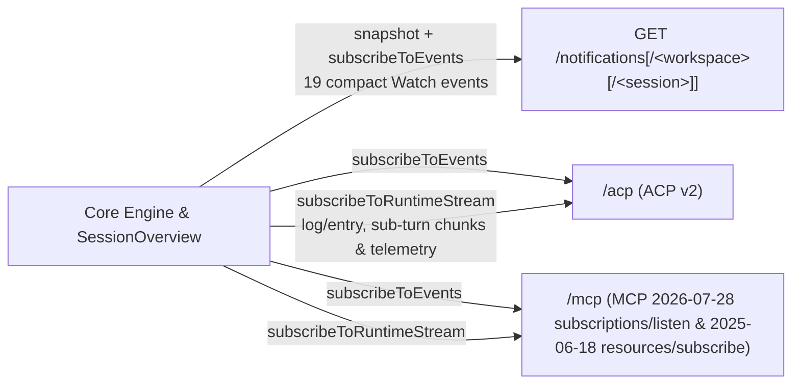

# Notifications and Watch Plane

Plurnk separates homomorphic Watch state replication (`GET /notifications`) from interactive session control & sub-turn streaming (`/acp`) and MCP resource/tool invalidation (`/mcp`), eliminating any need for in-daemon hook or plugin seams.

## Channel selection

| Need | Endpoint | Mechanism |
| --- | --- | --- |
| Read-only daemon, workspace, or session Watch replication (`Snapshot ⊕ Deltas`), open gates, reply excerpts, and user-facing notices | `GET /notifications[/<workspace>[/<session>]][?event=...][&since=now]` | Server-Sent Events (`DaemonNotificationEnvelope.json`) with Watch-by-default `notifications/snapshot` hydration and `Last-Event-ID` replay (`@plurnk/plurnk-contracts` `WatchStore`) |
| Interactive session control, full transcripts (`log/entry`), token/reasoning streaming, live tool progress, and gate resolution | `/acp` | ACP v2 `session/update` (`agent_message_chunk`, `agent_thought_chunk`, `tool_call_update`, `available_commands_update`, `config_option_update`, `state_update`), `session/request_permission`, and `elicitation/create` |
| External MCP host tool/resource cache invalidation | `/mcp[/<workspace>[/<session>]]` | MCP `2026-07-28` `POST` `subscriptions/listen` and `2025-06-18` stateful `resources/subscribe` SSE (`notifications/tools/list_changed`, `notifications/resources/list_changed`, `notifications/resources/updated`) |

## Routes, authentication, Watch hydration, and `Last-Event-ID` resume

| Aspect | Contract |
| --- | --- |
| Routes | `/notifications` (daemon-wide), `/notifications/<workspace>` (workspace ID or URL-encoded name), `/notifications/<workspace>/<session>` (session ID or name; subtree `session/archived` and `session/deleted` match descendants) |
| Query parameters | Optional repeatable or comma-separated `?event=<event>` validated against `DAEMON_NOTIFICATION_EVENTS`, plus optional `?since=now` for tail-only streaming; unknown parameters or values fail `400 daemon/notifications/invalid-filter` |
| Authentication & CORS | Loopback-open by default with `admitBrowserOrigin` CSRF defense; when `PLURNK_AUTH_ISSUER` is configured, requires `Authorization: Bearer <token>` or `?access_token=<token>` (`401` / `403` RFC 9457 Problem Details); `PLURNK_SERVICE_NOTIFICATIONS_ALLOW_ORIGIN` (empty default = same-origin only; `*` or one origin enables CORS) governs `OPTIONS` `204` preflight and `Access-Control-Allow-Origin` / `Access-Control-Allow-Methods: GET, HEAD, OPTIONS` / `Access-Control-Allow-Headers: Authorization, Last-Event-ID` |
| Wire frame | `id: <epoch>:<seq>\nevent: <event>\ndata: <DaemonNotificationEnvelope JSON>\n\n` plus `: heartbeat\n\n` on open and every `PLURNK_SERVICE_NOTIFICATIONS_HEARTBEAT_MS` (`15000` ms default; `0` disables periodic heartbeats) |
| Watch & replay | Without `?since=now`, cold connects and out-of-window `Last-Event-ID` cursors immediately emit `id: <epoch>:<watermarkId>\nevent: notifications/snapshot` (`reason: "initial" \| "restarted" \| "evicted" \| "malformed"`, bounded by `PLURNK_SERVICE_NOTIFICATIONS_SESSIONS=200` and `PLURNK_SERVICE_NOTIFICATIONS_EXCERPT_CHARS=240`) followed by matching transitions strictly `> watermarkId`. In-window `Last-Event-ID: <epoch>:<seq>` replays missed matching transitions from the per-boot ring buffer (`PLURNK_SERVICE_NOTIFICATIONS_BUFFER`, default `512`; `0` disables replay) with zero snapshot overhead. With `?since=now`, cold connects skip the snapshot and out-of-window cursors emit `event: notifications/resync` |

## Stream envelope alphabet (`DaemonNotificationEnvelope.json`)

Every `data:` payload conforms to `@plurnk/plurnk-contracts/schema/DaemonNotificationEnvelope.json` (`{ id, event, timestamp, workspaceId, sessionId, data }`) and reduces cleanly via `@plurnk/plurnk-contracts` (`createWatchState`, `reduceWatchNotification`, `projectWatchOverview`):

| Family | Event | `workspaceId` | `sessionId` | `data` shape |
| --- | --- | --- | --- | --- |
| Watch control | `notifications/snapshot` | `<id> \| null` | `<id> \| null` | `{ reason, epoch, latestId, workspaces, sessions, proposals, interactions, omitted }` |
| Watch control | `notifications/resync` | `<id> \| null` | `<id> \| null` | `{ reason: "restarted" \| "evicted" \| "malformed", epoch, latestId }` (`?since=now` tail mode only) |
| Workspace | `workspace/created` | `<id>` | `null` | `{ id, name, projectRoot, projectLabel }` |
| Workspace | `workspace/renamed` | `<id>` | `null` | `{ id, name }` |
| Workspace | `workspace/archived` | `<id>` | `null` | `{ id, archivedAt }` |
| Config | `config/changed` | `<id> \| null` | `null` | `{ workspaceId, scope: "service" \| "workspace", key }` |
| Functionality | `functionality/changed` | `<id> \| null` | `<id> \| null` | `{ workspaceId, sessionId, family }` (`personas`, `members`, `env`, `skills`, `schedule`, `mcp`) |
| Session | `session/created` | `<id>` | `<id>` | `{ id, workspaceId, workspaceName, projectRoot, projectLabel, name, parentSessionId, origin, kind, lifecycle, persona? }` |
| Session | `session/archived` | `<id>` | `<id>` | `{ id, sessionIds, archivedAt }` |
| Session | `session/deleted` | `<id>` | `<id>` | `{ id, sessionIds }` |
| Session | `session/titled` | `<id>` | `<id>` | `{ id, title }` |
| Session | `session/policy` | `<id>` | `<id>` | `{ sessionId, model, childModel, persona? }` |
| Session | `session/replied` | `<id>` | `<id>` | `{ sessionId, loopId, loopSeq, reply: { id, coordinate, completion, at, excerpt, continued }, repliedToActors? }` |
| Loop & gates | `loop/started` | `<id>` | `<id>` | `{ sessionId, loopId, loopSeq, opening?, session? }` |
| Loop & gates | `loop/parked` | `<id>` | `<id>` | `{ sessionId, loopId, loopSeq, status }` |
| Loop & gates | `loop/proposal` | `<id>` | `<id>` | `ProposalProjection` (`disposition.decision === "review"` opens a client review gate) |
| Loop & gates | `loop/interaction` | `<id>` | `<id>` | `ClientInteractionProjection` |
| Loop & gates | `loop/gate-settled` | `<id>` | `<id>` | `{ kind: "proposal", sessionId, loopId, logEntryId, decision, outcome } \| { kind: "interaction", sessionId, loopId, interactionId, action }` |
| Loop & gates | `loop/terminated` | `<id>` | `<id>` | `{ sessionId, loopId, loopSeq, result, hitMaxTurns, turnIds, attributions, terminatedAt, usage }` |
| Streams | `stream/concluded` | `<id>` | `<id>` | `{ sessionId, entryId, target, subscriptionId, result, scheme, summary, wakeAction, loopSeq?, turnSeq?, sequence? }` |
| Notices | `notice/event` | `<id>` | `<id> \| null` | `{ sessionId, loopId, notice }` (user-facing notices only; full `log/entry` rows and internal telemetry stay on `subscribeToRuntimeStream`) |
