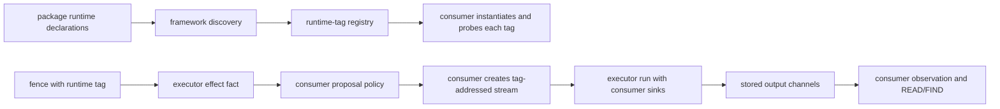

# plurnk-execs — Specification

Author contract for `@plurnk/plurnk-execs-*` runtime packages. Core consumes the framework; executor extensions implement it.

## §executor-role Role, ownership, and module slice

An executor owns one declared runtime-specific invocation shape, its mapping from that fence body and realized target to work, declared output channels, environment availability, and effect classification. The consumer owns dispatch, invocation-shape enforcement and target realization, proposal policy, storage, subscriptions, deadlines, polling, cancellation delivery, packet projection, and all reads of stored output.



- **Consumer composition:**
  1. Discovers declared tags, instantiates and probes each tag, and caches the verdict.
  2. Registers a derived output scheme for every admitted, available tag.
  3. Resolves the fence name to exactly one tag and obtains its effect fact.
  4. Applies proposal policy, creates the stream entry, and supplies sinks plus cancellation.
  5. Validates the terminal result and closes every declared channel and subscription coherently.
  6. Projects stream observations and later reads without calling back into the executor.
- **Module slice:** A host binds to `Executor` (the contract `BaseExecutor` implements), not to the class. A daemon module contributes runtimes as `RuntimeRegistration`s: a namespace owner, the runtime declaration ({§executor-discovery}), the executor (with optional `forContext(workspaceId, sessionId)` when a module runtime stamps authenticated caller context on outbound protocol calls), its availability, and an optional scheme facet ({§resource-tree-scheme}). The host arbitrates the namespace ({§core-extension-composition}) and publishes each registration ({§module-seam-slices}).
- **Forbidden in executor extensions:** Direct database, subscription, packet, or wake access; imports from `@plurnk/plurnk-service/*`; mutation of `ExecArgs` or state retained across runs; output through `console.*` instead of declared channels; writes or state transitions for undeclared channels; ignoring `args.signal` at a cancellable boundary; a process or network mechanism unrelated to the executor's declared runtime domain.

## §executor-contract Author surface, sinks, metadata, argv, and channels

```ts
abstract class BaseExecutor {
    readonly runtime: string;
    readonly glyph: string;

    abstract get channels(): Readonly<Record<string, ChannelDecl>>;
    get defaultChannel(): string;
    prepare(input: ExecInput): Promise<ExecPreparation>;
    abstract run(args: ExecArgs): Promise<ExecResult>;
    probe(signal?: AbortSignal): Promise<RuntimeAvailability>;
    effect(target: string | null): Effect;
    toolRegistry?(): RuntimeToolRegistry;
}
```

- `ExecArgs` carries **no Session identity**: an executor is a session-agnostic capability. A runtime whose behavior depends on a workspace is published per workspace by its module ({§functionality-model-projection}). The framework constructs one executor per matched runtime tag with `{ runtime, glyph }`. The derived addressable runtime scheme retains `glyph` for client discovery ({§resource-tree-scheme}); runtime aliases remain excluded from scheme model-teaching because the execution invocation directory owns that hot-path surface.

| `ExecArgs` field | Contract |
| --- | --- |
| `runtime` | The matched tag. |
| `body` | The authored fence body, interpreted according to the runtime's invocation declaration. |
| `cwd` | Consumer-selected project working directory, or `null` for a runtime that has none. |
| `target` | Consumer-realized optional execution target. Its representation and role come from the invocation declaration. |
| `metadata` | Exact ordered header blocks owned by the invoked executor, retained separately from the body and target. |
| `env` | Exact child environment when supplied. A subprocess must use it instead of reconstructing host policy. |
| `signal` | Consumer cancellation. Every executor must honor it at each cancellable boundary. |
| `write(channel, chunk, mimetype?)` | Append to a declared channel. An optional mimetype replaces that channel's per-call output type. |
| `setState(channel, state)` | Move a declared channel from `active` to terminal `closed` or `errored`. |
| `emit(notice)` | Publish a transient, nonterminal Notice. |
| `interact(request, signal?)` | Await one contracts-owned client interaction ({§provider-request-accounting}). An optional signal narrows, never replaces, the execution's cancellation scope. Core owns identity, pending-state durability, client presentation, and settlement; the executor owns the request and returned payload's meaning. |
| `entry?(path, content, opts)` | Optionally request consumer-owned entry materialization and receive its canonical model-facing address ({§executor-output-address}). |

- **Invocation metadata ownership:** The invoked executor owns its `[metadata]` for every target kind; an internal source READ carries no execution metadata.
  - **Preparation:** Optional `prepare(input)` receives `runtime`, `body`, logical `target`, default `cwd`, and ordered raw `metadata`, before effect admission or source acquisition. Validates options without executing the program and returns `200` with a concrete `cwd` or `null`, or one universal failure.
  - **Framework default:** `BaseExecutor.prepare` refuses unknown fields, duplicates, and malformed values. An unknown field's recovery names every field the run takes, the service's ({§resource-tree-scheme}), and nothing more ({§diagnostic-observation}): `` Its field is `lifetime`. ``
  - **Execution & evidence:** `run()` receives prepared `cwd`, realized `target`, unchanged `body`, and original `metadata`. Raw metadata follows the transient proposal handoff, never added to proposal attrs or emitted as receipt metadata.
- **`tokenizeArgv`:** Splits a command line into argv by shell quoting alone. Plain words split on whitespace; quoted multi-word and quoted empty arguments stay whole; escapes are honoured; nothing is expanded (no variables, command substitution, or metacharacters); unterminated quoting is refused as `CommandSyntaxError`.
- **Channels:** The executor declares every channel it may write (`ChannelDecl: { mimetype, defaultState? }`). `defaultChannel` is the fragmentless READ channel and defaults to the first declared channel. Subprocess executors declare `stdout` and `stderr` (`stdout` first); logical runtimes commonly declare `results`. Incremental vs atomic publication derives from the channel's mimetype ({§exec-stream}). Generated JSON values use `renderJsonResult` ({§operation-results}) so a top-level result array has one addressable item per physical line.

## §executor-results Results, failures, notices, effect, and availability probe

- **Terminal results:** `run()` resolves one terminal channel-producer result (`ExecResult`, with optional subprocess `exitCode`). Nonterminal statuses and consumer-owned projection fields are invalid. A result with `status >= 400` carries one RFC 9457 Problem with matching status, leaving affected channels `errored`. Rejection by an aborted signal reason or `AbortError` is cancellation; other throws and invalid results become durable contract failures.
- **Invocation Problems:** `invalid-command` (`400`) when a command could not be parsed (detail includes a bounded cause). Third-party diagnostic text entering a Problem is bounded with `ErrorDetail` and `PLURNK_EXECS_ERROR_DETAIL_LIMIT` (default `512`). Missing or invalid configuration is `invalid-configuration`.
- **Page receipt:** When a tool result is a JSON array whose length equals the requested page size or the tool schema's default (`per_page`, `page_size`, `pageSize`, `limit`, first match), the result carries `page: { size, returned }` ({§exec-stream}). A shorter array, non-array, or call with no page size carries nothing.
- **Subprocess exit code:** A subprocess that exits resolves `200` with its integer `exitCode` (zero or non-zero), closes its channels, and carries no Problem. A subprocess that did not run to an exit is a failure: `spawn-failed` when it could not start, `cancelled` under the consumer's abort ({§executor-subprocess}), and `terminated-by-signal` when an unsent signal ended it (with `signal` name and `exitCode: -1`).
- **Notices:** `emit` is only for transient progress or nonterminal observations; runtime-neutral Notice types are re-exported from `@plurnk/plurnk-contracts`.
- **Effect (`effect(target)`):** Pure, synchronous, cheap, and target-classified (`"host" | "read" | "pure"`), called once before proposal policy. Unknown or unclassifiable work defaults to `host` (human proposal gate); `read` and `pure` are automatically accepted. After acceptance, external execution uses the background stream path ({§exec-lifetime}, {§exec-stream}).
- **Availability (`probe(signal?)`):** Reports `{ available: boolean, detail?: string }` per runtime tag at boot under a per-probe timeout (`{ available: true }` default). Probe rejection, timeout, or typed `ConfigurationError` during loading/construction/probing marks only that tag unavailable without publishing an executable or output scheme ({§operator-config-workspace-settings}).

## §executor-output-address Tag-addressed output and optional materialization

Every available runtime receives one derived read-only scheme face from its tag, channels, and default channel:

| Output | Model-facing address |
| --- | --- |
| Workspace execution stream | `<tag>:///<id>#<channel>` |
| Fragmentless read | `<tag>:///<id>` $\to$ the declared default channel |
| Example subprocess stdout / structured result | `sh:///ab3d5678#stdout`, `mcp:///c2d45678#results` |

- `publishedChannel` selects one declared channel for automatic stream observations; absent/null selects all channels. Non-published channels remain READ-addressable ({§exec-stream}, {§resource-tree-scheme}).
- **`entry(path, content, { mimetype?, name? })` sink:** Consumer-implemented materialization returning the canonical address of an ordinary resource:
  - **Absolute resource URL:** Materialize or update that resource through its scheme owner.
  - **`path: null`:** Publish beneath this invocation's output address in `resources/`. Preserve `name` as one URI-encoded component; otherwise allocate an 8-character hex identifier. Duplicate names receive a hash suffix and never overwrite another publication. The returned address is workspace-stable and carries no Session selector.
  - **Content:** String content + mimetype preserves source layout; `Uint8Array` + mimetype retains raw bytes; `content: null` acquires bytes from an absolute HTTP(S) URL.

## §executor-discovery Discovery, declarations, invocation, tool registries, and documents

`discover(options?)` scans every scoped and unscoped package under `node_modules` for `plurnk.kind === "exec"`, returning `{ registry, packageAttributions, skipped, disabled }` ({§extension-discovery}). Tag collisions across packages fail hard naming both packages.

| Package state | Effective policy and probe | Runtime result |
| --- | --- | --- |
| Absent | Any configuration | Not discovered, registered, advertised, or dispatchable. |
| Installed | Tag disabled in any policy layer | Listed in `Discovery.disabled`; not registered or advertised. |
| Installed | Tag admitted; probe unavailable | Registered as unavailable; not advertised or dispatchable. |
| Installed | Tag admitted; probe available | Registered, advertised through `availableRuntimes()`, dispatchable. |

- **Runtime declaration (`RuntimeDecl`):** Closed to `name` (`[a-z][a-z0-9+._-]*`, excluding reserved `only`), `glyph` (optional), `summary` (required one-line description or `{ from: "tools", description?: string }`), `invocation` (required), `details` (optional supplemental Markdown; `docs/<tag>.md` wins over inline and strips leading `# <tag>`), and `packageName`.
- **Dynamic declarations (`plurnk.runtimesModule`):** Exported subpath whose `runtimes` or default export returns `RuntimeDecl[] | Promise<RuntimeDecl[]>`. Static `runtimes[]` wins when both are present. Imported only after the extension trust gate (`PLURNK_EXTENSIONS_TRUSTED_ONLY`); untrusted packages execute no code and land in `Discovery.skipped`.
- **Invocation contract (`RuntimeInvocation`):**
  - `body`: `{ role: string, required: boolean, mimetype?: string }` (malformed body media type counts as a fence-pairing repair under {§fence-pairing}).
  - `target` (optional): `{ role: string, required: boolean, kind: "literal" | "path" | "resource" | "script" }` ({§exec-lifetime}, {§op-shapes}).
  - `exclusive?: true`: body and target are mutually exclusive (requires `target`). Every execution must supply at least a body or target.
  - Exactly one of `example` (`{ body?, target? }`), `signature` (`string`), or `inputSchema` (JSON Schema object) is required.
  - **Blank invocation:** A refusal of an absent required body/target (or neither supplied) carries in `recovery` the invocation's copyable fence (`header` + input preview, or every enabled target's fence for a registry runtime) ({§functionality-coordinator}).
- **Tool registry (`toolRegistry(workspaceId?)`):** Returns `{ tools: readonly { target, summary, invocation, details?, definition?, traits? }[] }`. Each entry has a required `literal` target and nonempty one-line summary. Replaces the generic invocation for model presentation and admission (empty set exposes and admits no target). If `definition` is present, it must be supplied for every tool or none, and renders as an on-demand sibling `.json` catalog `{"tools":[...definitions]}`.
- **Tool documents and schema previews:**
  - General runtime: H2 `Summary` and `Invocation` sections with compact witness.
  - Exact registry: H2 `Tools` with one executable fence per tool.
  - Schema-backed invocation: links from its aside (`<!-- Schema: ... -->`) to a `.json` child document containing full description and original `inputSchema`. The preview skeleton emits only explicitly required top-level fields (`""`, `0`, `false`, `[]`, `{}`, `null`, first `enum` value, or first `anyOf` branch). The aside summarizes 2–12 string enum choices (`"a"|"b"|…`), one-level nested object/array shapes (up to 4 union branches and 6 fields per branch, `… +N opt`), and up to 12 optional top-level properties (`name?: type`, `… +N opt`).

## §executor-policy Subtractive runtime policy, spawn account, and default inventory

| Variable / API | Enforced effect |
| --- | --- |
| `PLURNK_EXECS_<TAG>=0` or `false` | Remove that tag (case-insensitive key match). |
| `PLURNK_EXECS_ONLY=<list>` | When present, remove every unlisted tag; empty removes all (`only` is reserved). |
| `Policy.isKey(key)` / `Policy.enabledAcross(tag, layers)` | Admit only `ONLY` or a canonical runtime-tag suffix; keep tag iff enabled in every layer. |
| `PLURNK_EXECS_SPAWN_USER` | Account each subprocess runtime's child and availability probe runs as: account name resolved once via `getent passwd`, or `uid[:gid]` as written; unset uses the daemon's own account. Sets child `HOME`, `USER`, and `LOGNAME` for named accounts. Unresolvable account fails as `invalid-configuration` (`names no account on this host` or `was not resolved`). |
| Default installed inventory (`@plurnk/plurnk-execs-common`) | Declares `sh`, `js`, `python3` (`effect: "host"`, channels `stdout`, `stderr` with `text/stream`). |

## §executor-subprocess Subprocess routing, shell resolution, and cancellation

`SubprocessExecutor` translates a runtime, body, and optional target into `SpawnArgs { cmd, args, useShell, stdin? }`:

| Runtime | No-target spawn | File target (`target` is program, `body` tokenized via `tokenizeArgv` into argv) |
| --- | --- | --- |
| `sh` | `<shell> -c <body>`, where `<shell>` is `$SHELL` if an absolute executable path, else `/bin/sh`, resolved once per daemon process and named with its `--version` in the `sh` summary (`Run shell commands and scripts with <name> <ver> (<path>).`). | `<shell> <target> ...argv` |
| `js` | `node -e <body>` | `node <target> ...argv` |
| `python3` | `python3 -c <body>` | `python3 <target> ...argv` |
| Other default-base | `<runtime> -c <body>` | `<runtime> <target> ...argv` |

- **Cancellation:** Executors know only the supplied `AbortSignal` ({§exec-lifetime}). Subprocess cancellation signals the process group: a caller-supplied kill code is delivered once; ordinary cancellation uses `SIGHUP`; loop-end housekeeping may escalate after the consumer-provided grace period.
