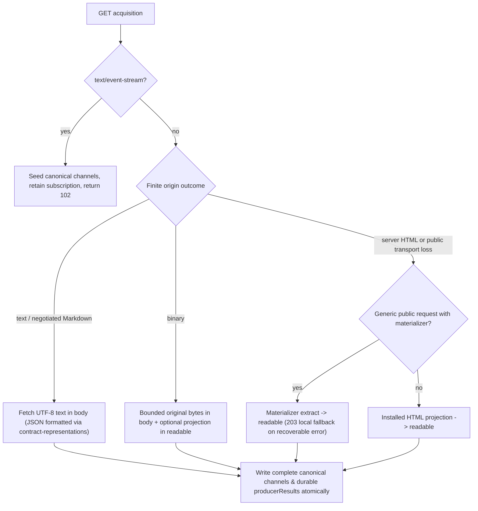
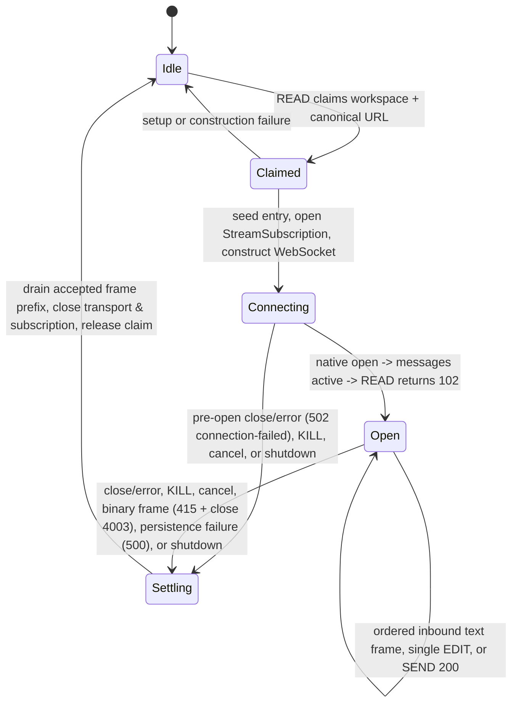

# `@plurnk/plurnk-schemes-http` Specification

Owns the `http(s)://` request/response scheme (`Http`), the `ws(s)://` full-duplex WebSocket scheme (`Ws`), automatic web acquisition (`WebFetcher`), URL/host policy (`Guard`, `HostPolicy`), and pluggable HTML materializers (`MaterializerRegistry`).

## §http-manifest HTTP manifest and operation surface

`Http` registers as `https` (plain `http` routes to the same handler; `package.json#plurnk.schemes` registers `http` via default export and `wss` via `Ws`) with `category: "data"`, `writableBy: ["model", "client"]`, `volatile: true`, `modelVisible: true`, `metadataModifier: true`, `traits: ["web"]`, and channels:

| Channel | Seed type | Meaning |
|---|---|---|
| `body` (default) | `application/octet-stream` | Source text or original binary bytes; SSE `data` lines for a live response |
| `header` | `text/plain` | Origin status/headers, acquisition stamps, cache variant, materializer, and projection evidence |
| `readable` | `text/markdown` | Optional derived text/facts from an HTML materializer or installed mimetype projection ({§channel-selection}) |

Identity and transport URLs normalize through `NetworkAddress` ({§network-address}): authority is `<host>[:<non-default-port>]`, pathname is `<path>[?<serialized-query>]` (`%28`/`%29` in path canonicalize to literal `(` / `)`, query order/duplicates/empty `?` preserved), `#fragment` selects the Plurnk channel, and URL userinfo is rejected (`400`).

| Operation | Remote action | Contract |
|---|---|---|
| Exact `READ (url) <scope?>` | `GET` (unless a fresh cached `GET` is usable) | Scope-blind `prepareRepresentation`, then Core selects channel and scope |
| Exact `FIND (url)` | `GET` only when acquisition is required | Same preparation, then universal query, matcher, weighting, and pagination |
| Pattern `FIND (pattern-url)` | None (`PathSyntax.hasGlob`, {§path-syntax}) | Query already-materialized web entries in the workspace without remote discovery |
| `SEND (url)` with body | `POST` | Proposes (`effect: "host"`, `202`); on apply, streams and persists response under `url` |
| `EDIT (url)` with body | `PUT` | Proposes (`effect: "host"`, `202`); replaces whole remote resource (line markers fail `400`: `Remove the line range and submit the complete replacement body.`) |
| `KILL (url)` | None | Cancels all live workspace acquisitions of `url` (owners settle `499`), else deletes local stored entry |
| `KILL (url) [{"remote": true}]` | `DELETE` | Proposes (`effect: "host"`, `202`); remaining options in the metadata block become request headers |

- **Headers and proposals (`http-outbound-proposes`):** Request headers are passed in one `[{"Key": "value"}]` metadata block ({§slot-order}). `POST`, `PUT`, remote `DELETE`, and WebSocket `EDIT`/`SEND` frames declare `effect: "host"` and return `202` ({§proposal}, {§exec-lifetime}), governed by `PLURNK_SERVICE_EFFECT_HOST`. `GET` and WebSocket `READ` connection opens are observational and ungated; a WebSocket frame checks for an open socket both before proposing and again at `applyResolution`, and the resolver may replace the proposed body before it is sent.

## §http-lifecycle Acquisition, decoding, and materialization

| Response / surface | `body` | Auxiliary materialization (`readable` / `header`) | Completion |
|---|---|---|---|
| Negotiated origin `text/markdown` | Exact origin Markdown | None (single request; no `readable` needed) | Static representation |
| HTML page production | Exact server HTML when origin supplied it | Materializer Markdown, local Markdown (`200` or `203` fallback), or independent error in `readable` | Static representation; channels carry independent `producerResult`s |
| `text/event-stream` (SSE) | One joined `data` value + `\n` per `text/plain` chunk | Initial response metadata in `header` | `102`; origin close settles subscription |
| Empty response body | Present empty text `""` | Response and package metadata in `header` | Static representation (`READ` of `body` returns `204`) |
| Origin HTTP `4xx`/`5xx` | Available origin text or bytes preserved | Origin-backed channels carry durable `http-response-status` Problem | Selected channel's durable outcome |
| Configured textual / JSON type | Fetch `Response.text()` UTF-8 (streamed mutations use incremental `TextDecoder`; finite JSON formats via {§contract-representations}) | Response and package metadata in `header` (`charset` preserved as evidence) | Static representation |
| Configured binary type | Complete original bytes via {§mimetype-binary-input} (native attachment eligible on `READ` of `body`, `#bytes`, or `#readable`, {§log-wire-format}) | Derived Unicode in `readable` (when reader exists); `x-plurnk-projection-id` in `header` | Static representation, or `413 projection-input-limit` if over byte ceiling |
| Unreadable binary or unknown bytes | Complete original bytes (`application/octet-stream`) | No `readable` projection or native media claim | Static representation; ordinary hex `READ` |

`WebFetcher.materialize` outcomes across input and materializer states:

| Input or event | Action | Result |
|---|---|---|
| Configured non-HTML text | Decode with Fetch UTF-8 | Original representation in `body` |
| Configured binary with / without reader | Retain bounded bytes (and apply projection when present) | Original `body`, optional `readable`, and `projectionIdentity` (or `WebMaterializationError` from `ProjectionInputLimitError` when over limit) |
| Negotiated origin `text/markdown` | Accept without materializer | Exact Markdown in `body`; no `readable`, no second request |
| Eligible HTML with materializer selected | Run materializer `eligible(url)` + `extract` | Origin HTML in `body`; materializer Markdown in `readable` |
| Ineligible HTML or no materializer selected | Run installed HTML projection | Origin HTML in `body`; local Markdown in `readable` |
| Recoverable materializer failure with HTML (`502 materializer-recoverable`) | Fall back to installed HTML projection | Source in `body`; local Markdown in `readable` with durable status `203` |
| Hard materializer failure | Preserve evidence; no local recovery | `readable` errored; independently successful `body`/`header` survive |
| Materializer success after origin loss | Preserve provider text and origin failure | `readable` static; `body` errored with origin's own failure |
| Projection implementation throws | Stop and preserve cause | `WebMaterializationError` with stage `projection` |

- **Materializer extensions (`PLURNK_SCHEMES_HTTP_MATERIALIZER`):** `Http` publishes `WebFetcher` as `webMaterializer` ({§scheme-operation-dispatch}). When no `Accept` header is authored, `GET` sends `Accept: text/markdown, text/html;q=0.9, */*;q=0.1`. For a credential-free, metadata-free generic public request, `PLURNK_SCHEMES_HTTP_MATERIALIZER` selects a discovered `http-materializer` package (`plurnk: { kind: "http-materializer", materializers: [{ id, module }] }` or `plugin.json#extensions.ai.plurnk`, {§extension-discovery}). If `eligible(url)` returns an identity string, `extract` returns `success`, `recoverable` (`502 materializer-recoverable`: `The materializer could not extract <url> (<reason>); the failure is retryable.`), or `hard`.
- **Origin `llms.txt` companions (`PLURNK_SCHEMES_HTTP_LLMS_TXT`):** When `PLURNK_SCHEMES_HTTP_LLMS_TXT=1` (default), a successful generic `GET` opportunistically probes `<origin>/llms.txt` once per origin TTL window and materializes `https://<host>/llms.txt` as a discoverable workspace entry; missing/non-`2xx`/binary/failed probes are remembered quietly and never fail the initiating `READ`.

## §http-status Status mapping and replay

| Outcome | Operation status |
|---|---|
| Finite origin `2xx`/`3xx` exact `READ` / empty text response | `200` / `204` (origin status preserved in `header`) |
| Exact `FIND` after preparation / `KILL` with no live acquisition | Universal query result / exact entry-delete result |
| Automatic `WebFetcher` returns `null` / missing response channel | `404 not-materialized` / `404 channel-not-found` |
| Selected origin-backed channel received HTTP `4xx`/`5xx` | Origin status with durable `http-response-status` Problem |
| Final status outside `200..599` | `502 invalid-response-status` with `originStatus` |
| Recoverable materializer fallback / absent local HTML projection | `203` on `#readable` / `422 no-readable-projection` |
| Binary input exceeds byte bound | `413 projection-input-limit` |
| `KILL` of live acquisition / client-cancelled finite acquisition | `200` (owner settles `499`) / `499 cancelled` |
| `SSE` after acquisition: normal / cancelled / parser or transfer failure | `102` initial; settles channel result, `499`, or `502` |
| Multi-statement HTTP edit batch / invalid target, line edit, or userinfo | `409 non-atomic-edit-batch` / `400` |
| Non-corresponding `304` or transport failure without materializer output | `502 fetch-failed` (detail bounded by `PLURNK_SCHEMES_HTTP_ERROR_DETAIL_LIMIT`) |
| Projection exception / uninterpreted `SEND` status | `500 projection-failed` / `501 send-status-unsupported` |

- **Replay:** Failed `GET`, `PUT`, and `DELETE` acquisitions are retryable (idempotent); `POST` and post-open `SSE` stream failures are non-retryable.

## §http-host-policy Host policy and URL guard

| Surface | Contract |
|---|---|
| Configuration floor | `plurnk-schemes-http/.env.defaults` assembled via {§operator-config-precedence}; missing or invalid required values fail at readiness or owning read. |
| `PLURNK_SCHEMES_HTTP_HOSTS` | Unset or empty admits all hosts. A JSON array admits exact hostnames (`"example.com"`), wildcard subdomains (`"*.example.com"`), or none (`[]`). Disallowed direct `HTTP`/`WS` targets and redirect hops fail `403 host-not-permitted` before I/O; disallowed automatic acquisitions return `null` ({§capability-admission}). |
| `Guard.fetch` (automatic acquisition) | Solely used by `WebFetcher` for automatic byte acquisition: requires credential-free `http(s):` targets whose resolved DNS addresses are all globally reachable unicast, re-checked on every redirect hop (`301`/`302` rewrite `POST` $\to$ `GET`; `303` rewrites non-`GET`/`HEAD` $\to$ `GET`; `307`/`308` preserve method/body; cross-origin hops strip `Authorization`). Direct `HTTP` and `WebSocket` operations do not run `Guard.fetch` and permit loopback/private/link-local targets. |

## §revalidation Revalidation, target rewrite, and SSE

- **GitHub raw rewrite (`host-rewrite`):** Acquisition `GET`s (direct `READ`, exact `FIND`, `WebFetcher`) rewrite `https://github.com/<owner>/<repo>/blob/<ref>/<path>` to `raw.githubusercontent.com` for byte transport while preserving the addressed GitHub URL as entry identity. `POST`, `PUT`, and `DELETE` are never retargeted.
- **Cache variants and freshness (`PLURNK_SCHEMES_HTTP_TTL_MS`):** Acquired responses append authoritative `x-plurnk-request-method`, `x-plurnk-fetched-at`, `x-plurnk-cache-variant` (`default` when no explicit request metadata and no `Vary`, else `bypass`), `x-plurnk-materializer-id`, and `x-plurnk-projection-id`. Only terminal `default`-variant `GET` responses with successful `body` and `header` and cacheable status/directives (excluding `no-store`, `private`, and `206`) are eligible for reuse:

| Stored origin policy | Direct `READ` after acquisition | Exact `FIND` after acquisition |
|---|---|---|
| `no-store` or `private` (qualified or unqualified) | Full acquisition without stored validators | Full acquisition |
| `no-cache` (qualified or unqualified) | Validate when a stored validator exists; else acquire | Full acquisition |
| Valid `s-maxage` > `max-age` > `Expires` | Serve while fresh under both origin lifetime and `PLURNK_SCHEMES_HTTP_TTL_MS` (`s-maxage` overrides `max-age`/`Expires` even if invalid) | Reuse while fresh under both limits |
| Invalid or ambiguous explicit expiry | Treat as stale; validate or acquire | Full acquisition |
| Eligible response without explicit lifetime | Heuristic reuse within `PLURNK_SCHEMES_HTTP_TTL_MS` (`0` disables validation-free reuse) | Reuse within `PLURNK_SCHEMES_HTTP_TTL_MS` |

- **Conditional `304` revalidation:** Outside the fresh window, a non-materializer representation with a singular valid `ETag` or `Last-Modified` sends conditional headers. A `304` restores stored channels only when its validator corresponds per RFC 9111 §4.3.4:

| `304` validator / metadata class | Correspondence & stored-header action |
|---|---|
| Strong `ETag` / Weak `ETag` / `Last-Modified` (no `ETag`) | Must match stored strong `ETag`, weak `ETag` (weak comparison; strong `304` tag cannot promote stored weak tag), or exact `Last-Modified` instant; non-corresponding `304` triggers one unconditional `GET`, and a second or unsolicited `304` fails `502 fetch-failed`. |
| Present end-to-end origin fields vs absent origin fields | Present fields replace prior case-insensitive matches; absent origin fields are preserved (`Vary` on `304` downgrades variant to `bypass`). |
| `Content-Type`, `Content-Encoding`, `Content-Range`, `Content-Length`, projection evidence | Preserved from the stored representation; package method, acquisition stamp, and cache variant are rebuilt authoritatively. |

- **Server-sent events (`sse`):** Direct `GET` with `text/event-stream` persists `header`, returns `102`, and streams each event's joined `data` + `\n` into `body` (`text/plain`) via `eventsource-parser` and the retained `StreamSubscription` (no reconnect; buffer/transport failure settles `502`, cancellation settles `499`).

## §prefetch WebFetcher

`WebFetcher` implements `webMaterializer` ({§scheme-operation-dispatch}) over `Guard.fetch`, `HostPolicy`, and `MaterializerRegistry`:

| Result | Meaning |
|---|---|
| Origin HTML / Negotiated origin Markdown | Exact source text (negotiated Markdown skips a second HTML request), MIME type, package-stamped headers, and page-producer eligibility |
| Other accepted body | Unconsumed byte stream, MIME type, package-stamped headers, and cancellation owner |
| Admitted origin transport failure | Bounded origin failure plus eligibility for materializer-only page production |
| `materialize`: text / binary / HTML page | Complete UTF-8 `body`; bounded `body` bytes + optional `readable` + `projectionIdentity`; or independent HTML `body`/`readable` outcomes |
| Automatic top-level `null` vs caller cancellation | Refused target, non-`2xx` automatic response, or unavailable target with no materializer returns `null`; caller `AbortSignal` aborts reject with the caller's exact reason |

## §ws-lifecycle WebSocket scheme and lifecycle

`Ws` registers as `wss` (`ws` routes to it) with default `text/plain` channel `messages` and canonical `NetworkAddress` identity (no `[metadata]` support; Node $\ge 26$):

| Operation / event | Contract |
|---|---|
| `READ (ws(s)://...)` | Claims workspace/URL coordinate, seeds entry and `StreamSubscription`, opens native `WebSocket`, and returns `102` on `open`. Concurrent duplicate `READ`s join the pending open and return `200` with connection state without opening a second socket. |
| `EDIT (ws(s)://...)` / `SEND (ws(s)://...)` | Single-statement markerless `EDIT` and `SEND` (`200`) propose (`202`, `effect: "host"`) and send one text frame when the owner is `open` (`readyState === OPEN`). Absent/non-open owner fails `409` (`READ the WebSocket URL before sending a message.`); send throw fails `502` (`The WebSocket message could not be sent.`); line ranges and multi-statement batches fail `400`/`409`. |
| `KILL (ws(s)://...)` | Closes/cancels the claimed owner (`404` when no live owner exists; close throw fails `502`: `The WebSocket connection could not be closed.`). |
| Inbound frames & settlement | Text frames chain sequentially onto `messages` after `open`. A binary frame retains the text prefix, prunes later frames, closes with WebSocket code `4003`, and settles `415 binary-frame-unsupported`. First persistence failure prunes later frames and settles `500 message-persistence-failed`. Pre-open close settles `502 connection-failed`; post-open close drains accepted frames and settles `200` ({§execution-output-identity}, {§scheme-operation-dispatch}). |
